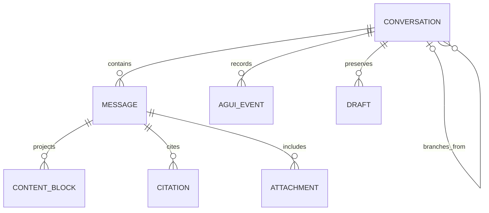
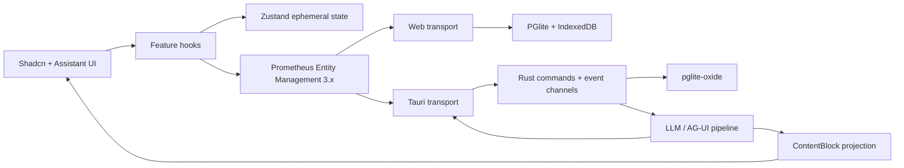
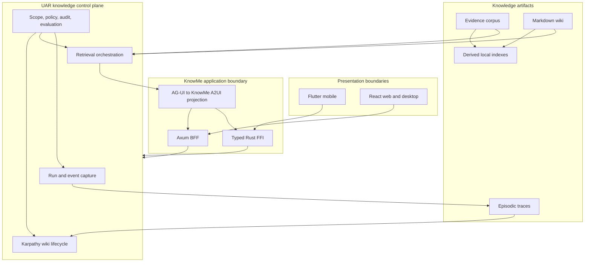
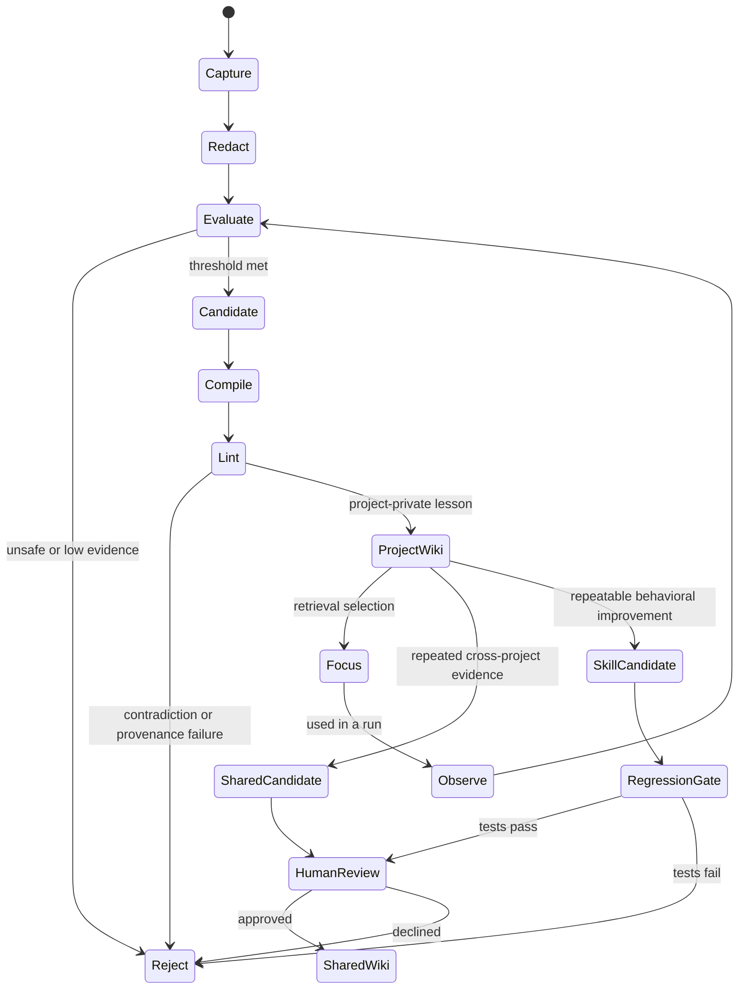

# KnowMe Praxis — The Sovereign Agentic Workspace

## 00 · KnowMe Praxis

**Intent should survive the conversation.** A workspace earns its place when the user's question, the work it produces, and the authority to act remain connected. KnowMe Praxis is the proposed product and architecture name for that workspace. The name refers to knowledge put into practice. It is an editorial name, not a claim of trademark clearance.

The original paper identified three durable responsibilities: selecting work, directing it, and keeping its result. Praxis retains that distinction and removes the assumption that one fixed arrangement of three panels can serve every task. Home, a focused conversation, a document, a small application, and a live call are states of one workspace. Their data and authorization contracts remain stable as the layout changes.

The product has a native Flutter mobile application, a Tauri/React desktop shell, and a browser shell. Rust owns domain behavior, context construction, persistence access, policy decisions, and agent coordination behind platform adapters. Optional private dots add either personal assistance or project coaching. Plugins contribute capabilities and declarative surfaces. LiveKit carries realtime human and agent audio/video. Durable actions and receipts remain in the application control plane.

**This is an engineering specification and proposed integration design.** It is not a release announcement. “Code observed” means files and implementations were inspected in the checkout. “Source requirement” means an existing specification requires or proposes it. “Proposed” means this paper adds or reconciles a design. “Certified” requires a named execution receipt against a specific build and device; this document does not manufacture one.

The complete technical source ledger is part of the specification. Each retained source section is assigned to an owning chapter, given a stable clause identifier, and linked from the coverage matrix. Existing source text remains available at full depth. Explicit amendments in §02 govern contradictions. Historical vendor observations and commercial assumptions retain their source date rather than becoming current product facts.


## 01 · The workspace has three responsibilities

The navigator identifies the current work container. The conversation expresses intent, records progress and decisions, and exposes the actions taken. The canvas holds durable artifacts and applications. A tool rail provides local operations on the active artifact. These responsibilities survive on phones even when only one surface is visible at a time. Short answers remain in the thread; a canvas opens when there is something worth keeping or operating.

**WS-01 — Container before form.** A project, engagement, objective, conversation, or personal workspace exists from the first meaningful act of work. Creating a draft container must not require every field of a downstream business form. A title can be provisional; identity and provenance cannot. Selecting another container changes the visible context, thread list, dashboard query, artifact scope, and suggested actions together.

**WS-02 — Durable record.** Every domain mutation and governed external effect links to a thread or activity record with actor, subject, time, command identity, affected entity versions, and outcome. A stream of model text is not the evidence that a file was saved or an effect completed. Preserve raw event envelopes and materialized blocks separately so the timeline can be rebuilt without another model call.

**WS-03 — Layout as a mode.** Desktop supports conversation-forward and application-forward arrangements. In the former, navigator/thread/canvas reproduces the original paper's pattern. In the latter, navigator/application/assistant reproduces the San Saba shell. The active work determines emphasis; switching modes does not move records to a different store. Canvas states are closed, docked, expanded, and full-width. Resizing is keyboard accessible and persisted per device, with safe minimum widths.

**WS-04 — Artifact lifecycle.** Preserve requested, generating, published, previewing, iterating, and exported states from the original paper. Add explicit draft version, selected version, current version, signed version where relevant, failure, and uncertain publication outcome. “Published” means a publication receipt exists. “Signed” means the authoritative signature service confirms the exact artifact digest. Neither is inferred from model language.

**WS-05 — Human decisions.** Sending, signing, paying, publishing, and representing a person cross action boundaries. The thread shows the prepared object, destination, scope, costs where relevant, and the named authority. Existing valid authorization may satisfy the gate within its scope. The agent cannot approve itself, manufacture consent, or treat a generic “continue” as permission for a different destination or object. The approval is bound to the effect digest and expires or invalidates when material fields change.

**WS-06 — Visible context.** Show selected container, attached files, chosen artifact version, model placement, memory scopes, plugin contributions, and delegated agent identity. Each removable context item has a provenance link. Removing it changes subsequent context construction and does not claim to erase plaintext previously sent to a recipient.

**WS-07 — Mobile continuity.** On a phone, the navigator becomes a drawer or route and the canvas becomes a full-screen destination. Back returns to the exact thread position and composer draft. A persistent call strip survives internal navigation. No three-column miniature is permitted. Tablet split views are an enhancement over the same navigation state.

The original mineral-rights example remains useful as a technical pattern: one deal container, a running thread, a checklist, versioned documents, units and valuation inputs, and an existing app embedded in the canvas. A confirmed workspace value may populate a legacy form without saving it. Preserve that explicit save boundary. The generalized KnowMe counterpart is an engagement linked to objectives, decisions, documents, and a plugin surface, all reading the same durable records.


## 02 · Evidence, precedence, and deliberate corrections

**EV-01 — Evidence hierarchy.** User decisions and accepted amendments govern product intent. Inspected code establishes implementation presence. Build and device receipts establish only the behavior actually exercised. Source specifications establish requirements and historical rationale. External primary documentation establishes upstream contracts at the access date. None of these substitutes for another.

| Source statement or conflict | Praxis resolution and rationale |
|---|---|
| The original product name and San Saba document branding | Superseded by KnowMe Praxis. Historical names remain only in source attribution and the migration record. |
| React/Tauri “one codebase” on all devices | Native Flutter is the mobile presentation layer; shared Rust behavior crosses FFI. Retain the original seven-layer separation, not the obsolete mobile UI implementation. |
| The plugin host is only a skeleton | Checkout contains `WasmtimePluginHost`, typed bindings, fuel/epoch/memory enforcement and host dispatch. Mark code observed, not certified. Installer/distribution completion must be proved separately. |
| `knowme:plugin@0.1.0`, `knowme:plugin@1.0.0`, `prometheus:component/*`, `uar:plugin@0.2.0` | These are distinct source dialects. Current local WIT uses KnowMe 1.0.0; the strategy assigns future generic ownership to UAR. Pin each ABI and require a tested adapter; do not rename a package string and call it migration. |
| One signed Wasm binary runs everywhere | Superseded by capability portability plus explicit execution profiles (§08). Native mobile admission, browser adaptation, and server execution each need their own conformance evidence. |
| Plugin UI can ship arbitrary HTML, iframe UI, or platform source | A2UI data is the portable baseline. Audited embedded/webview surfaces are separately declared exceptions. No downloaded React or Dart code enters the native component catalog. |
| `kind: core/agentic`, `/embed/*`, caller-built AG-UI subpaths | Retired by the San Saba amendments: independent navigation/protection/surface fields, registry-resolved embed origins, registered agent IDs. Retained as migration history only. |
| San Saba authentication is its app authorization boundary | Preserved for that application. It does not remove KnowMe personal-context grants, representation grants, plugin capability enforcement, or tenant isolation. |
| Unknown capability actions need no schema validation | Superseded: all action inputs and outputs are schema validated, recognized namespace or not. Semantic discovery never grants authority. |
| `did:key` proves a reverse-DNS namespace | Superseded: it proves key control. Namespace ownership needs independent proof or a trusted registry decision. |
| Policy checked only at activation/compile time | Activation may precompute policy structures; every action re-evaluates effective authority, expiry, revocation, scope and budget at execution time. |
| A2UI attributed to Anthropic or confused with internal `A2uiEvent` | Google A2UI is the external declarative format. AG-UI is the event vocabulary. KnowMe ContentBlock and internal envelope types are adapters, not alternate names for the standard. |
| One shared memory across assistant and coach | Superseded: personal dot, general assistant, each project coach, and team contexts are separately scoped; no shared coach/general-assistant embedding index. |
| “Zero capability” imports clocks and randomness | Corrected to minimum capability: time and randomness are capabilities and must be declared. A no-import pure evaluator is a stricter profile. |
| Fixed context presets always fit | The budget invariant governs. Some source presets and thinking reserves cannot simply be added. Recompute available slices and validate the sum before dispatch. |
| Browser UAR, OFP transport, Hands scheduling, or local inference described as universal | Retain as source intentions with placement-specific proof gates. The native UAR library and browser facade are not evidence of a complete browser agent kernel. |
| Private-dot infrastructure and protocol versions presented as deployed | Preserve as design requirements unless a current implementation receipt establishes them. Model names, runtime versions, pricing, latency and policy assertions in historical sources are dated observations or targets. |
| Vendor examples imply industry-wide convergence or unique invention | Retain the field-guide observations and sources. The synthesis is this design's architectural choice; novelty and all-vendor claims are not established by the evidence. |

**Code observed on 20 October 2026:** the Rust workspace declares 22 member crates. `gen_ui_ffi` exposes chat send/cancel/actions, tool confirmation, model operations, entity CRUD, sync/status streams, provider configuration, memory ingest/search/deletion, and graph expansion. The plugin host depends on Wasmtime 46 and supports hook, contributor, and app-shell typed worlds. Its older top-level comments and `NotImplemented` variants coexist with implementation files. Hands and OFP domain crates still contain explicit incomplete-path markers. These findings justify a mixed status table, not a blanket “implemented” label.

The snapshot inspection did not run Rust builds, device installations, app releases, or the unrelated UAR workstream. Public publication of this document proves document delivery only.


## 03 · A home screen that earns its space

**HOME-01 — Four regions, one context.** Home combines a prompt composer, dashboard cards, prompt suggestions, and A2UI mini applications. The visible container selector and placement indicator govern all four. Empty home centers the composer with a short invitation and three to six suggestions. An established workspace places the composer at the bottom of the primary work region, leaving the dashboard readable above it. Avoid duplicate composers competing for focus.

**HOME-02 — Dashboard cards.** Initial card types are Continue working, Needs your decision, Recent artifacts, Scheduled Hands, Active calls, and optional Private Dot. Each card shows its data freshness, owner or actor, relevant container, and an explicit action. Permission-filter the query before aggregation; a hidden private container must not leak through a badge count. Loading, empty, offline, stale, denied, and error are distinct states. A card never reports zero when a request failed.

**HOME-03 — Suggestions.** Suggestions are editable drafts, not executable commands. Derive them from the selected container's permitted state, installed capabilities, and explicit user preferences. Display why each suggestion appears and the data scopes it would use. Clicking inserts text into the composer or opens a preview with parameter fields. It does not send mail, start recording, invite participants, or activate a background agent. Support dismiss, pin, refresh, and disabling personalized suggestions. No private-dot memory contributes unless explicitly allowed for this surface.

**HOME-04 — Mini applications.** Home surfaces persist by `surface_id` and `container_id`. An A2UI surface can be a form, checklist, brief, table, tracker, settings panel, or call roster. A user can pin, resize within allowed spans, reorder, open full-screen, close, and restore it. Persist layout separately from business state: device-specific geometry, user-specific preferred cards, container-specific data. Live run endings do not destroy durable surfaces.

**HOME-05 — Adaptive layout.** At compact widths, order is context/title, critical decision card, suggestions, dashboard, mini applications, and a safe-area-aware composer. Above a measured layout breakpoint, cards form a two-column grid; wide desktop can show the navigator and conversation simultaneously. Text scale and content fit, not device names, decide breakpoints. The document's 860 px reading-layout breakpoint is not an application platform mandate.

**HOME-06 — Restore safely.** Restore the selected container, thread scroll position, draft, card order, and surfaces after process death. Revalidate action grants, surface revision, and current user scope before enabling controls. Unsaved local forms are labeled drafts. A revoked or removed plugin leaves an explanatory placeholder with export/recovery options; it does not leave an invisible data loss.

**HOME-07 — Attention budget.** Personal-dot proactivity is opt-in. A project coach is silent during healthy execution. Group low-priority notices; expose a single decision inbox with counts by urgency and source. Cards are not a place for simulated activity. Every “working” state links to an actual run or bounded pending command.

A static home specimen in this document demonstrates the proposed arrangement. It is a specification illustration, with synthetic data and no live agent connection.


### HOME-08 — Activity is the durable unit of attention

An Activity survives individual model runs and media sessions. Store `activity_id`, container, objective, owner, policy revision, current checkpoint, linked run IDs, pending decisions, host receipts and terminal outcome. Use explicit states: draft, queued, running, waiting for input, waiting for approval, waiting for dependency, waiting for host, pause requested, paused, cancellation requested, cancelled, failed, completed and unknown/reconciling. Waiting is not failure. A cancellation request is not acknowledgement. A completed model turn is not a completed Activity.

Cards summarize Activities from authoritative records. The user can inspect the exact checkpoint and outstanding decision, resume with preserved context, or reconcile an uncertain host outcome. Do not invent progress percentages from token generation. A result card links to the artifact revision and receipt that establish its status.

### HOME-09 — Suggestions and drafts have their own contracts

A suggestion stores its provenance, freshness, prerequisites, permitted context, intended placement and draft text. Stable ordering preserves keyboard focus while background queries refresh. “Dismiss this suggestion” differs from “do not suggest this kind of work.” Never infer sensitive facts on a shared display. A disabled prerequisite explains the missing capability without executing installation.

One composer owns the active draft. Empty work centers it; populated work can dock it at the bottom, as requested for this design. A compact top composer was considered in the upstream home research; it remains an optional future layout variant rather than changing the selected center/bottom convention. Preserve drafts separately per container/thread. Failed sends retain the draft and attachment handles. IME composition does not trigger send; double submission uses an idempotency key. Changing destination shows the resulting scope before sending. Expose placement, attachment access and billable model selection when they affect the decision.

### HOME-10 — A complete screen inventory

Acceptance must exercise these distinct layouts, not merely recolor one screenshot: (1) empty home with no dot; (2) returning home with a decision, activity and artifact; (3) calm home with no urgent work; (4) partial dashboard failure; (5) offline home; (6) empty container with centered composer; (7) active thread with bottom composer; (8) docked canvas; (9) expanded canvas; (10) phone thread, navigation and canvas routes; (11) dirty form with remote conflict; (12) unsupported catalog; (13) blocked plugin; (14) activity running, interrupted, offline and uncertain; (15) approval expired or resolved elsewhere; (16) pause requested versus acknowledged; (17) all private-dot lifecycle states; (18) personal versus project memory; (19) explicit cloud choice and unavailable local model; (20) every terminal outcome; (21) export, notification and offboarding settings; and (22) keyboard navigation, 200% text and compact screens.

The specimens in this paper illustrate the central layout only. This publication's render checks do not claim implementation of the entire screen inventory.


## 04 · One container substrate and one durable state plane

**CT-01 — Domain model.** Keep one host-side container substrate with typed payloads. `Engagement` and `Objective` share identity, namespace, provenance, staleness clock, gates, delegation links and audit rules. Goal horizon rollups remain objective-specific. Add workspace/project presentation types without duplicating the gate engine. Cross-kind edges represent real dependencies: an objective milestone can depend on an engagement decision in the same governed graph.

```text
Container(id, kind, namespace, classification, title, revision,
          parent_id?, payload_schema, payload, created_at, updated_at)
ContainerEdge(id, from_id, relation, to_id, provenance, revision)
Thread(id, container_id, participants, context_policy, revision)
Artifact(id, container_id, kind, versions[], current_version, provenance)
Surface(id, container_id, plugin_id?, catalog_profile, revision, bindings)
Decision(id, container_id, effect_digest, authority, status, expires_at)
Command(id, scope, actor, subject, expected_revision, state, receipt?)
```

**CT-02 — Identity and isolation.** Authorization derives from authenticated claims or verified local identity. Never accept tenant or user identity from an untrusted body as authority. Scope storage, subscriptions, cache entries, embeddings and command replay by user/tenant/namespace. Policy evaluates both container kind and namespace. If classification or retention demands physical separation, split the store while retaining the shared substrate and gate logic.

**CT-03 — Projection.** Normalize entities by `(type,id)` inside the active authorized scope. Lists hold IDs. Human edits, agent results, embedded-app bridge changes and sync events feed one projection; components do not maintain competing copies. React uses PEM for entity/server state and Zustand only for transient interaction. Flutter uses typed repositories and Riverpod projections over Rust-owned records. The server or local transaction boundary owns authoritative writes.

**CT-04 — Three persistence lanes.** Keep authoritative read replication, durable mutation intent, and collaborative CRDT state separate. Read shapes cannot widen beyond the server-selected scope. Mutations enter an outbox in the same transaction as optimistic projection, with stable command IDs. Loro/CRDT merges may handle explicitly eligible collaborative content and preferences; grants, releases, approvals, policy changes and financial authority are never ordinary CRDT values.

**CT-05 — Offline writes and uncertain outcomes.** New submission gets a new identity; an IPC/network retry reuses the original identity. Persist an attempt before network I/O. A lost reply is uncertain, not failed. Recover by querying or replaying the identical request against a provider receipt. Acknowledgment and local settlement commit together; later edits reapply in order. Conflicts and terminal rejection remain inspectable, while transient failures use bounded backoff. “Exactly once” is not a network guarantee; the target is deduplicated effects under a documented provider receipt contract.

**CT-06 — Revocation and resnapshot.** Scope changes suspend old command replay and clear previous readable projection without deleting command history. Revoked read grants remove disclosed rows and prevent overlay from repopulating them. Opaque cursor compare-and-set and row application are atomic. Resnapshot preserves tombstones and eligible pending intent. Each shape reports its own status so one healthy shape cannot hide another revoked grant.

**CT-07 — CRM and goals.** Retain engagement stage gates, health/staleness evaluation, source attribution, blocked decisions, goal extraction, horizon rollup and explicit human commitments. Stateless `container-gate`, `container-health`, `goal-rollup` and `goal-extract` modules operate on host-supplied typed payloads. They return evaluations and proposals; the host applies approved state changes. A shared gate evaluator does not merge personal objectives with client data without classification checks.


## 05 · Container and capability APIs

The following is a proposed versioned contract. Existing San Saba routes remain adapters until parity is certified. Do not advertise these routes as deployed merely because they appear here.

| Method and route | Semantics |
|---|---|
| `GET /api/v1/host` | Supported profiles, action schemas, catalogs, execution placements, limits and compatibility versions; no secret values. |
| `GET /api/v1/containers?cursor=…` | Authorized containers with stable cursor pagination and freshness. |
| `POST /api/v1/containers` | Create typed container from schema-validated input; idempotency key required. |
| `GET /api/v1/containers/{id}` | Snapshot with revision and ETag. |
| `PATCH /api/v1/containers/{id}` | Conditional typed mutation with `If-Match`; reject stale revisions with conflict details. |
| `POST /api/v1/containers/{id}/actions/{action}` | Invoke a registered action through authorization and approval gates. |
| `GET /api/v1/commands/{command_id}` | Durable outcome: queued, running, awaiting decision, committed, rejected, cancelled or uncertain. |
| `GET /api/v1/containers/{id}/events` | SSE events with resume cursor, scoped replay and explicit resnapshot instruction. |
| `POST /api/v1/surfaces/assemble` | Resolve installed catalog, producer and bindings; assemble durable surface state. |
| `POST /api/v1/surfaces/{id}/actions` | Semantic A2UI action with surface revision, component ID and command identity. |
| `POST /api/v1/runs` / `POST /api/v1/runs/{id}/cancel` | Start/cancel a bounded agent run under a pinned deployment binding. |
| `POST /api/v1/decisions/{id}/resolve` | Authenticated human decision bound to exact proposal/effect digest. |
| `POST /api/v1/calls` / `POST /api/v1/calls/{id}/join` | Create room policy, then issue short-lived participant credentials after current access checks. |

**API-01 — Envelope.** Commands contain `command_id`, `schema_version`, target reference, `expected_revision`, payload, and a client correlation ID. The host supplies authenticated subject, actor, effective grants, policy revision and timestamps. An idempotency key reused with a different canonical payload is a conflict. Paginated reads set a maximum page size; uploads have declared byte limits, media types and hashes.

```json
{
  "command_id": "<new-submission-uuid>",
  "schema_version": "knowme.command/1",
  "target": {"kind": "container", "id": "<container-id>"},
  "action": "commitment.reschedule",
  "expected_revision": 17,
  "payload": {"commitment_id": "<id>", "date": "<date-only>"}
}
```

**API-02 — Errors.** Use typed problems: invalid schema, unauthenticated, forbidden, approval required, stale revision, unsupported profile, quota exhausted, rate limited, unavailable placement, cancelled, and uncertain effect. Include correlation ID and safe remediation. Never return provider credentials, full prompts, or raw private memory in generic errors. A timeout after submission does not authorize a fresh command identity.

**API-03 — Event contract.** Persist `profile,event_id,sequence,thread_id,run_id,command_id?,message_id?,tool_call_id?`. Deduplicate event IDs, detect gaps, preserve unknown payloads in an inert artifact/inspector channel, and resume from a durable cursor. Keep raw envelopes separate from UI projection. Sequence scope is explicitly defined per stream; do not compare unrelated room/media sequences to domain revisions.

**API-04 — Protocol adapters.** AG-UI transports run lifecycle and state events; A2UI carries validated component/data surfaces; A2A covers delegated task lifecycle; MCP exposes tools and resources at integration edges. REST/FFI/IPC adapt to the same service methods. The WIT host interface is an in-process capability boundary, not an HTTP URL. A plugin cannot construct arbitrary agent routes or backend destinations.

**API-05 — Backpressure.** Bound events by count and byte size. Preserve semantic checkpoints and terminal outcomes; coalesce replaceable token deltas under pressure, with recorded coalescing metadata. Cancellation is idempotent and acknowledged. Subscription disposal releases native resources. A disconnected consumer must not leave an unbounded Rust channel growing behind a suspended Flutter view.


### API-06 — Durable activities and interrupted runs

AG-UI is an adapter for observable agent events. Under the researched AG-UI 1.0 HTTP+SSE transport, `Last-Event-ID` is not a general durable resume contract. Praxis therefore owns event cursors, snapshots and reconciliation above the transport. An interrupt ends a run; continuing starts a new run attached to the same thread and Activity. Resolve or explicitly abandon all outstanding interrupts before continuation. Reject expired approvals and validate that the approved candidate still matches the current effect digest. Activity messages describe rendered activity and are not silently injected into the next conversation input.

Apply state deltas against a declared base revision. A missing predecessor or failed JSON Patch pauses application of subsequent patches and requests a fresh authoritative snapshot. Preserve local dirty fields during that recovery. Store server cursors separately from producer-local sequence numbers. Persist state before acknowledging acceptance, and distinguish an accepted command from a committed effect.

A mutation envelope includes command ID, Activity ID, actor, scope, expected revision, schema version, payload, policy revision, correlation ID and causation ID. A receipt includes the accepted command identity, execution attempt, authoritative outcome, resulting revision, effect digest and uncertainty. A timeout requires lookup by command ID before retry; it never grants permission to issue a new effect.


## 06 · Optional private dots, with separate authority

**DOT-01 — Optional means absent is complete.** KnowMe works without any dot. Home has no fake empty companion, background memory indexing, microphone listener, or blocked workflow when dots are disabled. A user can enable a personal dot, attach a coach to a project, or do both independently. Disabling a dot stops new triggers, revokes relevant runtime grants, cancels or explicitly reports delegated work, and preserves inspectable history and export controls.

**DOT-02 — Personal dot.** It supports the user's own intentions and commitments, with on-device, editable, exportable memory. Outcomes are **Kept, Missed, Rescheduled, Dropped, Unknown**, tagged with evidence class: self-report, calendar or artifact. It never calls a personal commitment “verified.” Local inference is the default; an explicit per-conversation route choice governs off-device processing. Contacting a counselor, partner or other person is a typed effect requiring the user's recorded consent. There is no automatic third-party escalation.

**DOT-03 — Project coach.** This is a separate BossFang Hand observing a particular project under a signed `CoachingContract`. It has a per-project provenance store and no cross-project reads or embedding index shared with the general assistant. It observes read-only KBD predicates, current candidate receipts, repository differences and CI state. Executor transcripts are statements to inspect, not authoritative evidence of completion.

**DOT-04 — Authority classes.** The contract enumerates `pre_authorized`, `decision_required`, and `never`. Unlisted steering is decision-required. Preauthorization remains bounded by action, scope, candidate/contract revision, expiry, counters and stop condition. Repair attempts, no-progress count, coach interventions, executor credit budget, and coach credit budget are independent counters. No summing or transfer between them is allowed. An exhausted contract is amended by its owner or closed; reconciliation does not replenish it.

**DOT-05 — Triggers and proposals.** Preserve RepeatedIdenticalFailure, ConflictingTerminalClaims, MissingRequiredScenario, ScopeGrowth, BudgetInconsistency, StaleEvidence, MissingPhaseReceipt and OverclaimDetected. Healthy execution yields no coaching commentary. Only the semantic portion of scope growth/overclaim classification can consult a decision model. Each proposal contains one discrepancy, its receipts, `objective_unchanged=true`, exactly one next action, expected evidence, authority class and allowance consumption. Excluded successor work is rejected at schema validation.

**DOT-06 — Steering boundary.** A coach cannot run a shell, edit code, execute tests, spawn a coding harness or alter a ledger. It submits one bounded A2A task through UAR under the owner's subject and coach actor identity. UAR checks policy each time. Denial produces a named blocker; retrying through another channel, tool or worker is forbidden. Decision-required tasks resume only after an authenticated owner response bound to the proposal.

**DOT-07 — Evidence and closure.** KBD owns deterministic verdicts. Required receipts bind candidate digest, contract revision, check, signer and previous hash. A stale receipt cannot prove the current candidate. Coaching memory is derivative and reconstructable; the signed receipt chain and authoritative ledger remain the record. Reconcile an intervention once as resolved, diagnosis changed, or no progress. Unchanged evidence cannot generate the same proposal again. Terminal dispositions are VerifiedSuccess, Blocked, FailedAcceptance, ExhaustedAllowance, Cancelled and MissingEvidence. After disposition, stop; useful successor work is retained backlog.

**DOT-08 — Memory and metering.** Beliefs carry source, receipt ID, contract revision, observation time and freshness. Owner corrections create attributed revisions. Export includes readable wiki data plus structured database export. Every coach call/retrieval/intervention has an Assignment-bound usage event; coach cost is separate from executor cost and includes review/rework in intervention-yield accounting. No valid Assignment means no work-lane spend. Credential revocation stops future coach authority.

**DOT-09 — UX.** A dot panel shows identity, personal/project scope, deployment placement, current contract, next allowed trigger, budget, memory access and Stop. Personal-dot and coach colors/icons may differ, but labels—not color—carry the distinction. Switching projects closes coach context before opening another. Inviting a dot into a call shares only the selected room context; it does not silently share its private memory or all project artifacts.

**DOT-10 — Targets and gates.** Retain source targets of trigger-to-proposal under 30 s, interrupt delivery under 5 s, and restart reconstruction under 60 s as proposed SLOs. Certify historical-receipt overclaim, exhausted budget, scope creep, denied steering, healthy silence, and crash recovery before autonomous pilot activation. Project coach rollout is independent of personal-dot availability.


## 07 · A smaller plugin concept with full expressiveness

**PL-01 — One package, many capabilities.** A plugin is a versioned, integrity-checked capability package. It may contain declarative data only, a Wasm component, a trusted bundled implementation reference, or a registered remote implementation reference. The package says what it provides and requires; a deployment binding says where it can execute; a separately stored grant says what this installation may access. Avoid distinct “agent plugin,” “tool plugin” and “UI plugin” lifecycles.

**PL-02 — Keep the contract small.** Five required groups are identity, capabilities, artifacts/implementations, compatibility, and integrity. Settings, UI, events and distribution are optional contributions. A capability card names an ID/version, description/tags, JSON Schema 2020-12 action inputs/outputs, emits/consumes declarations, dependencies and required host profile. Headless is normal. Unknown capability namespaces remain discoverable and schema checked but receive no special pipeline authority.

```json
{
  "schema": "knowme.package/1-proposed",
  "id": "example.commitments",
  "version": "1.0.0",
  "publisher": "<publisher-identity>",
  "capabilities": [{
    "id": "example.commitment.review", "version": "1.0.0",
    "profile_required": "full-ui",
    "actions": [{"id": "review", "input_schema": "schemas/input.json",
                 "output_schema": "schemas/output.json"}],
    "requires": ["host:container.read"],
    "emits": ["example.commitment.reviewed"]
  }],
  "implementations": [{"kind": "wasm-component", "path": "review.wasm",
    "world": "<exact-supported-world>", "profiles": ["desktop-component"]}],
  "ui": {"catalog": "<pinned-catalog>", "surfaces": ["ui/review.json"]},
  "integrity": {"files": "sha256.json", "signature": "manifest.sig"}
}
```

This example is a proposed interchange view, not a claim that the current parser accepts it. Its schema migration must preserve every field in the existing capability-card model: settings scopes, actions, events, chunks, `requires`, `enhances`, namespace proof, combination risks, license, entitlement, SBOM and governance proposals. Move them into orthogonal groups; do not discard them to make a shorter manifest.

**PL-03 — Installation transaction.** Download from an explicitly chosen source, bound total bytes and archive depth, reject path traversal/symlinks escaping staging, verify each hash and signature, validate schema and namespace proof, resolve dependency graph and pinned versions, check supported world/imports, compute effective capabilities and risky combinations, show permission diff, obtain required consent, then atomically activate one generation. Invalid signatures reject. Unsigned local developer packages require an explicit developer trust policy; they never display verified publisher status.

**PL-04 — Lifecycle.** States are discovered, downloaded, verified, awaiting consent, installed, active, suspended, quarantined, disabled, and removed. Update is a new generation with rollback pointer and additive migration plan. New privileges require renewed consent. Revocation/advisory refresh can quarantine a compromised generation. A crash-loop circuit breaker disables repeated failures and preserves recoverable data. Uninstall revokes execution and subscriptions first, then offers retention/export or data deletion according to declared policy.

**PL-05 — Capability enforcement.** Effective authority is the intersection of declared capability, installation grant, user/organization policy, current task scope, platform profile and live budget. Capability discovery is never a grant. The host stamps event provenance, checks emit allowlists and rate caps, validates all action I/O, and prevents contributor reentrancy. Events cannot impersonate another publisher or fabricate a trusted tool outcome.

**PL-06 — Hooks.** Preserve ingress → intent-classify → route → context-assemble → prompt-build → inference → tool-gate → tool-execute → post-process → egress. Hooks declare stages and data classes at install time. They return typed contributions with source and budget; they do not overwrite prompts or weaken policy. Deterministic order is priority then stable plugin ID. The context allocator decides admitted tokens. A proposed 200 ms hook limit must be measured per profile; timeout skips a contribution with a trace, never silently grants more time.

**PL-07 — Identity, sharing and marketplace.** Definitions travel; identities, secrets and grants do not. Every deployed agent instance gets its own principal. Audit records user subject and agent actor. Signed exports, IPFS/OCI distribution, and peer delivery use the same verification pipeline. Keep publisher identity, key rotation, license, SBOM and entitlement metadata now; storefront business policy remains deferred. Offline entitlement verification is not action authorization and does not promise tamper-proof DRM. A lapsed update entitlement must not silently delete local work.

**PL-08 — Settings.** One schema-driven substrate stores definitions and values with owner kind/ID, device/user/tenant/agent scope, schema version, sensitivity, sync class and UI hints. Secret settings store keychain/Vault references only. Validate on write and migration. Settings precedence and defaults are inspectable. Generate native A2UI forms from the same schemas; custom settings surfaces bind the same definitions rather than introducing a second store.


### PL-09 — A small portable event profile

The existing typed hook, contributor and app-shell worlds remain supported dialects. A proposed minimal event profile can simplify new portable plugins without claiming ABI compatibility with those worlds. Its adapter is versioned and tested. One entry point consumes an event and returns bounded declarative commands. Long work runs through host-managed jobs and later completion events; it does not hold a reentrant callback open across an unbounded host operation.

```wit
package knowme:portable-event@0.1.0;
interface runtime {
  enum error-code { invalid-input, unsupported, failed }
  record plugin-error { code: error-code, message: string }
  record event {
    id: string,
    correlation-id: option<string>,
    kind: string,
    schema: string,
    payload: list<u8>,
  }
  enum command-kind { result, ui, host-request, checkpoint, log }
  record command {
    id: string,
    kind: command-kind,
    schema: string,
    payload: list<u8>,
  }
  handle: func(input: event) -> result<list<command>, plugin-error>;
}
world plugin { export runtime; }
```

This WIT is illustrative and has not been compiled as part of this document. The separate package name makes its proposal status explicit. Payloads use UTF-8 JSON under pinned schemas with size and nesting bounds; large assets use scoped handles. Validate before deserialization into domain types. Reject unknown privilege-bearing fields. An intermediary may preserve unknown extension fields only where the schema explicitly permits them and cannot interpret them as grants.

A request refers to a declared capability alias such as `own-store`. The host resolves that alias to the current caller's admitted capability and grant. The guest cannot supply an actor or tenant identifier to acquire different authority. Common host services are compare-and-swap storage, scoped assets, connector operations, jobs, model requests, network requests, surface updates and host confirmations. Do not expose a generic shell or raw credential getter through a convenience service.

### PL-10 — Seven independent versions

Track package version, manifest schema, WIT ABI/world, payload schema, UI catalog profile, persisted state schema and runtime/compiler fingerprint independently. A single semver string cannot represent all seven compatibility decisions. Installation verifies each required axis before migration, records the admission result and leaves an exportable prior state on failure. A package signature covers the exact manifest and resource hashes; generated browser output is a separately verified build artifact derived from the component.

A plugin declares locality as device-required, device-preferred or remote-allowed. Remote execution is a separate placement decision with user-visible data consequences. Missing device execution support does not silently become a cloud upload. Headless and full-UI profiles are separate; a headless host rejects UI-only assumptions with a structured unsupported result. No installation scripts or arbitrary native dynamic libraries are part of the portable package.

### PL-11 — Reference plugins and conformance

Certify three small reference implementations before a marketplace: a pure transform with no host imports, a container CRUD application with declarative UI, and an asynchronous connector/agent workflow with cancellation and receipts. Run each supported profile against the same schema fixtures, denied capability attempts, restart checkpoints, duplicate events, unknown catalog components, state migration and tampered artifacts. Record the exact WIT, runtime, catalog and platform build; “supports Wasm” is not a conformance result.


## 08 · Rust, FFI, and component execution boundaries

**RT-01 — Mobile is native.** Flutter widgets call Riverpod providers, repositories, then generated Rust FFI. Rust owns networking for domain services, model/provider routing, persistence, policy, context and agent coordination. Flutter owns rendering, gestures, accessibility and necessary OS/RTC SDK adapters. The LiveKit Flutter media engine captures/renders tracks through native SDK plumbing; this bounded media exception must not become a second domain service layer.

**RT-02 — Desktop and web.** Tauri components call hooks, stores and typed IPC; stores own API calls. Browser components use the same service semantics through server-backed HTTP/SSE or a deliberately smaller browser/Wasm facade. A browser core module compiled for `wasm32-unknown-unknown` is not a WASI Preview 2 component host. `wasm32-wasip2` is a guest component target with explicit WIT imports. Treat these as separate compilation and integration products.

| Execution profile | Baseline | Limits and fallback |
|---|---|---|
| Declarative portable | A2UI, settings, capability metadata, workflows without downloaded native code | Host vocabulary and policy must support every required primitive/action. Unsupported surfaces show a labeled fallback. |
| Trusted bundled native | Reviewed Rust code included in the signed application; FFI/IPC adapters | New native capabilities ship through application release and platform review. |
| Desktop/server component | Wasmtime Component Model, pinned WIT and host ABI | OS/runtime resource isolation, import grants, fuel/epoch/memory budgets; no ambient credentials. |
| Mobile interpreted component | Optional separately certified profile, such as an interpreter path | Not the default promise. Store-policy review, interpreter build, battery/memory measurements and physical-device tests required. No untrusted precompiled native cache on iOS. |
| Browser adapted component | Optional jco/component adaptation in a worker with explicit host shims | Browser permissions, CSP, network origin constraints, unsupported WASI APIs and termination semantics differ from native Wasmtime. |
| Remote execution | Registered peer/server worker reached through authenticated API | Explicit off-device data/placement consent; online requirement and latency visible. Never silently used when local execution is unsupported. |

**RT-03 — FFI contract.** Expose typed command requests and results; where current bridges carry JSON strings, validate schema at the Rust boundary and keep migration versioned. Use stable IDs, enums and owned buffers. Never expose raw pointers to plugins. Document ownership/lifetimes, cancellation tokens, stream subscription disposal, panic containment, error taxonomy and engine shutdown. Expensive CPU/blocking work runs off the UI isolate and async executor core. Repeated initialization must not create duplicate runtimes.

**RT-04 — WIT.** The local 1.0.0 source includes granular host logging, KV, settings, network, UAR invocation, events, inference, memory, filesystem, environment and time interfaces, with `host-a2ui` only for app-shell. Hook, contributor and app-shell exports are implemented bindings; other proposed worlds remain separately tracked. Linking a world is not a blanket grant to every declared interface: import compatibility and per-call capability checks both apply. Narrow worlds for pure evaluation should omit unneeded imports.

**RT-05 — Sandbox.** Enforce linear memory limits, CPU/fuel limits, wall-clock deadlines, host-call byte/time quotas, bounded event queues and maximum recursion/concurrency. The source default is 64 MiB and 30 s per event; hooks and mobile need tighter measured profiles. A zero fuel setting in current types is effectively unbounded and is not an acceptable untrusted production default. Termination must cancel host I/O and mark uncertain external effects for reconciliation.

**RT-06 — Host calls.** Inference is a host callback under a filtered model registry and budget, never a provider key handed to the guest. Network is destination-constrained with DNS/IP/redirect validation against SSRF, including loopback, link-local and private-network policy. Files use scoped handles or validated roots, not unrestricted path strings. KV namespaces include plugin instance and user scope. Logs are bounded and redacted. Credentials stay in the host secret store.

**RT-07 — Caches and versions.** A Wasmtime `.cwasm` cache is a host-produced optimization, never a portable trusted artifact. Bind cache keys to component digest, engine/compiler version, target, feature configuration and signing provenance; invalidate on mismatch. Never deserialize attacker-provided precompiled native output. Pin the current host major and plan security updates; historical ADR LTS recommendations and current dependency pins must be reconciled by a release decision, not guessed from a calendar.

**RT-08 — Honest mobile scheduling.** Foreground, OS-opportunistic and delegated execution are distinct modes. iOS/Android background opportunities do not provide reliable arbitrary cron. A browser tab or service worker is not an always-on scheduler. The UI shows actual placement, next eligible attempt, missed opportunity, and delegated status. A call's permitted media background mode does not authorize unrelated perpetual agent compute.


### RT-09 — Runtime support is an admission decision

Upstream Wasmtime platform documentation distinguishes execution support and support tiers. The researched iOS/Android entries are not a promise of production parity with desktop tier-one targets. AOT compilation does not by itself solve an iOS executable-memory or downloaded-code constraint: deserializing a native compiled module still depends on runtime and platform behavior. Never accept an untrusted `.cwasm` blob; native compiled artifacts require authenticated provenance and an exact compatible engine fingerprint. Wasmtime's Pulley is an internal portable interpreter bytecode, not a universal substitute for component packaging or store approval.

WASI 0.3 ratification, a runtime's experimental implementation and a released production feature set are different facts. The initial Praxis profile should pin a tested WASI Preview 2 contract and host-managed asynchronous jobs. Evaluate newer async/component features through explicit compatibility fixtures. The inspected KnowMe dependency is Wasmtime 46; an upstream release observed during research does not authorize silently upgrading the live project. Freeze an exact supported patch and security review at implementation time.

The browser profile may use `jco`-produced JavaScript and core Wasm in a worker, with an allowlisted import adapter and no ambient DOM authority. A worker improves responsiveness; it does not independently confine every imported function or shared origin capability. Treat generated glue, host imports, asset origins and CSP as part of the trusted computing base. A browser-only component must still pass schema, grant and resource limits.

### RT-10 — Native FFI has ownership, not magic portability

Flutter Rust Bridge transports typed domain calls and subscriptions. It is neither a Wasm sandbox nor permission to run downloaded native code. Pin bridge generation/runtime versions together, generate reproducible bindings, translate errors without leaking secrets, specify buffer ownership and dispose subscriptions at the correct lifecycle boundary. Rust's default ABI is not a stable dynamic-plugin ABI; arbitrary Rust dylibs are outside the portable plugin contract. Native extensions require a reviewed compiled application update and stable explicit boundaries.

Host-enforced budgets cover component linear memory, tables, stack, compute/fuel, deadline, event input/output, pending jobs, network bytes and destinations, model tokens/cost and process RSS. A linear-memory limiter does not bound all host allocations. Fuel and epoch interruption do not cancel a blocking host call: each host operation owns its timeout, cancellation, concurrency and cleanup. A separate process adds containment for untrusted workloads and crash recovery. Test quota cleanup after timeout rather than only successful calls.

### RT-11 — Store policy and distribution gates

Apple App Review 2.5.2 and the applicable 4.7 rules require a distribution review for downloaded software, mini applications, access to native APIs, per-miniapp consent, indexing/deep links, content/age restrictions and commerce. A declarative catalog or remote execution does not automatically exempt an application. Google Play restrictions on downloaded dex/JAR/native libraries and its interpreter/VM conditions still require policy compliance, including indirectly invoked platform APIs. These are engineering admission gates based on primary policy text, not a guarantee of store approval.

The default mobile release ships audited native catalogs and host services. A downloaded component profile remains unavailable until device behavior, resource limits, security review and the relevant distribution policy are documented. The installation UI explains unsupported profiles and offers only already-authorized alternatives.


## 09 · A2UI and the native interaction contract

**UI-01 — One approved catalog.** App, agent and plugin producers emit declarative components resolved against the installed catalog/profile. UAR owns the generic catalog contract; KnowMe owns renderer conformance and its cache/contributions. Catalog ID, wire version, component version and renderer capability must be negotiated independently. Historical `uar.a2ui/1`/Google v0.9.1 declarations remain pinned source profiles, not claims of the latest upstream version.

**UI-02 — Fail closed with a useful explanation.** Unknown components or actions never become HTML/JavaScript. Render an inert labeled fallback with source, required profile and a supported alternative. A partially supported surface cannot leave a destructive action enabled when its required confirmation or fields are missing. A2UI is data validation, not protection against misleading text; provenance and action policy remain necessary.

**UI-03 — Interaction.** Text inputs echo and validate locally. Send semantic actions—field committed, form submitted, item selected—not raw keystrokes. Actions include surface/component IDs, version and command identity, and use the same audited service path as chat tools. Debounce only where it preserves semantics. Persist drafts independently from authoritative entity state and show optimistic updates with their pending status.

**UI-04 — Surface lifecycle.** Create, update components, patch data, delete and restore have explicit revisions. Bind durable surfaces to watched graph state, not one run's transient stream. A run can propose a surface; the host persists the approved definition and bindings. On reopen, check producer installation, catalog, grants and entity freshness before enabling controls.

**UI-05 — Content blocks.** Preserve the closed ContentBlock vocabulary and its typed tool, citation, memory, image/audio, artifact and status paths. Provider-reported reasoning, where present, stays in a separate provenance-tagged block and is excluded from future prompts, fact extraction and summaries by default. Do not imply access to hidden model reasoning. Raw protocol frames belong in an inspector. Tool calls/results remain paired across truncation and replay.

**UI-06 — Flutter UX.** Use native scrolling, keyboard insets, safe areas, platform back behavior, focus restoration, screen-reader semantics, large-text reflow, reduced motion and minimum touch targets of 44 points on iOS/48 dp on Android as design targets. A composer remains above the keyboard without obscuring the selected message. Attachments have progress, cancel and failure states. Selection/copy, streaming stop, and unsent text survive navigation. Dynamic UI must announce meaningful status changes without reading every token aloud.

**UI-07 — Visual system.** Retain KnowMe Flat 2.0: surfaces separated by tone, restrained accent, no decorative layout borders/shadows. Renderers inherit shared typography, spacing, status and theme tokens. Tables permit local horizontal scrolling on phones; the entire page must not overflow. Charts require text equivalents. Dark mode is a first-class validation target, not a color inversion.

**UI-08 — Legacy embed exception.** Resolve `embed.ref` to a trusted registered origin and sandbox policy. Verify exact origin, `event.source`, protocol version, mini-app identity and correlation ID for every bridge message. Send context/action payloads, never bearer tokens. Do not revive the rejected path-prefix reverse proxy for root-relative application assets. Embedded desktop/web apps need a native or external-browser fallback on mobile; the UI discloses that limitation before opening.


### UI-09 — Catalog and action semantics

Pin the A2UI protocol version separately from renderer and catalog versions. Research identifies A2UI 0.9.1 support in multiple renderer families; a Flutter GenUI SDK alpha status does not mean the same thing as the protocol's maturity. Catalog identifiers are identifiers, not URLs that a client fetches and executes. The allowlisted catalog includes trusted functions as well as components. Universal web components based on Lit are not automatically native Flutter widgets.

Use shared semantic families for layout, content, input, work status, decisions and navigation. Define native/web mappings and loading, empty, error, disabled, stale, offline, large-text and accessibility behavior for every component. Streamed unresolved children remain inert until valid; malformed or unsupported nodes show recoverable errors. Action payloads identify the surface revision, component, semantic action and schema. The host confirms privileged actions using its own labels, candidate details and authority checks.

Returning an entire data model with an action is optional and risky: it can include hidden fields or stale private context. Prefer explicit field allowlists and purpose-scoped action context. Dirty local values survive server patches; base-revision conflicts request resolution rather than overwriting silently. Closing a surface changes layout only; it neither cancels an activity nor deletes business data.

### UI-10 — Embedded applications and static document safety

An embedded iframe/webview is a separate capability tier with a narrow, origin-checked bridge. Declare clipboard, popups, downloads, camera, microphone and navigation independently. Do not copy another protocol's sandbox flags without evaluating the threat model. A hidden iframe is not a trusted service and a visually hidden participant is not a private call.

HTMX fragments are host-authored, escaped templates. Model output does not become HTML or `hx-*` instructions. Keep canonical links and form semantics so reading/navigation survives JavaScript failure. Coordinate concurrent requests so a stale refresh cannot overwrite a newer surface or dirty form. Sensitive pages use appropriate history/cache/logout rules, including `hx-history="false"` where required; that attribute alone does not secure all browser caches. Modal dialogs trap focus, make background controls inert and restore focus to the invoker. Announce bounded state changes, not every generated token. Preserve keyboard access, visible focus, reflow and reduced-motion preferences.

### UI-11 — Native continuity and notifications

Persist selected IDs and semantic navigation state, not fragile pixel widths. Recompute layouts for safe areas, folding displays, virtual keyboards and text scale. Back navigates; cancellation is an explicit operation. Offline storage preserves drafts but does not preserve stale authorization for high-impact effects. Revalidate upon reconnect before execution.

Notifications carry opaque references and minimal privacy-safe hints. Opening one fetches current authorized state; it is not evidence that an action remains pending or a delivery guarantee. Respect quiet periods, category controls and lock-screen privacy. Mobile push delivery, force-quit behavior and background processing are bounded platform capabilities. Do not promise continuous local inference or indefinite background microphone access.


## 10 · Context, models, memory and knowledge

**CX-01 — One context fabric.** `gen_ui_context` resolves device, model and runtime profiles plus measured session envelope into an effective budget. The builder owns ordering, truncation, tool shortlisting, retrieval and escalation. UI adapters load profiles and display decisions; they do not duplicate budget arithmetic. A model's advertised context length is not its measured reliable retrieval capacity.

**CX-02 — Budget invariant.** System, tool schemas, history, memories, knowledge, output reserve, reasoning reserve and margin must fit the effective ceiling. Exact tokenizer counts are preferred; heuristic estimates carry an explicit wider margin and telemetry. Context presets in the retained source are initial targets. Validate their arithmetic on every turn, especially when reasoning is enabled, rather than assuming source tables are internally additive. Thermal pressure or sustained latency reduces the local budget and offers an explicit handoff choice.

**CX-03 — Strategies.** Preserve sliding window, truncate-middle with counted omission marker, progressive summary, hierarchical short/mid/long-term memory, and pre-compact triggers. Never split a tool call from its result. Summaries store covered turn IDs and provenance. If summarization fails or is thermally disallowed, fall back visibly to sliding window for that turn. Fact extraction is opt-in and writes through the governed memory store rather than a hidden second memory.

**CX-04 — Retrieval.** Preserve atomic short notes, semantic boundary chunking, recursive overlap, and parent-child retrieval. Chunks have stable document/ordinal IDs, source spans, token estimates and ingestion provenance; document replacement is transactional. Separate memory and knowledge budgets prevent a large document from starving explicit personal memory. Fuse eligible vector/BM25/graph lanes, apply bounded diversity/recency ranking and deterministic placement. A cross-encoder is a measured follow-up, not a default mobile burden.

**CX-05 — Model resolution.** Global role slots, agent/Hand pins, deployment-target configuration and conversation overrides resolve to a permitted provider/model with required capabilities. Preserve `provider::model` identity, embedding model/dimension stamps, re-embedding migrations, explicit cloud consent and local-only usage-based suggestions. Remote fallback is a proposal, never a silent privacy downgrade. A model unavailable on the current device produces an honest state with alternative placement choices.

**CX-06 — Acquisition.** Retain curated catalog provenance, license gating, user-chosen model imports, resumable downloads, content integrity, available storage checks, hardware/memory probes, and post-download validation. Source engine/model combinations are lane-specific and historically dated. Certify model load, tokenizer/template correctness, bounded generation, tool/structured output semantics and physical-device resource behavior against actual artifacts. A successful download is not a successful local inference deployment.

**CX-07 — Knowledge base.** Preserve source-linked knowledge/wikis, incremental ingestion, link/provenance graphs, stale-source detection, index rebuilds and export. Derived summaries do not overwrite originals or acquire higher authority than their sources. Deletion propagates through eligible indexes and derived artifacts with an inspectable receipt; it cannot recall previously disclosed text from another participant or provider.

**CX-08 — Capture and tools.** Ask Image, Audio Scribe, Prompt Lab and Skills remain first-class workflows. Vision/OCR/document extraction preserve attachments and source spans; Audio Scribe keeps recording, transcription, speaker labels and summaries distinct; Prompt Lab supports ephemeral single-turn templates and model comparison; Skills distinguish atomic tools from packaged practices with instructions and policy proposals. MCP is an adapter at the edge, not a bypass around grants or budgets.


## 11 · LiveKit rooms for people and dots

**RTC-01 — One media standard.** Use LiveKit for one-to-one and multiparty audio/video. Supported compositions are human↔human, human↔personal dot, human↔project coach, multiple humans, and multiple humans with one or more explicitly invited dots. A dot is a visibly labeled agent participant, with separate identity and permissions. A call can exist without a dot; enabling a dot does not automatically join calls.

**RTC-02 — Split responsibilities.** LiveKit provides room/media transport and SDK primitives. The Rust application control plane authenticates participants, creates call records, applies container access, issues short-lived scoped tokens, selects agent workers, records consent and persists durable outcomes. Use LiveKit Agents Python/Node workers for supported agent orchestration; Rust RTC/server/auth SDKs do not establish a Rust equivalent of the complete Agents framework. A worker calls UAR tools through a bounded adapter with subject/actor/grant context.

**RTC-03 — Join flow.** Select a container and intended participants; create a call policy; review microphone/camera, recording/transcription and agent-processing choices; request OS permissions; obtain a short-lived room-scoped credential; connect and publish only allowed tracks. Human invitees authenticate under the room access policy. Tokens are not embedded in public pages or plugin manifests. A join URL locates a call; it is not by itself unlimited room authority.

**RTC-04 — Multiparty agent turn-taking.** A LiveKit room can contain many participants, while a default AgentSession RoomIO connection is associated with one participant. Multiparty conversation therefore needs an explicit coordinator. Preserve participant-scoped audio input/transcription, speaker IDs and timing. The coordinator tracks addressed agent, explicit mention/push-to-talk, current floor, interruptions, pending responses and moderation. It routes a bounded utterance with the permitted shared context to the selected dot. Only one agent owns the response floor unless a deliberate multi-agent mode is enabled.

**RTC-05 — Interruption and echo.** Human speech may interrupt agent output according to room policy. Cancel or truncate the corresponding response and persist the actually delivered transcript extent. Do not feed agent playback into human transcription as a new human utterance. Separate microphone tracks, use SDK echo cancellation where available, and retain participant attribution. A reconnect must not restart an already delivered response or duplicate a tool effect.

**RTC-06 — Shared context.** Room context is its own scoped object containing explicitly shared artifacts, participant consent, transcript policy and selected container references. A dot's private memory is not room memory. A project coach may explain its packet using authorized evidence; it cannot read another project to answer a casual question. Whisper/private-to-dot channels need explicit isolated delivery and UI state; never implement them as hidden messages in the shared transcript.

**RTC-07 — Tools and decisions.** Spoken intent can request an action, but a high-impact effect still goes through a typed proposal and the applicable authenticated decision surface. Transcription confidence is not identity proof. A statement attributed to the wrong speaker must not authorize an effect. Call summaries include decision IDs and receipts; they do not create approvals retroactively.

**RTC-08 — Recording, transcription and encryption.** Recording, transcription, summaries and agent inference are separate consent/data flows. Before enabling each, show who receives media/text, storage location, retention and available deletion. Transport encryption protects a connection; end-to-end media encryption requires a separate key/distribution design and compatible participants. An agent that hears encrypted media necessarily receives plaintext at its endpoint. Server recording/transcription compatibility cannot be assumed. A change in processing mode reopens the relevant consent gate.

**RTC-09 — Mobile behavior.** Native Flutter controls handle device switching, camera facing, Bluetooth/headset routes, mute, speakerphone, background/foreground transition and interruptions by system calls. Request permissions just in time. Provide audio-only fallback for constrained bandwidth/thermal state. Screen sharing and picture-in-picture use platform-specific support and explicit availability states. Losing camera permission must not disconnect a permitted audio call.

**RTC-10 — Failure recovery.** Distinguish connecting, connected, reconnecting, degraded, permission denied, removed and ended. Short media reconnection preserves the call record and participant identity while refreshing authorization as needed. Long gaps show missing transcript intervals. TURN/network restrictions, worker crash, revoked membership and provider outage have separate remediation. If agent inference fails, human conversation continues where possible and the roster marks the dot unavailable.

**RTC-11 — Multiparty controls.** Provide participant list, invite/remove, mute controls within host authority, raise hand, active speaker, speaker labels, connection quality, agent listening/responding state and clear leave/end distinction. Late joiners receive only the history permitted by policy. A host ending the room closes agent jobs and durable subscriptions with terminal receipts; leaving personally does not necessarily end a multiparty room.


### RTC-12 — Control plane services and room identities

Use a Rust control plane with IdentityService, ConversationService, RtcGateway, AgentOrchestrator, PolicyGateway, ConsentService, EventStore/Outbox, ArtifactService and UsageService. ConversationService owns a room epoch so a recreated room cannot accidentally inherit old authorization or event cursors. AgentOrchestrator stores dispatch intent, a lease and a fenced generation. Python LiveKit Agents workers are the initial integration target; Node workers are supported by upstream, while a custom Rust participant is not automatically feature-equivalent to the Agents framework.

Flutter owns LiveKit capture, playback, rendering and platform AudioManager integration. Rust FFI carries domain state and control, not a custom per-frame audio/video loop. If later DSP requires shared buffers, specify sample format, time base, ownership, bounded buffering, cancellation and disposal before adding that path.

Separate user ID, device ID, login session ID, room ID, room epoch and participant identity. Reusing a participant identity can evict another connection. Mint unique opaque participant identities for device/session membership. A join token permits only the required room, publish/subscribe/data rights and track sources; it never grants room administration to a normal client. Token expiry is not an active-session kill switch. Removal, refusing reissue and provider-specific revocation are distinct controls, and self-hosted deployments must test whether an old token can rejoin.

Three mechanisms must agree: token grants, publisher subscription permissions and local subscriber choice. Default room subscription behavior can expose tracks. `autoSubscribe=false` or hiding a track in the UI is not confidentiality. Test existing, newly published and republished tracks after permissions change. Dispatching an agent into an existing room requires explicit dispatch; token-based dispatch on room creation is not the same operation.

### RTC-13 — Topologies with explicit audiences

Human-only calls have no hidden agent. A one-to-one personal-dot call binds the owner to the agent. An invited shared agent uses meeting-authorized context and a visible roster identity. Multiple agents require a speech-floor lease with human preemption. An internal agent handoff does not imply multiple independently audible participants.

A private companion starts in text or a separate room. Enforce one active audio destination. Confirm shared publishing has stopped before sending private speech; headphones or text reduce physical speaker/microphone leakage. A personal agent hearing a group call requires the group's applicable processing consent. Personal memory is never copied into the shared room merely because its owner is present. Late joiners receive only authorized retained history.

### RTC-14 — Dispatch, turns and interruption

The agent lifecycle is requested → authorized → dispatching → joining → initializing → ready → draining → ended. Track degraded, reconnecting, failed and cancellation-requested conditions separately. Persist dispatch through an outbox, use compare-and-swap generation fencing and acknowledge readiness only when model/provider and subscribed/published tracks are ready. Reconcile a timed-out dispatch before creating another worker. Cleanup must stop orphan jobs and their billing.

Default single-participant RoomIO assumptions do not solve multiparty coordination. Bind a one-to-one session explicitly to its owner. For multiparty, maintain participant-track identity, timestamps, overlap and turn policy in a coordinator. Select one primary turn authority: provider server detection, LiveKit client turn detection, or manual push-to-talk. Do not run competing authorities that commit duplicate turns.

Handle short backchannels, overlapping speech, barge-in, delayed audio and echo. Distinguish generated text from text actually played to listeners. Stopping speech does not undo a tool effect already committed. Speculative generation must not produce speculative external effects. STT diarization labels are not authenticated participant identities. Preserve both the room identity source and any diarization uncertainty.

### RTC-15 — Video and consented perception

Publishing a camera track does not authorize sending frames to a model. Store the purpose, recipient/model route, audience and retention decision for vision separately. Select sampled frames under explicit bandwidth/cost limits and display when vision is enabled. Upstream frame sampling defaults and provider session limits are version-specific observations; freeze measured values with the chosen SDK/provider build. Passive camera publication alone does not trigger an inference. A provider session can roll over while the LiveKit room persists; preserve conversation state and consent without duplicating effects.

### RTC-16 — Proposed API and event contract

```text
POST   /v1/conversations
POST   /v1/conversations/{id}/join
POST   /v1/conversations/{id}/agents
DELETE /v1/conversations/{id}/agents/{binding}
POST   /v1/conversations/{id}/consents
POST   /v1/tool-runs/{id}/approvals
POST   /v1/tool-runs/{id}/cancel
GET    /v1/conversations/{id}/events?after={cursor}
GET    /v1/conversations/{id}/snapshot
```

Join returns room epoch, LiveKit URL, scoped short-lived token, participant identity, expiry, policy revision, effective permissions, agent bindings, recording/processing status, durable cursor and negotiated capabilities. Deliver encryption keys separately through an authenticated authorized channel. Never put signing secrets in a client response.

An event envelope carries event ID, room epoch, Activity ID, producer identity and sequence, durable server cursor, schema version, timestamp, audience scope, policy/consent revisions, correlation and causation. Families cover call, participant, track, agent, utterance, transcript, response, playout, floor, tool, privacy and usage. Partial transcripts are ephemeral unless explicitly retained; final transcript storage requires its own policy. Missing intervals are shown, not reconstructed as if observed.

LiveKit text streams have no durable history and late joiners miss prior/open streams. Reliable data packets do not create offline durable delivery. RPC has payload/time bounds (the researched default is 15 KiB and 10 seconds); long-running work returns an operation ID and completes through the control plane. Media data channels can carry low-latency hints, while application receipts remain authoritative.

### RTC-17 — Encryption, recording and redaction

Human-only E2EE, agent-readable encryption and recording are distinct modes. A participating AI endpoint receives plaintext by design; describe that boundary honestly. Rotate key epochs after membership changes and test removal. Modern SDK `encryption` settings and deprecated `e2ee` options have different data coverage; pin and test the complete media/data configuration. Signaling and service APIs remain TLS-protected service-visible channels. Do not assume an Egress recording path can record an encrypted room without a separately designed key/consent path.

For Agents session recording, explicitly configure recording off for the private baseline. The researched API fixes recording options at session start; omitting the option can inherit project settings, and omitted granular recording keys may remain enabled. Verify configuration with a receipt rather than trusting an empty options object. LiveKit Cloud PII redaction is best effort and does not automatically cover application history or Egress. Realtime audio redaction has timing limitations even where transcript redaction is available. Keep consent and retention controls independent of this optional processing aid.

Consent is per participant, purpose and audience. Rejection remains usable where possible. A mode change requiring more access pauses that processing until the relevant decision arrives; it does not silently downgrade privacy. Recording, transcription, agent processing, vision and memory persistence each have visible states and audit records.

### RTC-18 — Mobile audio, recovery and economics

Request microphone/camera permission at the relevant action and offer receive-only or text alternatives. iOS audio-session interruptions and Android foreground-service/background-start restrictions govern behavior. A foreground user call can have permitted background continuation; this does not justify an always-listening private dot. Test wired/Bluetooth routes, speaker switching, phone calls, camera interruption, process death and foreground/background transitions on devices.

Recover transport health separately from application membership and agent health. Verify signed webhook payloads against their original bytes, deduplicate by event identity and durably ingest before acknowledging. Webhooks have finite delivery and need reconciliation; they do not replace periodic state repair. Test network switching, TURN-only networks, revoked membership, provider outage, worker crash and model maximum-session rollover.

Proposed performance targets are warm agent ready p95 under 3 seconds, first audio under 1.5 seconds and interruption playback stop under 300 ms. They are targets, not measured results. Budget room media, agent minutes, inference, STT/TTS, vision, Egress, storage and application work together. Enforce tenant/room/binding/model budgets, idle timeout, maximum duration, frame rate and tool limits. Published plan prices, included minutes and concurrency change; a dated commercial snapshot is not a contractual entitlement or a provider-model quota.

### RTC-19 — Delivery phases and tests

Phase zero pins versions and proves compatibility/security on actual devices. Phase one delivers human calls and one personal dot. Phase two adds an explicitly addressed shared agent. Phase three adds private sidecars and then optional voice/multiagent arbitration. Phase four adds vision, governed recording, retention and regional controls.

The gate includes duplicate identities, unauthorized track subscription, newly published tracks after removal, private-memory leakage, consent refusal/revocation, E2EE membership rotation and vision-off behavior; speech overlap, backchannels, stop requests, echo and delivered-versus-generated transcript; native permission/audio-route/network transitions; duplicate/timed-out dispatch, fenced workers, outbox replay, uncertain tool effects, model limits and orphan billing. Unit simulations supplement device and multiparty tests; they do not substitute for them.


## 12 · Identity, authority and trustworthy outcomes

**SEC-01 — Four separate checks.** Package signature establishes integrity/publisher identity. Capability admission establishes a supported contract. A user grant establishes scoped authority. Runtime policy determines whether this action may execute now. No single green “trusted” badge should collapse all four. Surface unsigned, unsupported, ungranted and revoked independently.

**SEC-02 — Representation.** A private context profile does not grant the right to impersonate its owner. Named-human representation requires a separately stored RepresentationGrant with issuer, subject, audience, allowed actions, context classes, disclosure, expiry, revocation and evidence revision. A generic role assistant remains generic until that grant exists. A personal grant cannot authorize organizational spending. Voice surfaces identify AI participants plainly.

**SEC-03 — Secret custody.** Provider keys, room signing secrets, peer credentials and publisher private keys remain in keychain/keystore/Vault or equivalent host storage. Guest components receive capability handles and scoped outputs. Public signed manifests contain public verification material only. Logs, exports, screenshots and crash diagnostics pass redaction controls before leaving the device.

**SEC-04 — Prompt injection.** Treat retrieved documents, plugin descriptions, messages and transcripts as untrusted content. They may inform a response but cannot redefine grants, executable routes, identity or acceptance predicates. Tool arguments are schema checked and policy evaluated independently of model claims. A2UI text can be deceptive even when no script runs; consequential actions show host-owned labels, source and destination.

**SEC-05 — Receipt limits.** A signed receipt proves an issuer signed a statement about a specific candidate/check; it does not prove the check was correct or the signer uncompromised. Record tool version, environment, input digest, outcome and uncertainty. Separate observation from interpretation and deterministic check from semantic classification. Export supports independent verification of signatures, chains, versions and missing segments.

**SEC-06 — Public artifacts.** Publishing a paper is a separate effect from deploying KnowMe. The artifact may contain technical schemas, synthetic examples and source hashes. It must exclude credentials, private personality/writing substrate, customer records and unnecessary local paths. A public IPFS CID is immutable distribution, not access control or a deletion guarantee. Publish only the vetted artifact directory.


## 13 · Implementation ownership and migration

| Workstream | Owning seam | Deliverable and proof |
|---|---|---|
| Workspace/home | Desktop feature shell and Flutter feature shell | Container-aware home, composer modes, dashboard freshness, suggestions-as-drafts, pinned A2UI surfaces; responsive and accessibility proof. |
| Container substrate | Rust domain/repository/service layer | Typed variants, edges, gates, optimistic revision control, intent receipts and scope-safe replay. |
| Plugin package | Generic UAR contract plus KnowMe product adapter | Schema, capability cards, registry proof, install/update/quarantine generations, current-dialect adapters. |
| Component host | Existing plugin-host facade and sandbox | Import/per-call enforcement, budgets, cancellation, cache integrity and denied-call fixtures. |
| Native bridge | `gen_ui_ffi`, Tauri IPC, browser/server facade | Versioned DTOs, stream lifecycle, cancellation and identical service outcomes. |
| A2UI | Catalog/profile owner and platform renderers | Closed vocabulary, durable surface store, semantic actions and paired native/web conformance fixtures. |
| Private dots | Personal Hand and project coach as separate packages | Explicit scope, contract, budgets, receipts, stop behavior and export. |
| Realtime | Rust call service + LiveKit SDKs + Python/Node workers | Human-only rooms first, then personal dot, then coordinator-backed multiparty dots. |
| Context/model/knowledge | Rust context/inference/database abstractions | Budget arithmetic, acquisition gates, provenance, no silent cloud fallback. |

**IM-01 — Sequence.** First freeze vocabulary and generate contracts/fixtures. Then prove a minimal vertical: one container, one dashboard, one declarative plugin, one typed action, one durable receipt, and the same surface on desktop and Flutter. Next add component execution on desktop/server with denial tests. Add private dots independently. Add human-only LiveKit calling, one-to-one agent calling, then multiparty arbitration. Roll out optional browser/mobile component profiles only after their distinct certification gates.

**IM-02 — Compatibility.** Maintain a migration registry mapping source ABI/world/schema to destination and adapter version. Preserve legacy manifests as immutable inputs with content hashes. Convert navigation placement independently from protection and surface kind. Do not infer permission grants from old UI visibility. Run old and new fixtures against the same host service contract before retiring an adapter.

**IM-03 — Data migration.** Use additive schemas, explicit version stamps, transactionally checkpointed backfills and reversible feature activation. Never delete old personal data merely because a plugin profile is unsupported. Rollback may disable new execution while keeping command/receipt history. Reconcile uncertain effects before replaying them under a different runtime generation.

**IM-04 — Workstream isolation.** This specification does not authorize changes to the active UAR implementation, infrastructure, signing policy or release workflow. Its proposed migration is a reviewable future implementation contract. Source ownership splits remain explicit so a product document does not silently create a competing agent runtime.


## 14 · Acceptance gates and measurable failure cases

| Gate | Required scenario and pass condition |
|---|---|
| G01 Source coverage | Every inventoried technical section/requirement has a stable source hash, retained detail location, owning revised clause and disposition; zero unexplained omissions. |
| G02 Home continuity | Empty, populated, stale, offline, denied and failed dashboards at compact/tablet/desktop widths; suggestions never execute without submission; restore draft/card state after restart. |
| G03 Container isolation | Cross-user/tenant/project read and mutation attempts fail at the service boundary; badge counts and semantic search do not leak hidden containers. |
| G04 Intent reconciliation | Duplicate submission, lost reply, process kill, conflict, revocation and scope change preserve identities and never replay an old command under new authority. |
| G05 Plugin admission | Tampered hash, invalid signature, namespace squatting, undeclared import, new privilege, missing profile and malicious archive all fail safely. |
| G06 Runtime limits | Infinite compute, memory growth, slow host I/O, recursion and flood events hit distinct enforced limits; a failed plugin cannot wedge the UI or leave an unbounded queue. |
| G07 A2UI parity | Shared fixtures on React and Flutter in light/dark, compact/wide and large text; unknown components inert; local echo and semantic actions preserve schema/version identity. |
| G08 FFI lifecycle | Repeated boot, stream disposal, cancelled run, panic/error propagation and background/foreground transitions do not duplicate engines, leak subscriptions or block the UI. |
| G09 Personal dot | Local default, explicit conversation cloud route, separated memory, editable/exportable beliefs, five honest commitment outcomes, no unsolicited third-party contact. |
| G10 Project coach | Stale evidence, exhausted allowance, scope creep, denied task, healthy silence and restart cases satisfy every PD requirement; KBD remains verdict owner. |
| G11 Human media | One-to-one and multiparty audio/video, permission denial, headset switch, reconnect, late join, participant removal and end-room tested with distinct accounts/devices. |
| G12 Agent media | One-to-one and multiparty room arbitration, overlapping speech, barge-in, echoed audio, worker crash, revoked dot grant and repeated tool request; no duplicate effect or private-memory leak. |
| G13 Data consent | Recording/transcription/agent processing independently consented; decline remains usable; encrypted mode compatibility and plaintext endpoints disclosed accurately. |
| G14 Context | Exact budget invariant, paired tool messages, retrieval provenance, summarizer degradation, thermal limits and cloud-refusal behavior measured on real model artifacts. |
| G15 Accessibility | Keyboard-only controls, screen-reader labels, focus return, contrast, reduced motion, dynamic type and no page-level horizontal overflow. |
| G16 Publication | Hash final files, verify public HTML and every required asset, render desktop/mobile, inspect diagrams, keep receipt with actual CID and observed URLs. |

Performance values are proposed targets pending measurements: local navigation should respond within one frame budget where possible; permission/action validation and first useful feedback should be bounded and visibly pending; media tests must record join time, RTT, packet loss, jitter, first response, interruption latency, CPU, memory, battery and thermal state. Do not turn an unmeasured target into a marketing number.

Release evidence records build/commit digest, host/runtime/catalog versions, device/OS, test inputs, timestamp, result and known gaps. A desktop screenshot cannot certify an iOS plugin runtime. A room with two tracks cannot certify multiparty agent turn-taking. A source file named `sandbox` cannot certify a secure installer.


### Detailed acceptance families

Home tests assert honest freshness and failure states; permission-safe counts; one focused composer; draft-preserving failed sends; suggestions that only prepare drafts; stable focus during refresh; restore behavior; and all 22 screen states. Workspace tests assert context switching, artifact revision identity, canvas navigation without unintended cancellation, legacy prefill without saving, and layout persistence.

A2UI tests cover protocol/catalog negotiation; ordered updates; unresolved-child handling; unknown components; schema-invalid actions; host-owned approvals; malicious text/URLs; explicit action context; dirty-field conflicts; snapshot recovery; native/web parity; and disabled/revoked-plugin recovery. Run tests cover interrupt completion and continuation, multiple outstanding decisions, expiry, activity/run separation, unknown outcomes, cursor gaps and failed patches. Dot tests cover absent/setup/active/paused/offline/revoked, child cancellation acknowledgement, scoped memory, export/deletion and healthy-coach silence.

Plugin tests cover all seven version axes, locality refusal, no silent cloud fallback, hash/signature/namespace rejection, undeclared imports, grant expiry/revocation, guest identity spoofing, quota exhaustion, blocking host I/O, cancellation cleanup, state migration, browser glue confinement and mobile distribution admission. Mobile tests cover safe area/keyboard/reflow, process restoration, audio routing, notification freshness and offline authorization. Browser tests cover escaped HTMX fragments, race control, sensitive history/cache handling and progressive navigation. Accessibility tests cover keyboard, screen reader, focus visibility/return, large text and reduced motion. Every pass records build/device/profile and every unsupported case remains explicit.


## 15 · Decisions that remain open

The recommended default is native Flutter plus shared Rust services, declarative A2UI portability, desktop/server component execution, explicit remote fallback, and LiveKit with a separate multiparty coordinator. That is sufficient to implement the first complete vertical without betting on mobile downloaded-code acceptance.

Decisions still needing implementation evidence are: the generic UAR plugin namespace/version migration; minimum production runtime/toolchain pins; mobile interpreted component admission and measured budgets; browser component adaptation; room encryption/key management and agent participation policy; recording/transcript retention; reliable delegated scheduling; and exact model/hardware presets. Marketplace revenue policy and LoRa transport remain deferred source proposals. They are not prerequisites for a working workspace.

The cost of this design is real. Shared semantics require conformance work across native and web renderers. Explicit grants add state to installation and collaboration. A multiparty voice agent needs coordination beyond a room connection. Those costs buy something concrete: the user can tell what is running, what it can see, who it represents, and whether its work actually happened.


## 16 · Sources, authorship and coverage

Prepared for KnowMe from the user-provided published paper, selected KnowMe and San Saba technical specifications, current local code inspection, and primary documentation. The original paper is preserved locally byte-for-byte. Technical source sections are retained in full in the integrated requirements records, with privacy edits documented in the transformation ledger and contradictions governed by §02.

**Authorship:** new prose, diagrams, examples, integration contracts and editorial decisions are AI-generated with Codex (OpenAI; model identifier not independently exposed in this execution). No claim of human editing or approval of every sentence is made. The original article is attributed as supplied; its prior AI/human provenance was not independently established. The authentic digital twin writing substrate guided naming and voice and is not included in the public artifact.

Each source-derived block has a source ID and revision hash. Each new chapter has a stable clause prefix. The coverage matrix maps source sections and explicit requirement identifiers to their retained text and revised owning clause. An original-source reference is not an assertion that the described feature ships. Historical pricing, market observations and dated dependency claims remain historical context. Public technical references use repository-relative paths; private raw snapshots and audit paths remain in the local evidence package.


# Integrated complete technical source records

Historical source details below are governed by revised clauses and EV-01.


# S00 · published-original.html

The Agentic Triptych
Why every serious AI workspace is converging on three panels, and how to design yours.
Travis James · Draft for publication · 2026-10-05
Open ChatGPT, Claude, Kimi or Gemini on a desktop today and you'll find the same shape. There's a list of your work on the left and a conversation in the middle. When the conversation produces something worth keeping, a panel slides in on the right to hold it.
None of the vendors call it the same thing:
OpenAI and Google call the right-hand panel
Canvas
.
Anthropic calls it
Artifacts
.
Microsoft calls it a "persistent canvas" that opens "side-by-side the chat".
The AI UX Playground catalogue files the pattern as
Chat Artifacts
and defines a canvas as "a dedicated side surface, panel, tab, or split view."
I call the whole arrangement the
Agentic Triptych
. A triptych is three hinged panels whose two wings fold open and shut around a central one. That is how these workspaces behave: the side panels open and close, and the conversation stays put in the middle. The name is mine, not an industry standard, but the pattern underneath it is everywhere.
Why the chat box wasn't enough
A chat transcript is a good record of intent and a poor place to keep work. A contract, a spreadsheet or a running app scrolls away as soon as you ask the next question.
AI UX Playground's description of the pattern puts it well: use it for "dual-pane layouts where conversation stays the control plane and the artifact is the payload."
That split is the whole idea:
The conversation
is where you direct the work and see the reasoning.
The canvas
is where the work lives, gets edited, and survives.
Here is how the vendors described the shift when they shipped it:
Anthropic (June 2024)
said Artifacts "appear in a dedicated window alongside their conversation", and called it "Claude's evolution from a conversational AI to a collaborative work environment."
OpenAI (October 2024)
said Canvas "opens in a separate window" for "creating and refining ideas side by side." It called it "the first major update to ChatGPT's visual interface since we launched two years ago."
The three panels
1. The navigator (left).
This is the list of containers your work lives in: projects, chats, sessions, and in our case deals. It answers "what am I working on?" Choosing a container changes everything to its right.
2. The thread (centre).
This is the control plane. You state intent here, the agent shows its reasoning and progress here, and approvals happen here. It is also the record: what was asked, what was done, and who agreed.
3. The canvas (right).
This is the payload: a document, a code file, a preview, a table. More and more often it is a whole embedded application. It opens on demand, can be resized or expanded, and can be closed.
Most mature versions add a fourth, quieter element:
a rail
of tools along the edge. OpenAI's own Canvas launch image shows a vertical toolbar with controls like "Reading Level" running down the side of the canvas.
A field guide
ChatGPT (OpenAI)
ChatGPT's canvas, from OpenAI's announcement (October 2024). Image: OpenAI.
What it shows:
Canvas
introduced the side-by-side document and code editor in October 2024. It can open on its own when ChatGPT detects a suitable task, and you can restore previous versions.
Projects
live in the left-hand menu.
On macOS,
Work with Apps
lets ChatGPT read from and edit other apps on the desktop.
The current desktop app
calls itself "your command center for complex work". It opens documents, spreadsheets and images "in the same workspace", with a toggle above the composer to choose Chat or Work.
A counter-example worth noting.
AI UX Playground's comparison points out that ChatGPT keeps formatted prose in the thread rather than in a side pane. Not everything belongs in the canvas. Short answers should stay in the conversation.
Claude (Anthropic)
Claude's artifact pane. Screenshot: AI UX Playground teardown of Claude Artifacts.
AI UX Playground's teardown sums up Claude's design: "Split pane is Claude's core bet: thread as reasoning trail, right pane as the product of the session."
The shape has spread across Anthropic's products:
In the chat app,
an artifact "opens beside your conversation". A Publish control warns that the artifact becomes public while the chat stays private.
In Claude Code on desktop,
the work area is "built around panes you can arrange in any layout: chat, diff, browser, terminal, file, plan, tasks, and subagent."
Cowork, now merged into chat,
puts "files Claude creates … alongside the conversation."
Kimi (Moonshot AI)
Kimi's agent ("Kimi's Computer") showing every step of a website build. Image: Kimi help centre.
What it shows:
Kimi's agent mode
launched on 26 September 2025 as
OK Computer
. It makes the work visible: you can watch "the types of tools called", "the websites visited" and the intermediate steps, then preview, download or share what it delivers.
Choosing an outcome reshapes the composer.
AI UX Playground's teardown notes that picking Websites, Docs, Slides or Swarm "rewrite[s] the composer into a job workspace."
Kimi Work
takes the same idea to a desktop app ("AI for Knowledge Work, Built for Desktop"). It works with local files and scheduled tasks, and has an
Ask before acting
setting.
Kimi's Websites mode. Screenshot: AI UX Playground teardown of the Kimi composer.
Everyone else
Google Gemini.
Canvas launched in March 2025 as "a new interactive space for refining your documents and code," with live HTML and React previews. A later release added apps that save data between sessions. That makes Gemini an early sign that the canvas can hold
software
, not just documents.
Microsoft Copilot Pages
(September 2024) is a "dynamic, persistent canvas in Copilot chat." "Edit in Pages" opens it side by side with the chat.
Cursor's
agents window lists agents in the sidebar. Its browser tool can appear inline as a pane.
Replit Agent
runs generated apps "live in a preview pane alongside the agent conversation". AI UX Playground cites it as evidence for the Chat Artifacts pattern.
Cherry Studio
runs mini apps (web services or local packages) inside the client in their own sandbox. That's the triptych's canvas used as an app host.
Seven rules for designing your own
1. Let the container decide the navigator.
In a coding tool the container is a project or session; in a legal tool, a matter; in a deal business, the deal. Pick the noun your users already use for "the file", and make it exist from the first moment of work, not the moment a form is filled in.
2. Treat the thread as the record.
Every action the agent takes, and every decision a person makes, should land in the thread with a name and a time. If the agent changed something in the canvas, the thread should say so.
3. Open the canvas on demand, and let it resize and close.
AI UX Playground lists "panels that cannot resize or collapse" among the pattern's common mistakes. Give the canvas three sizes:
docked beside the thread;
expanded;
full width for wide work like spreadsheets.
4. Give artifacts states, and show them.
The catalogue's Chat Artifacts pattern names six: requested, generating, published, previewing, iterating, exported. Users need to know which version is current, and, for anything legal, which one was signed.
5. Approvals live in the thread, and the agent never approves itself.
Anything that sends, signs, pays or publishes should stop for a named person in the thread. Claude warns before publishing; Kimi Work asks before acting. Make that the default, not a setting.
6. Show what the agent can see.
The canvas that is open, the record selected, any files attached: show them as visible, removable context. Hidden context is how a confident answer ends up about the wrong customer.
7. On a phone, the wings become sheets.
On a small screen, the navigator becomes a drawer and the canvas a full-screen sheet with a back button. The thread stays home.
A worked example: one record per deal
At Prometheus we are applying the triptych to a mineral-rights acquisition business. Today a deal begins life as a phone call and a folder on a shared drive. It's tracked on a paper checklist that one of the team described simply:
the checklist is the deal.
In the triptych version:
The navigator
lists deals by stage, from the first call onward.
The thread
is the deal's running record: notes, hand-offs, pre-checks the assistant runs before a document is generated, and partner approval before any payment.
The canvas
holds the deal file: checklist, versioned documents, units with prices and net royalty acres. It also holds the company's existing Mineral Rights Manager application, embedded as a mini app.
Rather than give that legacy app a full screen of its own, we adapted its layout to the pane. It already responds to its own width, so the same work that makes it usable on a phone makes it usable in the canvas. When a person confirms a value in the workspace, the embedded form fills it in but doesn't save it. The person still saves it in the app.
Where the pattern goes wrong
A canvas you can't close
turns a workspace into a cockpit. Let it collapse.
Silent changes.
If the agent edits the canvas without a line in the thread, nobody can reconstruct what happened.
Approval by accident.
A button that sends, pays or signs in one click from an agent's suggestion is a liability, not a convenience.
Invisible context.
The answer is only as good as what the agent was looking at. Show it.
Agents that pretend to be people.
In the US, the FCC ruled in 2024 that AI-generated voices count as "artificial" voices under the TCPA, which brings consent and disclosure obligations. Workspaces that reach outside the building should say clearly when an AI is speaking.
Credits and sources
Pattern definitions and teardowns:
AI UX Playground
, maintained by Bestfolios.com:
Chat Artifacts
Canvas (glossary)
Claude Artifacts teardown
Kimi composer teardown
Output comparison
OpenAI:
Introducing canvas
Work with Apps on macOS
Projects in ChatGPT
ChatGPT desktop app
Anthropic:
Claude 3.5 Sonnet and Artifacts
Artifacts help
Cowork and chat
Claude Code desktop
Moonshot AI:
Kimi agent overview
Kimi Work
Others:
Google,
Gemini collaboration features
Microsoft,
Copilot Pages
Cursor,
Cursor 3
and
browser tool
Cherry Studio,
mini apps
FCC,
Declaratory Ruling 24-17
Before publishing (remove this section)
Image rights.
— The ChatGPT image is OpenAI's announcement image, and the Kimi agent image is from Kimi's help centre. — The Claude and Kimi Websites screenshots come from AI UX Playground. Its terms allow citing and linking but don't explicitly grant re-hosting its screenshots, which show third-party products. — Confirm permission, or replace them with your own screenshots, before publishing.
Recheck vendor details.
Help pages for ChatGPT's desktop app, Claude Cowork and Kimi Work change often. The details above were checked on 5 October 2026.
The name.
"Agentic Triptych" is our name for the pattern. The vendors' terms are Canvas, Artifacts and side by side.
Prometheus AGS for San Saba Royalty · draft article
Source: article/agentic-triptych.md · page generated by site/build-article.py

Source link and image-reference ledger
Reference: AI UX Playground — https://aiuxplayground.com/
Reference: Chat Artifacts — https://aiuxplayground.com/pattern/chat-artifact
Reference: Canvas (glossary) — https://aiuxplayground.com/glossary/canvas
Reference: Claude Artifacts teardown — https://aiuxplayground.com/teardowns/claude/artifacts
Reference: Kimi composer teardown — https://aiuxplayground.com/teardowns/kimi/composer
Reference: Output comparison — https://aiuxplayground.com/teardowns/compare/output-artifacts-refinement
Reference: Introducing canvas — https://openai.com/index/introducing-canvas/
Reference: Work with Apps on macOS — https://help.openai.com/en/articles/10119604-work-with-apps-on-macos
Reference: Projects in ChatGPT — https://help.openai.com/en/articles/10169521-projects-in-chatgpt
Reference: ChatGPT desktop app — https://learn.chatgpt.com/docs/app
Reference: Claude 3.5 Sonnet and Artifacts — https://www.anthropic.com/news/claude-3-5-sonnet
Reference: Artifacts help — https://support.claude.com/en/articles/9487310
Reference: Cowork and chat — https://support.claude.com/en/articles/16761823
Reference: Claude Code desktop — https://code.claude.com/docs/en/desktop
Reference: Kimi agent overview — https://www.kimi.com/en/help/agent/agent-overview
Reference: Kimi Work — https://www.kimi.com/en/products/kimi-work
Reference: Gemini collaboration features — https://blog.google/products-and-platforms/products/gemini/gemini-collaboration-features/
Reference: Copilot Pages — https://techcommunity.microsoft.com/blog/microsoft-copilot-blog/announcing-copilot-pages-for-multiplayer-collaboration/4242701
Reference: Cursor 3 — https://cursor.com/blog/cursor-3
Reference: browser tool — https://cursor.com/docs/agent/tools/browser
Reference: mini apps — https://docs.cherryai.com.cn/cherry-studio/preview/app
Reference: Declaratory Ruling 24-17 — https://docs.fcc.gov/public/attachments/FCC-24-17A1.pdf
Source image reference: ChatGPT with canvas: the conversation on the left, an editable "Design notes" document on the right, with an inline "make it more creative" edit prompt. — article/img/chatgpt-canvas.webp
Source image reference: Claude with an artifact open: the chat on the left with an "Interactive artifact" card, and a live calculator in the right-hand pane with Copy and Publish controls. — article/img/claude-split-pane.webp
Source image reference: Kimi's agent mode showing "Kimi's Computer" with progress 9/9 and a checklist of completed build steps. — article/img/kimi-agent-task.png
Source image reference: Kimi with the Websites mode selected: the composer reads "Beautiful design, real backend. Just describe your site", with a project selector and templates below. — article/img/kimi-websites-mode.webp

# S01 · knowme-functional-spec.html

Contents
01 · Overview
02 · Philosophy
03 · Users
04 · Capabilities
05 · Architecture
06 · Hands System
07 · BossFang Sync
08 · Plugin System
09 · Privacy & Trust
10 · Tiers & Access
11 · Roadmap
// Personal Intelligence Platform · Functional Specification
Personal intelligence,
on your device.
KnowMe is a sovereign personal AI platform that runs the same workflow on phone, tablet, and desktop. Eight tools for thinking with AI, fully on-device by default. Hands that work for you while you sleep. WASM plugins that extend the surface without compromising the core. Encrypted peer sync with your own BossFang instances when — and only when — you choose.
Document
FUNC-SPEC v1.0
Date
May 2026
Owner
KnowMe, LLC
Stack
Tauri 2 · Rust · React 19
Site
know-me.tools
01 · Overview
What KnowMe is.
KnowMe is a single application that ships on macOS, Windows, Linux, iOS, and Android from one Rust + React 19 codebase. It runs language models on the user's own hardware — Gemma, Qwen, Phi, and Mistral families — using
mistral.rs
on desktop (Metal) and
llama.cpp
on mobile, both behind the
InferenceProvider
trait (see versions.toml [inference]). It bundles eight thinking tools the user reaches for daily, six autonomous-agent templates that work without supervision, and a content-addressed plugin system that lets third parties extend the surface without ever touching user data.
Where most "AI assistants" are thin clients to someone else's server, KnowMe inverts the model. The local device is the primary runtime. The cloud is optional, opt-in, and exists only to sync with the user's own BossFang instances — which the user owns, runs, and shuts down at will. There is no central account that holds the user's conversations. There is no training pipeline that ingests their data. The conversation history, the agent memory, the encrypted skills registry — all of it lives in an embedded SurrealDB on the user's machine.
The result is an AI tool with the convenience profile of a consumer app and the trust profile of a piece of physical paper. It works on the subway. It works on a flight. It works in a SCIF. It works for the user the same way regardless of whether the user is online or whether KnowMe LLC is still in business.
◎
Eight tools
Chat · Hands · Ask Image · Audio Scribe · Prompt Lab · Skills · Models · Settings. One coherent surface.
⌘
Six form factors
One codebase ships to desktop, tablet, and phone. The same workflow, fitted to the screen.
⊘
Sovereign by default
On-device inference. Encrypted local memory. Air-gap-capable. Cloud is an opt-in, not a requirement.
✦
Hands
Six autonomous-agent templates. They run on your schedule, on your device or your BossFang instance.
⊞
Plugin marketplace
WASM Component Model + IPFS distribution + Ed25519 signing. Sandboxed by Wasmtime, governed by Cedar.
⇆
Peer sync
OFP gossip protocol. Your devices talk to your BossFang instances directly. No hub, no broker, no leak.
02 · Philosophy
The four commitments.
KnowMe is the consumer surface for a particular set of architectural beliefs. These are not slogans. They are constraints applied to every decision in the codebase, from the choice of inference engine down to how filenames are cased.
Sovereignty is structural, not configurable.
Most "private AI" products express privacy as a setting. The user toggles a checkbox; the vendor promises the data didn't go anywhere. KnowMe rejects that model.
Sovereignty is enforced by where the code runs, not by a checkbox in a settings panel.
Inference happens on-device because the model weights and the user's prompt never leave the device — there is no "private mode" because there is no other mode. Cloud calls require explicit Cedar policy approval at the runtime level. The architecture is the guarantee.
Knowledge-Driven Development.
The user's own context — their files, their writing voice, their schedule, their preferences — is the model's most important input. KnowMe encodes that context into a local SurrealDB knowledge graph that grows with use. When the user asks a Hand to triage their inbox, the Hand reads from a KB the user owns, not from a model fine-tuned on a million strangers' inboxes.
Reasoning is compiled at the user's edge, not resolved at someone else's query time.
Compile-time over query-time.
The expensive parts of agent reasoning — skill selection, tool routing, policy evaluation — are precomputed when the user activates a Hand or installs a skill, not on every invocation. The Cedar policy that says "this Hand may read mail but not send it" is a typed predicate at compile time, not a string parsed each time the Hand runs. The skill registry is a checked manifest, not a discovered set. The result is fast, predictable, auditable behavior on hardware that does not have to be a datacenter.
The user owns the substrate.
Every artifact KnowMe produces — Hands, conversation histories, skill registrations, model files, plugin manifests — lives in formats the user can export, version, and migrate. The SurrealDB file is on disk. The GGUF models are on disk. The plugin manifests are content-addressed CIDs the user can re-fetch from any IPFS gateway.
If KnowMe LLC disappeared tomorrow, the user's KnowMe installation would keep working indefinitely.
That is what sovereignty means in practice.
The contrast that matters
Closed assistants log every query, train on aggregate data, and cease to function the moment their vendor's billing system goes down. KnowMe runs on the user's hardware, learns from the user's own context, and continues to function regardless of upstream conditions. The trade-off is real: the most powerful frontier models are still cloud-only. KnowMe handles that by letting the user route specific calls to specific cloud providers — under explicit Cedar policy — rather than making cloud the default.
03 · Users
Who KnowMe is for.
KnowMe is designed for individuals who want AI leverage without surrendering their data. Four primary personas frame the product decisions. Each tab below describes who they are, why KnowMe matters to them specifically, and what their daily workflow looks like.
The Knowledge Worker
The Privacy-Conscious Pro
The Builder
The Cross-Device Power User
KW
The Knowledge Worker
consultant · researcher · writer
"I spend three hours a day on email triage and reading. I want a system that does the first pass for me — and I want to know exactly what it read."
Why KnowMe
Inbox Triage Hand
reads mail on a 2-hour cadence and surfaces what needs attention.
Researcher Hand
watches three topics and writes a daily digest with sources.
Reading List Hand
captures URLs, summarizes them, files them by topic in local memory.
Every artifact is auditable. The user can ask "what did you read to write this?" and get a citation list.
Daily workflow
9 AM
— Open KnowMe. Review the Researcher digest from the morning's run.
11 AM
— Inbox Triage has surfaced four messages flagged "decision needed." Reply via Chat with Gemma-4-3B drafting against the user's known voice.
3 PM
— Drop a 40-page PDF into Ask Image. Get structured extraction in 90 seconds without the file leaving the laptop.
PP
The Privacy-Conscious Professional
attorney · therapist · physician · journalist
"My work is privileged. I cannot put client material into a SaaS chatbot. But I still want the productivity of an AI assistant. KnowMe is the only product I have found that solves this without compromise."
Why KnowMe
On-device-only mode
blocks every cloud call at the Cedar policy layer. The lockdown is structural, not a setting.
Encrypted SurrealDB at rest
with AES-256-GCM. The conversation history is unreadable to anyone without the user's device key.
Per-tool consent prompts
. The first time any Hand wants to use any skill, the user must approve. No background drift.
Air-gap capable
. Works on a laptop with the WiFi turned off. Many professionals draft on flights for exactly this reason.
Daily workflow
Drafts case notes against a local Qwen model. The notes are encrypted to disk and never touch a network.
Uses Audio Scribe to transcribe client sessions on-device. Whisper runs locally. The audio never uploads.
Disables sync entirely. Each device has its own KnowMe install with its own keys. Cross-device handoff happens via signed export files.
BD
The Builder / Developer
software engineer · indie hacker · researcher
"I want a personal AI that is also a platform I can extend. The plugin system is what made me pay for it."
Why KnowMe
Code Watcher Hand
watches a repo, summarizes diffs on every commit, and flags risky changes.
WASM plugin SDK
with strong typing via WIT. Build in Rust, TypeScript, Go, or any language that compiles to
wasm32-wasip2
.
Skill Lab
exposes the UAR runtime directly. Custom MCP servers register as skills the user's Hands can call.
Models tab supports custom GGUF imports. The user can run their own fine-tuned weights with no platform gatekeeping.
Daily workflow
Develops a plugin against the
knowme:plugin@0.1.0
WIT contract. Tests locally, pins to IPFS, shares the CID with collaborators.
Wires KnowMe Hands into a CI pipeline via the Code Watcher template. PR summaries arrive in their preferred channel.
Uses Prompt Lab as a sandbox for prompt engineering — full parameter control, no rate limits, instant iteration.
CP
The Cross-Device Power User
founder · executive · multi-device generalist
"I move between three devices a day. I want my agents and my conversation history to follow me — but to my own infrastructure, not someone else's cloud."
Why KnowMe
Runs on phone, tablet, and desktop from the same codebase. The same Hand schedule, the same conversations.
Personal BossFang instance
on a home Mac Pro or rented VM. The user's devices sync through it, not through KnowMe LLC.
OFP gossip protocol
. Encrypted, peer-to-peer, no central broker. The user's home BossFang and their phone find each other directly.
Model selection per device
. The phone runs Gemma-3n-2B locally; the desktop offloads big-context work to a Qwen 35B running on the home server.
Daily workflow
Morning
— Quick chat on the phone. Hand digests delivered overnight. Both synced from the home BossFang.
Afternoon
— At the desk, opens the desktop app. The same conversation continues. Switches to the larger Qwen model for a long-form document.
Evening
— Reviews the day's Hand activity log. All instances reconciled via OFP.
04 · Capabilities
The eight tiles.
KnowMe organizes its surface around eight capability tiles. Each is a distinct workflow with its own runtime characteristics, but they share the same memory layer, the same skills registry, and the same Cedar governance. Click through each tile to see what it does, what it requires, and what it produces.
◎ Chat
✦ Hands
⊡ Image
◈ Audio
◧ Prompt Lab
◉ Skills
▣ Models
⊙ Settings
◎
AI Chat
multi-turn · streaming · thinking mode
The conversational surface. Multi-turn dialogue with streaming token output, optional reasoning visibility ("thinking" mode), tool-call rendering, and per-message skill activation. Conversations persist to the local SurrealDB and are searchable from any other tile.
Key features
Streaming output via Tauri channels — no polling
Thinking-mode toggle (visible reasoning tokens)
Tool calls render inline with input/output panels
Per-conversation model override
Encrypted at rest; full-text searchable
Export to Markdown, JSON, or signed audit bundle
Powered by
candle-vllm (desktop) or llama.cpp (mobile)
UAR for skill orchestration
SurrealDB embedded for history
Cedar policy for tool consent
liter-llm for cloud routing (opt-in)
✦
Hands
autonomous agents · scheduled execution · cedar-governed
Autonomous agents that work for the user — distinct from chat agents the user works with. Six templates ship in v1.0: Researcher, Inbox Triage, Code Watcher, Market Pulse, Daily Journal, Reading List. Each runs on its own schedule, against the user's chosen model, and within a Cedar policy that limits which skills it may invoke.
Key features
Six built-in templates across six categories
Three-step creation: Identity → Config → Deployment
Schedule by cron, event, or manual trigger
Run locally or on a connected BossFang instance
Per-Hand audit log (every skill call recorded)
Pause / resume / run-now from any device
Powered by
UAR scheduler for cadence
Cedar policies (deny-by-default for new skills)
SurrealDB for run history and state
OFP sync for cross-device run delivery
Tool-call consent for first-use prompts
⊡
Ask Image
vision · multimodal · on-device
Drop an image, document scan, screenshot, or PDF. Ask questions about its contents. Vision models run locally on supported hardware — no upload, no cloud round-trip. Output is structured: extracted text, identified objects, generated captions, and answers to free-form questions, all routable into Chat or saved to memory.
Key features
JPG, PNG, HEIC, PDF, screenshot capture
OCR + structured extraction in one pass
Free-form Q&A against the image
Batch mode for multi-page PDFs
Output saves to KnowMe memory automatically
Zero upload — files stay on device
Powered by
Gemma-3n vision (desktop) · Phi-3.5-vision (mobile)
Tauri filesystem plugin for sandboxed reads
Native PDF reader via system frameworks
UAR memory writer for extracted KB
◈
Audio Scribe
whisper · transcription · translation · on-device
Record a meeting, voice memo, or interview. Get transcription, speaker diarization, summary, and optional translation — all on-device via local Whisper. Recordings stay on the device. Transcripts route into Chat for follow-up questions or save directly to memory as searchable artifacts.
Key features
Live transcription with token streaming
Multi-speaker diarization
50+ language transcription
Translation to user's preferred language
Auto-summarize at end of recording
Audio file is local-only by default
Powered by
whisper.cpp (Metal · Vulkan · CPU)
Tauri audio capture (cross-platform)
Local LLM for summary pass
SurrealDB for transcript persistence
◧
Prompt Lab
single-turn · parameter control · template library
Single-turn workspace for prompt engineering and quick one-shots. Full control over temperature, top-p, max tokens, system prompt, and stop sequences. Save templates to a personal library. Compare outputs across two models side-by-side. The fast path for "I just need an answer" without polluting the chat history.
Key features
Full sampling parameter exposure
Template library with variables
Side-by-side model comparison
Token-by-token output stream
Export to clipboard, file, or Chat
No history pollution — ephemeral by default
Powered by
Same inference layer as Chat
Local template store (SurrealDB)
Tauri streaming channels
◉
Agent Skills
MCP registry · UAR runtime · cedar governance
Skills are the verbs the agent runtime can invoke: web-fetch, wikipedia, filesystem, shell-exec, mail-imap, and any user-installed MCP server. Every skill registers with UAR, every invocation passes through Cedar policy, and every call is logged. The Skills tab is where the user audits, enables, disables, and inspects what their Hands and chats are allowed to do.
Key features
Built-in skills: web · filesystem · shell · email · memory
MCP server installer (npm or local)
Per-skill consent policy editor
Invocation history with full input/output
Per-Hand allowed-skills matrix
Skill versioning and rollback
Powered by
Universal Agent Runtime (UAR)
Cedar policy engine
MCP protocol over stdio / HTTP
SurrealDB skill registry
▣
Models
gguf · download · benchmark · acceleration
The on-device model library. Browse curated models, download GGUFs, benchmark them on the user's hardware, manage RAM allocation, and configure acceleration (CUDA · Metal · Vulkan · CPU). Custom GGUF imports are supported — drop a file, and KnowMe registers it. Remote models hosted on connected BossFang instances appear here too, marked clearly as off-device.
Key features
Curated model gallery (Gemma · Qwen · Phi · Mistral)
Resumable parallel downloads
On-device benchmark with tok/s output
Per-model RAM and quantization stats
Custom GGUF import (sideload)
Remote BossFang model linking
Powered by
candle-vllm or llama.cpp (per platform)
HuggingFace Hub fetcher
Tauri filesystem plugin
Platform-specific acceleration backends
⊙
Settings
instances · sync · privacy · plugins · appearance
Seven panels, one place. Connect and manage BossFang instances. Configure peer sync (which entities sync, when, with whom). Control privacy — on-device-only, encrypted history, telemetry off, tool consent. Install plugins by IPFS CID. Configure cloud LLM providers when used. Toggle theme. The settings tab is also the system audit surface: every consent, every skill grant, every sync event has an inspection point.
Key features
BossFang instance manager (4 default types)
Per-entity sync toggles (Hands · history · memory · models)
On-device-only mode (Cedar lockdown)
Plugin installer by IPFS CID
Provider keys (Anthropic · OpenAI · Groq via UAR)
Theme: light · dark · system
Powered by
SurrealDB settings repository
Tauri secure storage (keychain · keystore)
OFP gossip configuration
Cedar policy editor
05 · Architecture
How KnowMe is built.
KnowMe is a Tauri 2 application. The frontend is React 19 with a strict layering discipline: components depend only on hooks, hooks subscribe only to stores, stores own all API calls. The backend is Rust, with platform-specific inference engines selected at compile time via Cargo cfg gates. State change propagates upward through subscription, never through callback drilling.
LAYER 01 · UI
React 19 + Vite 8
Components
presentation only
Hooks
selectors
Stores
zustand + entity-mgmt
APIs
invoke wrappers
Tauri IPC
LAYER 02 · CORE
Rust · Tauri commands → AppState
UAR
agent runtime
cedar policies
PMPO loop
embedded
Inference
candle-vllm
llama.cpp
whisper.cpp
cfg-gated
Data
SurrealDB 3.0.5
RocksDB engine
repositories
embedded
Plugins
Wasmtime 41
Component Model
WIT contracts
sandboxed
OFP
peer gossip
QUIC transport
AES-256-GCM
peer-to-peer
EXTERNAL
WASM Plugins
isolated UI iframe
+ wasm sandbox
EXTERNAL
BossFang
user's instances
via OFP gossip
FIG. 5.1 — KnowMe layer architecture · UI → IPC → Rust core → optional external surfaces
The seven layers in detail
01
Presentation — components
Pure JSX. Receives props and hook returns. Never imports stores or APIs directly. Mobile and desktop differ only in layout components; the data flow is identical.
react 19
tailwind 4
02
Selection — hooks
Subscribe to store slices via Zustand selectors and to the entity graph via
useEntityView
. Compose feature-specific transforms. Never call the network.
zustand 5
entity-mgmt
03
State ownership — stores
The only layer that calls APIs. Zustand + Immer for client state;
@prometheus-ags/prometheus-entity-management
for normalized server state with relations.
immer
graph store
04
IPC — Tauri commands
Thin
invoke()
wrappers in
src/api/
. The only place Tauri's IPC surface appears in the frontend. Strongly typed against Rust handler signatures.
tauri 2.10
05
Agent runtime — UAR
The Universal Agent Runtime, embedded as a Rust library. Owns the skill registry, Cedar policy enforcement, the PMPO orchestration loop, and the Hand scheduler.
cedar 4
policy-first
06
Inference engine — platform-split
candle-vllm on desktop (CUDA · Metal · Vulkan). llama.cpp via
llama-cpp-2
on mobile (Metal on iOS, Vulkan on Android). Both implement
InferenceProvider
.
cfg-gated
trait-abstracted
07
Persistence — embedded SurrealDB
SurrealDB 3.0.5 with the RocksDB engine. Database file lives in the platform's app-data directory. Schema migrations run at startup. Encrypted at rest with AES-256-GCM.
surrealdb 3.0.5
encrypted
06 · Hands System
Autonomous agents that work for you.
The distinction between Hands and Chat is the distinction between an agent the user works
with
and an agent that works
for
the user. A chat agent is reactive. A Hand is proactive — it runs on a schedule, executes within a Cedar policy, and writes its outputs to the user's memory regardless of whether the user is watching.
Six templates ship in v1.0. Each has been chosen because it represents a high-leverage, recurring task that benefits from continuous attention rather than session-bound interaction. The templates are the starting point — users customize the name, schedule, model, and skills, and KnowMe registers the result as a deployed Hand.
The six built-in templates
Template
Category
What it does
Default cadence
Skills required
Researcher
Productivity
Watches a topic. Writes a daily digest with sources.
daily 9am
web-fetch · wikipedia
Inbox Triage
Communication
Triages messages. Surfaces what needs attention.
every 2h
email-imap
Code Watcher
Development
Watches a repo. Summarizes diffs, flags risky changes.
on commit
filesystem · shell-exec
Market Pulse
Finance
Tracks tickers. Daily delta summary with context.
daily 5pm
web-fetch
Daily Journal
Productivity
Asks a check-in question. Builds private memory.
daily 8pm
surreal-memory
Reading List
Content
Captures URLs, summarizes, files them by topic.
on capture
web-fetch · memory
The three-step creation flow
Every Hand is created through a deterministic three-step modal. The constraint is intentional — predictability is what makes autonomous agents trustworthy.
①
Identity
Name, description, category. The Hand's "what it is and what it's for." Defaults seeded from the template.
②
Configuration
Model selection, schedule, skill grants. Per-skill consent — the Hand cannot use a skill not listed here.
③
Deployment
Run locally or on a connected BossFang instance. Cedar policy reviewed and accepted before activation.
Cedar policy enforcement
Every skill invocation by a Hand passes through Cedar at runtime. The policy is not a runtime instruction the model can be tricked into ignoring — it is a typed predicate evaluated by the Rust core
after
the model decides to call a tool but
before
the tool actually executes. A Hand whose policy says "may read mail but not send mail" cannot send mail even if a malicious email instructs it to. This is the structural defense against prompt injection that no LLM-layer mitigation can match.
First-use consent prompt
The first time a Hand attempts to invoke any skill, the user receives a consent prompt. The prompt shows the skill, the input, and the expected behavior. The user grants or denies. The grant is per-Hand, per-skill, and revocable from the Skills tab. Background drift is impossible — every new capability acquisition is a deliberate user action.
07 · BossFang Sync
Your devices talk to your servers.
KnowMe runs on the user's devices. BossFang (the production name for the librefang server) runs on the user's other infrastructure — a home Mac Pro, a rented VM, an enterprise cluster. The two communicate via OFP, the Open Fang Protocol, which is a peer-to-peer gossip layer over QUIC with encrypted application payloads. There is no central broker. There is no KnowMe LLC server in the path.
The four instance types
Instance
Form factor
Role
Sync surface
This device
in-process
Primary. The local KnowMe install.
—
Home Mac Pro
https://bossfang.local:8443
Personal peer. Larger models, always-on Hands.
Hands · history · memory
Personal Cloud
https://bossfang.<you>.cloud
Rented VM you own. Off-device runtime when you're mobile.
Hands · history · memory · models
Team Instance
https://team.<org>.com
Multi-user shared. Org-controlled, member-scoped data.
Skills · selected memory
What syncs, by default
Every entity in KnowMe has a default sync policy that the user can override. Conservative defaults; the user opts in to anything that would create asymmetric exposure.
✦
Hands
Default
on
. Definitions and schedules sync to all peers. Run history is per-instance.
◎
Conversation history
Default
on
. AES-256-GCM encrypted at rest; encrypted in transit over OFP.
⊞
SurrealDB memory
Default
on
. The personal knowledge graph. CRDT merge resolves cross-device conflicts.
◉
Skill registrations
Default
on
. MCP servers and Cedar policies. Lets a Hand created on phone run on home Mac.
▣
Models (GGUF)
Default
off
. Model files are large (1–20 GB). Sync only on Wi-Fi when explicitly enabled.
⊙
Settings
Default
per-device
. The user usually wants different theme / breakpoint defaults per form factor.
The OFP gossip protocol
OFP is what makes "your devices talk to your servers" not require a third party. Each instance maintains a peer list. State changes propagate through the peer graph using a Lamport-clock-based gossip with CRDT-friendly conflict resolution. Application payloads are encrypted with the user's identity key (a
did:key:
the user controls) and authenticated by mutual TLS. Without the user's key material, KnowMe LLC could not read sync traffic even if it sat on the wire.
No hub, no broker, no leak
OFP's design rule is that all four instance types are peers. The "Personal Cloud" instance is not privileged over the phone. The phone can be the source of truth for one entity and the home Mac Pro the source of truth for another. Conflict resolution is structural (CRDTs and Lamport clocks), not authoritative (server says so). This is what makes the architecture sovereign in the strict sense — there is no oracle.
08 · Plugin System
Extensibility without compromise.
Third-party developers extend KnowMe through WASM components built against the
knowme:plugin@0.1.0
WIT contract. Plugins are content-addressed and distributed via IPFS. The host runtime is Wasmtime 41 with the Component Model enabled. Every plugin runs in a sandbox; every host capability is governed by Cedar; every UI surface is rendered in an isolated webview.
The WIT contract
The interface between host and plugin is defined in WebAssembly Interface Types — a typed IDL that produces Rust trait stubs at compile time via
wasmtime::component::bindgen!()
. The contract has two interfaces:
host
— capabilities the runtime exposes to plugins in
v0.1
:
log
,
storage-{get,set,delete}
,
uar-invoke
,
emit-event
. Deliberately few, typed, and boring — the only successful consumer-app precedent for Rust→WASM extensions (Zed, Wasmtime + WIT in production since 2024) shipped a similarly restricted surface and expanded only with ecosystem pull.
plugin
— lifecycle hooks the plugin must implement:
init
,
handle-event
,
shutdown
.
v0.2 candidates (not in the v0.1 contract)
Deferred until real plugins demonstrate the need, each with its own threat-model review (2026-07-16 assessment, rec #9):
librefang-call
(direct library surface),
register-navigation
(app-shell navigation injection), and the sandboxed-iframe plugin UI surface (
window.knowme.invoke()
/
subscribe()
bridge). Until then, plugins are headless capabilities reached through UAR skills and events.
The contract is versioned. Plugins compiled against
@0.1.0
work against any host running
0.1.x
for any
x ≥ 0
. Backwards-compatible additions bump patch. Because the contract is pre-1.0, a
minor
bump (
0.2.0
) signals a breaking change, per standard 0.x semver.
The plugin manifest
A plugin lives in IPFS as a directory:
manifest.json
,
plugin.wasm
, and (v0.2, once the iframe UI surface lands)
ui-bundle.tar.gz
. The manifest declares everything the host needs to install, sandbox, and govern the plugin.
Field
Purpose
id
Globally unique. Reverse-DNS recommended.
wasm.cid + sha256
Content address of the WASM blob. SHA-256 verified after fetch.
ui.cid + entry
v0.2 candidate
— reserved; ignored by v0.1 hosts. Content address of the UI bundle (HTML / CSS / JS) and entry file.
navigation
v0.2 candidate
— reserved; ignored by v0.1 hosts. (Up to 10 entries the host would inject into the app shell; plugins never control top-level routing.)
permissions
v0.1: storage · uar_skills (network is reached only via
uar-invoke("web-fetch", …)
, governed by Cedar).
v0.2 candidates:
librefang. The user reviews these at install time.
signature
Optional Ed25519 signature over the canonical JSON. Unsigned plugins install with a warning.
Distribution and trust
Distribution uses IPFS for content addressing, with an HTTP gateway fallback for mobile (where running a local IPFS daemon is impractical). The fetcher tries the local daemon first, falls back to
ipfs.io
/
cloudflare-ipfs.com
/
pinata.cloud
, and verifies SHA-256 against the manifest after every fetch. Even a malicious gateway cannot serve a tampered binary — the hash check rejects it.
Trust is structural. Publishers sign their manifests with Ed25519 keys bound to a
did:key:
in the publisher record. Verified signatures display as a green pill in the plugin install sheet; unsigned plugins display as amber and require an explicit "trust unverified" toggle. The user always sees and approves the permission set before any code runs.
The sandbox
A plugin running in Wasmtime
can
call host functions for which it holds permission, allocate up to 64 MiB of linear memory, and run for up to 30 seconds per
handle-event
invocation (epoch interruption). It
cannot
open files outside its scoped storage, open network sockets directly, spawn threads, access the host's React tree, or call other plugins. Network access goes through
uar-invoke("web-fetch", …)
with a manifest-declared allow-list. Inter-plugin communication goes through the host event bus.
(v0.2 candidate — the plugin UI surface is not in the v0.1 contract.)
When it lands, the plugin's UI bundle renders in an
<iframe sandbox="allow-scripts allow-same-origin">
. The host injects a small
plugin-bridge.js
that exposes
window.knowme.invoke()
and
window.knowme.subscribe()
, both of which translate to
postMessage
events routed to the plugin's WASM
handle-event
export. The plugin UI never touches the host's React state directly.
Why WASM Component Model and not Extism
Extism is the easier onboarding path — bytes in, bytes out, multi-language SDKs. KnowMe chose Wasmtime + Component Model because the surface includes UAR skill calls and BossFang HTTP — both involve structured data where loose typing would produce real bugs. The WIT file becomes a versioned contract enforced at compile time. The cost is steeper plugin-author onboarding; the benefit is a plugin ecosystem that does not silently rot as the host evolves.
09 · Privacy & Trust
What "sovereign" actually means.
"Privacy-first" appears in nearly every consumer AI product's marketing. KnowMe's claim is more specific and more verifiable:
the application's privacy properties are structural consequences of where the code runs, not policy promises about what the vendor will do.
If KnowMe LLC went bankrupt tomorrow, every user's installed copy would continue to function indefinitely with the same privacy properties.
The seven structural guarantees
Guarantee
How it's enforced
Failure mode
Inference is on-device
Model weights and prompts never leave the device. candle-vllm and llama.cpp run in-process.
None — there is no network code path for local inference.
Conversation history is local
Embedded SurrealDB. AES-256-GCM at rest. Device-key-derived.
Disk forensics on an unlocked device. Mitigated by OS-level disk encryption.
No telemetry by default
Telemetry disabled in default config. No event firing path absent the toggle.
Crash reports remain disabled until explicitly enabled.
Cloud calls require Cedar approval
Every outbound LLM call hits a Cedar policy check before request build.
User explicitly authorizes cloud routing per provider.
Tool consent at first use
UAR prompts the user for explicit grant on a Hand's first call to any new skill.
User can pre-grant a skill's broad use in Settings.
Sync traffic is end-to-end encrypted
OFP payloads encrypted with the user's
did:key:
. Mutual TLS authenticates peers.
Compromised peer key. Mitigated by per-device key rotation.
Plugins are sandboxed
Wasmtime memory + epoch limits. Cedar governs every host call. UI in isolated iframe.
Bug in Wasmtime itself. Mitigated by version-pinning and security advisories.
On-device-only mode
The most aggressive privacy setting is "on-device-only mode." Toggling it rewrites the active Cedar policy to deny every cloud call, every outbound HTTP, every plugin network grant, and every BossFang sync. In this mode KnowMe is provably air-gapped — the user can verify by disconnecting the device's network and confirming nothing breaks. Some users (privacy-conscious professionals, regulated industries) live in this mode permanently.
What KnowMe does not do
No central account.
KnowMe LLC has no database of users. The product works without registration.
No training on user data.
User conversations and Hand outputs never reach any training pipeline. There is no pipeline.
No silent updates of permissions.
A plugin's permission grant is immutable from install. Updating a plugin requires re-consent if the permission set changed.
No cross-tenant data flow.
Each user's KnowMe install is an island. Sync goes only to peers the user has explicitly added.
No third-party analytics.
No Segment, no Mixpanel, no Sentry-by-default. The user can opt in to crash reports if they choose.
The audit surface
Every consent decision, every skill invocation, every sync event, every plugin install is logged to a local audit trail the user can inspect from the Skills tab. The log is append-only and cryptographically chained — tampering is detectable. For users who need to demonstrate compliance to a third party (legal, medical, regulated industries), the audit trail is exportable as a signed bundle.
10 · Tiers & Access
Three tiers, one product.
KnowMe ships under a freemium model with two paid tiers above it. The free tier is genuinely useful, not a trial. The $20 tier is the consumer default. The $200 tier is the load-bearing tier — it is built around a powerful local model (Qwen-class) running on user hardware, which is what justifies the price without cloud API costs dominating the unit economics.
Tier
Price
What you get
Best for
Free
$0
All eight tiles. On-device inference (Gemma-3n-2B, Phi-3.5-mini). One Hand. Local-only — no sync.
Anyone who wants a private AI assistant. The product is fully usable indefinitely at this tier.
KnowMe
$20 / month
Free tier features plus: cloud LLM access (Claude · GPT · Groq · 142+ providers via UAR's liter-llm). Up to 10 Hands. BossFang sync to one personal instance. Plugin marketplace access.
The mainstream user. Mixes local for routine tasks with cloud frontier models for hard problems.
KnowMe Pro
$200 / month
Everything in KnowMe plus: licensed local Qwen-class model (35B-A3B) with TurboQuant 3-bit KV compression. Unlimited Hands. Multi-instance BossFang sync. Priority plugin signing. Air-gap deployment guide and support.
Professionals and power users who need frontier-class reasoning without surrendering data to a cloud provider.
Why the $200 tier is load-bearing
Most "AI subscription" products at the $200 price point are reselling cloud API capacity at a markup. The unit economics are dominated by per-token API costs to Anthropic, OpenAI, or similar. KnowMe Pro inverts this:
the value at $200 is a licensed local model running on the user's hardware
, not a cloud reselling spread. The user pays for the licensing and packaging of the local Qwen build, the TurboQuant compression that makes it run on prosumer hardware, the air-gap support, and the priority plugin signing — none of which scale linearly with usage. This is what makes the tier sustainable at scale and explains why converting a $20 user to $200 is a higher-leverage activity than acquiring a new free user.
No tier ever takes away local sovereignty
The free tier and the $200 tier have the same privacy properties. Privacy is not a paywall feature — it is structural to the product. What scales with tier is access to bigger models, more Hands, more devices, and white-glove support. The architectural guarantees apply to every user.
11 · Roadmap
Where this is going.
KnowMe v1.0 is the consumer surface. The roadmap below charts the eighteen months following launch — milestones, not promises, each tied to a measurable user-facing outcome.
Phase
Window
Defining shipment
Unlocks
Foundation
Month 1–2
Public launch. Eight tiles ship. Six Hand templates. Free + $20 tier active. Cherry Studio (The Boss) integration complete.
The consumer thesis is in market. First $20 cohort.
Pro Tier
Month 3–4
$200 tier launches with licensed local Qwen-35B-A3B. TurboQuant KV compression integrated. Air-gap deployment guide published.
The load-bearing tier. Pro user cohort begins building.
Plugin Marketplace
Month 5–7
plugins.know-me.tools
opens. Curated index of signed plugin CIDs. Update notifications. Publisher onboarding.
Third-party ecosystem. Plugin authors can build sustainable businesses on the platform.
Multi-instance Sync
Month 6–8
OFP gossip protocol stable. Four-instance topology supported. Conflict resolution via CRDTs proven across phone+desktop+home+cloud.
The cross-device persona finds the product complete.
Mobile Inference
Month 8–10
iOS and Android shipping. llama.cpp via
llama-cpp-2
in production. Gemma-3n-2B-Q4 (~1.5 GB) as default mobile model.
Phone becomes a first-class device, not a chat client.
Skills 2.0
Month 10–12
Skill marketplace. Cedar policy editor with visual diff. Per-skill audit dashboards. MCP server installer with verification.
The user's Skill repertoire becomes the leverage. Pro users have rich custom toolchains.
Hybrid SSM Models
Month 12–15
Jamba, Falcon-H1, RWKV-7 supported in candle-vllm fork. Multi-session agent infrastructure on prosumer hardware.
The $200 tier becomes a clear "I run this locally" advantage over cloud-only competitors.
Enterprise Edition
Month 15–18
Team-tier BossFang. Group-controlled Cedar policies. SSO via Ory Kratos. Audit-bundle export for compliance.
Small businesses and regulated teams adopt the same architecture as individuals.
What is intentionally missing from this roadmap
Notably absent: a "KnowMe Cloud" tier where KnowMe LLC hosts inference on the user's behalf. This is missing on purpose. Once the vendor holds the user's queries on its own hardware, every privacy guarantee becomes a policy promise instead of an architectural fact. The roadmap is constrained to milestones that preserve the structural sovereignty thesis.
Know
Me
, LLC
FUNCTIONAL SPECIFICATION v1.0 · MAY 2026 · know-me.tools

Source link and image-reference ledger
Reference: 01 · Overview — #overview
Reference: 02 · Philosophy — #philosophy
Reference: 03 · Users — #users
Reference: 04 · Capabilities — #capabilities
Reference: 05 · Architecture — #architecture
Reference: 06 · Hands System — #hands
Reference: 07 · BossFang Sync — #bossfang
Reference: 08 · Plugin System — #plugins
Reference: 09 · Privacy & Trust — #privacy
Reference: 10 · Tiers & Access — #tiers
Reference: 11 · Roadmap — #roadmap

# S02 · tj-arch-mob-001.html

travisjames.ai · Prometheus AGS · KnowMe, LLC · Architecture Standards
Mobile Platform
architecture standard.
Two stacks, one Rust core, a clear decision boundary. This document establishes the architectural standard for selecting between Flutter + Rust FFI and Tauri + React 19 when building mobile and native desktop applications across the KnowMe and Prometheus AGS portfolios. The decision is not religious — it is structural, driven by rendering model, distribution target, and product context.
Doc
·
TJ-ARCH-MOB-001
Version
·
1.0 · March 2026
Applies to
·
KnowMe · Prometheus AGS · TribeHealth.ai
Stacks
·
Flutter · Tauri · Rust · React 19
Author
·
Travis James
Scope — what this document governs
Platform selection criteria for iOS, Android, macOS, Windows, and Linux application targets
Rust core sharing strategy — gen_ui_core as the invariant infrastructure substrate for both stacks
Product-specific verdicts for KnowMe (consumer AI tools) and Prometheus AGS (enterprise consulting platform)
The recommended hybrid architecture — write the infrastructure once, optimize each platform's rendering layer independently
01
The architectural question
What we are actually deciding — and why it is a platform question, not a preference question
Both Flutter + Rust FFI and Tauri + React 19 share an identical Rust infrastructure core. The Tokio runtime, A2UI/AG-UI protocol pipeline, local inference engine (candle GGUF), SurrealDB embedded graph and vector store, MCP client, and Universal Agent Runtime are the same crate regardless of which UI framework sits above it.
The decision concerns only the rendering layer and the IPC boundary between Dart/JavaScript and Rust.
That boundary has profound downstream consequences for mobile distribution, touch fidelity, streaming performance, UI component richness, and developer velocity. This document makes those consequences explicit so the decision at each product layer is principled, not habitual.
The fundamental divide
Flutter renders every pixel itself using a custom engine (Impeller on mobile, Skia on desktop). It does not use native platform widgets. Tauri renders through the OS WebView — WKWebView on iOS/macOS, the system WebView on Android, Chromium on Windows/Linux. This single architectural difference explains most of the downstream advantages and disadvantages of each approach across the mobile and desktop contexts.
FL
Flutter + Rust FFI
mobile-first
Custom rendering engine — every pixel is Flutter's canvas
Zero-copy FFI bridge via flutter_rust_bridge v2
Native gesture recognizer — no WebView event mediation
StreamSink → Riverpod: direct Rust→UI event path
Metal-accelerated inference on iOS/macOS out of the box
Pixel-identical rendering across all platforms
TR
Tauri + React 19
desktop-first
WebView rendering — WKWebView on macOS/iOS, Chromium on desktop
JSON IPC boundary — invoke() + emit() for Rust↔JS
Full web ecosystem: assistant-ui, shadcn/ui, Prometheus Entity Management 3.x, TanStack Router/Table
Vite 7 HMR — submillisecond UI development cycle
3–10 MB installer vs 15–30 MB Flutter desktop bundle
Native accessibility via OS WebView accessibility tree
02
The shared Rust core
gen_ui_core — the infrastructure substrate that does not change regardless of UI framework
The most important architectural fact: everything below the rendering layer is identical. The
gen_ui_core
Rust crate compiles to
cdylib
(Android
.so
) and
staticlib
(iOS
.a
/ XCFramework) for Flutter, and to a Tauri sidecar or direct Tauri plugin for desktop. The business logic, inference, memory, and agent runtime are written once.
Flutter / Dart
Riverpod · ContentBlock widgets
React 19 / TypeScript
Zustand · assistant-ui · shadcn/ui
flutter_rust_bridge v2
zero-copy FFI · StreamSink · async
Tauri IPC
invoke() · emit() · JSON serialization
gen_ui_core (Rust)
shared across both rendering strategies
Tokio runtime
runtime.rs
A2UI/AG-UI
protocol/
Inference
candle GGUF
SurrealDB
db/
MCP Client
mcp/
Agent Runtime
agent/ (PMPO)
iOS · Android · macOS
macOS · Windows · Linux · (mobile)
← shared Rust infrastructure →
Figure 1 — Shared Rust Core: gen_ui_core is invariant · only the rendering layer and IPC boundary change
Invariant — both stacks
gen_ui_core: runtime, protocols, inference, memory, MCP, agent loop
Every module below the FFI/IPC boundary compiles unchanged regardless of which UI framework is above it. The Tokio runtime, streaming SSE parser, A2UI/AG-UI protocol adapters, candle inference engine, SurrealDB embedded stores, MCP client registry, and PMPO agent loop are written once, tested once, deployed to both targets.
Compilation targets
Flutter: cdylib → .so (Android JNI) · staticlib → .a (iOS XCFramework)
Tauri: cdylib → .dylib / .dll (desktop plugin) · cargo build --target
Variable — rendering layer only
UI framework, state management, component library, IPC/FFI boundary
Everything above the Rust boundary is substitutable. Dart + Riverpod + custom widgets on the Flutter path. TypeScript + Zustand 5 + React 19 + shadcn/ui on the Tauri path. The ContentBlock model and A2UI event routing are re-expressed in each language using the same structural logic — sealed unions in Dart, discriminated unions in TypeScript.
03
The rendering philosophy divide
Custom canvas vs. platform WebView — why this single choice explains most downstream trade-offs
Flutter and Tauri make fundamentally opposite bets about where rendering authority should live. Understanding this divide explains almost every advantage and disadvantage that follows in platform-specific analysis.
Flutter
Dart widget tree (Riverpod reactive)
Impeller / Skia rendering engine
Custom canvas — owns every pixel
Metal (iOS/macOS)
OpenGL ES (Android)
iOS UIKit · Android SurfaceView (host only)
Tauri
React 19 DOM tree (Zustand reactive)
JavaScript V8 / JavaScriptCore runtime
Platform WebView (OS-provided)
WKWebView
macOS · iOS
Android System WebView
version varies by device
iOS UIKit · Android Activity (host shell)
KEY
SPLIT
consistent · no OS dependency · owns gestures
OS-dependent · web ecosystem · standards-native
Figure 2 — Rendering Stack Comparison: Flutter custom canvas vs. Tauri platform WebView
The consequence of this divide on mobile
On mobile, the WebView inconsistency between iOS WKWebView and Android System WebView is real and persistent. Android device fragmentation means the system WebView version varies significantly across the install base. Flutter eliminates this problem entirely — its engine is bundled with every app. For a consumer product like KnowMe serving a general audience across all Android versions and device tiers, Flutter's rendering independence is a meaningful operational advantage.
The consequence of this divide on desktop
On macOS and Windows, the WebView story inverts. WKWebView on macOS is fast, standards-compliant, and deeply integrated with the OS. Chromium on Windows is consistent and high-performance. The fragmentation problem disappears, and Tauri gains the full web component ecosystem without the platform risk that makes it problematic on mobile.
04
Mobile platform analysis
iOS and Android — where Flutter + Rust FFI wins decisively, and why
For iOS and Android distribution, Flutter + Rust FFI is the correct architecture. The analysis across five critical dimensions — IPC latency, gesture fidelity, WebView fragmentation, streaming performance, and rendering consistency — all break in Flutter's favour on mobile. These are structural advantages, not stylistic preferences.
Dimension 01 · IPC vs FFI
Every Rust→UI event crosses a different kind of boundary
In Flutter, an A2UI streaming event emitted from the Rust protocol pipeline reaches Riverpod state via a direct FFI call through flutter_rust_bridge — essentially a typed function call with zero-copy value transfer where possible. In Tauri, the same event must be serialized to JSON, dispatched via
app.emit()
, cross the JavaScript bridge, and be deserialized on the React side. For an AI chat interface emitting hundreds of streaming tokens per second, that serialization cost compounds across the run. The bounded
mpsc::channel(256)
back-pressure model is architecturally cleaner over FFI than over IPC.
Impact on gen_ui
ThinkingDelta, TextDelta, ToolCallInputDelta — high-frequency streaming events — are most affected. Each crosses the boundary potentially 50–200 times per second during active inference. FFI is measurably faster for sustained high-frequency event delivery.
Dimension 02 · Gesture handling
Flutter's gesture recognizer owns the touch event stack entirely
Flutter intercepts touch events at the platform embedding layer before they reach any native OS handler. Its gesture recognizer competes directly with the OS recognizer and wins reliably. A Tauri app's touch handling is mediated by the WebView's DOM event system, which introduces latency on swipe velocity, rubber-band scroll physics, and long-press detection. For a chat application with scrollable message lists, artifact expand/collapse, and swipe-to-dismiss — all interaction-heavy patterns in gen_ui — the Flutter touch model is perceptibly more responsive.
Dimension 03 · WebView fragmentation (Tauri mobile risk)
Android System WebView version varies wildly across the install base
Tauri 2.x supports mobile via WebView embedding. On iOS, WKWebView is consistent across supported iOS versions. On Android, Tauri relies on the Android System WebView, which is updated via Google Play but version uptake is slow on older or budget devices. CSS features, Web APIs, and JavaScript runtime behaviour differ between WebView versions. Tauri bundles no WebView of its own — it depends entirely on what the OS provides. For a consumer product targeting a broad Android audience, this is a support and QA burden that Flutter eliminates by bundling its own engine.
Dimension 04 · Local inference pipeline
Metal-accelerated candle runs natively regardless, but the streaming path matters
The candle inference engine and Metal dispatch run in Rust on both stacks. The difference is in the token streaming path: in Flutter, tokens flow from the Rust blocking thread pool through
StreamSink
directly into a Riverpod stream that updates a
TextBlock
widget. In Tauri mobile, tokens flow through
app.emit()
, through the WebView JS bridge, into a React state update. Both work; the FFI path has lower and more predictable latency for the streaming cursor animation that makes the UI feel live.
Dimension 05 · App store distribution
Flutter has a mature, production-tested mobile distribution story
Flutter has shipped in production at scale on iOS App Store and Google Play since 2018. The toolchain, code signing, entitlements, and binary size optimization paths are well-documented and stable. Tauri mobile (v2) is significantly newer. It works, but the community surface area, edge case documentation, and production war stories are thinner. For a product going to general consumer distribution in 2026, Flutter mobile is the lower-risk choice.
✓ Do — Flutter mobile
Use Flutter + Rust FFI for all iOS and Android primary targets
Connect Rust streaming via flutter_rust_bridge StreamSink → Riverpod
Use Riverpod's
.autoDispose
providers to manage streaming subscription lifecycle
Keep all inference, MCP, and agent logic in Rust — never re-implement in Dart
Use the ContentBlock sealed union as the single source of truth for UI state
✗ Do not — Flutter mobile
Do not use Tauri as the primary mobile distribution strategy for consumer apps
Do not implement business logic in Dart — it belongs in gen_ui_core
Do not bypass the ContentBlock system with ad-hoc widget state
Do not block the Tokio worker pool with inference — always use spawn_blocking
Do not assume WebView performance parity on Android across device tiers
05
Desktop platform analysis
macOS, Windows, Linux — where Tauri + React 19 wins significantly, and why
On macOS, Windows, and Linux, the calculation inverts. The WebView fragmentation problem that plagues Tauri mobile is largely absent on desktop. WKWebView on macOS is fast and standards-compliant. Chromium on Windows and Linux is consistent. Meanwhile, the web ecosystem's advantages — component richness, tooling, developer velocity — compound dramatically on desktop where screen space and interface complexity grow.
Dimension 01 · UI component ecosystem
React 19 + the web ecosystem is the richest native desktop UI toolkit that exists
Every shadcn/ui component, Radix primitive, Prometheus Entity Management 3.x entity/query primitive, TanStack Router/Table/Virtual utility, Recharts, Sandpack for artifact previews, and assistant-ui streaming primitive is available immediately. The gen_ui
ArtifactBlock
viewer in Flutter required building a custom data table, document renderer, and code viewer from first principles. In React, those are
@tanstack/react-table
,
react-markdown
, and Sandpack respectively — three imports and a day of integration work versus several days of custom widget construction.
Specific advantage for gen_ui
assistant-ui ships streaming ContentPart components that map directly to A2UI events. The gen_ui ContentBlock system would be composed from assistant-ui primitives rather than built from scratch in Dart.
Dimension 02 · Developer experience
Vite 7 HMR is submillisecond. Flutter hot reload is fast but not the same.
Vite 7 hot module replacement is effectively instantaneous — the time from saving a component to seeing the result in the browser is under 100ms for most changes, with no loss of component state. Flutter hot reload is impressive for a compiled language but involves recompilation of affected widgets and loses state on full hot restarts. For a UI-heavy development workflow building complex chat interfaces with animated content blocks, the React development cycle is faster by a meaningful margin. Browser DevTools, React DevTools, and the WebView inspector all work inside the Tauri window.
Dimension 03 · Binary and distribution size
Tauri apps are 3–10 MB. Flutter desktop apps start at 15–30 MB before application code.
A Tauri app on macOS or Windows is the Rust binary plus the system WebView. The total installer is typically 3–10 MB. Flutter desktop apps bundle the Flutter engine (libflutter, Skia/Impeller, Dart runtime) — installers start at 15–30 MB before application code is included. For a developer tool distributed via direct download or auto-update, the difference affects both distribution bandwidth costs and user perception. For enterprise distribution (Prometheus AGS consulting platform), smaller installers reduce friction in managed environments.
Dimension 04 · Native platform integration
On desktop, Tauri apps feel native because they use the same rendering engine as the OS browser
On macOS, WKWebView uses the same font rendering, system font stack, color profile, and accessibility infrastructure as Safari and every other Cocoa application. System font scaling respects user preferences automatically. The OS accessibility engine works without any additional integration. On Windows, Tauri apps using WebView2 (Chromium-based) are indistinguishable from native Electron-class applications — which is what users expect from developer tools. Flutter on Windows is visually distinct from native Win32/WinUI applications in ways that attentive users notice.
Dimension 05 · Sandpack and artifact rendering
The ArtifactBlock generative UI story is dramatically stronger on Tauri desktop
The
ArtifactBlock
in gen_ui can render code, data tables, documents, and UI components generated by the agent. In Tauri, Sandpack runs natively in the WebView — you can render full React component previews inside the artifact viewer, exactly as Claude.ai does. In Flutter, there is no equivalent to Sandpack. Rendering interactive web components requires a WebView plugin inside Flutter, which reintroduces all the WebView consistency problems at a component level, while adding significant integration complexity.
The IPC overhead argument disappears on desktop
The JSON serialization cost of Tauri's IPC boundary — a concern on mobile where you're emitting hundreds of tokens per second into a constrained battery-managed CPU — is irrelevant on desktop. Desktop CPUs serialize hundreds of thousands of JSON objects per second. The
invoke()
round-trip is microseconds. The IPC performance argument that favours Flutter on mobile does not transfer to desktop hardware.
✓ Do — Tauri desktop
Use Tauri + React 19 for macOS, Windows, and Linux primary targets
Leverage assistant-ui's streaming ContentPart components for A2UI rendering
Use Sandpack for ArtifactBlock code and UI component previews
Connect Rust via Tauri commands for request/response and events for streaming
Use Zustand 5 for client/UI state and Prometheus Entity Management 3.x for normalized server, async, and entity state
✗ Do not — Tauri desktop
Do not rebuild assistant-ui or shadcn/ui from scratch — consume them as dependencies
Do not add TanStack Query — Prometheus Entity Management 3.x is the required replacement
Do not implement Rust business logic in TypeScript — maintain the core boundary
Do not use Tauri's window.webview for custom WebView panels inside the app — prefer Sandpack's session isolation
Do not try to achieve pixel parity with the Flutter mobile app — optimize each platform's UI independently
06
gen_ui specific analysis
How each sub-system of the gen_ui architecture maps to the two stacks
The gen_ui architecture was designed to make this comparison concrete. Every major sub-system has a clear position in the Flutter vs. Tauri comparison. The following analysis is a system-by-system translation of the gen_ui spec into platform-specific terms.
gen_ui sub-system
Flutter + Rust FFI
Tauri + React 19
Better on mobile
ContentBlock sealed union
Freezed sealed class · exhaustive switch · compiler-enforced
TypeScript discriminated union · switch · compiler-enforced
Parity
A2UI event pipeline
Dart sealed A2uiEvent · A2uiContentDriver · direct FFI
TS discriminated AguiEvent · event listener · IPC JSON
Flutter
AG-UI bidirectional
AguiClient Riverpod notifier · confirm() via FFI
Zustand store · invoke() · useAgui() hook
Parity
Streaming text / markdown
StreamingTextWidget → GenUIMarkdown · Lora serif
assistant-ui StreamText → react-markdown · Tailwind prose
Flutter
Thinking block (animated)
ThinkingBlockWidget · AnimationController · collapsible
ThinkingPart (assistant-ui) · CSS animation · details element
Parity
Code block (highlight)
CodeBlockWidget · flutter_highlight · 30+ languages
CodeMirror 6 / Shiki · Sandpack for live preview
Tauri (Sandpack)
Artifact block (generative UI)
ArtifactBlockWidget · custom table/doc/code viewers
Sandpack · @tanstack/react-table · react-markdown · native
Tauri (significantly)
Skill activation block
SkillBlockWidget · orbit icon · progress bar · flutter_animate
Custom React component · Framer Motion · CSS progress
Parity
Memory block
MemoryBlockWidget · type icon · namespace display
Custom React component · Lucide icons · Tailwind
Parity
Local inference streaming
StreamSink<String> → Riverpod stream → widget
Tauri emit() → React state → component
Flutter
SurrealDB integration
FFI → MemoryStore / ToolCache / EntityGraph
invoke() → same Rust MemoryStore / ToolCache
Parity (Rust layer)
MCP tool calling
FFI → McpRegistry::call_tool() → StreamEvent
invoke() → McpRegistry::call_tool() → emit()
Parity (Rust layer)
Input bar (multi-line)
Flutter TextField · natural expand · gesture-native
HTML textarea · CSS resize · contenteditable option
Flutter
Empty state / starter chips
Custom Flutter widgets · Wrap layout
React components · Flexbox/Grid · shadcn/ui Button
Parity
Design system (tokens)
tokens.dart (T.ember, T.violet, etc.) · Google Fonts
Tailwind 4 CSS variables · shadcn/ui design tokens
Parity
Confirmation overlay (HITL)
AguiConfirmationOverlay · showDialog() · AlertDialog
shadcn/ui AlertDialog · React portal · Radix primitives
Parity
07
Full decision matrix
Quantified comparison across all architectural dimensions for mobile, desktop, and the hybrid strategy
Architectural Dimension
Flutter + FFI
Tauri + React
Hybrid
iOS / Android polish
★★★★★
★★★
★★★★★
macOS / Windows / Linux
★★★★
★★★★★
★★★★★
Gesture handling (mobile)
★★★★★
★★★
★★★★★
Streaming performance (mobile)
★★★★★
★★★★
★★★★★
UI component richness
★★★
★★★★★
★★★★★
Developer velocity (UI)
★★★
★★★★★
★★★★★
Rust integration depth
★★★★★
★★★★
★★★★★
Binary / install size
★★★
★★★★★
★★★★
WebView fragmentation risk (mobile)
None
Significant
None on mobile
Artifact / generative UI rendering
★★★
★★★★★
★★★★★
Accessibility (native)
★★★★
★★★★★
★★★★★
Local inference pipeline
★★★★★
★★★★★
★★★★★
Production mobile distribution maturity
★★★★★
★★★
★★★★★
Enterprise Windows support
★★★
★★★★★
★★★★★
The matrix conclusion
Flutter + Rust FFI wins on mobile-specific dimensions (gesture, streaming, distribution maturity, fragmentation immunity). Tauri + React 19 wins on desktop-specific dimensions (component richness, developer velocity, artifact rendering, binary size, enterprise Windows integration). The hybrid architecture wins everywhere — because it assigns each rendering layer to the context where it excels, while the Rust core remains invariant beneath both.
08
Product-specific verdicts
KnowMe, LLC and Prometheus AGS — what the analysis means for each product context
The architectural analysis is product-agnostic. Applying it to specific products requires accounting for the target audience, distribution model, feature priorities, and competitive context of each entity in the portfolio.
KnowMe, LLC · know-me.tools
KnowMe — AI Personal Manager
Mobile: Flutter + Rust FFI · Desktop: Tauri + React 19
KnowMe is a direct-to-consumer AI personal management tool serving a general public audience — diverse devices, Android fragmentation, consumer app store distribution, and gestural touch UX are primary concerns. The core interaction model is conversational AI with streaming responses and rich agent output (memory recall, tool results, skill activation). This is exactly the profile where Flutter's mobile advantages matter most. For the desktop companion (power user workflow, enterprise integrations), Tauri delivers far richer interface density with lower effort.
Consumer audience
App Store / Play Store
Streaming AI UX primary
Gestural touch patterns
Desktop companion use case
Flutter mobile · Tauri desktop
Prometheus AGS · prometheusags.ai
Prometheus AGS — Enterprise AI Consulting Platform
Desktop: Tauri + React 19 primary · Mobile: Flutter for field access
Prometheus AGS serves enterprise clients and consultants. The primary interface is a desktop workspace — multi-panel layouts, data visualization, document generation, and agent orchestration tooling. This is Tauri's natural domain: information-dense interfaces, Windows enterprise compatibility, Sandpack-powered artifact generation, and the full React component ecosystem for rapid enterprise UI assembly. Mobile Flutter provides field access for consultants and client-facing demos — a secondary but important channel where Flutter's polished native mobile experience outperforms a Tauri mobile shell.
Enterprise desktop primary
Windows compatibility required
Information-dense layouts
Artifact generation (Sandpack)
Flutter for field mobile
Tauri desktop · Flutter field mobile
TribeHealth.ai — supplemental guidance
TribeHealth.ai — Flutter mobile, no exceptions
Healthcare AI applications face additional regulatory and performance constraints beyond standard consumer products. Flutter's deterministic rendering, absence of WebView version dependencies, and well-established accessibility compliance story make it the only appropriate choice for TribeHealth.ai's patient-facing mobile interfaces. The WebView fragmentation risk in Tauri is a liability in healthcare distribution where you cannot control the OS environment. Desktop clinical tools (provider-facing) may consider Tauri for its Windows enterprise integration advantages.
09
The recommended architecture
One Rust core · Flutter mobile · Tauri desktop — write infrastructure once, optimize rendering per platform
The correct architecture is not a choice between Flutter and Tauri — it is both, organized as two rendering clients consuming one shared Rust infrastructure library. The gen_ui_core crate is the invariant. The UI framework is the variable. This is the same pattern used at scale by companies that ship across platform boundaries: the business logic is a library, the UI is a consumer of that library.
iOS
App Store
Android
Play Store
macOS
Mac App Store
Windows
MSIX · direct
Linux
AppImage
Flutter Application
Dart · Riverpod · ContentBlock widgets
A2uiContentDriver · AguiClient
GenUIMarkdown · SkillBlock · ArtifactBlock
Tauri Application
React 19 · Zustand 5 · shadcn/ui · assistant-ui
PEM 3.x · TanStack Router/Table · Sandpack
A2UI/AG-UI TypeScript consumers · IPC bridge
flutter_rust_bridge v2
zero-copy FFI · StreamSink · async fn
Tauri IPC + Plugin API
invoke() commands · emit() events · JSON
gen_ui_core (Rust) — shared invariant
runtime.rs
A2UI / AG-UI
inference/
mcp/
db/ surreal
agent/ PMPO
Tokio · candle · SurrealDB RocksDB · reqwest · MCP JSON-RPC · A2UI/AG-UI protocol pipeline
mobile boundary
Figure 3 — Hybrid Architecture: Flutter mobile · Tauri desktop · gen_ui_core shared Rust infrastructure
The TypeScript translation of gen_ui for Tauri desktop
The gen_ui ContentBlock system, A2UI event pipeline, and AG-UI client all translate directly to TypeScript discriminated unions. The structural logic is identical — only the syntax changes. This is not a re-architecture; it is a re-expression.
Rust → TypeScript translation · ContentBlock sealed union
TypeScript
// Dart (Flutter) — freezed sealed class
// const factory ContentBlock.skill({required String skillId, ...}) = SkillBlock;
// TypeScript (Tauri) — discriminated union
type
ContentBlock
=
  | {
type
:
'text'
;    text: string; isStreaming: boolean }
  | {
type
:
'thinking'
; thinking: string; isStreaming: boolean }
  | {
type
:
'code'
;    code: string; language: string; filename?: string }
  | {
type
:
'citation'
; text: string; sources: CitationSource[] }
  | {
type
:
'memory'
;   content: string; memoryType: MemoryType; key: string; isNew: boolean }
  | {
type
:
'toolUse'
;  toolUseId: string; toolName: string; input: Record<string, unknown>; status: ToolStatus }
  | {
type
:
'toolResult'
; toolUseId: string; content: unknown; isError: boolean; elapsedMs: number }
  | {
type
:
'skill'
;    skillId: string; skillName: string; parameters: Record<string, unknown>; status: SkillStatus }
  | {
type
:
'artifact'
; artifactId: string; artifactType: ArtifactType; title: string; contentJson: string }
  | {
type
:
'image'
;    source: string; altText?: string }
  | {
type
:
'divider'
};
// MessageBubble dispatch — TypeScript exhaustive switch
function
renderBlock
(block: ContentBlock): React.ReactNode {
switch
(block.type) {
case
'thinking'
:
return
<ThinkingBlock {...block} />;
case
'skill'
:
return
<SkillBlock {...block} />;
case
'artifact'
:
return
<ArtifactBlock {...block} />;
// Sandpack inside
// ... all cases required by TypeScript exhaustiveness check
}
}
Tauri Rust→React streaming — replacing StreamSink with emit()
Rust + TypeScript
// Rust (Tauri) — emit A2UI events to React
while let
Ok(ev) = a2ui_rx.recv().await {
    let done =
matches!
(ev, A2uiEvent::RunFinished { .. });
    app.emit(
"a2ui_event"
, serde_json::to_value(&ev)?)?;
if
done {
break
; }
}
// TypeScript (React) — listen and route to Zustand
const
{ streamBlock, finalizeMessage } = useChatStore();
useEffect
(() => {
const
unlisten = listen<A2uiEvent>(
'a2ui_event'
, ({ payload }) => {
    applyA2uiEvent(payload, { streamBlock, finalizeMessage });
  });
return
() => { unlisten.then(fn => fn()); };
}, []);
10
Decision criteria reference
Unambiguous rules for selecting the rendering stack on any new project
When a new application project begins, the platform selection decision should be made using these criteria in order. If the project satisfies any mandatory criterion, that criterion governs the decision. If no mandatory criterion applies, the recommended guidance should be used.
Criterion 01 · Mandatory
Consumer mobile with general Android audience → Flutter, always
Any application targeting the general public via Google Play — where you cannot control or guarantee the Android System WebView version across the install base — must use Flutter. This is a non-negotiable requirement for consumer products. KnowMe mobile, TribeHealth patient mobile, and any future consumer app in the portfolio fall under this criterion.
Criterion 02 · Mandatory
Healthcare / regulated industry mobile → Flutter, always
Regulated industry applications have deterministic rendering requirements, well-documented accessibility compliance paths, and cannot accept WebView engine version variability as a variable in their QA surface. Flutter's bundled engine eliminates this variability. TribeHealth.ai mobile interfaces fall under this criterion regardless of audience scope.
Criterion 03 · Recommended
Enterprise desktop with Windows as primary platform → Tauri
Enterprise consulting tools, developer workspaces, and internal tooling targeting corporate Windows environments should use Tauri + React 19. Tauri's WebView2 (Chromium-based) rendering on Windows is consistent, the binary size is acceptable for enterprise deployment, and the React component ecosystem for complex data-dense interfaces is unmatched. Prometheus AGS consulting platform falls under this criterion.
Criterion 04 · Recommended
New project requiring rich generative UI / artifact rendering → Tauri desktop
Any project where the agent's primary output is interactive UI components, code previews, or data visualizations — and where desktop is the primary distribution target — should use Tauri to access the Sandpack ecosystem and the full web rendering pipeline. The ArtifactBlock use case is an order of magnitude more capable on Tauri than Flutter for desktop.
Criterion 05 · Default
Any new mobile-first project not covered above → Flutter
When none of the above criteria apply definitively, and the project is mobile-first, choose Flutter. The streaming AI performance advantage, gesture fidelity, and distribution maturity make it the safer default for new mobile projects where the use case is still being validated.
The hybrid architecture is the correct long-term target for established products
KnowMe and Prometheus AGS should each converge on the hybrid architecture as they mature: Flutter for their mobile surfaces, Tauri for their desktop surfaces, and gen_ui_core as the shared Rust library beneath both. This is not additional work — it is a different organizational principle for existing work. The gen_ui_core crate already compiles to both targets. What remains is building the Tauri React application that consumes it for desktop.
11
Integration roadmap
Practical steps for activating the hybrid architecture from the current gen_ui baseline
The gen_ui_core Rust crate already exists and compiles to both FFI targets. The Flutter mobile application is implemented. The remaining work is building the Tauri desktop surface and establishing the shared crate as a formal library dependency in both projects.
Phase
Task
Effort
Dependency
Phase 1 — Crate extraction
Extract gen_ui_core into a standalone published crate (private registry or path dependency) usable by both Flutter and Tauri projects independently
1–2 days
None
Phase 2 — Tauri scaffold
Create Tauri 2.10.3 project with React 19 + Vite 7 + Tailwind 4 + shadcn/ui + Zustand 5. Add gen_ui_core as a Tauri plugin. Wire Rust emit() events to React listen() handlers.
2–3 days
Phase 1
Phase 3 — TypeScript ContentBlock system
Implement the TypeScript discriminated union ContentBlock and the A2UI event driver. Wire assistant-ui's streaming components as the text rendering layer.
3–5 days
Phase 2
Phase 4 — Block components
Build React equivalents of all 11 ContentBlock widget variants (ThinkingBlock, SkillBlock, ArtifactBlock with Sandpack, MemoryBlock, ToolBlock, CitationBlock, etc.)
5–7 days
Phase 3
Phase 5 — AG-UI bidirectional
Implement AguiClient Zustand store, ConfirmationDialog (shadcn/ui AlertDialog), RenderSlot generative UI registry, and interrupt/confirm client events.
2–3 days
Phase 4
Phase 6 — Product wiring
Fork the Tauri scaffold into KnowMe desktop and Prometheus AGS desktop applications. Apply respective brand systems. Wire product-specific MCP servers.
Ongoing
Phase 5
Total time to hybrid architecture baseline: approximately 2–3 weeks
The Rust infrastructure is already built. The Flutter mobile application is already built. The TypeScript translation of the ContentBlock system is mechanical — discriminated unions mirror sealed classes directly. The majority of the work is in Phase 4 (building the React block components) and Phase 3 (wiring the A2UI event stream). Phases 1–2 are infrastructure work that can be done in parallel with other ongoing development.
12
Enforcement and governance
How this standard is maintained across projects and contributors
✓ Standard compliance
All new mobile projects reference this document at architecture review
gen_ui_core is the mandatory infrastructure substrate — no business logic in Dart or TypeScript
ContentBlock sealed union / discriminated union is the required state primitive for all AI output
A2UI event pipeline is the required streaming architecture for all agent interactions
Deviations from platform selection criteria require documented rationale in the project ADR
✗ Non-compliant patterns
Using Tauri as the primary iOS/Android distribution strategy for consumer applications
Re-implementing inference, memory, or agent logic in Dart or TypeScript
Using ad-hoc widget state to bypass the ContentBlock system
Implementing separate LLM API clients in Dart/TypeScript that duplicate api_http.rs
Mixing platform selection criteria (e.g., using Flutter for Windows-primary enterprise tools)
The governing principle of this standard
Mobile and desktop are different computing contexts with different interaction models, not just different screen sizes. The architecture that serves them best is the one that assigns each layer to the technology that has the structural advantage in that context. Flutter earns its place on mobile through rendering independence and gesture ownership. React earns its place on desktop through ecosystem richness and developer velocity. Rust earns its place at every layer beneath both through performance, safety, and the ability to express the same infrastructure once across every platform target.
travis
james
.ai · Prometheus Agentic Growth Solutions
TJ-ARCH-MOB-001 · v1.0 · March 2026 · Architecture Standards · Confidential

# S03 · gen_ui_spec.html

Overview
01
Introduction
02
Design Philosophy
Architecture
03
System Architecture
04
Threading Model
05
Content Block System
Protocols
06
A2UI Protocol
07
AG-UI Protocol
08
Protocol Pipeline
Infrastructure
09
Local Inference
10
SurrealDB Integration
11
MCP Client
12
Agent Runtime
Delivery
13
Build System
14
Project Structure
15
Extension Guide
SPECIFICATION
TJ-SPEC-GENUI-001
March 2026
gen_ui
— Generative AI
Native Platform
A production-grade Flutter + Rust application delivering native AI agent interaction on iOS and Android. Combines Flutter's rendering with Rust's performance through a zero-copy FFI bridge, implementing the A2UI and AG-UI protocols for structured agent output, local on-device inference, MCP tool use, and embedded SurrealDB for graph and vector operations.
Flutter 3.x
Rust 1.80+
A2UI Protocol
AG-UI Protocol
flutter_rust_bridge v2
candle GGUF
SurrealDB Embedded
MCP JSON-RPC 2.0
Riverpod
Tokio
Metal / BLAS
Source Files
41
files
Rust Modules
14
modules
Block Types
11
variants
Local Models
7
supported
Author
Travis James
02
Design Philosophy
The Right Language for Each Layer
Four interlocking principles drive every architectural decision. Each concern lives at the layer where it has the best combination of performance and information.
Language Stratification
Dart owns pixels and reactive state. Rust owns bytes and threads. The FFI boundary is essentially free — flutter_rust_bridge generates zero-copy marshalling with no heap duplication where avoidable.
Single Runtime Principle
One Tokio runtime per process, globally owned. All async tasks share one work-stealing scheduler. The blocking pool (max 8 threads) handles GGUF loading and inference forward passes — never mixing them with SSE event loops.
Sealed Content Block as Protocol
The
ContentBlock
sealed union is not just a data type — it is the protocol between the agent runtime and the UI. Semantic annotation happens once, at the stream boundary, in the layer with full context.
Locality-First Agent Loop
The PMPO loop runs entirely in Rust, adjacent to both the network and state. Tool dispatch, memory hydration, and result caching happen before Dart sees a single event. The
max_turns
budget enforces loop termination structurally.
Core Invariant
Push semantic annotation as early as possible; let downstream code stay dumb and declarative. The compiler enforces exhaustiveness at every layer boundary.
03
Architecture
System Architecture
The system is structured in three horizontal layers separated by two well-defined boundaries: the FFI bridge and the SSE stream parser. No layer reaches past its adjacent neighbour.
FLUTTER / DART — UI LAYER
Thinking
Block
ThinkingBlockWidget
Code
Block
CodeBlockWidget
Tool / Skill
Block
Tool/SkillBlock
Artifact
Block
ArtifactBlockWidget
Memory
Block
MemoryBlockWidget
Citation
Block
CitationBlockWidget
+ 5 more
Text · Image · Divider
compiler-enforced
Riverpod — ChatNotifier · A2uiContentDriver · A2uiSession · AguiClient
A2uiEvent sealed → ContentBlock mutations → MessageBubble exhaustive switch
AguiClient: state tree · pending confirmations · render slots · bidirectional events
Dart Sealed Event Hierarchies
A2uiEvent (27 variants) · AguiEvent (12 variants)
fromFrb() factory · JSON deserialization · type dispatch
flutter_rust_bridge v2 FFI
RUST — PROTOCOL LAYER
api.rs — FFI Surface
stream_agent_a2ui()
stream_agent_agui()
local_generate()
memory_write/read()
mcp_call_tool()
protocol/
A2uiAdapter (27 events)
AguiAdapter (translate)
ProtocolPipeline
broadcast::channel ×2
streaming.rs
parse_anthropic_event()
StreamEvent (sealed)
ContentBlockType
raw SSE → typed events
runtime.rs
global Tokio runtime
N-1 worker threads
8 blocking threads
spawn / spawn_blocking
RUST — INFRASTRUCTURE LAYER
agent/
AgentRuntime
PMPO loop
max_turns guard
tool routing
api_http.rs
AnthropicClient
reqwest HTTP/2
rustls TLS
prompt caching
inference/
candle GGUF
7 model catalog
Metal / BLAS
sampler.rs
mcp/
McpRegistry
SSE transport
stdio transport
tool namespace routing
db/
SurrealDB RocksDB
MemoryStore
ToolCache + EntityGraph
vector similarity search
Android arm64 / armv7 / x86 → .so (JNI)
iOS aarch64 / sim → XCFramework (Metal)
Figure 1 — Full System Architecture: Flutter UI Layer · Rust Protocol Layer · Rust Infrastructure Layer
04
Threading
Threading Model
Three distinct execution contexts, each assigned work that matches its performance profile. Tokio work-stealing ensures idle workers pull tasks from busy workers automatically — no manual thread coordination.
Flutter Main Thread
Widget build / layout / paint
Riverpod state propagation
Dart event loop
A2uiContentDriver dispatch
AguiClient state patches
⚡ frb async → Dart Future
Stream Sinks
A2uiEvent → ContentBlock
back-pressure: channel(256)
GC runs here — isolated
from inference loop
no GC pauses in stream
FFI
Tokio Worker Pool (N−1 cores)
SSE Event Loop
reqwest-eventsource · sub-ms response
Protocol Pipeline
A2uiAdapter + AguiAdapter · broadcast
Agent PMPO Loop
tool dispatch · memory · HTTP calls
MCP Client I/O
per-server async req/resp
work-stealing across all tasks · thread_keep_alive 60s
spawn_blocking
Blocking Pool (max 8)
GGUF Model Loading
disk I/O + memory map
tokenizer init
Inference Forward Pass
CPU: rayon BLAS
token sampling loop
SurrealDB RocksDB
vector search · graph ops
memory writes / reads
Metal Command Queue
iOS/macOS GPU dispatch
(outside Tokio, async GPU)
Figure 2 — Three-Context Threading Model: Flutter Main · Tokio Workers · Blocking Pool
Context
Thread Count
Work Profile
Back-Pressure
Flutter main / Dart event loop
1 (+ Dart isolates)
Widget render, reactive state, GC
mpsc channel(256) → parks Rust
Tokio worker pool
cpu_count − 1
SSE I/O, protocol adaptation, HTTP, agent loop
Tokio back-pressure + bounded channels
Tokio blocking pool
max 8
GGUF loading, tensor math, RocksDB I/O
spawn_blocking queue depth
Metal command queue (iOS)
GPU async
candle Metal dispatch for forward pass
GPU command buffer
05
Content Blocks
Content Block System
The
ContentBlock
sealed union is the central data primitive of the entire application. It is simultaneously the Dart model, the widget dispatch table, and the UI-layer projection of the A2UI protocol schema. Eleven variants, each mapped exhaustively to a dedicated widget by the compiler.
Compiler Invariant
Adding a new
ContentBlock
variant produces compile errors at:
MessageBubble._buildBlock()
and
A2uiContentDriver._handle()
. The compiler guides you to every location that needs updating — you cannot forget a case.
ContentBlock
sealed union · freezed
11 variants · compiler-exhaustive
TextBlock
text · isStreaming
→ StreamingTextWidget
→ GenUIMarkdown
ThinkingBlock
thinking · isStreaming
→ ThinkingBlockWidget
pulse dot · collapsible
CodeBlock
code · language · filename
→ CodeBlockWidget
highlight.js · copy button
CitationBlock
text · sources[]
→ CitationBlockWidget
source chips · score
ImageBlock
source · altText · ratio
MemoryBlock
key · type · isNew · ns
→ MemoryBlockWidget
type icon · recall badge
ToolUseBlock
toolName · input · status
→ ToolUseBlockWidget
expand JSON · spin icon
ToolResultBlock
content · isError · time
→ ToolResultBlockWidget
elapsed · error tint
SkillBlock
skillName · status · tools
→ SkillBlockWidget
orbit icon · progress bar
ArtifactBlock
type · contentJson · lang
DividerBlock
→ styled hr separator
Figure 3 — ContentBlock Sealed Union: 11 Variants · Each Variant = One Widget
Variant
A2UI Source Event
Widget Class
Key Features
TextBlock
TextDelta
StreamingTextWidget → GenUIMarkdown
Blinking cursor while streaming; full markdown on complete
ThinkingBlock
ThinkingDelta
ThinkingBlockWidget
Pulsing dot, collapsible, italic prose
CodeBlock
CodeBlock
CodeBlockWidget
highlight.js 30+ languages, copy, filename badge
CitationBlock
CitationBlock
CitationBlockWidget
Source chips, relevance score, external link
MemoryBlock
MemoryWrite / MemoryRead
MemoryBlockWidget
Type icon (episodic/semantic/working/procedural), new/recall badge, namespace
ToolUseBlock
ToolCallStarted / Complete
ToolUseBlockWidget
Status enum, expandable JSON input, spin animation for running
ToolResultBlock
ToolResultReceived
ToolResultBlockWidget
Execution time, error tint, JSON/text content
SkillBlock
SkillActivated / SkillComplete
SkillBlockWidget
Orbit icon, progress bar, output summary, tool call count
ArtifactBlock
ArtifactBlock
ArtifactBlockWidget
Type router (code/data/document/UI), full-screen expand, copy
ImageBlock
inline image
_ImageBlock
URL/base64, aspect ratio, alt text
DividerBlock
separator sentinel
styled Divider
Token-matched border color
06
Protocols
A2UI Protocol
A2UI (Agent-to-UI — gen_ui’s internal protocol;
not
Google’s A2UI standard at a2ui.org — see
docs/corrections-2026-07-16.md
) is the semantic event envelope that sits above the raw Anthropic SSE stream. Where raw SSE delivers
content_block_delta
bytes, A2UI delivers structured, named events with typed payloads that map 1:1 to renderable UI blocks.
Anthropic
Messages API
SSE stream
streaming.rs
parse_anthropic
_event()
StreamEvent enum
A2uiAdapter
ingest(StreamEvent)
→ Vec<A2uiEvent>
stateful block accumulator
tool_map: HashMap<u32,usize>
FFI
A2uiEvent
Dart sealed class
27 variants
fromFrb() factory
JSON deserialization
Content
Driver
_blockIndex
_blockTexts
→ CB
A2UI EVENT TYPES — 27 variants
RunStarted
RunFinished
RunError
TextDelta
ThinkingDelta
CodeBlock
ToolCallStarted
ToolCallComplete
ToolResultReceived
CitationBlock
MemoryWrite
MemoryRead
SkillActivated
SkillComplete
ArtifactBlock
StateSnapshot
StateDelta
+9 more variants
Figure 4 — A2UI Pipeline: SSE → StreamEvent → A2uiAdapter → FFI → Dart → ContentBlock
07
Protocols
AG-UI Protocol — Bidirectional
AG-UI (CopilotKit open standard) extends A2UI with bidirectionality. Where A2UI is agent→UI only, AG-UI supports
frontend→agent
events: interrupts, confirmations, state requests. The
AguiClient
Riverpod notifier is the Flutter-side owner of agent state, pending confirmations, and generative UI render slots.
Agent Runtime (Rust)
AguiAdapter::translate()
broadcast::Sender<AguiEvent>
ConfirmationRequest park
oneshot::Receiver<String>
bidirectional
frb StreamSink
AguiClient (Flutter)
agentState: Map<String, dynamic>
pendingConfirmations: List
renderSlots: Map<String, Comp>
aguiSendClientEvent(json)
StateSnapshot / StateDelta
RFC 6902 JSON Patch applied locally
ConfirmationOverlay
showDialog → confirm() → resume
AguiRenderSlot
registry map → ComponentBuilder
Figure 5 — AG-UI Bidirectional Protocol: Agent State · Confirmations · Generative UI Slots
Human-in-the-Loop Pattern
1
Agent signals confirmation needed
Before executing a destructive action, the agent emits
A2uiConfirmationRequest
with a prompt and option list. The Rust runtime parks a
oneshot::Receiver<String>
in a
DashMap
keyed by
confirmation_id
.
2
Flutter renders confirmation dialog
AguiConfirmationOverlay
listens to the
AguiClient
provider. When a new confirmation arrives,
showDialog()
is called with the options. No polling, no timers — pure reactive.
3
User responds
AguiClient.confirm(id, option)
calls
ffi.aguiSendClientEvent()
, which routes to the Rust
AguiClientEventRouter
, resolves the oneshot, and resumes the PMPO loop.
4
Agent loop resumes
The confirmation is appended to the conversation as a tool result. The next agent turn has full context of what was approved. No blocking thread was held during the wait.
08
Protocols
Dual Protocol Pipeline
The
ProtocolPipeline
drives a single
mpsc::Receiver<StreamEvent>
through both adapters sequentially. A2UI events are produced first (no re-parsing), then passed directly to
AguiAdapter::translate()
. Two
broadcast
channels fan out to any number of subscribers with zero duplication.
Agent
Runtime
Sender<StreamEvent>
ProtocolPipeline::drive()
mpsc::Receiver
<StreamEvent>
A2uiAdapter
ingest()
AguiAdapter
translate()
broadcast
A2uiEvent
broadcast
AguiEvent
Flutter A2uiContentDriver
→ ContentBlock mutations
Flutter AguiClient
→ state · confirm · slots
optional: HTTP SSE / CopilotKit
Figure 6 — Dual Protocol Pipeline: one stream, two adapters, broadcast to N subscribers
09
Infrastructure
Local Inference Engine
On-device LLM inference using candle with GGUF quantized models downloaded from HuggingFace Hub. Metal-accelerated on Apple Silicon; rayon BLAS multi-core on Android. The inference loop runs entirely on the Tokio blocking thread pool — never touching the SSE event loop.
Supported Models
Model ID
HF Repository
GGUF Size
RAM Required
Best Use
qwen2_5_0_5b
Qwen/Qwen2.5-0.5B-Instruct-GGUF
~400 MB
~600 MB
Ultra-fast completions
qwen2_5_1_5b
Qwen/Qwen2.5-1.5B-Instruct-GGUF
~1.0 GB
~1.4 GB
Quality + speed balance
phi3_5_mini
bartowski/Phi-3.5-mini-instruct-GGUF
~2.2 GB
~3 GB
Best reasoning per size
llama3_2_1b
bartowski/Llama-3.2-1B-Instruct-GGUF
~650 MB
~900 MB
Llama family tasks
llama3_2_3b
bartowski/Llama-3.2-3B-Instruct-GGUF
~1.8 GB
~2.4 GB
Strong instruction following
gemma2_2b
bartowski/gemma-2-2b-it-GGUF
~1.5 GB
~2 GB
Google instruction model
smollm2_1_7b
HuggingFaceTB/SmolLM2-1.7B-Instruct-GGUF
~1.1 GB
~1.5 GB
Compact, capable
All models use Q4_K_M quantization. Cached at platform HuggingFace default path. Download streams
DownloadEvent
progress to Dart via
StreamSink
.
Chat Templates
Template
Format
Used By
ChatML
<|im_start|>role\ncontent<|im_end|>
Qwen 2.5, SmolLM2
Llama3
<|start_header_id|>role…<|eot_id|>
Llama 3.2 1B / 3B
Phi3
<|role|>\ncontent<|end|>
Phi-3.5 Mini
Gemma
<start_of_turn>role\ncontent<end_of_turn>
Gemma 2 2B
Sampling Pipeline
Each token passes through:
repeat penalty
(penalizes recently generated tokens) →
temperature scaling
→
softmax normalization
→
top-k filtering
→
top-p (nucleus) filtering
→
weighted random sample
. All sampling runs synchronously on the blocking thread; tokens stream to Dart via bounded
mpsc::channel(256)
.
10
Infrastructure
SurrealDB Integration
SurrealDB with RocksDB backend runs embedded — no separate process, no network hop. Initialized once on app start from the
dataDir
passed to
initCore()
. Schema migration runs automatically on first open.
MemoryStore
write(key, value, type, ns, emb)
read(key, namespace)
vector_search(query_emb, top_k)
search(query, namespace)
episodic · semantic · working · procedural
ToolCache
get(tool_name, input_hash)
set(name, hash, result, ttl)
TTL-based expiry
default: 300 seconds
hash = DefaultHasher(input_json)
reduces repeated MCP round-trips
EntityGraph
upsert_entity(name, type, props, emb)
relate(from, relation, to, weight)
neighbors(name, depth)
FETCH relates_to.N..
depth-N graph traversal
cosine similarity on embeddings
SurrealDB 2.x — RocksDB backend — embedded in process — no separate daemon
OnceCell<Arc<Surreal>>
Figure 7 — SurrealDB: Three Access Patterns — Memory · Tool Cache · Entity Graph
Schema Summary
Table
Key Fields
Purpose
memory
key, value, memory_type, namespace, embedding
Agent memory — all four types + vector index
conversation
title, created_at, updated_at
Conversation thread metadata
message
conversation_id, role, content_json
Full message history with content JSON
tool_cache
tool_name, input_hash, result_json, expires_at
TTL-based tool result cache
entity
name, entity_type, properties, embedding
Graph nodes with optional embeddings
relates_to
weight, relation, properties
Graph edges (source → target)
11
Infrastructure
MCP Client Architecture
The MCP registry manages N servers simultaneously. Tool names are namespaced as
server_name::tool_name
to avoid collisions across servers. The agent runtime routes tool calls through the registry transparently — the PMPO loop has no knowledge of which server handled a call.
Transport
Protocol
Connection Pattern
Status
SSE Transport
GET {url}/sse → POST {endpoint}
Persistent SSE channel; JSON-RPC over POST. Responses return via SSE channel using request ID correlation.
Implemented
Stdio Transport
subprocess stdin/stdout
Spawn process, write JSON-RPC to stdin, read from stdout. Used for local MCP servers like filesystem, git.
Stub — wire tokio::process
Tool Name Routing
// Qualified call — explicit server
mcp_reg.call_tool(
"tavily::web_search"
, args).await
// Unqualified — scans all servers for first match
mcp_reg.call_tool(
"web_search"
, args).await
// Local Rust tool — no network hop, sub-microsecond
agent.register_tool(
"memory_recall"
,
"..."
, schema, |args| {
    Ok(
format!
(
"recalled: {:?}"
, args.get(
"key"
)))
});
Well-Known MCP Servers
Server
URL
Capability
Tavily
https://mcp.tavily.com/mcp
Web search with citations
Filesystem
http://localhost:3000/mcp
File read/write/list
Supabase
http://localhost:54321/mcp
Database queries
SurrealDB
local (db/ module)
Memory, vector search, graph
12
Infrastructure
Universal Agent Runtime
The PMPO (Prometheus Meta-Prompting Orchestration) loop drives every agent run. Tool calls, memory hydration, and result caching happen within the Rust loop — before any event reaches Dart. A hard
max_turns
budget enforces termination.
PMPO Loop (Rust)
for turn in 0..config.max_turns
1. Hydrate context from SurrealDB
memory search · recent tool results
2. Build AnthropicRequest
system · messages · tools (cache-pinned) · thinking
3. Stream SSE Response
→ protocol pipeline → Flutter events
4. Execute Tool Calls (if any)
local → MCP → cache result in SurrealDB
5. Check stop_reason
end_turn → break · tool_use → continue
next turn
max_turns guard — structural termination
INPUTS
AnthropicClient
McpRegistry
MemoryStore
ToolCache
Local tool registry
Figure 8 — PMPO Agent Loop: Hydrate → Build → Stream → Execute → Check
Config Field
Default
Description
model
claude-opus-4-5-20251101
Anthropic model string
max_tokens
16,000
Maximum output tokens per turn
max_turns
10
Hard limit on agentic loop iterations
thinking_budget
10,000
Extended thinking token budget (None to disable)
enable_mcp
true
Include all registered MCP tools
enable_db_memory
true
Hydrate context from SurrealDB on each turn
tool_cache_ttl
300 seconds
TTL for tool result caching in SurrealDB
13
Delivery
Build System
Android
# Install tools
cargo install cargo-ndk
rustup target add \
  aarch64-linux-android \
  armv7-linux-androideabi \
  x86_64-linux-android
# Build all ABIs
./scripts/android/build.sh release
# Output locations
gen_ui/android/app/src/main/jniLibs/
arm64-v8a/libgen_ui_core.so
  armeabi-v7a/libgen_ui_core.so
  x86_64/libgen_ui_core.so
iOS / macOS
# Install tools
rustup target add \
  aarch64-apple-ios \
  aarch64-apple-ios-sim \
  x86_64-apple-ios
# Build universal XCFramework
./scripts/ios/build_xcframework.sh release
# Output
gen_ui/ios/Frameworks/GenUICore.xcframework/
Dart Bindings (post-build)
flutter_rust_bridge_codegen generate \
  --rust-input  rust/gen_ui_core/src/api.rs \
  --dart-output gen_ui/lib/bridge/generated_api.dart \
  --c-output    scripts/ios/Headers/gen_ui_core.h
Cargo Profile
Setting
Value
Rationale
opt-level
3
Maximum optimization
lto
thin
Link-time optimization across crates — fast enough for CI
codegen-units
1
Single unit enables maximum cross-function inlining
panic
abort
Eliminates panic unwind code — ~15% binary size reduction
strip
symbols
Debug symbols stripped from release binary
14
Delivery
Project Structure
Flutter —
gen_ui/lib/
core/theme/
  tokens.dart
← all design tokens
app_theme.dart
← ThemeData
bridge/
  rust_bridge_provider.dart
  a2ui/
    a2ui_event.dart
← sealed hierarchy
a2ui_content_driver.dart
  agui/
    agui_provider.dart

features/chat/
  models/message.dart
← ContentBlock union
providers/
    chat_provider.dart
  screens/
    chat_screen.dart
  widgets/
    message_bubble.dart
    blocks/
      thinking_block.dart
      code_block.dart
      citation_block.dart
      memory_block.dart
      tool_block.dart
      skill_block.dart
      artifact_block.dart
    markdown/
      gen_ui_markdown.dart
    input/
      chat_input_bar.dart
Rust —
rust/gen_ui_core/src/
lib.rs
← module declarations
api.rs
← FFI surface (frb target)
api_http.rs
← Anthropic HTTP client
runtime.rs
← Tokio runtime
streaming.rs
← SSE parser + StreamEvent
protocol/
  mod.rs
← ProtocolPipeline
a2ui.rs
← A2UI adapter + events
agui.rs
← AG-UI adapter + events
agent/mod.rs
← PMPO loop
inference/
  mod.rs
← InferenceEngine
sampler.rs
← token sampling
mcp/
  mod.rs
← McpClient + Registry
sse_transport.rs
  stdio_transport.rs
db/mod.rs
← SurrealDB stores
scripts/
  android/build.sh
  ios/build_xcframework.sh
15
Delivery
Extension Guide
Adding a New Content Block Type
The compiler enforces every step. You cannot skip step 4 or 6 — they produce exhaustive switch errors.
1
Add variant to
ContentBlock
In
gen_ui/lib/features/chat/models/message.dart
, add a new
const factory ContentBlock.myBlock({...}) = MyBlock;
variant.
2
Regenerate freezed
dart run build_runner build
— generates the
.freezed.dart
and
.g.dart
files.
3
Create the widget
Create
widgets/blocks/my_block.dart
. Follow the token system — use
T.blockDecoration(bg:..., accent:...)
for consistent visual language.
4
Add case to
MessageBubble._buildBlock()
Compiler enforced.
The exhaustive switch in
message_bubble.dart
fails to compile until this case is added.
5
Add StreamEvent variant (Rust)
In
rust/gen_ui_core/src/streaming.rs
, add a new arm to the
StreamEvent
enum. Add ingestion logic to
A2uiAdapter::ingest()
.
6
Add A2uiEvent Dart class + driver case
Add the sealed subclass in
bridge/a2ui/a2ui_event.dart
. Add the mapping case in
A2uiContentDriver._handle()
.
Compiler enforced.
7
Run frb codegen
If the Rust FFI surface changed, re-run
flutter_rust_bridge_codegen generate
to regenerate
lib/bridge/generated_api.dart
.
Registering a Generative UI Component
// Register once at app startup (main.dart or provider init)
AguiRenderSlot.
register
(
'stock_chart'
, (context, props) {
return
StockChartWidget(
    symbol: props[
'symbol'
]
as
String,
    period: props[
'period'
]
as
String,
  );
});
// Place anywhere in widget tree
AguiRenderSlot
(slot:
'stock_chart'
)
// Agent pushes the component at runtime:
// A2uiEvent::RenderComponent { component: "stock_chart",
//   props: { "symbol": "NVDA", "period": "1Y" }, slot: "stock_chart" }
Connecting the Real FFI Bridge
Three changes activate the Rust backend for a production build.
// 1. In lib/bridge/rust_bridge_provider.dart
import
'generated_api.dart'
as
ffi;
// uncomment
// replace stub bodies with ffi.* calls
// 2. In lib/features/chat/providers/chat_provider.dart
// Replace _simulateA2UI() with:
final
stream = streamAgentA2ui(AgentRunRequest(
  history: _buildFlatHistory(),
  userMessage: text,
  config:
const
AgentConfig(),
));
_driver = A2uiContentDriver(
  messageId: assistantId,
  onBlock: streamBlock,
  onFinalize: finalizeMessage,
)..connect(stream);
// 3. In lib/main.dart
await
initRustBridge(dataDir: appDir.path);
// Local chat is ready without credentials. Optional cloud providers are
// configured through the Rust provider-admin API and platform secure storage.
Integration Checklist
Run build scripts → run frb codegen → uncomment imports → replace simulation → call initRustBridge() before runApp(). All other app code is unchanged — the simulation and production paths share the same
ContentBlock
model and widget tree.
travis
james
.ai — Prometheus Agentic Growth Solutions
TJ-SPEC-GENUI-001 · v1.0.0 · March 2026 · CONFIDENTIAL

Source link and image-reference ledger
Reference: 01 Introduction — #overview
Reference: 02 Design Philosophy — #design-philosophy
Reference: 03 System Architecture — #system-architecture
Reference: 04 Threading Model — #threading
Reference: 05 Content Block System — #content-blocks
Reference: 06 A2UI Protocol — #a2ui-protocol
Reference: 07 AG-UI Protocol — #agui-protocol
Reference: 08 Protocol Pipeline — #protocol-pipeline
Reference: 09 Local Inference — #inference
Reference: 10 SurrealDB Integration — #surrealdb
Reference: 11 MCP Client — #mcp
Reference: 12 Agent Runtime — #agent-runtime
Reference: 13 Build System — #build-system
Reference: 14 Project Structure — #project-structure
Reference: 15 Extension Guide — #extension-guide

# S04 · KnowMe.dc.html

````html
<!DOCTYPE html>
<html>
<head>
<meta charset="utf-8">
<meta name="viewport" content="width=device-width, initial-scale=1">
<script src="./support.js"></script>
</head>
<body>
<x-dc>
<helmet>
<meta name="viewport" content="width=device-width, initial-scale=1" />
<title>KnowMe</title>
<link rel="preconnect" href="https://fonts.googleapis.com" />
<link href="https://fonts.googleapis.com/css2?family=Space+Grotesk:wght@600;700&family=Inter:wght@500;600;700&family=Roboto:wght@400&family=JetBrains+Mono:wght@500;600&display=swap" rel="stylesheet" />
<style>
  * { box-sizing: border-box; }
  body { margin: 0; }
  a { color: #FF6A3D; text-decoration: none; }
  a:hover { color: #FF8B65; }
  textarea:focus, input:focus { outline: none; }
  ::placeholder { color: #6B7280; }
  @keyframes km-pulse { 0%, 100% { opacity: 1; } 50% { opacity: 0.4; } }
  ::-webkit-scrollbar { width: 8px; height: 8px; }
  ::-webkit-scrollbar-thumb { background: #253044; border-radius: 999px; }
</style>
</helmet>

<div style="position:fixed;inset:0;background:{{ t.chrome }};display:flex;align-items:center;justify-content:center;overflow:hidden;font-family:'Inter',sans-serif">

  <div style="position:absolute;top:16px;right:16px;display:flex;gap:8px;z-index:80">
    <button title="Toggle device frame" onClick="{{ toggleFormFactor }}" style="display:flex;align-items:center;gap:6px;background:{{ t.raised }};color:{{ t.textSecondary }};border:none;border-radius:999px;padding:8px 12px;font-family:'Inter',sans-serif;font-size:12px;font-weight:600;cursor:pointer" style-hover="background:{{ t.hover }}">
      <svg width="14" height="14" viewBox="0 0 24 24" fill="none"><rect x="4" y="2" width="16" height="20" rx="2" stroke="currentColor" stroke-width="1.8"/><line x1="10" y1="19" x2="14" y2="19" stroke="currentColor" stroke-width="1.8" stroke-linecap="round"/></svg>
      {{ formFactorLabel }}
    </button>
    <button title="Toggle appearance" onClick="{{ toggleTheme }}" style="display:flex;align-items:center;gap:6px;background:{{ t.raised }};color:{{ t.textSecondary }};border:none;border-radius:999px;padding:8px 12px;font-family:'Inter',sans-serif;font-size:12px;font-weight:600;cursor:pointer" style-hover="background:{{ t.hover }}">
      <svg width="14" height="14" viewBox="0 0 24 24" fill="none"><circle cx="12" cy="12" r="4" stroke="currentColor" stroke-width="1.8"/><line x1="12" y1="2" x2="12" y2="4" stroke="currentColor" stroke-width="1.8" stroke-linecap="round"/><line x1="12" y1="20" x2="12" y2="22" stroke="currentColor" stroke-width="1.8" stroke-linecap="round"/><line x1="4" y1="12" x2="2" y2="12" stroke="currentColor" stroke-width="1.8" stroke-linecap="round"/><line x1="22" y1="12" x2="20" y2="12" stroke="currentColor" stroke-width="1.8" stroke-linecap="round"/></svg>
      {{ themeLabel }}
    </button>
  </div>

  <div style="width:{{ frameWidth }};height:{{ frameHeight }};max-width:100%;max-height:100%;background:{{ t.canvas }};border-radius:{{ frameRadius }};overflow:hidden;display:flex;flex-direction:column;box-shadow:{{ frameShadow }}">

    <div style="height:44px;flex-shrink:0;background:{{ t.chrome }};display:flex;align-items:center;gap:12px;padding:0 16px">
      <div style="display:{{ trafficDisplay }};gap:7px">
        <div style="width:11px;height:11px;border-radius:999px;background:{{ t.error }}"></div>
        <div style="width:11px;height:11px;border-radius:999px;background:{{ t.warning }}"></div>
        <div style="width:11px;height:11px;border-radius:999px;background:{{ t.success }}"></div>
      </div>
      <div style="display:flex;align-items:center;gap:7px;margin-left:{{ logoMargin }}">
        <svg width="18" height="18" viewBox="0 0 24 24" fill="none"><path d="M5 3v18" stroke="{{ t.text }}" stroke-width="3" stroke-linecap="round"/><path d="M5 12 15 3M5 12l10 9" stroke="{{ t.text }}" stroke-width="3" stroke-linecap="round" stroke-linejoin="round"/><circle cx="10" cy="12" r="2.1" fill="{{ t.ember }}"/></svg>
        <span style="font-family:'Space Grotesk',sans-serif;font-weight:700;font-size:15px;color:{{ t.text }}">Know<span style="color:{{ t.ember }}">Me</span></span>
      </div>
      <div style="flex:1"></div>
      <div style="display:flex;align-items:center;gap:6px;background:{{ t.surface }};border-radius:999px;padding:5px 12px">
        <div style="width:7px;height:7px;border-radius:999px;background:{{ t.success }}"></div>
        <span style="font-family:'JetBrains Mono',monospace;font-size:11px;color:{{ t.textSecondary }}">Ready</span>
      </div>
    </div>

    <div style="flex:1;display:flex;flex-direction:row;min-height:0;overflow:hidden">

      <div style="display:{{ railDisplay }};width:208px;flex-shrink:0;background:{{ t.chrome }};flex-direction:column;padding:14px 10px;gap:2px;overflow-y:auto">
        <sc-for list="{{ navItems }}" as="item" hint-placeholder-count="6">
          <div onClick="{{ item.onClick }}" style="display:flex;align-items:center;gap:12px;padding:10px 12px;border-radius:10px;cursor:pointer;background:{{ item.bg }}" style-hover="background:{{ t.hover }}">
            <sc-if value="{{ item.iconIsHome }}"><svg width="18" height="18" viewBox="0 0 24 24" fill="none"><rect x="3" y="3" width="7" height="9" rx="1.5" stroke="{{ item.color }}" stroke-width="1.8"/><rect x="14" y="3" width="7" height="5" rx="1.5" stroke="{{ item.color }}" stroke-width="1.8"/><rect x="14" y="12" width="7" height="9" rx="1.5" stroke="{{ item.color }}" stroke-width="1.8"/><rect x="3" y="16" width="7" height="5" rx="1.5" stroke="{{ item.color }}" stroke-width="1.8"/></svg></sc-if>
            <sc-if value="{{ item.iconIsChat }}"><svg width="18" height="18" viewBox="0 0 24 24" fill="none"><path d="M21 15a2 2 0 0 1-2 2H8l-4 4V5a2 2 0 0 1 2-2h13a2 2 0 0 1 2 2z" stroke="{{ item.color }}" stroke-width="1.8" stroke-linejoin="round"/></svg></sc-if>
            <sc-if value="{{ item.iconIsHands }}"><svg width="18" height="18" viewBox="0 0 24 24" fill="none"><path d="M13 2 3 14h7l-1 8 10-12h-7l1-8z" stroke="{{ item.color }}" stroke-width="1.8" stroke-linejoin="round"/></svg></sc-if>
            <sc-if value="{{ item.iconIsMemory }}"><svg width="18" height="18" viewBox="0 0 24 24" fill="none"><circle cx="6" cy="6" r="2" stroke="{{ item.color }}" stroke-width="1.8"/><circle cx="18" cy="6" r="2" stroke="{{ item.color }}" stroke-width="1.8"/><circle cx="12" cy="13" r="2" stroke="{{ item.color }}" stroke-width="1.8"/><circle cx="6" cy="19" r="2" stroke="{{ item.color }}" stroke-width="1.8"/><circle cx="18" cy="19" r="2" stroke="{{ item.color }}" stroke-width="1.8"/><line x1="7.5" y1="7.5" x2="10.5" y2="11.5" stroke="{{ item.color }}" stroke-width="1.6"/><line x1="16.5" y1="7.5" x2="13.5" y2="11.5" stroke="{{ item.color }}" stroke-width="1.6"/><line x1="10.5" y1="14.5" x2="7.5" y2="17.5" stroke="{{ item.color }}" stroke-width="1.6"/><line x1="13.5" y1="14.5" x2="16.5" y2="17.5" stroke="{{ item.color }}" stroke-width="1.6"/></svg></sc-if>
            <sc-if value="{{ item.iconIsModels }}"><svg width="18" height="18" viewBox="0 0 24 24" fill="none"><path d="M12 2 2 7l10 5 10-5-10-5z" stroke="{{ item.color }}" stroke-width="1.8" stroke-linejoin="round"/><path d="M2 17l10 5 10-5" stroke="{{ item.color }}" stroke-width="1.8" stroke-linejoin="round"/><path d="M2 12l10 5 10-5" stroke="{{ item.color }}" stroke-width="1.8" stroke-linejoin="round"/></svg></sc-if>
            <sc-if value="{{ item.iconIsSettings }}"><svg width="18" height="18" viewBox="0 0 24 24" fill="none"><line x1="4" y1="6" x2="20" y2="6" stroke="{{ item.color }}" stroke-width="1.8"/><circle cx="9" cy="6" r="2" fill="{{ t.chrome }}" stroke="{{ item.color }}" stroke-width="1.8"/><line x1="4" y1="12" x2="20" y2="12" stroke="{{ item.color }}" stroke-width="1.8"/><circle cx="15" cy="12" r="2" fill="{{ t.chrome }}" stroke="{{ item.color }}" stroke-width="1.8"/><line x1="4" y1="18" x2="20" y2="18" stroke="{{ item.color }}" stroke-width="1.8"/><circle cx="7" cy="18" r="2" fill="{{ t.chrome }}" stroke="{{ item.color }}" stroke-width="1.8"/></svg></sc-if>
            <span style="font-family:'Inter',sans-serif;font-size:13px;font-weight:600;color:{{ item.color }}">{{ item.label }}</span>
            <sc-if value="{{ item.badge }}" hint-placeholder-val="{{ false }}"><div style="width:6px;height:6px;border-radius:999px;background:{{ t.ember }};margin-left:auto"></div></sc-if>
          </div>
        </sc-for>
      </div>

      <div style="flex:1;min-width:0;overflow:hidden;display:flex;flex-direction:column;background:{{ t.canvas }}">

        <sc-if value="{{ isHome }}">
        <div style="flex:1;overflow-y:auto;padding:32px 40px;display:flex;flex-direction:column;gap:26px;max-width:1000px">
          <div>
            <div style="font-family:'JetBrains Mono',monospace;font-size:11px;letter-spacing:0.06em;color:{{ t.textFaint }};margin-bottom:8px">// KnowMe · Tuesday, Jul 17</div>
            <div style="font-family:'Space Grotesk',sans-serif;font-weight:700;font-size:32px;color:{{ t.text }};letter-spacing:-0.02em">Good afternoon.</div>
            <div style="font-family:'Roboto',sans-serif;font-size:15px;color:{{ t.textSecondary }};margin-top:6px">Here's where things stand.</div>
          </div>
          <div style="display:flex;gap:16px;flex-wrap:wrap">
            <div style="flex:1;min-width:220px;background:{{ t.surface }};border-radius:12px;padding:20px">
              <div style="font-family:'JetBrains Mono',monospace;font-size:11px;color:{{ t.textFaint }}">ACTIVE MODEL</div>
              <div style="font-family:'Space Grotesk',sans-serif;font-weight:700;font-size:19px;color:{{ t.text }};margin-top:6px">Llama 3.2 8B</div>
              <div style="display:flex;align-items:center;gap:6px;margin-top:8px">
                <div style="width:6px;height:6px;border-radius:999px;background:{{ t.success }}"></div>
                <span style="font-family:'Inter',sans-serif;font-size:12px;color:{{ t.textSecondary }}">On-device · Metal · 38 tok/s</span>
              </div>
            </div>
            <div style="flex:1;min-width:220px;background:{{ t.surface }};border-radius:12px;padding:20px">
              <div style="font-family:'JetBrains Mono',monospace;font-size:11px;color:{{ t.textFaint }}">MEMORY</div>
              <div style="font-family:'Space Grotesk',sans-serif;font-weight:700;font-size:19px;color:{{ t.text }};margin-top:6px">1,204 entities</div>
              <div style="font-family:'Inter',sans-serif;font-size:12px;color:{{ t.textSecondary }};margin-top:8px">Synced 6 minutes ago</div>
            </div>
            <div style="flex:1;min-width:220px;background:{{ t.surface }};border-radius:12px;padding:20px">
              <div style="font-family:'JetBrains Mono',monospace;font-size:11px;color:{{ t.textFaint }}">DEVICES</div>
              <div style="font-family:'Space Grotesk',sans-serif;font-weight:700;font-size:19px;color:{{ t.text }};margin-top:6px">3 online</div>
              <div style="font-family:'Inter',sans-serif;font-size:12px;color:{{ t.textSecondary }};margin-top:8px">This Mac · iPhone · Home server</div>
            </div>
          </div>
          <div>
            <div style="font-family:'Inter',sans-serif;font-weight:700;font-size:15px;color:{{ t.text }};margin-bottom:12px">Capabilities</div>
            <div style="display:grid;grid-template-columns:repeat(auto-fill,minmax(180px,1fr));gap:14px">
              <sc-for list="{{ capTiles }}" as="tile" hint-placeholder-count="5">
                <div onClick="{{ tile.onClick }}" style="background:{{ t.surface }};border-radius:12px;padding:18px;cursor:pointer;display:flex;flex-direction:column;gap:8px" style-hover="background:{{ t.hover }}">
                  <span style="font-family:'Inter',sans-serif;font-weight:700;font-size:14px;color:{{ t.text }}">{{ tile.label }}</span>
                  <span style="font-family:'Roboto',sans-serif;font-size:12.5px;color:{{ t.textSecondary }};line-height:1.5">{{ tile.desc }}</span>
                </div>
              </sc-for>
            </div>
          </div>
          <div>
            <div style="font-family:'Inter',sans-serif;font-weight:700;font-size:15px;color:{{ t.text }};margin-bottom:12px">Recent activity</div>
            <div style="background:{{ t.surface }};border-radius:12px;display:flex;flex-direction:column">
              <sc-for list="{{ activity }}" as="row" hint-placeholder-count="4">
                <div style="display:flex;align-items:center;gap:12px;padding:14px 18px">
                  <div style="width:6px;height:6px;border-radius:999px;background:{{ row.color }};flex-shrink:0"></div>
                  <span style="font-family:'Roboto',sans-serif;font-size:13.5px;color:{{ t.text }};flex:1">{{ row.text }}</span>
                  <span style="font-family:'JetBrains Mono',monospace;font-size:11px;color:{{ t.textFaint }}">{{ row.time }}</span>
                </div>
              </sc-for>
            </div>
          </div>
        </div>
        </sc-if>

        <sc-if value="{{ isChat }}">
        <div style="flex:1;display:flex;flex-direction:row;min-height:0;overflow:hidden">
          <div style="display:{{ libraryDisplay }};width:260px;flex-shrink:0;background:{{ t.surface }};flex-direction:column;padding:16px;gap:10px;overflow-y:auto">
            <div style="display:flex;align-items:center;gap:8px;background:{{ t.muted }};border-radius:8px;padding:8px 10px">
              <svg width="14" height="14" viewBox="0 0 24 24" fill="none"><circle cx="11" cy="11" r="7" stroke="{{ t.textFaint }}" stroke-width="1.8"/><line x1="21" y1="21" x2="16.65" y2="16.65" stroke="{{ t.textFaint }}" stroke-width="1.8" stroke-linecap="round"/></svg>
              <span style="font-family:'Inter',sans-serif;font-size:12.5px;color:{{ t.textFaint }}">Search conversations</span>
            </div>
            <div onClick="{{ newConversation }}" style="display:flex;align-items:center;gap:8px;background:{{ t.emberTint }};color:{{ t.ember }};border-radius:8px;padding:9px 10px;cursor:pointer;font-family:'Inter',sans-serif;font-size:12.5px;font-weight:700" style-hover="background:{{ t.emberTintHover }}">
              <svg width="14" height="14" viewBox="0 0 24 24" fill="none"><line x1="12" y1="5" x2="12" y2="19" stroke="currentColor" stroke-width="2" stroke-linecap="round"/><line x1="5" y1="12" x2="19" y2="12" stroke="currentColor" stroke-width="2" stroke-linecap="round"/></svg>
              New conversation
            </div>
            <div style="font-family:'JetBrains Mono',monospace;font-size:10.5px;letter-spacing:0.06em;color:{{ t.textFaint }};margin-top:6px">TODAY</div>
            <sc-for list="{{ todayConvs }}" as="c" hint-placeholder-count="2">
              <div onClick="{{ c.onClick }}" style="background:{{ c.bg }};border-radius:10px;padding:10px 12px;cursor:pointer;display:flex;flex-direction:column;gap:3px" style-hover="background:{{ t.hover }}">
                <span style="font-family:'Inter',sans-serif;font-size:13px;font-weight:600;color:{{ t.text }};white-space:nowrap;overflow:hidden;text-overflow:ellipsis">{{ c.title }}</span>
                <span style="font-family:'Roboto',sans-serif;font-size:12px;color:{{ t.textSecondary }};white-space:nowrap;overflow:hidden;text-overflow:ellipsis">{{ c.preview }}</span>
              </div>
            </sc-for>
            <div style="font-family:'JetBrains Mono',monospace;font-size:10.5px;letter-spacing:0.06em;color:{{ t.textFaint }};margin-top:6px">PREVIOUS 7 DAYS</div>
            <sc-for list="{{ olderConvs }}" as="c" hint-placeholder-count="1">
              <div onClick="{{ c.onClick }}" style="background:{{ c.bg }};border-radius:10px;padding:10px 12px;cursor:pointer;display:flex;flex-direction:column;gap:3px" style-hover="background:{{ t.hover }}">
                <span style="font-family:'Inter',sans-serif;font-size:13px;font-weight:600;color:{{ t.text }}">{{ c.title }}</span>
                <span style="font-family:'Roboto',sans-serif;font-size:12px;color:{{ t.textSecondary }};white-space:nowrap;overflow:hidden;text-overflow:ellipsis">{{ c.preview }}</span>
              </div>
            </sc-for>
          </div>

          <div style="flex:1;min-width:0;display:flex;flex-direction:column">
            <div style="height:58px;flex-shrink:0;padding:0 24px;display:flex;align-items:center;gap:12px;position:relative">
              <span style="font-family:'Space Grotesk',sans-serif;font-weight:700;font-size:15.5px;color:{{ t.text }}">{{ activeConvTitle }}</span>
              <div style="flex:1"></div>
              <div onClick="{{ toggleLanePicker }}" style="display:flex;align-items:center;gap:6px;background:{{ t.muted }};border-radius:999px;padding:6px 12px;cursor:pointer" style-hover="background:{{ t.hover }}">
                <div style="width:6px;height:6px;border-radius:999px;background:{{ activeLaneColor }}"></div>
                <span style="font-family:'Inter',sans-serif;font-size:12px;font-weight:600;color:{{ t.text }}">{{ activeLaneLabel }} · {{ activeModelShortName }}</span>
                <svg width="12" height="12" viewBox="0 0 24 24" fill="none"><path d="M6 9l6 6 6-6" stroke="{{ t.textSecondary }}" stroke-width="2" stroke-linecap="round" stroke-linejoin="round"/></svg>
              </div>
              <sc-if value="{{ laneOpen }}">
                <div style="position:absolute;top:52px;right:24px;width:280px;background:{{ t.raised }};border-radius:12px;padding:8px;z-index:40;display:flex;flex-direction:column;gap:2px">
                  <sc-for list="{{ laneOptions }}" as="lane" hint-placeholder-count="3">
                    <div onClick="{{ lane.onClick }}" style="padding:10px 12px;border-radius:8px;cursor:pointer;background:{{ lane.bg }}" style-hover="background:{{ t.hover }}">
                      <div style="display:flex;align-items:center;gap:8px">
                        <div style="width:7px;height:7px;border-radius:999px;background:{{ lane.color }}"></div>
                        <span style="font-family:'Inter',sans-serif;font-size:13px;font-weight:700;color:{{ t.text }}">{{ lane.label }}</span>
                      </div>
                      <div style="font-family:'Roboto',sans-serif;font-size:12px;color:{{ t.textSecondary }};margin-top:3px;margin-left:15px">{{ lane.desc }}</div>
                    </div>
                  </sc-for>
                </div>
              </sc-if>
            </div>

            <div style="flex:1;overflow-y:auto;padding:8px 32px 24px;display:flex;flex-direction:column;gap:18px">
              <sc-for list="{{ messages }}" as="m" hint-placeholder-count="2">
                <sc-if value="{{ m.isUser }}">
                  <div style="display:flex;justify-content:flex-end">
                    <div style="background:{{ t.emberTint }};color:{{ t.text }};border-radius:16px 16px 4px 16px;padding:10px 16px;max-width:70%;font-family:'Roboto',sans-serif;font-size:14.5px;line-height:1.6">{{ m.text }}</div>
                  </div>
                </sc-if>
                <sc-if value="{{ m.isAssistant }}">
                  <div style="display:flex;flex-direction:column;gap:10px;max-width:78%">
                    <sc-for list="{{ m.blocks }}" as="b" hint-placeholder-count="1">
                      <sc-if value="{{ b.isThinking }}">
                        <div onClick="{{ b.onToggle }}" style="background:{{ t.cyanTint }};border-radius:10px;padding:10px 14px;cursor:pointer">
                          <div style="display:flex;align-items:center;gap:8px">
                            <svg width="14" height="14" viewBox="0 0 24 24" fill="none" style="{{ b.pulseStyle }}"><path d="M12 3v4M12 17v4M3 12h4M17 12h4M6 6l2.5 2.5M15.5 15.5 18 18M18 6l-2.5 2.5M8.5 15.5 6 18" stroke="{{ t.cyan }}" stroke-width="1.8" stroke-linecap="round"/></svg>
                            <span style="font-family:'JetBrains Mono',monospace;font-size:11.5px;font-weight:600;color:{{ t.cyan }}">Thinking</span>
                            <span style="font-family:'JetBrains Mono',monospace;font-size:11px;color:{{ t.textFaint }}">{{ b.statusText }}</span>
                            <div style="flex:1"></div>
                            <svg width="12" height="12" viewBox="0 0 24 24" fill="none"><path d="{{ b.chevronPath }}" stroke="{{ t.textSecondary }}" stroke-width="2" stroke-linecap="round" stroke-linejoin="round"/></svg>
                          </div>
                          <sc-if value="{{ b.showContent }}"><div style="font-family:'Roboto',sans-serif;font-size:13px;color:{{ t.textSecondary }};margin-top:8px;line-height:1.5">{{ b.content }}</div></sc-if>
                        </div>
                      </sc-if>
                      <sc-if value="{{ b.isTool }}">
                        <div onClick="{{ b.onToggle }}" style="background:{{ t.surface }};border-radius:10px;padding:10px 14px;cursor:pointer">
                          <div style="display:flex;align-items:center;gap:8px">
                            <svg width="14" height="14" viewBox="0 0 24 24" fill="none"><path d="M14.7 6.3a4 4 0 1 1-5.4 5.4L3 18l3 3 6.3-6.3a4 4 0 0 1 5.4-5.4z" stroke="{{ t.textSecondary }}" stroke-width="1.6" stroke-linejoin="round"/></svg>
                            <span style="font-family:'Inter',sans-serif;font-size:12.5px;font-weight:700;color:{{ t.text }}">{{ b.name }}</span>
                            <span style="font-family:'JetBrains Mono',monospace;font-size:10.5px;color:{{ b.statusColor }};{{ b.pulseStyle }}">{{ b.statusText }}</span>
                          </div>
                          <sc-if value="{{ b.showContent }}">
                            <div style="font-family:'JetBrains Mono',monospace;font-size:11.5px;color:{{ t.textFaint }};margin-top:8px">{{ b.input }}</div>
                            <div style="font-family:'JetBrains Mono',monospace;font-size:11.5px;color:{{ t.textSecondary }};margin-top:3px">{{ b.result }}</div>
                          </sc-if>
                        </div>
                      </sc-if>
                      <sc-if value="{{ b.isCitation }}">
                        <div style="background:{{ t.surface }};border-radius:10px;padding:10px 14px">
                          <div style="display:flex;align-items:center;gap:8px;margin-bottom:8px">
                            <svg width="14" height="14" viewBox="0 0 24 24" fill="none"><path d="M6 3h12a1 1 0 0 1 1 1v16l-7-4-7 4V4a1 1 0 0 1 1-1z" stroke="{{ t.textSecondary }}" stroke-width="1.6" stroke-linejoin="round"/></svg>
                            <span style="font-family:'Inter',sans-serif;font-size:12.5px;font-weight:700;color:{{ t.text }}">Sources</span>
                          </div>
                          <sc-for list="{{ b.sources }}" as="src" hint-placeholder-count="1">
                            <div style="background:{{ t.muted }};border-radius:8px;padding:10px;margin-top:6px">
                              <div style="font-family:'Space Grotesk',sans-serif;font-weight:700;font-size:12.5px;color:{{ t.text }}">{{ src.title }}</div>
                              <div style="font-family:'JetBrains Mono',monospace;font-size:10.5px;color:{{ t.textFaint }};margin-top:2px">{{ src.source }}</div>
                              <div style="font-family:'Roboto',sans-serif;font-size:12px;color:{{ t.textSecondary }};margin-top:4px">{{ src.excerpt }}</div>
                            </div>
                          </sc-for>
                        </div>
                      </sc-if>
                      <sc-if value="{{ b.isMemory }}">
                        <div style="background:{{ t.muted }};border-radius:10px;padding:10px 14px;display:flex;align-items:center;gap:10px">
                          <svg width="14" height="14" viewBox="0 0 24 24" fill="none" style="flex-shrink:0"><circle cx="12" cy="12" r="9" stroke="{{ t.ember }}" stroke-width="1.8"/><line x1="12" y1="8" x2="12" y2="16" stroke="{{ t.ember }}" stroke-width="1.8" stroke-linecap="round"/><line x1="8" y1="12" x2="16" y2="12" stroke="{{ t.ember }}" stroke-width="1.8" stroke-linecap="round"/></svg>
                          <span style="font-family:'Roboto',sans-serif;font-size:12.5px;color:{{ t.textSecondary }};flex:1">{{ b.text }}</span>
                          <sc-if value="{{ b.showActions }}">
                            <div style="display:flex;gap:6px;flex-shrink:0">
                              <button onClick="{{ b.onAccept }}" style="background:{{ t.ember }};color:#fff;border:none;border-radius:6px;padding:5px 10px;font-family:'Inter',sans-serif;font-size:11.5px;font-weight:700;cursor:pointer">Accept</button>
                              <button onClick="{{ b.onReject }}" style="background:transparent;color:{{ t.textSecondary }};border:none;border-radius:6px;padding:5px 10px;font-family:'Inter',sans-serif;font-size:11.5px;font-weight:700;cursor:pointer" style-hover="background:{{ t.hover }}">Dismiss</button>
                            </div>
                          </sc-if>
                          <sc-if value="{{ b.resolvedText }}" hint-placeholder-val=""><span style="font-family:'JetBrains Mono',monospace;font-size:10.5px;color:{{ t.textFaint }};flex-shrink:0">{{ b.resolvedText }}</span></sc-if>
                        </div>
                      </sc-if>
                      <sc-if value="{{ b.isText }}">
                        <div style="font-family:'Roboto',sans-serif;font-size:14.5px;line-height:1.7;color:{{ t.text }};white-space:pre-wrap">{{ b.text }}</div>
                      </sc-if>
                    </sc-for>
                  </div>
                </sc-if>
              </sc-for>
            </div>

            <div style="flex-shrink:0;background:{{ t.surface }};padding:14px 24px 16px;display:flex;flex-direction:column;gap:8px">
              <textarea value="{{ draft }}" onChange="{{ onDraftChange }}" onKeyDown="{{ onComposerKeyDown }}" placeholder="Ask KnowMe anything…" rows="2" style="width:100%;background:{{ t.muted }};color:{{ t.text }};border:none;border-radius:12px;padding:10px 14px;font-family:'Roboto',sans-serif;font-size:14px;resize:none"></textarea>
              <div style="display:flex;align-items:center;gap:10px">
                <button title="Voice note" style="background:transparent;border:none;color:{{ t.textSecondary }};cursor:pointer;padding:4px" style-hover="color:{{ t.text }}"><svg width="17" height="17" viewBox="0 0 24 24" fill="none"><rect x="9" y="2" width="6" height="11" rx="3" stroke="currentColor" stroke-width="1.8"/><path d="M5 10a7 7 0 0 0 14 0" stroke="currentColor" stroke-width="1.8"/><line x1="12" y1="17" x2="12" y2="21" stroke="currentColor" stroke-width="1.8" stroke-linecap="round"/></svg></button>
                <button title="Attach" style="background:transparent;border:none;color:{{ t.textSecondary }};cursor:pointer;padding:4px" style-hover="color:{{ t.text }}"><svg width="17" height="17" viewBox="0 0 24 24" fill="none"><path d="M21 12.5 12.5 21a5 5 0 0 1-7-7L14 5.5a3.5 3.5 0 1 1 5 5L10.5 19a1.5 1.5 0 1 1-2-2L16 9.5" stroke="currentColor" stroke-width="1.7" stroke-linecap="round" stroke-linejoin="round"/></svg></button>
                <div style="flex:1"></div>
                <button onClick="{{ onComposerAction }}" disabled="{{ sendDisabled }}" style="background:{{ sendBg }};color:#fff;border:none;border-radius:999px;width:38px;height:38px;display:flex;align-items:center;justify-content:center;cursor:pointer;flex-shrink:0">
                  <sc-if value="{{ streaming }}"><svg width="13" height="13" viewBox="0 0 24 24" fill="currentColor"><rect x="6" y="6" width="12" height="12" rx="2"/></svg></sc-if>
                  <sc-if value="{{ notStreaming }}"><svg width="16" height="16" viewBox="0 0 24 24" fill="none"><line x1="22" y1="2" x2="11" y2="13" stroke="currentColor" stroke-width="2" stroke-linecap="round"/><path d="M22 2 15 22l-4-9-9-4 20-7z" stroke="currentColor" stroke-width="2" stroke-linejoin="round"/></svg></sc-if>
                </button>
              </div>
            </div>
          </div>
        </div>
        </sc-if>

        <sc-if value="{{ isHands }}">
        <div style="flex:1;overflow-y:auto;padding:32px 40px;display:flex;flex-direction:column;gap:20px;max-width:900px">
          <div style="display:flex;align-items:center;gap:16px">
            <div>
              <div style="font-family:'Space Grotesk',sans-serif;font-weight:700;font-size:26px;color:{{ t.text }}">Hands</div>
              <div style="font-family:'Roboto',sans-serif;font-size:14px;color:{{ t.textSecondary }};margin-top:4px">Reliable staff, not scripts.</div>
            </div>
            <div style="flex:1"></div>
            <button style="background:{{ t.ember }};color:#fff;border:none;border-radius:8px;padding:10px 16px;font-family:'Inter',sans-serif;font-size:13px;font-weight:700;cursor:pointer">New hand</button>
          </div>
          <sc-for list="{{ hands }}" as="h" hint-placeholder-count="3">
            <div style="background:{{ t.surface }};border-radius:12px;padding:20px;display:flex;flex-direction:column;gap:8px">
              <div style="display:flex;align-items:center;gap:10px">
                <span style="font-family:'Space Grotesk',sans-serif;font-weight:700;font-size:16px;color:{{ t.text }}">{{ h.name }}</span>
                <span style="font-family:'JetBrains Mono',monospace;font-size:10.5px;font-weight:600;color:{{ h.statusColor }};background:{{ h.statusBg }};padding:3px 9px;border-radius:999px;{{ h.pulseStyle }}">{{ h.statusLabel }}</span>
              </div>
              <div style="font-family:'Roboto',sans-serif;font-size:13.5px;color:{{ t.textSecondary }}">{{ h.purpose }}</div>
              <div style="display:flex;gap:16px;font-family:'JetBrains Mono',monospace;font-size:11px;color:{{ t.textFaint }}">
                <span>{{ h.nextRun }}</span><span>{{ h.runsWeek }}</span><span>{{ h.lane }}</span>
              </div>
              <div onClick="{{ h.onToggle }}" style="cursor:pointer;margin-top:4px">
                <div style="font-family:'Roboto',sans-serif;font-size:12.5px;color:{{ t.textFaint }};font-style:italic">{{ h.lastOutputPreview }}</div>
                <sc-if value="{{ h.expanded }}"><div style="font-family:'Roboto',sans-serif;font-size:13px;color:{{ t.textSecondary }};background:{{ t.muted }};border-radius:8px;padding:10px;margin-top:8px">{{ h.lastOutputFull }}</div></sc-if>
              </div>
            </div>
          </sc-for>
        </div>
        </sc-if>

        <sc-if value="{{ isModels }}">
        <div style="flex:1;overflow-y:auto;padding:32px 40px;display:flex;flex-direction:column;gap:20px;max-width:900px">
          <div>
            <div style="font-family:'Space Grotesk',sans-serif;font-weight:700;font-size:26px;color:{{ t.text }}">Models</div>
            <div style="font-family:'Roboto',sans-serif;font-size:14px;color:{{ t.textSecondary }};margin-top:4px">Your model library, not a storefront.</div>
          </div>
          <sc-for list="{{ models }}" as="mo" hint-placeholder-count="4">
            <div style="background:{{ mo.bg }};border-radius:12px;padding:18px 20px;display:flex;align-items:center;gap:16px">
              <div style="flex:1">
                <div style="font-family:'Space Grotesk',sans-serif;font-weight:700;font-size:15px;color:{{ t.text }}">{{ mo.name }}</div>
                <div style="display:flex;gap:6px;margin-top:8px;flex-wrap:wrap">
                  <sc-for list="{{ mo.tags }}" as="tag" hint-placeholder-count="3">
                    <span style="background:{{ t.muted }};color:{{ t.textSecondary }};font-family:'JetBrains Mono',monospace;font-size:10.5px;padding:3px 8px;border-radius:999px">{{ tag }}</span>
                  </sc-for>
                </div>
              </div>
              <sc-if value="{{ mo.isActive }}">
                <div style="display:flex;align-items:center;gap:6px;flex-shrink:0">
                  <div style="width:7px;height:7px;border-radius:999px;background:{{ t.ember }}"></div>
                  <span style="font-family:'Inter',sans-serif;font-size:12px;font-weight:700;color:{{ t.ember }}">Active</span>
                </div>
              </sc-if>
              <sc-if value="{{ mo.showAction }}">
                <button onClick="{{ mo.onAction }}" style="background:{{ t.muted }};color:{{ t.text }};border:none;border-radius:8px;padding:8px 14px;font-family:'Inter',sans-serif;font-size:12.5px;font-weight:700;cursor:pointer;flex-shrink:0" style-hover="background:{{ t.hover }}">{{ mo.actionLabel }}</button>
              </sc-if>
            </div>
          </sc-for>
        </div>
        </sc-if>

        <sc-if value="{{ isMemory }}">
        <div style="flex:1;overflow-y:auto;padding:32px 40px;display:flex;flex-direction:column;gap:20px;max-width:900px">
          <div>
            <div style="font-family:'Space Grotesk',sans-serif;font-weight:700;font-size:26px;color:{{ t.text }}">Memory</div>
            <div style="font-family:'Roboto',sans-serif;font-size:14px;color:{{ t.textSecondary }};margin-top:4px">What KnowMe remembers about you.</div>
          </div>
          <div style="display:flex;align-items:center;gap:8px;background:{{ t.surface }};border-radius:8px;padding:9px 12px;max-width:360px">
            <svg width="14" height="14" viewBox="0 0 24 24" fill="none"><circle cx="11" cy="11" r="7" stroke="{{ t.textFaint }}" stroke-width="1.8"/><line x1="21" y1="21" x2="16.65" y2="16.65" stroke="{{ t.textFaint }}" stroke-width="1.8" stroke-linecap="round"/></svg>
            <span style="font-family:'Inter',sans-serif;font-size:12.5px;color:{{ t.textFaint }}">Search memory…</span>
          </div>
          <div style="display:flex;gap:8px;flex-wrap:wrap">
            <sc-for list="{{ memFilters }}" as="f" hint-placeholder-count="4">
              <div onClick="{{ f.onClick }}" style="background:{{ f.bg }};color:{{ f.color }};font-family:'Inter',sans-serif;font-size:12.5px;font-weight:600;padding:7px 14px;border-radius:999px;cursor:pointer">{{ f.label }}</div>
            </sc-for>
          </div>
          <sc-if value="{{ hasPendingProposals }}">
          <div>
            <div style="font-family:'Inter',sans-serif;font-weight:700;font-size:14px;color:{{ t.text }};margin-bottom:10px">Pending review</div>
            <sc-for list="{{ proposalRows }}" as="p" hint-placeholder-count="1">
              <div style="background:{{ t.cyanTint }};border-radius:10px;padding:14px 16px;display:flex;align-items:center;gap:12px;margin-bottom:8px">
                <span style="font-family:'Roboto',sans-serif;font-size:13.5px;color:{{ t.text }};flex:1">{{ p.text }}</span>
                <button onClick="{{ p.onAccept }}" style="background:{{ t.ember }};color:#fff;border:none;border-radius:6px;padding:6px 12px;font-family:'Inter',sans-serif;font-size:12px;font-weight:700;cursor:pointer">Accept</button>
                <button onClick="{{ p.onReject }}" style="background:transparent;color:{{ t.textSecondary }};border:none;border-radius:6px;padding:6px 12px;font-family:'Inter',sans-serif;font-size:12px;font-weight:700;cursor:pointer">Dismiss</button>
              </div>
            </sc-for>
          </div>
          </sc-if>
          <div style="display:flex;flex-direction:column;gap:10px">
            <sc-for list="{{ memEntries }}" as="e" hint-placeholder-count="4">
              <div style="background:{{ t.surface }};border-radius:12px;padding:16px 18px">
                <div style="font-family:'Space Grotesk',sans-serif;font-weight:700;font-size:14.5px;color:{{ t.text }}">{{ e.title }}</div>
                <div style="font-family:'Roboto',sans-serif;font-size:13px;color:{{ t.textSecondary }};margin-top:5px">{{ e.excerpt }}</div>
                <div style="display:flex;gap:14px;align-items:center;margin-top:9px;flex-wrap:wrap">
                  <span style="font-family:'JetBrains Mono',monospace;font-size:10.5px;color:{{ t.textFaint }}">{{ e.meta }}</span>
                  <sc-for list="{{ e.tags }}" as="tag" hint-placeholder-count="2">
                    <span style="background:{{ t.muted }};color:{{ t.textSecondary }};font-family:'Inter',sans-serif;font-size:11px;padding:3px 9px;border-radius:999px">{{ tag }}</span>
                  </sc-for>
                </div>
              </div>
            </sc-for>
          </div>
        </div>
        </sc-if>

        <sc-if value="{{ isSettings }}">
        <div style="flex:1;overflow-y:auto;padding:32px 40px;display:flex;flex-direction:column;gap:28px;max-width:820px">
          <div style="font-family:'Space Grotesk',sans-serif;font-weight:700;font-size:26px;color:{{ t.text }}">Settings</div>

          <div>
            <div style="font-family:'Inter',sans-serif;font-weight:700;font-size:14px;color:{{ t.text }};margin-bottom:10px">Appearance</div>
            <div style="background:{{ t.surface }};border-radius:12px;padding:16px 18px;display:flex;align-items:center;justify-content:space-between">
              <span style="font-family:'Roboto',sans-serif;font-size:13.5px;color:{{ t.text }}">Theme</span>
              <div onClick="{{ toggleTheme }}" style="width:44px;height:24px;border-radius:999px;background:{{ themeSwitchBg }};position:relative;cursor:pointer;flex-shrink:0">
                <div style="position:absolute;top:2px;left:{{ themeSwitchLeft }};width:20px;height:20px;border-radius:999px;background:#fff"></div>
              </div>
            </div>
          </div>

          <div>
            <div style="font-family:'Inter',sans-serif;font-weight:700;font-size:14px;color:{{ t.text }};margin-bottom:10px">Devices &amp; sync</div>
            <div style="display:flex;flex-direction:column;gap:8px">
              <sc-for list="{{ devices }}" as="d" hint-placeholder-count="3">
                <div style="background:{{ t.surface }};border-radius:12px;padding:14px 18px;display:flex;align-items:center;gap:12px">
                  <div style="width:7px;height:7px;border-radius:999px;background:{{ d.statusColor }};flex-shrink:0"></div>
                  <div style="flex:1">
                    <div style="font-family:'Inter',sans-serif;font-weight:600;font-size:13.5px;color:{{ t.text }}">{{ d.name }}</div>
                    <div style="font-family:'Roboto',sans-serif;font-size:12px;color:{{ t.textSecondary }};margin-top:2px">{{ d.role }}</div>
                  </div>
                  <span style="font-family:'JetBrains Mono',monospace;font-size:11px;color:{{ t.textFaint }}">{{ d.status }}</span>
                </div>
              </sc-for>
            </div>
          </div>

          <div>
            <div style="font-family:'Inter',sans-serif;font-weight:700;font-size:14px;color:{{ t.text }};margin-bottom:10px">Privacy &amp; data</div>
            <div style="display:flex;flex-direction:column;gap:8px">
              <sc-for list="{{ settingsToggles }}" as="s" hint-placeholder-count="3">
                <div style="background:{{ t.surface }};border-radius:12px;padding:14px 18px;display:flex;align-items:center;gap:14px">
                  <div style="flex:1">
                    <div style="font-family:'Inter',sans-serif;font-weight:600;font-size:13.5px;color:{{ t.text }}">{{ s.label }}</div>
                    <div style="font-family:'Roboto',sans-serif;font-size:12px;color:{{ t.textSecondary }};margin-top:3px;line-height:1.5">{{ s.caption }}</div>
                  </div>
                  <div onClick="{{ s.onToggle }}" style="width:40px;height:22px;border-radius:999px;background:{{ s.bg }};position:relative;cursor:pointer;flex-shrink:0">
                    <div style="position:absolute;top:2px;left:{{ s.knobLeft }};width:18px;height:18px;border-radius:999px;background:#fff"></div>
                  </div>
                </div>
              </sc-for>
            </div>
          </div>
        </div>
        </sc-if>

      </div>
    </div>

    <div style="display:{{ bottomNavDisplay }};height:64px;flex-shrink:0;background:{{ t.chrome }};align-items:center;justify-content:space-around;padding:0 4px">
      <sc-for list="{{ navItems }}" as="item2" hint-placeholder-count="6">
        <div onClick="{{ item2.onClick }}" style="display:flex;flex-direction:column;align-items:center;gap:3px;cursor:pointer;padding:6px 10px;border-radius:10px;background:{{ item2.bg }}">
          <sc-if value="{{ item2.iconIsHome }}"><svg width="18" height="18" viewBox="0 0 24 24" fill="none"><rect x="3" y="3" width="7" height="9" rx="1.5" stroke="{{ item2.color }}" stroke-width="1.8"/><rect x="14" y="3" width="7" height="5" rx="1.5" stroke="{{ item2.color }}" stroke-width="1.8"/><rect x="14" y="12" width="7" height="9" rx="1.5" stroke="{{ item2.color }}" stroke-width="1.8"/><rect x="3" y="16" width="7" height="5" rx="1.5" stroke="{{ item2.color }}" stroke-width="1.8"/></svg></sc-if>
          <sc-if value="{{ item2.iconIsChat }}"><svg width="18" height="18" viewBox="0 0 24 24" fill="none"><path d="M21 15a2 2 0 0 1-2 2H8l-4 4V5a2 2 0 0 1 2-2h13a2 2 0 0 1 2 2z" stroke="{{ item2.color }}" stroke-width="1.8" stroke-linejoin="round"/></svg></sc-if>
          <sc-if value="{{ item2.iconIsHands }}"><svg width="18" height="18" viewBox="0 0 24 24" fill="none"><path d="M13 2 3 14h7l-1 8 10-12h-7l1-8z" stroke="{{ item2.color }}" stroke-width="1.8" stroke-linejoin="round"/></svg></sc-if>
          <sc-if value="{{ item2.iconIsMemory }}"><svg width="18" height="18" viewBox="0 0 24 24" fill="none"><circle cx="6" cy="6" r="2" stroke="{{ item2.color }}" stroke-width="1.8"/><circle cx="18" cy="6" r="2" stroke="{{ item2.color }}" stroke-width="1.8"/><circle cx="12" cy="13" r="2" stroke="{{ item2.color }}" stroke-width="1.8"/><circle cx="6" cy="19" r="2" stroke="{{ item2.color }}" stroke-width="1.8"/><circle cx="18" cy="19" r="2" stroke="{{ item2.color }}" stroke-width="1.8"/></svg></sc-if>
          <sc-if value="{{ item2.iconIsModels }}"><svg width="18" height="18" viewBox="0 0 24 24" fill="none"><path d="M12 2 2 7l10 5 10-5-10-5z" stroke="{{ item2.color }}" stroke-width="1.8" stroke-linejoin="round"/><path d="M2 17l10 5 10-5" stroke="{{ item2.color }}" stroke-width="1.8" stroke-linejoin="round"/></svg></sc-if>
          <sc-if value="{{ item2.iconIsSettings }}"><svg width="18" height="18" viewBox="0 0 24 24" fill="none"><line x1="4" y1="6" x2="20" y2="6" stroke="{{ item2.color }}" stroke-width="1.8"/><circle cx="9" cy="6" r="2" fill="{{ t.chrome }}" stroke="{{ item2.color }}" stroke-width="1.8"/><line x1="4" y1="18" x2="20" y2="18" stroke="{{ item2.color }}" stroke-width="1.8"/><circle cx="15" cy="18" r="2" fill="{{ t.chrome }}" stroke="{{ item2.color }}" stroke-width="1.8"/></svg></sc-if>
          <span style="font-family:'Inter',sans-serif;font-size:10px;font-weight:600;color:{{ item2.color }}">{{ item2.label }}</span>
        </div>
      </sc-for>
    </div>

  </div>
</div>

</x-dc>
<script type="text/x-dc" data-dc-script>
const DARK = {
  canvas:'#0B0F14', chrome:'#111620', surface:'#161D29', raised:'#1C2535', hover:'#202B40', muted:'#253044',
  text:'#E8EDF3', textSecondary:'#A7B0BC', textFaint:'#6B7280',
  ember:'#FF6A3D', emberTint:'rgba(255,106,61,0.14)', emberTintHover:'rgba(255,106,61,0.22)',
  cyan:'#00C2DC', cyanTint:'rgba(0,194,220,0.12)',
  success:'#22C55E', warning:'#F59E0B', error:'#EF4444'
};
const LIGHT = {
  canvas:'#F7F7F8', chrome:'#FFFFFF', surface:'#FAFBFC', raised:'#FFFFFF', hover:'#F2F4F7', muted:'#EEF0F3',
  text:'#0B0F14', textSecondary:'#4B5563', textFaint:'#6B7280',
  ember:'#E04E28', emberTint:'rgba(224,78,40,0.10)', emberTintHover:'rgba(224,78,40,0.18)',
  cyan:'#0891B2', cyanTint:'rgba(8,145,178,0.10)',
  success:'#16A34A', warning:'#D97706', error:'#DC2626'
};

const NAV_DEFS = [
  {id:'home', label:'Home', key:'iconIsHome'},
  {id:'chat', label:'Chat', key:'iconIsChat'},
  {id:'hands', label:'Hands', key:'iconIsHands'},
  {id:'memory', label:'Memory', key:'iconIsMemory'},
  {id:'models', label:'Models', key:'iconIsModels'},
  {id:'settings', label:'Settings', key:'iconIsSettings'}
];

class Component extends DCLogic {
  state = {
    theme: 'dark',
    formFactor: 'desktop',
    screen: 'home',
    laneOpen: false,
    activeLane: 'device',
    activeModel: 'llama-3.2-8b',
    activeConvId: 'c1',
    draft: '',
    streaming: false,
    expanded: {},
    resolvedMemory: {},
    memFilter: 'all',
    settings: { syncConversations: true, cloudFallback: false, diagnostics: false },
    proposals: [
      { id: 'p1', text: 'Log "prefers async written updates over live standups" under Preferences', status: 'pending' }
    ],
    conversations: [
      {
        id: 'c1', title: 'Sync status & memory ingest', group: 'Today', preview: 'What changed since last sync?',
        messages: [
          { id: 'm1', role: 'user', blocks: [{ type: 'text', id: 'm1t', text: 'What changed in my memory since the last sync?' }] },
          { id: 'm2', role: 'assistant', blocks: [
            { type: 'thinking', id: 'm2think', status: 'done', duration: '1.2s', content: 'Checking the sync log for new memory writes since the last successful sync, then cross-referencing entities touched in the last 24 hours.' },
            { type: 'tool', id: 'm2tool', name: 'Check sync status', status: 'done', input: 'device: this-mac · since: 18:00', result: '3 devices synced · last sync 6 minutes ago' },
            { type: 'citation', id: 'm2cite', sources: [{ title: 'Sync log — knowme-sync', source: 'Local sync ledger', excerpt: '186 entities written, 4 conflicts auto-resolved by last-write-wins.' }] },
            { type: 'memory', id: 'm2mem', action: 'written', text: 'Logged: "prefers async standups" — written to Preferences' },
            { type: 'text', id: 'm2text', text: 'Since your last sync 6 minutes ago, 3 devices reconciled cleanly. 186 memory entities were written, with 4 conflicts auto-resolved by last-write-wins. One new preference was captured from this conversation: you prefer async written updates over live standups — filed under Preferences.' }
          ]}
        ]
      },
      { id: 'c2', title: 'Voice memo — product roadmap', group: 'Today', preview: 'Transcribed a 4-minute memo about Q3 scope…', messages: [
        { id: 'n1', role: 'user', blocks: [{ type: 'text', id: 'n1t', text: 'Transcribe the voice memo I just recorded and pull out action items.' }] },
        { id: 'n2', role: 'assistant', blocks: [
          { type: 'tool', id: 'n2tool', name: 'Transcribe audio (on-device whisper)', status: 'done', input: 'memo-2026-07-17.m4a · 4m12s', result: 'Transcript ready · 612 words' },
          { type: 'text', id: 'n2text', text: 'Three action items surfaced: finalize the Q3 roadmap brief, schedule the graph-RAG ingest test, and confirm the offline-edit conflict policy before the sync demo.' }
        ]}
      ]},
      { id: 'c3', title: 'Client onboarding checklist', group: 'Previous 7 Days', preview: 'Draft the checklist for new clients…', messages: [
        { id: 'o1', role: 'user', blocks: [{ type: 'text', id: 'o1t', text: 'Draft an onboarding checklist for new clients.' }] },
        { id: 'o2', role: 'assistant', blocks: [{ type: 'text', id: 'o2text', text: 'Here is a five-step checklist: account provisioning, device pairing, memory import, model selection, and a 15-minute walkthrough call.' }] }
      ]}
    ],
    hands: [
      { id: 'h1', name: 'Morning brief', purpose: 'Summarizes overnight memory writes and calendar into one note at 6am.', status: 'idle', nextRun: 'Next run: 6:00 AM tomorrow', runsWeek: '12 runs this week', lane: 'On-device', lastOutputPreview: '"3 memory writes overnight, no calendar conflicts…"', lastOutputFull: '3 memory writes overnight, no calendar conflicts. Q3 roadmap brief is still awaiting your review — flagged for today.' },
      { id: 'h2', name: 'Sync watchdog', purpose: 'Runs every 15 minutes, resolves conflicts, and pings if a device falls behind.', status: 'running', nextRun: 'Running now', runsWeek: '640 runs this week', lane: 'On-device', lastOutputPreview: '"All 3 devices within sync window…"', lastOutputFull: 'All 3 devices within sync window. Home server latency 340ms, within threshold.' },
      { id: 'h3', name: 'Weekly roadmap digest', purpose: 'Compiles project memory into a written update for async standups.', status: 'scheduled', nextRun: 'Next run: Friday 9:00 AM', runsWeek: '1 run this week', lane: 'My server', lastOutputPreview: '"Draft ready for review, 4 citations attached…"', lastOutputFull: 'Draft ready for review, 4 citations attached from the Projects memory graph.' }
    ],
    models: [
      { id: 'llama-3.2-8b', name: 'Llama 3.2 8B Instruct', tags: ['On-device', 'Metal', '4.7 GB'], status: 'active' },
      { id: 'qwen-14b', name: 'Qwen2.5 14B', tags: ['On-device', 'Metal', '8.1 GB'], status: 'available' },
      { id: 'whisper-small', name: 'Whisper Small', tags: ['On-device', 'Transcription', '0.5 GB'], status: 'loaded' },
      { id: 'claude-sonnet', name: 'Claude Sonnet', tags: ['Cloud provider', 'Optional fallback'], status: 'connect' }
    ],
    memEntries: [
      { id: 'e1', title: 'Prefers async written updates', excerpt: 'Captured during sync conversation — avoids live standups where possible.', meta: 'Preferences · 96% relevance · 6m ago', tags: ['Preferences', 'Work style'] },
      { id: 'e2', title: 'Q3 roadmap brief', excerpt: 'Async-first team, weekly written updates replace standups.', meta: 'Projects · 88% relevance · 2h ago', tags: ['Projects', 'Roadmap'] },
      { id: 'e3', title: 'Home server as sync anchor', excerpt: 'Home server treated as the owner for conflict resolution.', meta: 'Devices · 74% relevance · 1d ago', tags: ['Devices', 'Sync'] },
      { id: 'e4', title: 'Client onboarding checklist v1', excerpt: 'Five-step flow: provisioning, pairing, import, model, walkthrough.', meta: 'Projects · 61% relevance · 5d ago', tags: ['Projects'] }
    ]
  };

  toggleFormFactor = () => this.setState(s => ({ formFactor: s.formFactor === 'desktop' ? 'phone' : 'desktop' }));
  toggleTheme = () => this.setState(s => ({ theme: s.theme === 'dark' ? 'light' : 'dark' }));
  navigate = (screen) => this.setState({ screen, laneOpen: false });
  toggleLanePicker = () => this.setState(s => ({ laneOpen: !s.laneOpen }));
  selectLane = (id) => this.setState({ activeLane: id, laneOpen: false });
  selectConversation = (id) => this.setState({ activeConvId: id });
  toggleExpand = (id) => this.setState(s => ({ expanded: { ...s.expanded, [id]: !s.expanded[id] } }));
  toggleSetting = (key) => this.setState(s => ({ settings: { ...s.settings, [key]: !s.settings[key] } }));
  setMemFilter = (f) => this.setState({ memFilter: f });
  setActiveModel = (id) => this.setState({ activeModel: id });
  acceptProposal = (id) => this.setState(s => ({ proposals: s.proposals.map(p => p.id === id ? { ...p, status: 'accepted' } : p) }));
  rejectProposal = (id) => this.setState(s => ({ proposals: s.proposals.map(p => p.id === id ? { ...p, status: 'rejected' } : p) }));
  resolveMemBlock = (blockId, decision) => this.setState(s => ({ resolvedMemory: { ...s.resolvedMemory, [blockId]: decision } }));
  onDraftChange = (e) => this.setState({ draft: e.target.value });
  onComposerKeyDown = (e) => { if (e.key === 'Enter' && !e.shiftKey) { e.preventDefault(); this.handleSend(); } };
  onComposerAction = () => { if (this.state.streaming) { this.stopStreaming(); } else { this.handleSend(); } };

  stopStreaming = () => {
    clearInterval(this.streamInterval);
    clearTimeout(this.t1); clearTimeout(this.t2); clearTimeout(this.t3);
    this.setState({ streaming: false });
  };

  newConversation = () => {
    const id = 'c' + Date.now();
    this.setState(s => ({
      conversations: [{ id, title: 'New conversation', group: 'Today', preview: 'Just started…', messages: [] }, ...s.conversations],
      activeConvId: id
    }));
  };

  handleSend = () => {
    const text = this.state.draft.trim();
    if (!text || this.state.streaming) return;
    const convId = this.state.activeConvId;
    const uid = 'u' + Date.now();
    const aid = 'a' + Date.now();
    this.setState(s => ({
      draft: '', streaming: true,
      conversations: s.conversations.map(c => c.id !== convId ? c : {
        ...c, messages: [...c.messages,
          { id: uid, role: 'user', blocks: [{ type: 'text', id: uid + 't', text }] },
          { id: aid, role: 'assistant', blocks: [] }
        ]
      })
    }));
    this.runDemoReply(convId, aid, text);
  };

  updateBlocks = (convId, aid, fn) => {
    this.setState(s => ({
      conversations: s.conversations.map(c => c.id !== convId ? c : {
        ...c, messages: c.messages.map(m => m.id !== aid ? m : { ...m, blocks: fn(m.blocks) })
      })
    }));
  };

  runDemoReply(convId, aid, userText) {
    const thinkId = aid + '-think', toolId = aid + '-tool', citeId = aid + '-cite', memId = aid + '-mem', textId = aid + '-text';
    this.updateBlocks(convId, aid, b => [...b, { type: 'thinking', id: thinkId, status: 'running', content: 'Weighing whether this needs a memory lookup or general reasoning.' }]);
    this.t1 = setTimeout(() => {
      this.updateBlocks(convId, aid, b => b.map(x => x.id === thinkId ? { ...x, status: 'done', duration: '1.4s' } : x));
      this.updateBlocks(convId, aid, b => [...b, { type: 'tool', id: toolId, name: 'Search memory', status: 'running', input: 'query: "' + userText.slice(0, 44) + '"' }]);
      this.t2 = setTimeout(() => {
        this.updateBlocks(convId, aid, b => b.map(x => x.id === toolId ? { ...x, status: 'done', result: '4 relevant entities found · 0.3s' } : x));
        this.updateBlocks(convId, aid, b => [...b, { type: 'citation', id: citeId, sources: [{ title: 'Q3 roadmap brief', source: 'Memory · Projects', excerpt: 'Async-first team, weekly written updates replace standups.' }] }]);
        this.updateBlocks(convId, aid, b => [...b, { type: 'memory', id: memId, action: 'proposed', text: 'Propose logging this question under Projects for future recall.' }]);
        this.t3 = setTimeout(() => {
          const full = 'Running this on your on-device Llama 3.2 8B model via Metal, so nothing left this machine. Based on the Q3 roadmap brief in memory, I would fold this into the async written update rather than a live meeting, since it keeps the answer searchable later.';
          const words = full.split(' ');
          this.updateBlocks(convId, aid, b => [...b, { type: 'text', id: textId, text: '' }]);
          let i = 0;
          this.streamInterval = setInterval(() => {
            i++;
            const partial = words.slice(0, i).join(' ');
            this.updateBlocks(convId, aid, b => b.map(x => x.id === textId ? { ...x, text: partial } : x));
            if (i >= words.length) { clearInterval(this.streamInterval); this.setState({ streaming: false }); }
          }, 45);
        }, 700);
      }, 750);
    }, 900);
  }

  renderVals() {
    const s = this.state;
    const t = s.theme === 'dark' ? DARK : LIGHT;
    const isPhone = s.formFactor === 'phone';
    const pendingCount = s.proposals.filter(p => p.status === 'pending').length;

    const navItems = NAV_DEFS.map(n => {
      const active = s.screen === n.id;
      const o = { id: n.id, label: n.label, onClick: () => this.navigate(n.id), color: active ? t.ember : t.textSecondary, bg: active ? t.emberTint : 'transparent', badge: n.id === 'memory' && pendingCount > 0 };
      o.iconIsHome = n.key === 'iconIsHome'; o.iconIsChat = n.key === 'iconIsChat'; o.iconIsHands = n.key === 'iconIsHands';
      o.iconIsMemory = n.key === 'iconIsMemory'; o.iconIsModels = n.key === 'iconIsModels'; o.iconIsSettings = n.key === 'iconIsSettings';
      return o;
    });

    const capTiles = [
      { label: 'Chat', desc: 'Ask anything, with citations and memory.', onClick: () => this.navigate('chat') },
      { label: 'Hands', desc: 'Reliable automations that run for you.', onClick: () => this.navigate('hands') },
      { label: 'Memory', desc: 'Inspect what KnowMe remembers.', onClick: () => this.navigate('memory') },
      { label: 'Models', desc: 'Your on-device and cloud model library.', onClick: () => this.navigate('models') },
      { label: 'Settings', desc: 'Control sync, privacy, and devices.', onClick: () => this.navigate('settings') }
    ];

    const activity = [
      { text: 'Synced 186 memory entities across 3 devices', time: '6m ago', color: t.success },
      { text: "Hand 'Morning brief' completed", time: '42m ago', color: t.cyan },
      { text: 'Logged new preference: prefers async standups', time: '1h ago', color: t.ember },
      { text: 'Qwen2.5 14B download finished', time: '3h ago', color: t.textFaint }
    ];

    const activeConv = s.conversations.find(c => c.id === s.activeConvId) || s.conversations[0];
    const todayConvs = s.conversations.filter(c => c.group === 'Today').map(c => ({ id: c.id, title: c.title, preview: c.preview, onClick: () => this.selectConversation(c.id), bg: c.id === s.activeConvId ? t.raised : 'transparent' }));
    const olderConvs = s.conversations.filter(c => c.group === 'Previous 7 Days').map(c => ({ id: c.id, title: c.title, preview: c.preview, onClick: () => this.selectConversation(c.id), bg: c.id === s.activeConvId ? t.raised : 'transparent' }));

    const laneMeta = {
      device: { label: 'On-device', desc: 'Local Llama 3.2 8B via Metal. Nothing leaves this machine.', color: t.success },
      server: { label: 'My server', desc: 'Your self-hosted inference box on the home network.', color: t.cyan },
      cloud: { label: 'Cloud provider', desc: 'Optional cloud fallback. Off by default.', color: t.textFaint }
    };
    const laneOptions = Object.keys(laneMeta).map(id => ({ id, label: laneMeta[id].label, desc: laneMeta[id].desc, color: laneMeta[id].color, bg: id === s.activeLane ? t.emberTint : 'transparent', onClick: () => this.selectLane(id) }));

    const messages = activeConv.messages.map(m => ({
      id: m.id, isUser: m.role === 'user', isAssistant: m.role === 'assistant',
      text: m.role === 'user' ? m.blocks[0].text : '',
      blocks: m.blocks.map(b => {
        const expanded = !!s.expanded[b.id];
        if (b.type === 'thinking') {
          return { key: b.id, isThinking: true, statusText: b.status === 'running' ? 'running…' : 'done · ' + b.duration, pulseStyle: b.status === 'running' ? 'animation:km-pulse 1.4s ease-in-out infinite' : '', onToggle: () => this.toggleExpand(b.id), showContent: expanded && b.status === 'done', content: b.content, chevronPath: expanded ? 'M6 15l6-6 6 6' : 'M6 9l6 6 6-6' };
        }
        if (b.type === 'tool') {
          return { key: b.id, isTool: true, name: b.name, statusText: b.status === 'running' ? 'running…' : 'done', statusColor: b.status === 'running' ? t.warning : t.success, pulseStyle: b.status === 'running' ? 'animation:km-pulse 1.4s ease-in-out infinite' : '', onToggle: () => this.toggleExpand(b.id), showContent: expanded, input: b.input, result: b.result };
        }
        if (b.type === 'citation') return { key: b.id, isCitation: true, sources: b.sources };
        if (b.type === 'memory') {
          const resolved = s.resolvedMemory[b.id];
          return { key: b.id, isMemory: true, text: b.text, showActions: b.action === 'proposed' && !resolved, resolvedText: resolved ? (resolved === 'accept' ? 'Accepted' : 'Dismissed') : '', onAccept: () => this.resolveMemBlock(b.id, 'accept'), onReject: () => this.resolveMemBlock(b.id, 'reject') };
        }
        return { key: b.id, isText: true, text: b.text };
      })
    }));

    const modelActive = s.models.find(m => m.id === s.activeModel);
    const models = s.models.map(m => ({
      id: m.id, name: m.name, tags: m.tags, isActive: m.id === s.activeModel,
      bg: m.id === s.activeModel ? t.emberTint : t.surface,
      showAction: m.id !== s.activeModel,
      actionLabel: m.status === 'connect' ? 'Connect' : m.status === 'loaded' ? 'Use' : 'Load',
      onAction: () => this.setActiveModel(m.id)
    }));

    const memFilterDefs = ['All', 'Preferences', 'Projects', 'Devices'];
    const memFilters = memFilterDefs.map(f => {
      const id = f.toLowerCase();
      const active = s.memFilter === id;
      return { label: f, onClick: () => this.setMemFilter(id), bg: active ? t.ember : t.muted, color: active ? '#fff' : t.textSecondary };
    });
    const memEntries = s.memEntries.filter(e => s.memFilter === 'all' || e.tags.some(tag => tag.toLowerCase() === s.memFilter));

    const proposalRows = s.proposals.filter(p => p.status === 'pending').map(p => ({ text: p.text, onAccept: () => this.acceptProposal(p.id), onReject: () => this.rejectProposal(p.id) }));

    const devices = [
      { name: 'This Mac', role: 'Owner', status: 'Synced', statusColor: t.success },
      { name: 'iPhone 16 Pro', role: 'Member', status: 'Synced 6m ago', statusColor: t.success },
      { name: 'Home server', role: 'Owner · sync anchor', status: 'Reachable', statusColor: t.cyan }
    ];

    const settingsToggleDefs = [
      { key: 'syncConversations', label: 'Sync conversations to my server', caption: 'Keeps every message synced to your self-hosted server on the home network.' },
      { key: 'cloudFallback', label: 'Allow cloud provider fallback', caption: 'Only used if you explicitly pick a cloud model. Off by default.' },
      { key: 'diagnostics', label: 'Share anonymous diagnostics', caption: 'Crash and performance signals only — never conversation content.' }
    ];
    const settingsToggles = settingsToggleDefs.map(d => {
      const on = s.settings[d.key];
      return { ...d, onToggle: () => this.toggleSetting(d.key), bg: on ? t.ember : t.muted, knobLeft: on ? '22px' : '2px' };
    });

    return {
      t, isHome: s.screen === 'home', isChat: s.screen === 'chat', isHands: s.screen === 'hands',
      isModels: s.screen === 'models', isMemory: s.screen === 'memory', isSettings: s.screen === 'settings',
      navItems, capTiles, activity,
      frameWidth: isPhone ? '390px' : '100%', frameHeight: isPhone ? '844px' : '100%', frameRadius: isPhone ? '40px' : '0px',
      frameShadow: isPhone ? '0 30px 70px rgba(0,0,0,0.45)' : 'none',
      trafficDisplay: isPhone ? 'none' : 'flex', logoMargin: isPhone ? '0' : '2px',
      railDisplay: isPhone ? 'none' : 'flex', bottomNavDisplay: isPhone ? 'flex' : 'none', libraryDisplay: isPhone ? 'none' : 'flex',
      formFactorLabel: isPhone ? 'Desktop' : 'Phone', themeLabel: s.theme === 'dark' ? 'Light' : 'Dark',
      toggleFormFactor: this.toggleFormFactor, toggleTheme: this.toggleTheme,
      todayConvs, olderConvs, newConversation: this.newConversation,
      activeConvTitle: activeConv.title, messages,
      laneOpen: s.laneOpen, toggleLanePicker: this.toggleLanePicker, laneOptions,
      activeLaneColor: laneMeta[s.activeLane].color, activeLaneLabel: laneMeta[s.activeLane].label,
      activeModelShortName: modelActive ? modelActive.name.split(' ').slice(0, 2).join(' ') : '',
      draft: s.draft, onDraftChange: this.onDraftChange, onComposerKeyDown: this.onComposerKeyDown, onComposerAction: this.onComposerAction,
      streaming: s.streaming, notStreaming: !s.streaming, sendDisabled: !s.streaming && !s.draft.trim(),
      sendBg: s.streaming ? t.error : (s.draft.trim() ? t.ember : t.muted),
      hands: s.hands.map(h => ({
        ...h, expanded: !!s.expanded[h.id], onToggle: () => this.toggleExpand(h.id),
        statusLabel: h.status === 'running' ? 'Running' : h.status === 'scheduled' ? 'Scheduled' : 'Idle',
        statusColor: h.status === 'running' ? t.warning : h.status === 'scheduled' ? t.cyan : t.textSecondary,
        statusBg: h.status === 'running' ? t.cyanTint : t.muted,
        pulseStyle: h.status === 'running' ? 'animation:km-pulse 1.4s ease-in-out infinite' : ''
      })),
      models,
      memFilters, memEntries, hasPendingProposals: proposalRows.length > 0, proposalRows,
      devices, settingsToggles,
      themeSwitchBg: s.theme === 'dark' ? t.ember : t.muted, themeSwitchLeft: s.theme === 'dark' ? '22px' : '2px'
    };
  }
}

</script>
</body>
</html>

````

# S05 · knowme-flutter-uiux-spec.md

# PAGS-SPEC-KM-UIX-001 — KnowMe Flutter UI/UX for Unified Inference Recovery and Context Fabric

**Flutter mobile UI/UX contract for conversation recovery, lifecycle surfaces, branching, model management, attachments, and the context inspector**

| | |
|---|---|
| Document ID | PAGS-SPEC-KM-UIX-001 |
| Status | Draft for review — no code authorized until phase gates approved |
| Date | 2026-07-19 |
| Author | Kimi (session work product for Travis James, Prometheus AGS / KnowMe LLC) |
| Applies to | `know-me-system/mobile` (Flutter iOS/Android), `flutter_packages/gen_ui_widgets`, `flutter_packages/gen_ui_flutter` |
| Supersedes | Nothing. This is the first UI/UX feature spec; where it conflicts with older mockups, this document wins for the surfaces it covers |
| Governing | Unified Inference Recovery and Context Fabric Plan (2026-07), PAGS-SPEC-KM-CTX-001, `docs/knowme-ui-ux-standard.md` (binding design standard), TJ-ARCH-MOB-001, AGENT_BASE_RULES.md |
| Platform notes | Android = Qwen3-4B-Instruct-2507 Q5_K_M, text-only, non-thinking, llama.cpp CPU with gated OpenCL/Adreno. iOS = Qwen3.5 9B, vision, Metal, reasoning-capable |

---

## 1. Purpose and scope

This spec defines every Flutter UI/UX surface required by the Unified Inference
Recovery and Context Fabric Plan ("the Plan"). It covers what the user sees and
touches; it does not restate the Rust contracts except where the UI consumes
them. It is written to be implemented delta-first: several surfaces already
exist in partial form (§3) and must be formalized, not rebuilt.

In scope:

- Chat turn anatomy: ordered regions, thinking, lifecycle, tool/skill/memory
  panels, answer bubble, citations, error/cancelled bubbles.
- Message actions and branch behavior: Copy, Resubmit, Delete, Regenerate,
  Stop/Cancel, branch navigation, disabled-state rules.
- Run lifecycle UI: named phases, model download/load progress, cancellation,
  accessible announcements, crash-restoration presentation.
- Composer and attachments: Xberg/OCR states, conversation-scoped documents,
  promotion to durable knowledge.
- Models screen: library, download/resume/cancel, verification, backend
  diagnostics, the OpenCL ≥15% certification gate outcome, active-backend
  honesty.
- Context inspector: profile, estimator, slice spending (30/70), dropped
  items, degradation, escalation advice, unified with the activity/event
  inspector required by the design standard.
- Startup and lazy-initialization status surfaces.
- Settings and configuration schema: context strategy, developer flags,
  per-assistant fact-extraction opt-in, lane/model selection, cloud presets.
- Accessibility, motion, golden/behavior test matrices, and acceptance gates.

Out of scope: React/Tauri implementation (the standard governs parity; this
spec cites parity expectations where the Flutter surface leads), Rust
internals, and any code change authorized by this document alone.

Non-negotiable invariants inherited by every section:

- **Flat 2.0** — no borders, dividers, decorative outlines, or layout shadows;
  regions differ only by background color (`docs/knowme-ui-ux-standard.md` §3).
- **Layering** — `Widget → @riverpod provider → Repository → FFI (Rust core)`.
  Widgets are pure projections; state mutates only through providers; the Dart
  A2UI/FFI mirrors are regenerated, never hand-edited.
- **Tokens** — all color/spacing/type/radius values come from the shared token
  source projected into `KnowMeTheme`/`KnowMePalette`
  (`mobile/lib/core/theme/tokens.dart`); no raw `Color(0xFF…)` or magic
  `EdgeInsets` at call sites.
- **ContentBlock exhaustiveness** — one widget per variant, `switch` with no
  `default`, in `gen_ui_widgets` (see `.kimi-code/skills/content-block-ui`).

## 2. Governing constraints distilled

From the Plan, PAGS-SPEC-KM-CTX-001, the design standard, and project skills —
the rules every surface below must satisfy:

1. **Named phases replace spinners.** Runs emit `RunStatus` (queued, preparing,
   thinking, generating, complete, cancelled, error) and named phases (context
   assembly, document extraction, OCR, embedding preparation, memory retrieval,
   knowledge retrieval, tool selection, summarization, model download,
   verification, loading, fallback selection, tool execution, generation,
   persistence). The Plan forbids temporary generic spinners at any later
   stage; the final lifecycle components land with the state machines.
2. **The 11-variant ContentBlock union is closed.** Lifecycle and telemetry
   travel in the run-event envelope, never as new block variants. Unknown
   provider events surface as `ArtifactBlock` records (provider, event name,
   original payload) and are rendered by the artifact widget's raw-event path.
3. **Backend honesty.** The active backend (`cpu` / `opencl` / `metal` /
   cloud), device, offloaded layers, and any fallback reason are visible
   product information, not debug data. OpenCL is active only when the
   physical-device certification (correct, thermally safe, ≥15% median
   improvement) passes; otherwise CPU runs with a visible reason.
4. **Android is text-only and non-thinking.** Android attachments always pass
   Xberg/OCR before the text-only model; no image tensor is submitted and no
   thinking UI is promised on the Android local lane. The thinking surface is
   still specified (iOS, cloud, and future models require it) but must degrade
   to a documented empty state on Android, not a broken one.
5. **Reasoning is displayed, persisted, and quarantined.** Thinking blocks
   render and persist, but prior reasoning is excluded from subsequent prompts,
   summarization, fact extraction, and tool context. The UI never offers "send
   thinking back to the model" affordances.
6. **Mutating tools always require confirmation** (`AlwaysConfirm`,
   non-disableable by non-privileged layers, CTX §7.1/G4). The confirmation
   surface is a designed, accessible flow — never a raw JSON dump.
7. **Budget UX is a differentiator.** The context inspector is a product
   surface: profile, estimator, slice spending, dropped items, degradation,
   and escalation advice are all renderable from `ContextTelemetryEvent` and
   `PromptPlan` mirrors (CTX §11.2, §12).
8. **Tightening-only user overrides** (CTX §6.6): user-level budget controls
   may only reduce envelopes, never raise them.
9. **Destruction is confirmed and branch-scoped.** Delete removes the response
   plus its branch tail, invalidates branch summaries, and cleans fact
   provenance; destructive and resubmit actions are disabled while the
   affected branch has an active run.
10. **WCAG 2.2 AA everywhere:** 4.5:1 body / 3:1 large-text and component
    contrast in both themes, accessible names on every actionable element,
    keyboard/focus order, `liveRegion` announcements for streaming and status,
    ≥24 px targets (44 px primary touch), reduced-motion path, layouts that
    survive 200% text scaling.

## 3. Current-state inventory (delta baseline)

Verified against the working tree on 2026-07-19. "Formalize" means keep the
implementation and bring it to this spec; "extend" means add missing states or
data; "new" means the surface does not exist.

| Surface | Location | State today | Disposition |
|---|---|---|---|
| App shell, 6-destination bottom bar | `mobile/lib/app/router.dart` | Working (Home, Chat, Hands, Memory, Models, Settings) | Keep; resolve >5-destination policy (§4.2) |
| Chat screen, composer, scroll behavior | `features/chat/presentation/screens/chat_screen.dart` | Working | Formalize + extend (§6) |
| Turn segmentation (panels vs answer bubble, 80% cap) | `_AssistantTurn` in chat_screen.dart | Working | Formalize (§6.1) |
| Thinking panel (streaming-expand, manual override, copy) | `ContentBlockThinking` in `gen_ui_widgets` | Working | Extend: cyan tint, duration metadata, empty-state rule (§6.2) |
| Error/cancelled bubbles | `_RunErrorBubble`, `_RunCancelledBubble` | Working | Extend: retryability, phase/code chips, crash-restore variant (§6.5) |
| Run status bubble | `_RunStatusBubble` (spinner + statusMessage) | Partial | Replace with named-phase lifecycle strip (§6.4) |
| Model operation banner (progress, cancel, failed) | `_ModelOperationBanner` | Partial | Extend: resume affordance, verification state, backend context (§8.2) |
| Actions: Resubmit/Copy/Delete/Regenerate, Stop send button | chat_screen.dart | Working | Extend: branch semantics, active-run disable rule (§7) |
| Tool confirmation card + AG-UI confirmation | `_ToolConfirmationRequiredBlock`, `_ConfirmationRequest` | Working | Formalize as the AlwaysConfirm flow (§6.6) |
| Attachment strip (chips, 25 MB / 6-file guard) | `_AttachmentStrip` | Partial | Extend: extraction states; add document panel + promotion (§9) |
| Conversation sheet | `_ConversationSheet` | Partial | Extend: branch/running/failed badges, drafts (§11) |
| Startup gate (phase progress, boot error) | `features/startup/.../startup_gate.dart` | Partial | Extend: decoupled lazy-init status (§12) |
| Theme/palette | `core/theme/tokens.dart` | Working | No change; consume only |
| Models screen | placeholder in `overview_screens.dart` | Missing | New (§8) |
| Settings screen | placeholder (theme toggle only) | Missing | New (§13) |
| Context inspector | — | Missing | New (§10) |
| Branch navigation | — | Missing | New (§7.2) |
| ContentBlock dispatcher + variant widgets | `gen_ui_widgets/lib/src/content_block_view.dart` | Working (all 11 variants, mermaid/SVG/video/OG) | Keep; per-variant extensions only |

## 4. Information architecture

### 4.1 Destinations

The six-tab shell stays. The work in this spec concentrates in **Chat**
(primary), **Models** (new), **Settings** (new), and **Startup** (gate).
Memory and Hands are untouched except where memory panels appear inside chat.

### 4.2 Navigation policy note (decision required)

`mobile-navigation` caps bottom-bar destinations at 5; the shell currently has
6. This spec does not silently violate the skill. Options, in preference
order: (a) fold **Models** into **Settings → Model & Inference** and keep 5
destinations; (b) keep 6 and record an accepted deviation in this spec's
release notes. **Recommendation: (a)** — the Models surface is opened most
often from chat's model banner and settings, and 5 destinations preserve M3
rhythm. Decision owner: product. Until decided, the route table is unchanged.

### 4.3 Chat sub-surfaces

| Surface | Entry | Dismissal |
|---|---|---|
| Conversation library sheet | Header icon (exists) | Swipe/back (exists) |
| Conversation documents panel | Header "Documents" action when the conversation has ingested files | Sheet close |
| Run/context inspector | Telemetry chip on any assistant turn; inspector icon on the model banner | Sheet close |
| Model detail | Models screen row, or chat model banner | Route pop |
| Settings sections | Settings destination rows | Route pop |

Sheets use `shadcn_flutter` overlay primitives restyled Flat 2.0 (scrim, no
shadow, no border). All sheets are reachable by screen reader and keyboard.

## 5. Data contracts the UI consumes

The UI renders only generated Dart mirrors (FRB) of these Rust types. Field
names below are logical; exact Dart names come from codegen. This section is
the widget-to-contract index, not a redefinition of the contracts.

| Contract | Carries | Consumed by |
|---|---|---|
| `ContentBlock` (11 variants) | Ordered semantic blocks per message | `ContentBlockView` dispatcher (exists) |
| `RunStatus` + named phase + `statusMessage` | Lifecycle of one run | Lifecycle strip (§6.4), message status, library badges |
| `RunError` | Stable code, phase, safe message, retryable, diagnostics | Error bubble (§6.5), announcements |
| `ModelOperationState` | not installed / downloading(bytes, rate, resumable) / verifying / loading / ready / cancelling / cancelled / failed(RunError) | Model banner (§8.2), Models screen (§8.3), startup (§12) |
| `RuntimeDiagnostics` | modelId, backend, deviceName, offloadedLayers, fallbackReason | Backend chip (§6.7), Models screen, inspector |
| `ContextTelemetryEvent` | strategyKind, tokensBefore/After/Saved, messagesRemoved, slices(kind, budget, spent, items), estimator, degraded, escalation, trigger | Telemetry chip, context inspector (§10) |
| `PromptPlan` (mirror) | Exactly what will be sent | Inspector "Prompt plan" view (§10.4) |
| `EscalationAdvice` | Typed cloud-handoff recommendation | Escalation card (§10.5) |
| `ChatMessage` mirror | id, role, blocks, runId, parentMessageId, branchId, status, error, attachments, generationSettings, runtimeDiagnostics, contextPlanVersion, timestamps | Thread, branches, actions |
| Conversation-scoped document record | name, mime, chunk count, extraction state, provenance, promotion state | Documents panel (§9.3) |
| Capability profile (baked) | device/model/runtime profile, trusted ceiling, nominal context | Models screen, inspector, capability explainer (§8.4) |

Persistence expectations the UI relies on (owned by PEM/Rust, listed here
because UI behavior depends on them): per-message entities with stable ordered
block wrappers; stream checkpoints at semantic boundaries plus a short
debounce; atomic finalization; crash restore reproducing exact block order,
status, errors, settings, diagnostics, and branch identity.

## 6. Chat thread — turn anatomy

### 6.1 Ordered regions (formalized)

An assistant turn renders, in order:

1. **Thinking region** (0..n `thinking` blocks) — outside the answer bubble.
2. **Lifecycle region** — the named-phase strip while the run is active;
   collapses to a summary line on completion (§6.4).
3. **Activity panels** — `toolUse`/`toolResult`/`skill`/`memory` panels in
   stream order, outside the answer bubble.
4. **Answer bubble** — `text`/`code`/`artifact`/`image`/`divider` runs, each
   maximal contiguous run wrapped in one surface, capped at 80% of viewport
   width (max 720 px), left-aligned.
5. **Citation attachments** — adjacent to the answer content they support
   (§6.3).
6. **Terminal bubbles** — persisted error or cancelled bubble after the last
   semantic block (§6.5).
7. **Action row** — right-aligned, below the turn (§7.1).

The existing `_AssistantTurn` segmentation implements regions 1–5; this spec
formalizes that behavior and adds the lifecycle strip and citation adjacency
rules. Region backgrounds come from the surface ladder: panels on `surface`,
the answer bubble on `card`/raised, thinking on the cyan-tinted surface
(§6.2). No region may introduce a border, divider, or shadow.

### 6.2 Thinking region

Behavior (formalizing `ContentBlockThinking`):

- **Expanded while streaming** its own block; **auto-collapses when answer
  content begins**, unless the user manually expanded or collapsed it. A
  manual choice always wins over automation for that block.
- Collapsed header shows: brain/psychology icon, "Thinking" label, and —
  once terminal — **duration metadata** ("Thought for 42 s"); while streaming,
  a live elapsed time replaces any spinner glyph.
- Body is **selectable plain text with whitespace preserved**; no Markdown
  rendering inside thinking; copy button copies the raw trace.
- **Tint:** cyan-tinted flat surface per design standard §7.5 (cyan =
  reasoning/citations/streaming). Current implementation uses the generic
  `secondary` surface — migrating to the cyan annotation tint is a formal
  delta of this spec, applied via tokens in both themes.
- **Android empty state:** on the Android local lane (non-thinking Qwen), the
  region simply never appears. If a thinking toggle exists in settings
  (§13.3), it is shown disabled with the explanation "The on-device Android
  model does not produce reasoning traces."
- Reasoning quarantine is invisible in day-to-day UX except one honesty touch:
  the inspector's prompt-plan view marks prior thinking blocks as excluded
  from context (§10.4).
- Accessibility: header exposes expanded/collapsed state programmatically;
  body announces via polite live region while streaming; expanded thinking is
  reachable in keyboard focus order after the header.

### 6.3 Citation attachments

The Plan moves citations from "panel among panels" to **adjacent to supported
answer content**:

- `citation` blocks render as compact source chips **inline at the end of the
  answer run they cite** (trailing the bubble), not interleaved with tool
  panels. Each chip: source icon, short label, count badge when several
  chunks ground the same span.
- Tapping a chip opens the citation card (existing `_BlockSurface` pattern):
  source title, excerpt, provenance (conversation / message / chunk / run),
  and — for memory citations — a "view memory" jump that opens the Memory
  destination at that record without losing thread position.
- Fallback: when a citation arrives before its answer run exists (streaming
  edge), it renders in the activity-panel region and migrates adjacency on
  finalization. The block order on record never changes; this is a
  presentation rule only.
- Citations use the cyan annotation tint; status is never by color alone
  (icon + "Citation · {source}" label).

### 6.4 Lifecycle region (replaces `_RunStatusBubble`)

While a run is active, a single strip above the answer area shows the run's
named phase — this is the component the Plan requires to exist before any
later stage may ship (no generic spinners downstream):

- Content: phase icon + human phase label ("Retrieving memories", "Reading
  document", "Selecting tools", "Generating") + elapsed time + **Stop**
  affordance (44 px, accessible name "Stop generating").
- Phase label mapping is a fixed table owned by the presentation layer; an
  unrecognized phase renders its snake_case name humanized — never a raw
  enum string, never blank.
- The strip is a **polite live region**: it announces on phase *change*, not
  on every tick; elapsed time is visual only.
- On completion the strip collapses to a one-line summary ("Generated in
  8.2 s · on-device · CPU") which remains persisted with the message; on
  error/cancel it is superseded by the terminal bubble.
- Queued/preparing states before the first phase event show "Preparing
  response" — this is a named state, not a spinner.
- Model-bound phases (download, verification, loading, fallback selection)
  are normally surfaced by the model banner (§8.2); if a run hits them
  mid-thread (e.g. first send after install), the strip mirrors the same
  label so the user never sees a dead turn.

### 6.5 Error and cancelled bubbles (extended)

Existing `_RunErrorBubble` / `_RunCancelledBubble` are extended, not replaced:

- Error bubble content, in order: error icon, **safe message** (plain
  language, from `RunError.message` — never a transport exception string),
  phase chip (e.g. "while loading model"), stable code in mono metadata,
  and a **retry affordance when `retryable`** ("Try again" re-runs the
  originating user message through the same path as Regenerate).
- Non-retryable errors state the recovery path in one sentence ("This model
  file failed verification. Re-download it from the Models screen.") with a
  deep-link action where one exists.
- Cancelled bubble: stop icon + "Response cancelled" + elapsed-before-cancel;
  no destructive styling (secondary surface).
- **Crash-restoration variant:** when a restored message has a non-terminal
  run status that can never resume (process death), the terminal bubble reads
  "Interrupted when the app closed" with a "Regenerate" action. Restoration
  must reproduce exact block order, status, and diagnostics; partial blocks
  keep their content with a "restored partial response" metadata line.
- Both bubbles persist with the message and appear in goldens (§15).

### 6.6 Tool, skill, and memory panels (formalized)

- Panels render status, not raw JSON: `pending → running → complete/failed`
  with disclosure for input/output (existing `_DisclosureBlock` pattern).
- **AlwaysConfirm flow:** a mutating tool renders the confirmation card in
  the panel region: tool name, human description of the mutation, parameters
  summary, consequence text, and **Confirm / Deny** actions (44 px, safe
  default = Deny, keyboard-focusable, announced as an alert). Confirmation
  resumes the exact stored call (existing `local_tool_approve` interaction);
  denial records a failed/skip result so the model can continue.
- Restored confirmations that can no longer resume (process-local approvals)
  show the existing "resubmit to create a fresh approval request" guidance —
  keep this copy.
- Repair attempts are visible: "Retrying tool call (2 of 2)" as panel status
  metadata, from the bounded-repair contract.
- Skill panels show skill identity + status + output summary behind
  disclosure; memory panels distinguish recalled / proposed / written /
  updated / rejected (existing mapping) and link to the Memory destination.

### 6.7 Backend chip

Every assistant turn carries a small metadata chip (mono, faint text,
non-interactive-by-default): model short name + backend + lane, e.g.
`Qwen3-4B · CPU · on-device` or `Qwen3.5-9B · Metal · on-device` or
`Gemma-4 · Cloud`. When `fallbackReason` exists, the chip gains a warning
icon and opens the inspector's diagnostics section on tap (e.g. "CPU
selected: OpenCL requires a physical-device certification…"). Lane wording
follows the standard's "On-device / My server / Cloud provider" trichotomy.

## 7. Message actions and branch behavior

### 7.1 Action inventory and rules

| Action | On | Behavior | Disabled when |
|---|---|---|---|
| Copy block | Every block header (exists) | Copies that block's canonical text | Never |
| Copy answer | Assistant action row (exists) | Copies answer-region blocks only (not thinking/panels) | Empty answer |
| Copy message | User bubble (exists) | Copies full user content | Never |
| Stop/Cancel | Active run (send button morphs, exists; lifecycle strip, §6.4) | Emits cancellation; terminal cancelled bubble follows | Not disabled while active |
| Resubmit | User message | **Creates a new branch**: saved user content + attachments + branch prefix + current settings + newly assembled context plan | Affected branch has an active run |
| Regenerate | Assistant turn | Branch-tail cleanup, then reruns the preceding saved user message | Affected branch has an active run |
| Delete | Assistant turn | Confirms scope, removes response + branch tail, invalidates branch summaries, cleans solely-originating fact provenance | Affected branch has an active run |

- The active-run disable rule is **branch-scoped**, not global: actions on
  other branches/conversations remain available. Disabled actions show a
  tooltip/explanation ("Wait for the current response to finish").
- Delete confirmation copy states the blast radius: "Delete this response and
  the N messages after it on this branch? Memories saved from them are
  removed too." Confirm is destructive-styled; recovery is not promised.
- All actions keep ≥48 px hit constraints (existing), tooltips, and
  accessible names; the action row is reachable after the turn content in
  focus order.

### 7.2 Branch navigation (new)

Branches are invisible today; the Plan makes them first-class:

- Any message with siblings (created by Resubmit/Regenerate) shows a compact
  **branch navigator** trailing the turn: `‹ 2/3 ›` monochrome, 44 px
  targets, accessible label "Response 2 of 3, branch {branchId}".
- Switching swaps the branch tail in place with the persisted block order of
  the selected sibling; scroll anchor stays on the navigator's message.
- The active branch id is conversation state, restored on relaunch; the
  conversation header shows a "Branch" badge when viewing a non-main branch,
  with a "Jump to main" action.
- The conversation library marks branched conversations (existing
  `branched` view expectation in the standard §7.8).
- Branch creation is never silent: a one-line divider-less metadata row in
  the thread marks "Branched from an earlier message" at the fork point.

## 8. Models surfaces

### 8.1 Models screen (new — `features/models`)

Design standard §9: "a user-owned library, not a storefront." Sections:

1. **Active model card** — model name, quant (`Q5_K_M`), size on disk,
   lane ("On-device"), **acceleration backend** (`CPU` / `OpenCL (Adreno)` /
   `Metal`), device name, offloaded layers when known, and status
   (`Ready`, `Not installed`, operation-in-progress). Android copy names the
   model honestly: "Qwen3-4B-Instruct-2507, Q5_K_M, ~2.9 GB".
2. **Backend row** — active backend with certification summary: "OpenCL
   locked: needs an on-device benchmark ≥15% faster than CPU" or "OpenCL
   certified: +23% median, thermally safe" or "CPU active: certification
   failed (correctness)". A "Re-run benchmark" action lives here (developer
   section mirrors it), producing the certification artifact the Rust gate
   consumes. Benchmark UX shows: running state with per-config progress
   (CPU run, OpenCL run), thermal readings, and the pass/fail verdict with
   the three criteria itemized.
3. **Available models** — the pinned catalog (Android: Qwen3-4B; iOS:
   Qwen3.5 9B) with capability tags (text-only / vision / reasoning),
   context figures (§8.4), and per-model state + primary action
   (Download / Resume / Cancel / Delete / Activate).
4. **Remote models** — BossFang-linked remote entries marked "Remote —
   runs on your server", visually and verbally distinct from local (standard
   §7.3 trichotomy); no remote row may look installed when it is not.
5. **Cloud presets** — baked, versioned presets listed read-only with
   provider, model, and capability tags; enabling one requires the lane/BYOK
   configuration in Settings (§13.2) and is marked "Cloud".

Empty state (no model installed): explains local-first value, download size
and time expectation, and one primary "Download Qwen3-4B" action — matching
the standard's "one-action recovery" rule.

### 8.2 Model operation banner (extended)

The existing chat `_ModelOperationBanner` extends to the full
`ModelOperationState` machine:

- States and copy: Not installed → slim info bar "No local model yet — chat
  uses cloud until one is installed" + action; Downloading → percent, data
  rate, **resumable indicator** ("resumes after interruption"), Cancel;
  Verifying → indeterminate-with-label; Loading → "Loading model into
  memory"; Ready → auto-dismiss with a transient confirmation; Cancelling →
  label only; Cancelled → "Download cancelled — resume anytime" + Resume;
  Failed → `RunError` safe message + retry/deep-link.
- The banner is the **single** place model operations appear in chat; the
  Models screen shows the same state machine on the active-model card (one
  source of truth via the shared provider).
- Polite live region announcing state transitions only; progress percent is
  visual.

### 8.3 Download integrity presentation

- Verification state is named ("Verifying download"), never folded into the
  progress bar.
- A failed checksum deletes the artifact and shows "Download failed
  integrity check and was removed" with a retry — this is the honesty
  standard applied to model files.
- Byte counts use the pinned catalog values; resumed downloads show
  "resumed at N%" once.

### 8.4 Capability honesty (nominal vs trusted context)

Model rows and the inspector show two figures with an explainer
(CTX §6.2): **nominal context** ("256K tokens — the model's advertised
window") and **trusted ceiling** ("8K tokens — verified reliable on this
device"). The explainer sheet (one tap on the figures) states: ceilings come
from on-device measurements, 16K is available in Developer settings, and
raising the ceiling trades reliability for history. iOS rows show the same
pattern with the 9B profile.

## 9. Composer and attachments

### 9.1 Attachment strip (extended)

Existing chip strip (25 MiB / 6-file guards, error line) gains **per-chip
extraction state** once sent is pressed and extraction begins:

- `pending → extracting → OCR → ready → failed`, shown as a state dot +
  label on the chip ("Reading", "OCR", "Ready", "Couldn't read").
- Android rule surfaced honestly: images and scans show "Text will be
  extracted — the on-device model can't see images directly" as a one-time
  hint under the strip (dismissible, per-conversation memory).
- Extraction failure never blocks silently: the chip turns destructive-tinted
  with the safe message, and send proceeds only after the user removes the
  failed file or explicitly sends without it (a per-chip "Send anyway as
  file reference" is **not** offered on Android's text-only lane; cloud lane
  keeps original parts per the Xberg pipeline doc).
- Limits remain: 25 MiB/file, 6 attachments, 512 KiB extracted text into
  context; hitting the text cap shows "Only the first part of this document
  fits the context" on the chip.

### 9.2 Attachment blocks in the thread

Sent attachments render as `artifact` blocks (existing
`ContentBlockDocumentPreview` path) with extraction metadata on disclosure:
extracted length, OCR used (yes/no), and warning when extraction partially
failed. The block header action copies the extracted text.

### 9.3 Conversation documents panel (new)

Plan §5: uploaded documents are conversation-scoped by default. A
header-level "Documents" sheet per conversation lists:

- Each ingested document: name, mime, size, chunk count, extraction state,
  and ingestion time.
- Scope marker: "Stored with this conversation — deleted when it is
  deleted."
- **Promote to Knowledge** action per document: moves chunks to durable
  knowledge with provenance intact; confirmation explains the scope change
  ("Available to all future conversations; governed by Memory settings").
- Delete action per document (removes its chunks from this conversation's
  retrieval, with confirmation).
- Empty state: "Files you send in this conversation can be searched in
  follow-up questions."

### 9.4 Retrieval visibility

When retrieval ran for a turn, a one-line metadata row under the lifecycle
summary names it: "3 memories · 2 document chunks · 1 knowledge note".
Tapping opens the inspector's slice section (§10.3). This keeps RAG
transparent without flooding the thread (standard: "inspectable without
flooding the default view").

## 10. Context inspector (new)

One inspector surface unifies the Plan's context inspector and the design
standard's activity/event inspector (§7.5) — a single progressive-depth
sheet, not two debug models. Entry: telemetry chip on a turn, retrieval row,
backend chip, or the model banner.

### 10.1 Overview section

Run identity (run id, message, branch), final status, timings per phase,
backend/lane/diagnostics, model + profile name. This is the default landing
section.

### 10.2 Diagnostics section

`RuntimeDiagnostics` rendered readably: backend, device, offloaded layers,
fallback reason (full text), thermal state during the run when recorded, and
the certification reference when the backend is OpenCL.

### 10.3 Context section (the Plan's inspector)

From `ContextTelemetryEvent` + profile:

- **Profile row:** baked capability profile name (device/model/runtime),
  estimator in use ("exact tokenizer" / "chars÷4 estimate"), and drift
  readout when comparison data exists ("estimate ran 12% hot this turn").
- **Envelope:** trusted ceiling vs nominal context (§8.4), session envelope,
  output and safety reserves as fixed rows.
- **Slice spending:** one row per slice — history, memory, knowledge, tools —
  with budget / spent / item count and a background-fill meter (Flat 2.0: a
  fill, not a bordered bar). The memory:knowledge split is labeled "30/70
  fixed" and is not user-editable (§13.4).
- **Dropped items:** list of dropped messages/chunks/tools with the reason
  (over budget, diversity dedup, recency decay, shortlist cap) — each row
  restorable for inspection ("what was dropped") but never re-injected from
  the UI.
- **Degradation badge:** present when the run degraded (e.g. "Summarization
  unavailable → sliding window", "Thermal denial → reduced envelope"); badge
  text explains the visible consequence.
- **Thinking-cost hint:** when thinking is enabled on a lane that supports
  it, the slice view shows the thinking reserve visibly reducing knowledge
  chunks (CTX §7.3), e.g. "Thinking reserve: 1,024 tokens (≈2 knowledge
  chunks)".

### 10.4 Prompt plan view

A read-only, syntax-grouped rendering of the `PromptPlan` mirror: system,
history window, memory/knowledge slices, tool schemas (shortlisted count
shown: "4 of 11 tools offered"), and the exact exclusion markers — prior
thinking shown struck-through-with-label "excluded from context". This is
the sovereignty surface (CTX §11.2): the user can see precisely what will
be sent. Copy action included; no editing here.

### 10.5 Escalation card

When `EscalationAdvice` is present: a distinct card ("This device is
struggling with this request") with the advice reason (thermal, envelope
downgrade), the suggested action ("Continue on My server" / "Use a cloud
preset"), and a one-tap handoff that resubmits the turn on the advised lane.
No automatic lane switching ever happens without this explicit action.

### 10.6 Events section

The standard's progressive-depth timeline: filter chips by family
(lifecycle, content, context, tools, memory, telemetry), rows with sequence
numbers, timestamps, and sanitized payload previews; unknown payloads render
as the `ArtifactBlock` raw records they are. Replay action rebuilds the
materialized thread from the append-only record without contacting the
model. Payloads are sanitized — secrets and raw base64 blobs are elided.

## 11. Conversation library (extended)

The existing sheet gains the standard's required states:

- Row metadata: title, relative time, message count, and **state badges**:
  running (phase label), failed (error icon + tint), branched (branch icon),
  local-only vs synced (privacy marker), per standard §7.8.
- Running conversations keep running when the sheet or another conversation
  is opened; selecting a conversation cancels only view subscriptions.
- Draft preservation: unsent composer text (and staged attachments) restore
  per conversation.
- Search across titles and message text; recency groups Today / Previous 7
  days / Older; row actions (rename, pin, archive, export, delete) in a
  context menu with destructive confirmation on delete ("Deletes this
  conversation, its branches, and its conversation-scoped documents.
  Promoted knowledge is kept.").

## 12. Startup and lazy initialization (extended)

The Plan decouples startup: only FFI, the entity database, the SurrealDB
schema, and compatibility metadata open eagerly; FastEmbed, seeds,
Xberg/OCR, downloads, and inference initialize lazily with named status.

- `StartupGate` keeps its current eager phase progress (migrations, schema)
  but the eager path must reach the usable shell within the 5-second cold-
  start gate; everything lazy moves out of the blocking sequence.
- A **lazy-init status surface** replaces blocking spinners for deferred
  subsystems: a subtle header chip (or Home instrument row) listing
  deferred components with named states — "Document reader: starting" /
  "Embeddings: ready" / "Model: not installed". Each resolves independently;
  failures surface per-component with a retry, never as an app-level boot
  error.
- Feature-level gating: invoking a feature whose dependency is still lazy
  (e.g. sending an attachment before Xberg is ready) shows the named
  preparation state inline ("Preparing document reader…") and completes
  without user intervention; it never dead-ends.
- Boot errors remain blocking and visible only for the eager set
  (migrations/schema/FFI), per the existing `_BootError`.

## 13. Settings and configuration schema

Settings becomes a real destination (`features/settings`). Every row: label,
current value, and — where the value came from a layered override — a
"source" hint (default / global / assistant / conversation). Tightening-only
applies to all budget controls (§2.8).

### 13.1 Appearance (existing)

Theme mode (system/light/dark). No change.

### 13.2 Model & Inference

- Active model (deep-links to Models screen; read-only summary row).
- **Execution lane:** On-device / My server (BossFang URL + status) / Cloud
  (preset picker from baked, versioned presets + BYOK credential entry via
  secure storage). Lane choice is per-conversation overridable from the chat
  header; the settings row shows the global default.
- **Sampling (read-only display):** temperature 0.7, top-p 0.8, top-k 20,
  min-p 0, presence penalty 0 for the pinned Qwen lane, labeled "Tuned for
  the on-device model". Cloud presets carry their own baked values.
- **Thinking/reasoning toggle:** visible only on lanes that support it
  (iOS local, reasoning-capable cloud presets); Android local shows the
  disabled row with the non-thinking explanation (§6.2). Enabling shows the
  context cost hint ("reserves ≈1,024 tokens of your context").

### 13.3 Context & Memory

- **History strategy:** None / Sliding window / Truncate middle / Summarize /
  Hierarchical (CTX §8.1), with the per-strategy fields from CTX §4.2
  (maxMessages; keepFirst 2 / keepLast 4 + omission marker; summarization
  model + 500-token cap + threshold 6; short-term 5 turns / mid 2,000 /
  long-term facts 500). Fields appear only for the active strategy.
- **Layered overrides:** global default here; per-assistant override in the
  assistant's configuration; per-conversation override in the conversation's
  detail sheet. Each level edits only its own layer; effective value is
  shown computed with its source.
- **Truncate-middle transcript marker:** when active, the thread renders the
  omission marker as a metadata row "[… 12 earlier messages omitted …]"
  (Divider-adjacent presentation: spacing + faint text, never a line).
- **Fact extraction (opt-in per assistant):** an assistant list with a
  toggle per assistant, default off. Enrolling shows what it does ("Saves
  durable facts from this assistant's answers; visible in Memory; deletion
  respected"). A "Review extracted facts" link opens Memory filtered to
  facts with provenance (conversation / message / run), each deletable
  (CTX §8.5 sovereignty requirement).
- **Memory behavior:** read-only summary of what enters future context
  (user content, assistant answers, tool outcomes, governed memory — never
  prior reasoning).

### 13.4 Budget & performance

- **Trusted ceiling:** default 8K; the 16K extended ceiling is visible only
  with Developer mode on (decision inherited from CTX §15.5 — §17). The
  control only tightens below the profile ceiling (§2.8); copy explains the
  trade.
- **Memory/knowledge split:** displayed as fixed "30 / 70" — not a user
  control (Plan fixes it).
- **Estimator:** read-only current estimator + drift summary; comparison
  mode is a Developer tool (§13.6).
- **Thermal policy display:** "Heavy work pauses when the device is hot"
  informational row, linked to escalation behavior (§10.5).

### 13.5 Attachments & Documents

- Default scope explainer ("Files stay with their conversation unless you
  promote them"), promotion review link, and per-file/OCR limits listed
  (25 MiB, 6 files, 512 KiB extracted).

### 13.6 Developer (behind a Developer-mode toggle)

- Extended 16K ceiling switch (§13.4).
- Benchmark runner + last certification artifact viewer (correctness,
  thermal, median improvement, verdict) — the same data the Models screen
  summarizes.
- Estimator comparison readouts; telemetry ring viewer (bounded local ring,
  newest-first).
- Protocol/event console: the inspector's Events section without a run
  context.
- Copy of build pins: Flutter 3.45.0-0.1.pre, Dart 3.13.0, Rust 1.96,
  FRB 2.12, Android arm64 / API 29.

### 13.7 Privacy & Sync

Unchanged scope (existing settings intent): what crosses the wire, instance
roles, per-entity sync defaults. This spec adds only the lane/privacy marker
consistency requirement (§6.7, §11).

## 14. Accessibility and motion requirements (per surface)

Global floor: WCAG 2.2 AA as itemized in §2.10. Per-surface specifics:

- **Streaming text/thinking:** polite `liveRegion` semantics; no per-token
  announcements — announce phase changes and completion, not deltas.
- **Thinking/panels:** expanded state programmatic (`Semantics(expanded:)`);
  disclosure controls labeled; focus order: panels → answer → actions.
- **Lifecycle strip:** phase transitions announced; Stop reachable by
  keyboard at all times during a run; Escape cancels when focus is in the
  thread.
- **Confirmations (tool/delete/promote):** alert semantics, safe default
  focused first, destructive action last in order, Escape = safe choice.
- **Branch navigator:** `Semantics(button, label: 'Response 2 of 3')`;
  switch announced.
- **Charts/meters in the inspector:** meter fills are decorative; values
  always paired with text (never color-only), slices readable top-to-bottom
  by screen reader.
- **Targets:** 44×44 for all touch actions (existing 48 px constraints meet
  this); inspector chips ≥44 px.
- **Text scaling:** all layouts verified at 130% and 200% scaler without
  overflow; bubbles use max-width + flexible wrapping; the inspector tables
  collapse to stacked rows at ≥130%.
- **Reduced motion:** auto-scroll becomes instant (exists); strip
  transitions, panel expansions, and sheet presentations become
  opacity-only or instant; no parallax or physics animations anywhere in
  these surfaces.
- **Themes:** every surface specified here renders in both palettes from
  `KnowMeTheme`; cyan/ember/status tints verified against resolved
  foreground pairs, not token names.

## 15. Golden and behavior test matrix

Per `flutter-golden-ui`: real `KnowMeTheme` wrapper, deterministic pumps
(fonts loaded, animations off, fixed sizes, settled), one golden per
meaningful state × light/dark, `goldens/<widget>_<light|dark>.png`. Alchemist
is the configured harness.

**Sizes:** 320 px and 768 px widths; **text scale:** 1.0 and 2.0 on selected
rows; **states** as listed per widget.

| Widget/surface | Golden states (×2 themes) |
|---|---|
| Thinking region | streaming-expanded, auto-collapsed, manual-expanded, terminal-with-duration |
| Lifecycle strip | each representative phase (retrieval, OCR, tool selection, generation), stopped-cancelled |
| Error bubble | retryable with phase chip, non-retryable with deep-link, crash-restored |
| Cancelled bubble | standard, restored-partial |
| Tool confirmation card | pending confirm, confirmed-running, failed, restored-unresumable |
| Citation chip + card | single, multi-source, memory-citation |
| Answer bubble | markdown+code, mermaid, narrow-320 at 2.0× text |
| Action row | full, disabled-during-active-run |
| Branch navigator | 1/2, 2/3, with fork metadata row |
| Model banner | download 40% resumable, verifying, loading, failed-checksum, cancelled-resume |
| Models screen | empty, installed-CPU, installed-OpenCL-certified, benchmark-running, remote-marked |
| Documents panel | empty, scoped list, promoted item, extraction-failed |
| Inspector | overview, slices with drops+degradation, prompt plan with exclusions, escalation card |
| Conversation library | badges (running/failed/branched), groups, search results |
| Startup | eager phases, boot error, lazy-status chip states |
| Settings sections | each section both themes; developer section |

**Behavior tests (widget-level, 3–5 per feature at the public surface):**
thinking auto-collapse on answer start (and manual-override precedence);
active-run disabling of Resubmit/Delete/Regenerate; branch navigator
switching swaps tails; banner cancel → cancelled state; confirmation
approve/deny interaction payloads; attachment chip failure removes-or-blocks
send; extraction-state transitions; tightening-only budget control rejects
increases; live-region announcements fire on phase change only.

## 16. Acceptance mapping to the Plan's gates

| Plan gate | Spec evidence |
|---|---|
| Lifecycle UI final at stage 2 (no later generic spinners) | §6.4 strip + §8.2 banner defined as stage-2 deliverables; §15 goldens |
| Turn anatomy: panels outside, 80% bubble, adjacent citations, persisted terminal bubbles | §6.1–§6.5 |
| Thinking: selectable, whitespace-preserved, streaming-expanded, auto-collapse, manual precedence | §6.2 + behavior tests §15 |
| Actions incl. branch-scoped disable; Resubmit/Delete/Regenerate semantics | §7 |
| Xberg before text-only model; extraction visibility; conversation-scoped docs + promotion | §9 |
| Context inspector (profile, estimator, slices, drops, degradation, escalation) | §10 |
| Settings: strategy layers, fact-extraction opt-in, dev flag, cloud presets | §13 |
| Backend honesty: OpenCL ≥15% gate visible; CPU fallback reason; diagnostics | §6.7, §8.1–§8.2, §10.2 |
| Startup decoupling with named lazy status; 5 s cold start | §12 |
| Android non-thinking honesty | §6.2, §13.2 |
| Goldens: both themes, text scaling, narrow, a11y semantics, focus, reduced motion, 44 px | §14, §15 |
| Crash restoration presentation (exact order/status/diagnostics/branch) | §5, §6.5, §7.2 |

## 17. Open questions (decisions required before implementation)

1. **Destination count** (§4.2): fold Models into Settings (recommended) or
   accept a 6-destination deviation.
2. **16K extended context in v1 UI** (inherited CTX §15.5): this spec
   assumes Developer-flag-only; confirm.
3. **Fact-extraction default** (inherited CTX §15.2): this spec assumes
   per-assistant opt-in, off by default; confirm against a global opt-in.
4. **Citation adjacency migration** (§6.3): confirm the presentation-only
   re-flow (panel → adjacent chip at finalization) versus keeping citations
   in the panel region permanently.
5. **Mermaid renderer:** current `flutter_mermaid` (WebView-class) is kept;
   pure-Dart rendering remains unviable upstream. Confirm continued WebView
   dependency with the existing source/accessible fallback.
6. **Benchmark runner placement:** Models screen action (this spec) vs
   Developer-only; exposing it to all users makes the OpenCL gate
   self-serve but invites thermal test abuse. Leaning: keep in Models with
   a cooldown + explanation.

— End of PAGS-SPEC-KM-UIX-001 —


# S06 · knowme-ui-ux-standard.md

# KnowMe UI/UX Standard

**Status:** Binding product-design standard
**Applies to:** React 19 web/PWA, Tauri desktop, Flutter iOS/Android, generated KnowMe surfaces, and shared UI packages
**Last updated:** 2026-07-17

## 1. Purpose and authority

KnowMe should feel like a private, capable personal-intelligence workspace: calm enough for sustained thinking, transparent enough to trust, and powerful without looking like an infrastructure console.

This standard consolidates the intended experience from the KnowMe functional specification, implementation plan, mood board, user journeys, and current product direction. When an older mockup conflicts with this document, this document wins. In particular, the older mood-board mockups use borders, divider lines, and shadows that are now explicitly superseded by the **Flat 2.0** rules below.

The standard is specific enough to serve as:

- an implementation contract for React and Flutter;
- an acceptance checklist for design and code review;
- the source for scaffold and design-token rules;
- a reference for future OpenDesign artifacts; and
- the basis for visual-regression, accessibility, and cross-platform parity tests.

## 2. Product experience

### 2.1 Product promise

KnowMe is **“AI that understands you.”** It combines private memory, local and user-controlled inference, agent workflows, and cross-device continuity. The interface must make three facts obvious:

1. The system is ready and the user can act immediately.
2. The user can see which model and device are doing the work.
3. The user remains in control of what is stored, synchronized, or sent elsewhere.

### 2.2 Primary users

The mood board identifies four overlapping audiences:

- knowledge workers who need rapid synthesis and continuity;
- privacy-conscious professionals handling sensitive material;
- builders and developers who want inspectable system behavior; and
- cross-device power users who expect conversations and memory to follow them across devices they control.

The UI therefore needs consumer-grade clarity with professional information density. It must not become either a sparse marketing page or a developer-only dashboard.

### 2.3 Experience qualities

Every KnowMe surface should be:

- **Personal:** use human language, remembered context, and a stable sense of place.
- **Local-first:** clearly identify on-device, user-owned remote, and commercial cloud execution.
- **Inspectable:** expose model, tool, citation, memory, and agent activity without flooding the default view.
- **Calm:** use restrained color, few simultaneous calls to action, and predictable motion.
- **Fast:** acknowledge input immediately and stream meaningful output as it arrives.
- **Honest:** show real readiness, progress, provenance, and errors; never fake completion.
- **Continuous:** preserve drafts, history, scroll position, selected model, and conversation state.

## 3. Flat 2.0 is non-negotiable

KnowMe uses a strict **Flat 2.0** visual language.

### 3.1 The rule

**Do not use lines or borders anywhere. Differentiate adjacent screen areas and components only with background-color changes.** Spacing, typography, shape, and content establish hierarchy *within* those areas; they are not substitutes for a required surface-color change.

This applies to application shells, titlebars, sidebars, tab bars, cards, inputs, buttons, menus, dialogs, chat bubbles, code blocks, tables, tool calls, citations, thinking panels, media, and Flutter equivalents.

### 3.2 Required treatment

| Need | Flat 2.0 treatment |
|---|---|
| Separate page from navigation | Use adjacent canvas and navigation background tokens. |
| Separate sections | Use spacing or alternating surface tokens. |
| Group content | Use a filled surface with modest radius and internal spacing. |
| Show hover | Shift to the hover background token. |
| Show selection | Use an accent-tinted background plus stronger text/icon color. |
| Show keyboard focus | Use a high-contrast focus background plus a visible icon, label, or state cue so focus does not depend on color alone. |
| Show input affordance | Use a distinct filled field background, placeholder, and cursor. |
| Show table structure | Use row background changes, alignment, and whitespace—not grid lines. |
| Render a protocol divider | Use vertical space or a surface transition, never an `<hr>` line. |
| Show elevation/modal priority | Dim the underlying canvas and use a distinct modal surface; avoid drop shadows. |

### 3.3 Prohibited treatment

- No `border`, `border-*`, `outline` used as decoration, separators, or input chrome.
- No one-pixel rules between sidebars, headers, rows, messages, or composer regions.
- No card outlines, even transparent outlines that become visible on hover.
- No bevels, skeuomorphic highlights, glassmorphism, gradients, or glossy controls.
- No layout-defining drop shadows. A modal scrim is the preferred depth cue.
- No default Material `Divider`, `OutlineInputBorder`, or outlined button variants.
- No Shadcn defaults may be accepted without removing their border-based styling.
- No status should be communicated by color alone.

### 3.4 Flat does not mean blank

Use a deliberate four-level surface ladder so hierarchy remains immediately legible:

1. **Canvas** — the page background.
2. **Chrome** — titlebar, sidebar, bottom navigation, and persistent utility areas.
3. **Surface** — major panels, composer, menus, and grouped content.
4. **Raised surface** — selected, expanded, modal, or actively streaming regions.

Large undifferentiated empty areas are not acceptable. Empty states must explain the value of the screen and offer a relevant first action.

## 4. KnowMe visual identity

### 4.1 Color system

Color is restrained. Most of the interface is monochrome surface differentiation. Ember is the brand/action color; cyan represents AI annotation and remote/streaming intelligence; green, amber, and red are reserved for status.

| Role | Dark | Light | Use |
|---|---:|---:|---|
| Canvas | `#0B0F14` | `#F7F7F8` | Primary application background |
| Chrome | `#111620` | `#FFFFFF` | Navigation and persistent chrome |
| Surface | `#161D29` | `#FAFBFC` | Panels and grouped regions |
| Raised surface | `#1C2535` | `#FFFFFF` | Selected/expanded/modal regions |
| Hover surface | `#202B40` | `#F2F4F7` | Pointer and keyboard interaction |
| Muted surface | `#253044` | `#EEF0F3` | Inputs, secondary controls, skeletons |
| Primary text | `#E8EDF3` | `#0B0F14` | Titles and body text |
| Secondary text | `#A7B0BC` | `#4B5563` | Supporting information |
| Faint text | `#6B7280` | `#6B7280` | Metadata that still passes contrast |
| Ember | `#FF6A3D` | `#E04E28` | Brand, primary action, active destination |
| Cyan | `#00C2DC` | `#0891B2` | Reasoning, citations, streaming, user-owned remote AI |
| Success | `#22C55E` | `#16A34A` | Ready, connected, completed |
| Warning | `#F59E0B` | `#D97706` | Degraded or attention needed |
| Error | `#EF4444` | `#DC2626` | Failed or destructive state |

Legacy `border` tokens should resolve to transparent or be removed. They must never create visible geometry.

### 4.2 Typography

- **Space Grotesk:** display headings and concise screen titles; tight tracking.
- **Inter:** navigation, controls, labels, and normal application copy.
- **Roboto:** optional long-form reading and assistant prose where it improves readability.
- **JetBrains Mono:** code, model identifiers, timestamps, measurements, event labels, and compact metadata—not entire screens.

Use responsive type roles rather than arbitrary sizes. Body copy should normally be 15–17 logical pixels with a comfortable line height. Do not shrink core UI copy below 12 logical pixels. Respect OS/browser text scaling without clipping or fixed-height text containers.

### 4.3 Logo and iconography

- Use the rounded-bar **K** monogram with the ember node at its joint.
- The wordmark is `Know` plus ember `Me`.
- Keep the logo optically clear against a single flat background.
- Use one coherent line-icon family, normally Lucide on React and its closest semantic Flutter equivalent.
- Icons support labels; they do not replace labels for unfamiliar or consequential actions.

### 4.4 Shape, spacing, and motion

- Use modest, consistent radii. Controls are softly rounded, not excessively pill-shaped.
- Reserve pills for compact status, model/lane identity, and metadata.
- Use a 4-pixel spacing base with an intentional rhythm: 4, 8, 12, 16, 24, 32, and 48.
- Motion should explain state change. Use short opacity/background transitions and restrained expansion.
- Honor `prefers-reduced-motion` and Flutter accessibility settings.
- Never animate merely to make an idle screen feel busy.

## 5. Responsive application shell

### 5.1 Desktop and wide web

- Use a branded custom titlebar in Tauri with platform-correct window controls.
- Use a left navigation rail/sidebar for top-level destinations.
- Keep the main work area centered within sensible reading widths while allowing data views to expand.
- The active destination uses an ember-tinted background and label/icon emphasis, not an outline.
- Persistent system status—active model, local/remote lane, sync, and readiness—must be available without opening settings.

### 5.2 Phone and narrow web

- Replace the rail with a bottom navigation bar based on width, not OS sniffing.
- Keep the primary action/composer above safe areas and the on-screen keyboard.
- Use a two-column capability grid only when labels remain readable; otherwise use one column.
- Never squeeze the desktop sidebar into a narrow rail of unexplained icons.

### 5.3 Tablet

- Prefer an adaptive rail plus flexible content.
- Conversation history may become a collapsible pane; it must not permanently consume the reading area.

## 6. Component and state standard

### 6.1 React 19 component stack

Use these layers deliberately:

- **Shadcn UI** is the default component vocabulary for buttons, inputs, menus, dialogs, sheets, sidebars, tabs, tooltips, scroll areas, command palettes, and accessible primitives.
- **Assistant UI** owns the chat thread primitives, composer behavior, message lifecycle, thread list integration, streaming affordances, actions, attachments, and assistant-specific interaction model.
- **`@prometheus-ags/gen-ui-react`** owns exhaustive rendering of the shared `ContentBlock` protocol.
- **React 19 components** implement KnowMe-specific compositions and rich renderers.
- Raw HTML controls should not be introduced when a suitable Shadcn primitive exists. Semantic HTML remains required underneath those components.

Shadcn and Assistant UI are starting points, not permission to ship their default appearance. Every component must use the KnowMe tokens and Flat 2.0 treatment. Remove visible borders, separator rules, default shadows, and unrelated neutral palettes.

### 6.2 Client state and persistence

TanStack Query is not part of the KnowMe architecture.

- **Prometheus Entity Management 3.x** is the entity/query/mutation/reactivity layer for conversations, messages, blocks, citations, attachments, and related client entities.
- **Zustand** stores ephemeral interaction state: active thread ID, composer draft, selected blocks, open panels, temporary stream assembly, scroll intent, and presentation preferences.
- **PGlite** persists browser/PWA conversation entities in IndexedDB-backed storage, preferably through a shared worker for safe multi-tab ownership.
- **pglite-oxide** persists the same relational conversation model in the Tauri Rust layer. React reaches it through typed Tauri commands/events; it does not open the desktop database directly.
- **SQLite + sqlite-vec** is the mobile relational/vector equivalent behind Rust repository traits because pglite-oxide does not support iOS or Android.
- **SurrealDB** remains the graph-memory/RAG store. Conversation citations may reference memory entities without duplicating the graph as component state.

React visual components follow this chain:

`Component → feature hook → Zustand/Prometheus Entity Management → platform transport → database or Rust command`

Flutter follows:

`Widget → @riverpod provider → repository/service → Rust FFI → platform database`

### 6.3 Required ownership boundaries

These libraries are complementary and must not be treated as interchangeable choices:

| Concern | Required owner |
|---|---|
| General React controls, navigation, overlays, and sidebars | Shadcn UI, restyled with KnowMe tokens |
| Thread, composer, attachments, message actions, streaming lifecycle, and thread list | Assistant UI |
| Normalized durable entities, queries, mutations, and reactive projections | `@prometheus-ags/prometheus-entity-management` 3.x |
| Active selection, panel visibility, draft interaction, scroll intent, and in-progress stream assembly | Zustand |
| Browser/PWA relational persistence | ElectricSQL PGlite in IndexedDB |
| Tauri desktop relational persistence | pglite-oxide owned by Rust and exposed through typed commands/events |
| Mobile relational persistence | SQLite/sqlite-vec behind the same Rust repository contracts |
| Personal memory graph and local RAG retrieval | SurrealDB plus the shared Rust memory/RAG pipeline |
| Cross-surface message and agent output | The shared AG-UI/ContentBlock protocol |

Installing Shadcn UI or Assistant UI without mounting their primitives at the real
interaction boundary does not satisfy this standard. Likewise, keeping conversations in
an in-memory Zustand array, while PGlite is merely present as a dependency, does not
satisfy persistence. Durable records must be written incrementally and restored after a
real page refresh or application relaunch.

## 7. World-class conversation experience

### 7.1 Conversation layout

The chat screen consists of four coordinated regions:

1. **Conversation library** — multiple conversations, search, new conversation, rename, pin, archive, delete, and optional grouping.
2. **Conversation header** — title, model/lane identity, readiness, sync/provenance, and contextual actions.
3. **Thread viewport** — virtualized messages and rich streamed blocks with stable scroll behavior.
4. **Composer** — multiline input, attachments, voice entry where supported, model/lane access, stop/regenerate, and send.

On wide screens the library is a Shadcn sidebar. On narrow screens it is a Shadcn sheet/drawer opened from the header. Assistant UI thread-list and thread primitives should be adapted to these surfaces rather than recreating chat behavior by hand.

### 7.2 Multiple conversations

Users must be able to:

- create a conversation instantly and type before persistence finishes;
- return to any prior conversation with its model, messages, citations, and artifacts intact;
- search titles and message content;
- see useful recency groups such as Today, Previous 7 Days, and Older;
- rename, pin, archive, export, and delete conversations;
- preserve unsent drafts per conversation;
- continue the same synchronized conversation on another owned device;
- branch from a message or regenerate without silently destroying the earlier answer; and
- understand whether a conversation is local-only, synced to owned infrastructure, or includes cloud calls.

The empty state should offer focused starter actions based on KnowMe capabilities, not a blank transcript.

### 7.3 Default local-first behavior

Chat must work out of the box without asking the user for provider credentials.

- Tauri defaults to an available local model and can download the product-default model with explicit progress.
- Browser/PWA defaults to WebLLM when WebGPU is available, with model caching in browser storage.
- If a local model is unavailable, explain what is needed and offer a one-action recovery; never expose a raw bridge exception as assistant content.
- Cloud providers are optional enhancements configured later.
- “On-device,” “My server,” and “Cloud provider” must be visually and verbally distinct.

### 7.4 Streaming behavior

- Echo the user message immediately.
- Create one assistant message and incrementally update its blocks; do not append one message per token.
- Preserve the event ordering emitted by the Rust protocol pipeline.
- Keep auto-scroll attached only while the user remains near the bottom. If the user scrolls upward, show a “jump to latest” action rather than stealing position.
- Provide stop generation, retry, copy, branch, and feedback actions.
- Show a subtle streaming state in the active content region; do not rely on a generic spinner when tokens or structured events are available.
- Persist events incrementally so a crash does not erase a long response.

### 7.5 AG-UI/A2UI event presentation

The protocol event stream is product-visible evidence, not debug noise. Store the append-only event record and project it into an exhaustive `ContentBlock` view.

| Block/event | Required presentation |
|---|---|
| Text | Streaming Markdown with stable typography and copy support |
| Thinking | Collapsed by default; cyan-tinted flat surface; duration/token metadata; user-controlled expansion |
| Code | Language label, copy action, optional filename, syntax highlighting, and safe wrapping/scrolling |
| Citation | Inline citation markers plus expandable source cards with title, source, excerpt, and jump/open action |
| Memory | Explain whether memory was read, proposed, written, updated, or rejected; allow inspection and user control |
| Tool use | Named step with pending/running/completed/failed state and inspectable input |
| Tool result | Structured result paired with its tool call; errors are explicit and recoverable |
| Skill | Skill identity, status, parameters, and useful output summary |
| Artifact | Dedicated preview for code, document, visualization, or generated component; preserve source/download |
| Image | Accessible alt text, constrained preview, open/download action, and provenance |
| Divider | Spacing or surface transition only—never a visible line |
| AG-UI state delta | Update the relevant visible state without dumping raw JSON into the thread |
| Confirmation request | Accessible Shadcn dialog/surface with consequences, choices, and safe default; resume the agent after response |

New protocol variants must cause compile-time exhaustiveness failures until React and Flutter renderers are implemented.

The user may open an **activity/event inspector** for a run. It presents the same ordered
event stream at progressively deeper levels rather than inventing a second debug-only
model:

- the normal thread shows human-readable text, thinking, memory, citation, tool, skill,
  confirmation, state, and artifact blocks;
- an expanded block shows its timing, status, model/lane, provenance, and related event
  span;
- an advanced timeline can filter by event family and reveal sanitized payloads, sequence
  numbers, run IDs, retries, and parent/child relationships; and
- replay uses the persisted append-only events to rebuild the materialized thread without
  contacting the model again.

Memory/RAG citations are first-class relationships. A citation chunk links the answer span
to the retrieved memory or source chunk, shows relevance and provenance, and lets the user
inspect the underlying memory without losing their place in the conversation. Thinking
chunks remain collapsed by default, stream live when expanded, and clearly distinguish
model reasoning summaries from tool activity or factual sources.

### 7.6 Markdown and rich media

Assistant prose supports CommonMark plus carefully selected extensions:

- GitHub-flavored tables, task lists, strikethrough, autolinks, footnotes, and fenced code;
- syntax-highlighted code with copy and accessible language metadata;
- Mermaid diagrams rendered lazily in a contained React component, with source and accessible text fallbacks;
- sanitized SVG preview—never execute arbitrary script, event handlers, or external references from model output;
- images with alt text, dimensions, provenance, and safe loading behavior;
- audio/video players with controls, captions/transcripts when available, poster/fallback states, and no autoplay;
- downloadable artifacts with explicit type and size;
- optional math rendering when a product workflow requires it.

Rich content must not use unsafe raw HTML. Sanitize Markdown extensions and remote media, enforce URL/content policies, and give users a source-view fallback when a renderer fails.

Implement each rich format as a typed React 19 renderer registered with the Assistant UI
thread, not as string replacement inside one monolithic message component. Renderers must
be lazy where their dependency is expensive, preserve stable keys while streaming, expose
an error boundary and source fallback, and avoid blocking ordinary text rendering. Mermaid,
SVG, images, video, audio, and artifacts open in a Shadcn sheet/dialog or an optional
side-by-side artifact workspace while the conversation remains visible.

### 7.7 Chat visual treatment

- Assistant responses should read as authored content within the canvas, not as an endless stack of outlined bubbles.
- User messages may use an ember-tinted filled surface aligned to the trailing edge.
- Thinking, citations, tools, and artifacts use distinct background tokens and labels while remaining borderless.
- Keep readable prose width even when the overall workspace is wide.
- Keep the composer visually anchored with a distinct filled surface; do not draw a box around it.
- Errors use a dedicated error surface with plain-language recovery, never raw `invoke`/JavaScript/Rust errors in the transcript.

### 7.8 Conversation library and workspace behavior

The conversation library is part of the working product, not decorative sidebar chrome.
It must be backed by the same persisted conversation entities as the thread and support:

- a prominent new-conversation action and immediate optimistic selection;
- full-text search across titles and message text;
- pinned, recent, archived, local-only, synchronized, and branched views;
- contextual rename, pin, archive, export, and recoverable-delete actions;
- unread/running/failed state without requiring the user to open each thread;
- per-conversation model, execution lane, draft, attachments, and last-read position; and
- responsive presentation as a persistent desktop sidebar or Shadcn sheet on narrow
  layouts.

Selecting another conversation must cancel only view subscriptions; it must not cancel an
unrelated background run. Running conversations continue to persist events and expose their
status in the library. Returning to one restores its thread, active artifacts, expansion
state, draft, and scroll anchor.

## 8. Data model for durable chat

The web and desktop schemas should be logically equivalent even when their platform adapters differ.



Minimum durable records:

- `conversations`: identity, title, timestamps, lane/model preference, sync/privacy mode, parent/branch metadata, pinned/archived state;
- `messages`: conversation, role, ordering, status, timestamps, generation metadata;
- `content_blocks`: ordered typed payloads and stable IDs;
- `agui_events`: append-only event ID, run ID, sequence, event type, payload, timestamp;
- `citations`: message/block relationship, memory/source identity, excerpt, location, provenance;
- `attachments`: metadata, content address, local/cache location, MIME type, dimensions/duration;
- `drafts`: per-conversation composer content and attachment references.

Persist raw protocol events for replay/audit and maintain materialized entities for fast UI rendering. Event IDs and sequence numbers make retries idempotent. Database migrations are versioned and shared at the repository-contract level.



## 9. Screen-specific intent from the mood board

### Home

The home screen is an instrument panel, not a marketing page. It immediately answers “Is the AI ready?” and “What can I do?” Show model/readiness, useful capacity, recent work, and capability entry points with high information density and low visual noise.

### Chat

Chat is the center of personal intelligence. It streams real output, exposes reasoning and citations on demand, preserves conversations, and makes the execution lane unmistakable.

### Hands

Hands should feel like reliable staff rather than scripts. Lead with current status, last useful output, next run, execution device, and accumulated history. Creation remains a short, comprehensible flow.

### Settings and sync

Settings make ownership concrete. Show which devices and servers are reachable, what role the user has, exactly what data may cross the wire, and conservative opt-in defaults for exposure or large transfers.

### Models

Models form a user-owned library, not a storefront. Clearly mark the active model, local versus remote execution, acceleration backend, size, capability, download/load status, and measured performance.

### Memory

Memory is inspectable personal context. Search results show relevance, source, time, and relationships. Memory writes triggered during chat must be visible and controllable.

## 10. Flutter parity

React and Flutter must express the same semantic design system, not merely similar colors.

- Generate both CSS variables and Flutter `ThemeData`/`ThemeExtension` values from one versioned token source.
- Match semantic surface, text, status, spacing, radius, typography, and motion roles.
- Use `shadcn_flutter` components where they provide the matching accessible interaction; otherwise build token-driven Flutter components with the same semantics.
- Do not use stock `ThemeData.dark()`, `ColorScheme.fromSeed`, outlined fields, `Divider`, or default Material elevation as substitutes for the KnowMe theme.
- Use width-based bottom navigation versus rail behavior consistently with React.
- Render the same ContentBlock union exhaustively and preserve AG-UI confirmation/state behavior through Riverpod and Rust FFI.
- Pixel identity between browser and Skia is not required; semantic token and interaction parity is.

## 11. Accessibility and trust

- Meet WCAG 2.2 AA contrast for text, controls, focus, and status.
- Support keyboard-only navigation, logical focus order, skip navigation, and screen-reader landmarks.
- Every icon-only control requires an accessible name and tooltip where appropriate.
- Streaming updates use polite live regions and must not repeatedly interrupt screen readers.
- Expanded/collapsed reasoning, tool, and citation sections expose state programmatically.
- Respect reduced motion, high contrast, text scaling, and platform safe areas.
- Destructive actions explain scope and require confirmation when recovery is not immediate.
- Privacy/execution labels use text and iconography in addition to color.

## 12. Acceptance criteria

A KnowMe UI change is acceptable only when all applicable statements are true:

### Visual

- No visible borders, divider lines, or layout shadows remain.
- Adjacent regions are distinguishable through approved background tokens.
- Light and dark modes both use the KnowMe palette and pass contrast checks.
- The ember accent remains restrained; cyan and status colors retain their meanings.
- Empty, loading, streaming, degraded, offline, and error states are intentionally designed.

### Components and architecture

- React uses Shadcn UI for general primitives and Assistant UI for chat/thread behavior.
- Flutter uses the corresponding token-driven/shadcn_flutter patterns.
- Prometheus Entity Management 3.x—not TanStack Query—owns entity reactivity and mutations.
- Zustand contains transient UI state, not the durable conversation database.
- Web conversations persist in PGlite; desktop conversations persist through Rust in pglite-oxide.
- Visual components call hooks rather than stores, database clients, or Tauri `invoke()` directly.

### Chat

- A new user can send a prompt using a local model without provider configuration.
- Multiple conversations can be created, searched, resumed, renamed, and archived.
- Streaming survives structured text, thinking, citation, tool, memory, artifact, and media blocks.
- Markdown, Mermaid, sanitized SVG, images, and video have safe renderers and fallbacks.
- Refresh/relaunch restores conversation history and per-thread drafts.
- Raw transport/runtime errors never appear as assistant responses.

### Responsive and cross-platform

- Review at 320, 768, 1024, and 1440 CSS pixels in both themes.
- Desktop uses sidebar/rail navigation; phone uses bottom navigation.
- Flutter goldens cover representative phone/tablet states in light and dark modes.
- React and Flutter token hashes/parity checks pass.
- Keyboard, screen-reader, reduced-motion, and text-scaling checks pass.

## 13. Source material

This standard derives from:

- [KnowMe mood board and user journeys](reference-app/knowme-moodboard-user-journeys.html)
- [KnowMe functional specification and architecture](reference-app/knowme-functional-specification-architecture.html)
- [KnowMe PoC architecture and implementation plan](reference-app/knowme-poc-architecture-and-implementation-plan.md)
- [gen_ui technical specification](gen_ui_spec.html)
- [Embedded Postgres/PGlite hybrid architecture](pglite-oxide-tauri-hybrid.md)
- the KnowMe application screenshots and direct product requirements supplied on 2026-07-17.

The mood board remains the visual and journey reference. Its palette, brand identity, information density, local-first trust model, and screen intent remain authoritative. Its border-, divider-, and shadow-based treatments do not; the Flat 2.0 section of this document supersedes them.


# S07 · knowme-context-fabric-spec.md

# PAGS-SPEC-KM-CTX-001 — KnowMe Context Fabric

**Cross-platform context builder, capability model, and budget abstraction for the KnowApp harness**

| | |
|---|---|
| Document ID | PAGS-SPEC-KM-CTX-001 |
| Status | Draft for review — no code authorized until phase gates approved |
| Date | 2026-07-18 |
| Author | Claude (session work product for Travis James, Prometheus AGS / KnowMe LLC) |
| Applies to | `know-me-system` (rust workspace, Flutter mobile, Tauri desktop, web, Axum cloud) |
| Supersedes | Ad-hoc per-call-site context assembly in `gen_ui_agent::chat` |
| Related | TJ-ARCH-MOB-001, FUNC-SPEC v1.0, cherry-studio fork `contextStrategy.ts` |

---

## 1. Executive summary

KnowMe's promise — "it knows the user" — is delivered through three inputs
(memories, dropped-note RAG, tools) fed to models whose real capacity varies by
two orders of magnitude across deployment targets: a Q4_K_M Qwen3.5-4B on a
Galaxy S25 Ultra is not a cloud frontier model, and pretending otherwise
produces an app that works in demos and fails in pockets. Today, context
assembly is implicit and scattered: `gen_ui_agent::chat` builds message lists
ad hoc, `gen_ui_db_graph` retrieves without budget awareness, tool schemas are
injected wholesale, and nothing enforces the token arithmetic that on-device
models require.

This specification defines **one context fabric**: a `gen_ui_context` crate in
the shared Rust core that owns (a) a three-layer **capabilities model**
(device / model / runtime) resolved into an **EffectiveBudgetPlan**, (b) a
deterministic **ContextBuilder pipeline** that fills that plan in a fixed
order, (c) the four **context-management strategies** from the Cherry Studio
fork, ported natively (sliding window, truncate-middle, progressive
summarization, hierarchical memory) plus the agent pre-compact trigger, (d) a
**chunking subsystem** for dropped documents, and (e) a **retrieval/re-ranking
pipeline** (existing RRF → MMR diversity → recency decay → placement policy).
Every surface — Flutter mobile, Tauri desktop, web/WASM, Axum cloud — consumes
the same crate through the same trait seams already used for
`InferenceProvider`; platforms differ only in the capability profile they
load, never in pipeline logic.

The design thesis is the same as the rest of the Fabric: **architectural
correctness over feature count**. The model plans nothing about its own
context; the harness owns budgets, ordering, truncation, and escalation as
deterministic Rust. This is not a stylistic preference — the research base
(§3) shows small on-device models measurably cannot self-manage tool memory,
long contexts, or multi-step state, and that structured subsystems recover
most of the gap.

## 2. Scope, goals, non-goals

**Goals**

1. A single capability + budget abstraction controlling: system prompt size,
   history window, memory injection count/tokens, knowledge-base retrieval
   count/tokens, tool shortlist size, tool-schema tokens, output reserve,
   thinking reserve, re-ranking configuration — on every platform.
2. Port the four fork strategies as first-class Rust implementations with the
   fork's layered override model (global → assistant/agent → topic/session).
3. Chunking for dropped notes/documents with provenance, integrated with the
   existing `gen_ui_db_graph` ingest path without breaking atomic short notes.
4. Deterministic, testable assembly: same inputs + same profile ⇒ same prompt,
   byte-for-byte, on every platform.
5. Telemetry parity with the fork (`tokensBefore/After/Saved`, alteration
   summary) surfaced on the AG-UI stream.

**Non-goals (v1)**

- Cross-encoder re-ranking (deferred behind a measurement gate, §10.4).
- Model fine-tuning / LoRA for tool calling (separate initiative; §3.4 notes
  when it becomes the higher-leverage move).
- Changing the embedding model or `EMBED_DIM` (stays 384 / all-MiniLM-L6-v2).
- Prompt-content authoring (skills/personas). This spec governs *assembly and
  budgets*, not what the system prompt says.

## 3. Research foundation (condensed, with sources)

Findings gathered across this design session; each shaped a specific mechanism
below. Full citations in §16.

**3.1 Effective context ≪ nominal context.** Qwen3.5-4B and -9B share an
identical 32-layer hybrid layout — 8 × (3 × Gated DeltaNet → 1 × Gated
Attention), `full_attention_interval: 4` — so both have exactly 8
full-attention "precision checkpoints"; the difference is width (2560 vs 4096
hidden), not checkpoint density. GDN layers compress history into fixed-size
recurrent state; precise recall depends on the 8 full-attention layers.
Nominal 262K is a training capability, not a usable retrieval window.
Consequence: **8K operating ceiling, 16K only behind an explicit degraded-mode
flag; reliable RAG budget is low thousands of tokens** (§7 tables).

**3.2 Quantization compounds with context length.** 8-bit ≈ −0.8% on
long-context suites; 4-bit methods lose up to 59% worst-case, damage growing
past 8K; K-quants are gentler than GPTQ/BNB-nf4 but Q4_K_M is still 4-bit.
The GDN-recurrent-state × 4-bit interaction is uncharacterized in the
literature — an explicit empirical risk. Consequence: **needle-in-haystack
smoke test against our actual GGUFs is a Phase 0 gate, not an afterthought.**

**3.3 Position matters ("lost in the middle").** Small models retrieve worst
at 20–70% depth. Consequence: the **placement policy** (§10.3): best hit last
(adjacent to the query), second-best first, middle treated as distractor
space.

**3.4 Agentic limits.** Success ∝ (1−p)^m — 99% per-step accuracy is 36.6% at
100 steps; per-step accuracy itself degrades with step count
(self-conditioning). Deviations on *mutating* actions reduce success odds by
up to 92–96%; read-only deviations barely matter (SABER). Tool-selection
accuracy degrades past ~20–25 exposed tools; Anthropic measured 58 tools ≈
55K tokens. Two-stage retrieve-then-load gives ~6× system-prompt reduction and
10–25× context-growth reduction (TinyAgent/ToolRAG lineage). Small models
cannot self-manage tool memory (MemTool); structured subsystems close the gap
(fastWorkflow). Consequence: **max 3–4 autonomous steps before checkpoint,
individual gates on all mutating actions, 5–8 tool shortlist ceiling, harness
owns planning.** A purpose-LoRA over our real schemas becomes the better
investment only after a tool cluster stabilizes — not before.

**3.5 Thermal envelope is a budget dimension.** Sustained inference: iPhone
−41.5% throughput plateau (Hot state by ~iteration 17); S25-class GPU cliffs
680→231 MHz at 78.3 °C; shell >42 °C in 100 s at peak; dense on-device RAG
prefill has exceeded 14 s TTFT in published deployments. Consequence: the
**SessionEnvelope** (§6.4) tracks cumulative inference and degrades or hands
off to cloud; RAG budgets also bound prefill latency, not just recall.

**3.6 Structured output.** Grammar-constrained decoding (llguidance, already a
declared-but-unwired feature of our vendored `llama-cpp-2`) makes malformed
JSON structurally impossible; it fixes shape, not semantics. Consequence:
wire `llama-cpp-2/llguidance` into both mobile composite features; keep
in-prompt tool descriptions to name + one line; compile grammars once per
session; temp 0.0–0.2 on structured turns; post-parse semantic validation;
1–2 capped repair retries then fail closed.

## 4. Current-state review

### 4.1 know-me-system (Rust workspace)

What exists and is kept:

- **`InferenceProvider` trait seam** (`gen_ui_inference`): engines behind a
  trait; Android = LiteRT-LM Gemma 4 E2B through the Rust boundary, iOS retains
  the existing llama.cpp/Qwen lane until re-certification, desktop has its own
  local engine lanes. The context fabric slots in as a sibling seam, not inside
  any engine.
- **Hybrid retrieval** (`gen_ui_db_graph`): SurrealDB `search::rrf` fuses
  vector + BM25 lanes; `rrf.rs` fuses the RELATE graph-hop lane (k=60,
  limit=20) with an explicitly documented constraint — RRF only for lanes that
  can agree; disjoint-ordered lanes score by hop distance. Kept as-is; the new
  pipeline wraps it (§10).
- **Embedder trait** (`embed.rs`): 384-dim, model-provenance check, batch API,
  `spawn_blocking` discipline. Chunking reuses it unchanged.
- **Atomic note ingest** (`corpus.rs`/`store.rs`): `memory_ingest` embeds each
  note whole; idempotent stable ids. Correct for short notes; there is **no
  document chunking anywhere** — the gap §9 fills.
- **Streaming chat loop** (`gen_ui_agent::chat`): OpenAI-shaped streaming with
  tool-call accumulation across chunks. It currently *assembles* context
  inline; after this spec it *requests* an assembled context from the builder.

Gaps this spec closes: no capability profiles; no budget arithmetic anywhere;
no chunking; no MMR/recency re-ranking; no history strategies; Android tool
calling now targets LiteRT-LM constrained decoding/manual tools rather than
llama.cpp `llguidance`; no context telemetry.

### 4.2 cherry-studio fork (`src/renderer/.../contextStrategy.ts` + agent lane)

The fork defines exactly four managed strategies plus `none`, a layered
resolution model, and telemetry. Honest implementation status, verified in
source:

| Strategy | Config | Chat apply path | Persistence |
|---|---|---|---|
| `sliding_window` | `maxMessages` (else dynamic by token budget) | **Fully wired** — `takeLastMessages` | — |
| `truncate_middle` | `keepFirstMessages=2`, `keepLastMessages=4`, `showOmissionMarker` | **Fully wired** — first+last slices | — |
| `summarize` | `summarizationModelId`, `summaryMaxTokens=500`, `summarizeThreshold=6` | Falls back to sliding window in the synchronous path | `TopicContextMetadata.conversationSummary`, `summarizedMessageIds` |
| `hierarchical` | `shortTermTurns=5`, `midTermSummaryTokens=2000`, `longTermFactsTokens=500` | Falls back likewise | `TopicContextMetadata.longTermFacts`, `factsUpdatedAt` |

Additional fork mechanics ported into the fabric:

- **Layered resolution**: `resolveEffectiveChatContextStrategy` merges
  global → assistant → topic overrides key-by-key; agents default to
  `{ type: 'none' }` and opt in separately. Ported as `StrategyResolver` (§8.1).
- **Agent pre-compact**: `shouldRunSdkCompactBeforeTurn` compares the *prior
  turn's* total-token usage (usage cache) against `compactTriggerTokens` and
  runs a compaction step before the next user message. Ported as the
  `PreCompactPolicy` on cloud/agent sessions (§8.6).
- **Telemetry**: `ContextManagementStreamPayload` (tokensBefore/After/Saved,
  messagesRemoved, alterationSummary, trigger). Ported as
  `ContextTelemetryEvent` on the AG-UI stream (§12).
- **Hygiene filters**: the fork runs a fixed filter chain (context-clear,
  useful-message, error-pair, adjacent-user, user-role-start) *before* the
  strategy. The fabric keeps the same two-phase shape: normalize → strategize.
- **Token estimation**: the fork uses chars/4. Acceptable for Electron; not
  acceptable as the only estimator on-device (§6.5).

The port obligation: **all four strategies become real in Rust** — the fork's
fallback behavior for `summarize`/`hierarchical` is a TypeScript-renderer
limitation, not a design decision to preserve.

## 5. Architecture

### 5.1 Crate placement

New workspace crate **`gen_ui_context`** (Rust, no engine deps, `no_std`-clean
core not required but wasm32-clean **is**):

```
gen_ui_types ──► gen_ui_context ──► consumed by: gen_ui_agent, gen_ui_host,
                     │                gen_ui_server_axum, gen_ui_ffi,
                     │                gen_ui_wasm, tauri-plugin-gen-ui
                     ├── depends on: gen_ui_db_graph (retrieval traits only)
                     └── never depends on: gen_ui_inference engines
```

Capability inversion holds: `gen_ui_context` knows *about* budgets and
retrieval capabilities through traits; it never links an inference engine, and
no engine crate links it. `gen_ui_agent` asks the builder for an
`AssembledContext`; the builder asks injected providers (history store, memory
store, KB store, tool registry, token estimator) for slices. Compile-time
dependency direction is the guarantee, per the standing Fabric invariant.

### 5.2 Module layout

```
gen_ui_context/
├── src/
│   ├── lib.rs
│   ├── capability/        # §6 — Device/Model/Runtime profiles, resolver
│   │   ├── device.rs
│   │   ├── model.rs
│   │   ├── runtime.rs
│   │   ├── resolve.rs     # → EffectiveCapabilities
│   │   └── presets.rs     # named tiers (§7)
│   ├── budget/            # §7 — BudgetPlan, slices, enforcement
│   │   ├── plan.rs
│   │   ├── ledger.rs      # running spend during assembly
│   │   └── policy.rs      # overflow policies
│   ├── strategy/          # §8 — the four fork strategies + resolver
│   │   ├── mod.rs         # ContextStrategy trait
│   │   ├── sliding_window.rs
│   │   ├── truncate_middle.rs
│   │   ├── summarize.rs
│   │   ├── hierarchical.rs
│   │   └── resolver.rs    # global→assistant→session override merge
│   ├── chunking/          # §9
│   │   ├── mod.rs         # ChunkingStrategy trait + router
│   │   ├── semantic.rs    # paragraph/boundary splitter
│   │   ├── recursive.rs   # size-targeted with overlap
│   │   └── parent_child.rs
│   ├── retrieval/         # §10 — pipeline around gen_ui_db_graph
│   │   ├── pipeline.rs    # lanes → RRF → MMR → recency → placement
│   │   ├── mmr.rs
│   │   └── recency.rs
│   ├── assemble/          # §11 — the ContextBuilder itself
│   │   ├── builder.rs
│   │   ├── placement.rs
│   │   └── render.rs      # → engine-neutral PromptPlan
│   ├── tokens/            # §6.5 — TokenEstimator trait + impls
│   └── telemetry.rs       # §12
└── tests/                 # golden assembly tests, property tests
```

### 5.3 Platform adapters (thin, config-only)

| Surface | Adapter | What differs |
|---|---|---|
| Mobile (Flutter/FFI) | `gen_ui_ffi` exposes `context_resolve_profile` + `context_assemble` via flutter_rust_bridge | Loads `mobile-4b-android` / `mobile-9b-ios` presets; runtime probe fills DeviceProfile |
| Desktop (Tauri 2) | `tauri-plugin-gen-ui` command | `desktop-local` preset; Metal/large-RAM numbers |
| Web | `gen_ui_wasm` | `web-wasm` preset; estimator = tokenizer-in-wasm or chars-heuristic fallback |
| Cloud (Axum) | `gen_ui_server_axum` middleware | `cloud-server` preset; provider-declared context sizes via liter-llm metadata |

No adapter contains budget logic. An adapter that needs an `if platform`
inside the pipeline is a spec violation.

## 6. Capabilities model

Three declared layers plus one measured layer, resolved into one effective
struct. Declared layers are data (TOML/JSON, shippable, overridable);
measurement adjusts at runtime.

### 6.1 DeviceProfile — what the hardware can sustain

```rust
#[derive(Debug, Clone, Serialize, Deserialize)]
pub struct DeviceProfile {
    pub id: String,                     // "iphone-17-pro-max", "gcp-l4", "browser"
    pub class: DeviceClass,             // MobileHigh | MobileMid | Desktop | Web | Server
    pub ram_mb: u32,
    pub sustained_infer_class: SustainedClass, // Bursty | Sustained | Unlimited
    pub thermal: ThermalPolicy,         // §6.4
    pub battery_aware: bool,
}
```

### 6.2 ModelProfile — what the weights can do

```rust
#[derive(Debug, Clone, Serialize, Deserialize)]
pub struct ModelProfile {
    pub id: String,                     // "gemma-4-e2b-it-litertlm"
    pub family: String,
    pub params_b: f32,
    pub quant: QuantTier,               // F16 | Q8 | Q5 | Q4 | Cloud
    pub nominal_context: u32,           // 32_768 for Android Gemma 4 E2B
    pub trusted_context: u32,           // 8_192 — empirically defended ceiling
    pub extended_context: Option<u32>,  // 16_384 behind degraded-mode flag
    pub attention: AttentionKind,       // Dense | HybridGdn { full_attn_layers: u8 }
    pub supports_vision: bool,          // Android default is text-only; Xberg/OCR feeds text
    pub tool_call_format: ToolCallFormat, // LiteRtLm | Qwen35 | Hermes | OpenAI | ...
    pub thinking_modes: ThinkingModes,  // None | Toggleable | Always
}
```

`trusted_context` is the load-bearing field: it is set by the Phase 0 needle
test (§14, P0-3), not copied from a model card. `nominal_context` exists only
so the UI can explain the difference to a curious user.

### 6.3 RuntimeProfile — what the engine build offers

```rust
#[derive(Debug, Clone, Serialize, Deserialize)]
pub struct RuntimeProfile {
    pub engine: EngineKind,             // LlamaCpp | MistralRs | WebLlm | CloudApi
    pub grammar_constrained: bool,      // llguidance wired?
    pub kv_cache_quant: Option<KvQuant>,
    pub streaming: bool,
    pub mtmd: bool,
    pub tokenizer: TokenizerRef,        // exact tokenizer for the estimator
}
```

### 6.4 SessionEnvelope — the measured layer

Mutable per-session state the resolver consults on every turn:

```rust
pub struct SessionEnvelope {
    pub consecutive_inferences: u32,
    pub session_infer_ms: u64,
    pub thermal_state: ThermalState,    // Nominal | Warm | Hot (OS-reported where available)
    pub last_ttft_ms: Option<u64>,
    pub last_total_tokens: Option<u32>, // feeds PreCompactPolicy (fork parity)
}
```

Envelope rules (deterministic, tunable per DeviceProfile): after
`max_consecutive_inferences` (default 12 mobile) or `thermal_state == Hot`,
the resolver downgrades — shorter output reserve, fewer RAG chunks, then
recommends cloud handoff via a typed `EscalationAdvice` the host surfaces.
This encodes §3.5 as mechanism instead of hope.

### 6.5 TokenEstimator

`trait TokenEstimator { fn estimate(&self, text: &str) -> u32; fn kind(&self) -> EstimatorKind; }`
Implementations: `ExactTokenizer` (llama.cpp vocab via FFI on-device; HF
tokenizer server-side), `CharsHeuristic` (chars/4, fork parity, web fallback).
The plan records which estimator produced its numbers; safety margin widens
from 10% → 15% when the heuristic is in play. Cross-platform consistency
requires estimating with the *model's own* tokenizer wherever possible —
Qwen3.5's 248K vocab tokenizes materially differently than chars/4 assumes.

### 6.6 Resolution

```rust
pub fn resolve(
    device: &DeviceProfile,
    model: &ModelProfile,
    runtime: &RuntimeProfile,
    envelope: &SessionEnvelope,
    overrides: &BudgetOverrides,        // user/agent/session layered, fork-style
) -> EffectiveCapabilities
```

Order: preset lookup (device×model) → derivation rules (§7.2) → envelope
degradation → override merge (only *tightening* overrides accepted from
non-privileged layers, mirroring the Cedar posture: product supplies
defaults, users may tighten). Result is cached per (profiles, envelope-bucket)
and logged once per session for reproducibility.

## 7. Budget abstraction

### 7.1 BudgetPlan — the contract every platform honors

```rust
#[derive(Debug, Clone, Serialize, Deserialize)]
pub struct BudgetPlan {
    pub context_ceiling: u32,           // = trusted_context unless extended flag

    // Token slices (hard caps)
    pub system_prompt_max: u32,
    pub tool_schema_max: u32,
    pub history_max: u32,
    pub memory_max: u32,                // user memories slice
    pub knowledge_max: u32,             // dropped-notes / KB RAG slice
    pub output_reserve: u32,
    pub thinking_reserve: u32,          // 0 when thinking disabled this turn
    pub safety_margin_pct: u8,          // 10 exact-tokenizer / 15 heuristic

    // Item-count caps (independent of tokens)
    pub max_tool_shortlist: u8,         // tools exposed to one call
    pub max_memory_items: u8,
    pub max_kb_retrievals: u8,          // chunks after re-ranking
    pub max_history_messages: Option<u16>,

    // Retrieval tuning
    pub chunk_target_tokens: u16,       // 250–400 band
    pub rerank: RerankPlan,             // §10
    pub placement: PlacementPolicy,     // §10.3

    // Agentic caps (§3.4)
    pub max_autonomous_steps: u8,       // before checkpoint
    pub mutating_action_gate: GatePolicy, // AlwaysConfirm (non-negotiable default)
}
```

### 7.2 Derivation rules

Given `C = context_ceiling` after safety margin:

1. `output_reserve` and `thinking_reserve` come off the top (never squeezed).
2. `system_prompt_max` + `tool_schema_max` are fixed by tier.
3. `history_max` fixed by tier; strategy (§8) keeps history inside it.
4. `memory_max + knowledge_max = remainder`, split by tier ratio
   (default 30/70 — dropped notes are the larger corpus; memories are short).
5. Invariant checked at resolve time:
   `Σ slices + margin ≤ C` — violation is a config error, not a runtime clamp.

### 7.3 Named tier presets (initial values)

Numbers for the two mobile tiers carry over from the budget analysis earlier
in this design cycle; cloud/desktop are set generously but still finite —
consistency of *shape* across platforms is the product requirement.

| Field | mobile-4b (S25U) | mobile-9b (iPhone 17 PM) | desktop-local | web-wasm | cloud-server |
|---|---|---|---|---|---|
| context_ceiling | 8 192 | 8 192 | 16 384 | 8 192 | 32 768¹ |
| system_prompt_max | 500 | 600 | 1 200 | 600 | 2 000 |
| tool_schema_max | 200 | 300 | 800 | 300 | 1 500 |
| history_max | 1 200 | 1 800 | 4 000 | 1 800 | 8 000 |
| memory_max | 600 | 850 | 1 800 | 850 | 3 000 |
| knowledge_max | 1 400 | 1 950 | 4 200 | 1 950 | 7 000 |
| output_reserve | 768 | 1 024 | 2 048 | 1 024 | 4 096 |
| thinking_reserve (when on) | 512 | 768 | 1 536 | 512 | 4 096 |
| safety_margin_pct | 10 | 10 | 10 | 15 | 10 |
| max_tool_shortlist | 4 | 6 | 8 | 5 | 8 |
| max_memory_items | 3 | 4 | 6 | 4 | 8 |
| max_kb_retrievals | 3 | 5 | 8 | 5 | 10 |
| chunk_target_tokens | 250 | 320 | 400 | 320 | 400 |
| max_autonomous_steps | 3 | 4 | 6 | 3 | 8 |

¹ Cloud ceiling is per-model via liter-llm metadata; 32K is the floor preset.
Thinking reserve is carved from output+knowledge when toggled on for a turn —
the resolver emits a per-turn variant plan, so "thinking on" visibly costs RAG
chunks rather than silently overflowing.

### 7.4 Enforcement — the BudgetLedger

Assembly runs against a `BudgetLedger` that debits each slice as content is
admitted. Policies per slice: `Hard` (refuse and record), `Shrink` (drop
lowest-ranked items first — retrieval slices), `Summarize` (history slice,
strategy-mediated). Overflow at final render is a **defect**: the ledger makes
it unreachable by construction, and a debug assertion + telemetry counter
back that claim in CI and in the field.

## 8. Context-management strategies (fork port, budget-aware)

### 8.1 Trait and resolver

```rust
#[async_trait]
pub trait ContextStrategy: Send + Sync {
    fn kind(&self) -> StrategyKind; // None|SlidingWindow|TruncateMiddle|Summarize|Hierarchical
    async fn apply(
        &self,
        history: Vec<Turn>,
        cfg: &StrategyConfig,
        ledger: &mut BudgetLedger,   // history slice only
        cx: &StrategyCx<'_>,         // estimator, summarizer handle, persisted metadata
    ) -> Result<StrategyOutcome, ContextError>;
}

pub struct StrategyOutcome {
    pub turns: Vec<Turn>,
    pub summary_updated: Option<SummaryRecord>,
    pub facts_extracted: Vec<FactRecord>,
    pub removed: u32,
    pub tokens_saved: u32,
    pub was_applied: bool,
}
```

`StrategyResolver` reproduces the fork's layered merge exactly: defaults →
global settings → assistant/agent config → topic/session override, key-by-key,
with `hasOverride` semantics preserved so a partial override doesn't clobber
unrelated fields. Agent sessions default to `None` + explicit opt-in, as in
the fork. The hygiene filter chain (context-clear, empty, error-pair,
adjacent-user, user-role-start) runs before any strategy, ported as pure
functions with the fork's tests translated to Rust.

### 8.2 SlidingWindow

Token-budget-first (the fork's "dynamic" mode becomes the primary mode):
admit turns newest→oldest until `history_max` or `max_history_messages` is
hit; `maxMessages` remains as an optional cap for fork parity. Never splits a
turn; never separates a tool call from its result (a constraint the fork
handles upstream via filters — here it is a builder invariant).

### 8.3 TruncateMiddle

`keep_first` (default 2) + `keep_last` (default 4) with an explicit omission
marker turn (`[… N earlier messages omitted …]`) when `show_omission_marker`.
Marker text is part of the token math, not free.

### 8.4 Summarize (progressive)

Real implementation, not fallback. Trigger: history over `history_max` AND
turn count ≥ `summarize_threshold` (6). The oldest overflow block is
summarized into ≤ `summary_max_tokens` (500) by a **summarizer route**:
on-device it reuses the loaded model with a short constrained prompt at temp
0.2 (one extra inference — the SessionEnvelope charges it); cloud/desktop may
route to a designated small model (fork's `summarizationModelId`).
`SummaryRecord` persists (SurrealDB, §11.3) with the covered turn-ids so
re-summarization is incremental — fork's `summarizedMessageIds` parity.
Failure mode honored: if the summarizer call fails or the envelope forbids the
extra inference, degrade to SlidingWindow for this turn and record it in
telemetry; never block the user's message on a summary.

### 8.5 Hierarchical (three-tier) — the KnowMe-native strategy

Short-term: last `short_term_turns` (5) verbatim. Mid-term: rolling summary
inside `mid_term_summary_tokens` (2000 desktop/cloud; clamped to the history
slice on mobile). Long-term: extracted durable facts within
`long_term_facts_tokens` (500). The KnowMe twist: **long-term facts are not a
parallel store** — extraction writes them through the existing memory ingest
(`gen_ui_db_graph::memory_ingest`, kind `"fact"`, provenance = session id),
so hierarchical memory and user memories converge on one governed store and
facts become retrievable by the same RRF pipeline in future sessions. This is
the mechanism that makes "it knows the user" compound over time. Extraction is
opt-in per assistant and surfaced in the UI (sovereignty: users see what was
written and can delete it; deletion respects the standing memory-removal path).

### 8.6 PreCompactPolicy (agent/cloud lane)

Fork parity: cache the prior turn's total-token usage; when it exceeds
`compact_trigger_tokens`, run a compaction step (strategy-mediated summarize)
before dispatching the next user message. On-device this maps to
"force-summarize now"; on cloud SDK sessions it maps to the provider compact
primitive where one exists.

## 9. Chunking subsystem

### 9.1 Router

Content entering the knowledge path is routed by size and structure:

| Condition | Strategy | Notes |
|---|---|---|
| ≤ 1.5 × chunk_target_tokens | **Atomic** | Current `memory_ingest` path unchanged — short notes stay whole |
| Prose above threshold | **SemanticBoundary** | Split on paragraph/heading boundaries near target size; never mid-sentence |
| Unstructured / very long | **RecursiveOverlap** | Size-targeted splits with 10–15% overlap |
| Long docs where precision matters | **ParentChild** | Embed child chunks (target size); store parent window reference; inject parent context at assembly |

### 9.2 Data model

```rust
pub struct ChunkRecord {
    pub id: String,                  // stable: {doc_id}#c{ordinal}
    pub doc_id: String,
    pub ordinal: u32,
    pub text: String,
    pub token_len: u32,              // by the ingest-time estimator
    pub parent_span: Option<(u32, u32)>, // char range in parent for window fetch
    pub kind: String,                // extends MemoryRecord.kind: "chunk"
    pub source: ChunkProvenance,     // doc title, ingest ts, origin (dropped|scribe|fact)
}
```

SurrealDB (3.x strict syntax) additions live beside the existing memory table;
chunks embed through the same `Embedder` (batch API, `spawn_blocking`), HNSW
`DIMENSION 384` unchanged. Ingest of an N-chunk doc is one transaction;
re-ingest of the same `doc_id` replaces its chunk set (stable ids ⇒
idempotent, matching `seed_corpus` discipline).

### 9.3 Injection

At assembly, a selected child chunk may be widened to its parent span if and
only if the knowledge ledger can afford it; widening is ranked (best hit
widens first). Provenance flows into `ContentBlock::Citation`/`Memory` so the
UI can show *which note* grounded an answer — a sovereignty feature, not just
debugging.

## 10. Retrieval & re-ranking pipeline

### 10.1 Stages

```
query ──► lanes (vector | BM25 | graph-hop)      [existing gen_ui_db_graph]
      ──► RRF fuse (k=60, limit=20)              [existing, unchanged]
      ──► MMR diversity pass (λ default 0.7)     [new — embedding math only]
      ──► recency boost: score × exp(−λr·age_d)  [new — λr per corpus kind]
      ──► truncate to max_kb_retrievals / max_memory_items
      ──► optional parent widening (§9.3)
      ──► placement (§10.3)
```

MMR uses the vectors already fetched for the RRF candidates — zero extra
model calls, bounded O(k²) at k ≤ 20. Recency defaults: memories λr = 0.01/day
(gentle), facts 0.005, chunks 0 unless the doc kind opts in. Both passes are
pure functions with property tests.

### 10.2 Memory vs knowledge lanes

Memories and knowledge chunks are retrieved as **separate pipeline runs
against separate ledger slices** (`memory_max` / `knowledge_max`). One shared
run would let a large dropped document starve the user's explicit memories —
the exact inversion of the product promise.

### 10.3 PlacementPolicy

Per §3.3: rank-1 item is placed *last* in its section (adjacent to the user
query); rank-2 first; remaining ranks fill the middle. Sections order:
system → tools → long-term facts → history → memories → knowledge → query.
Placement is deterministic and covered by golden tests: same inputs, same
bytes.

### 10.4 Cross-encoder gate (deferred)

Add a reranker model only if, after MMR+recency ship, retrieval precision is
still the measured bottleneck (eval set: ≥50 real query/expected-note pairs;
precision@3 target 0.8). If added: runs over RRF top-15–20 only, desktop/cloud
first; mobile only if the envelope affords it. Until that gate, the extra
forward passes buy less than they cost on-device.

## 11. Assembly pipeline & data models

### 11.1 End-to-end turn sequence

```
1  resolve EffectiveCapabilities (profiles + envelope + overrides)   [cached]
2  derive per-turn BudgetPlan variant (thinking on/off, degraded?)
3  tool stage: registry → relevance shortlist (≤ max_tool_shortlist)
      → minimal one-line descriptions in-prompt
      → full schemas compiled to grammar (llguidance) once per session
4  history stage: hygiene filters → resolved ContextStrategy.apply(ledger)
5  memory stage: retrieval pipeline against memory_max slice
6  knowledge stage: retrieval pipeline against knowledge_max slice (+widening)
7  assemble: PlacementPolicy orders sections; ledger proves Σ ≤ ceiling
8  render: engine-neutral PromptPlan → engine adapter maps to chat template
9  generate (structured turns: grammar-constrained, temp ≤ 0.2)
10 post: semantic validation → ≤2 repair retries → fail closed
11 telemetry event; envelope update; PreCompactPolicy check for next turn
```

Steps 1–8 are synchronous, deterministic, engine-free. Only 3 (grammar
compile) and 4 (summarize path) may incur model work, both envelope-charged.

### 11.2 Core assembly types

```rust
pub struct AssembleRequest {
    pub user_turn: Turn,
    pub session_id: String,
    pub assistant_id: String,
    pub thinking_requested: bool,
    pub overrides: BudgetOverrides,
}

pub struct AssembledContext {
    pub plan: BudgetPlan,               // the variant actually used
    pub prompt: PromptPlan,             // ordered sections, engine-neutral
    pub tool_shortlist: Vec<ToolRef>,
    pub grammar: Option<GrammarHandle>,
    pub telemetry: ContextTelemetryEvent,
    pub escalation: Option<EscalationAdvice>,
}

pub struct PromptPlan {
    pub sections: Vec<Section>,         // (SectionKind, Vec<RenderedItem>)
    pub estimated_tokens: u32,
    pub estimator: EstimatorKind,
}
```

`PromptPlan` is the cross-platform contract: Dart/TS mirrors are generated
(flutter_rust_bridge / ts-rs) so every UI can display *exactly* what will be
sent — the transparency surface the sovereignty story requires.

### 11.3 SurrealDB additions (3.x strict)

```sql
DEFINE TABLE chunk SCHEMAFULL;
DEFINE FIELD doc_id     ON chunk TYPE string;
DEFINE FIELD ordinal    ON chunk TYPE int;
DEFINE FIELD text       ON chunk TYPE string;
DEFINE FIELD token_len  ON chunk TYPE int;
DEFINE FIELD kind       ON chunk TYPE string;
DEFINE FIELD provenance ON chunk TYPE object;
DEFINE FIELD embedding  ON chunk TYPE array<float>;
DEFINE INDEX chunk_hnsw ON chunk FIELDS embedding HNSW DIMENSION 384;

DEFINE TABLE context_summary SCHEMAFULL;   -- SummaryRecord (fork TopicContextMetadata parity)
DEFINE FIELD session_id  ON context_summary TYPE string;
DEFINE FIELD text        ON context_summary TYPE string;
DEFINE FIELD covered_ids ON context_summary TYPE array<string>;
DEFINE FIELD updated_at  ON context_summary TYPE datetime;

DEFINE TABLE context_turn_log SCHEMAFULL;  -- telemetry ring (bounded, local-only)
DEFINE FIELD session_id ON context_turn_log TYPE string;
DEFINE FIELD event      ON context_turn_log TYPE object;
DEFINE FIELD at         ON context_turn_log TYPE datetime;
```

Writes use `type::record($table, $key)` and two-arg UPDATE form per standing
SurrealDB 3.x discipline; no `id` field inside content objects. Facts from
§8.5 go to the existing memory table (kind `"fact"`), not a new table.

## 12. Telemetry & consistency guarantees

`ContextTelemetryEvent` (Rust mirror of the fork payload, extended):
`strategy_kind, tokens_before, tokens_after, tokens_saved, messages_removed,
slices: Vec<(SliceKind, budget, spent, items)>, estimator, degraded: bool,
escalation: Option<…>, trigger`. Emitted on the AG-UI stream (`agui.*`
namespace) so any surface can render a context inspector; persisted to the
bounded local ring only. Guarantees the fabric makes testable: (G1)
byte-deterministic assembly; (G2) ledger-proven no-overflow; (G3) tool
call/result pairing never split; (G4) mutating-action gate cannot be disabled
by non-privileged override layers; (G5) memory slice cannot be starved by
knowledge slice.

## 13. Failure scenarios & trade-offs (what hurts)

Per standing discipline, the scenarios that hurt this design, named:

1. **Token-estimation drift.** chars/4 on Qwen3.5's 248K vocab can misestimate
   by 20–30% on code/multilingual text; even the exact tokenizer path costs an
   FFI round-trip per slice. Mitigation is the widened margin + estimator
   telemetry, but a systematic underestimate still means silent quality loss
   near the ceiling. Residual risk: **medium** until P0-2 measures real drift.
2. **Summarization on-device is an extra inference.** It competes with the
   thermal envelope and adds latency exactly when conversations are longest.
   The degrade-to-sliding-window path caps the damage but means the summarize
   strategy silently behaves like sliding window on hot devices — users may
   perceive memory loss. Telemetry makes it visible; it does not make it free.
3. **GDN × Q4 interaction is uncharacterized.** If the P0-3 needle test shows
   retrieval breaking below 8K on either GGUF, every tier table in §7.3
   shrinks and the product's on-device RAG story narrows. Probability
   subjectively 20–35%; impact contained because `trusted_context` is a data
   field, not a constant.
4. **Two token vocabularies of truth.** Fork-era chats managed by chars/4 and
   fabric-era chats managed by exact counts will window differently; users
   migrating desktop→mobile may see different history depth. Accepted;
   documented in release notes rather than papered over.
5. **Preset ossification.** Hardcoded tier numbers rot as models/devices
   change. Mitigation: presets are data files versioned with the app +
   overridable server-side for cloud tier; the needle test is rerun per new
   GGUF as a release gate.
6. **The scenario that hurts Prometheus:** a competitor ships "just use the
   cloud" with a 200K window and no budget UX, and it *feels* smarter on day
   one. Our counter is compounding personal memory (§8.5) + sovereignty +
   consistency — but that is a bet on retention economics, not an immediate
   demo win, and it should be stated as such to stakeholders.

## 14. Project plan

Phases gate on KDD discipline: each ends in a reviewable artifact + explicit
approval before the next begins. Estimates are ranges at stated confidence;
they assume one primary implementer with review support.

**Phase 0 — Spikes & gates (3–5 days, 80% confidence)**
- P0-1: Wire LiteRT-LM Android SDK constrained decoding/manual tool calling on Android;
  keep iOS Qwen/Metal as a separate re-certification lane.
  *Gate: Android CPU baseline produces valid bounded tool calls before GPU/NPU optimization.*
- P0-2: Estimator drift measurement — exact tokenizer vs chars/4 over a 50-doc
  corpus (notes, code, mixed-language). *Gate: margin table confirmed.*
- P0-3: Needle-in-haystack on actual Q4_K_M GGUFs (facts at 10/40/70/95%
  depth × 4K/8K/16K, both devices). *Gate: `trusted_context` values set from
  data.*
- P0-4: SessionEnvelope thermal probe feasibility per OS (thermal state APIs
  on iOS/Android; fallback = inference-count-only).

**Phase 1 — `gen_ui_context` core: capabilities + budgets (1.5–2.5 wks, 75%)**
Profiles, presets, resolver, BudgetPlan/Ledger, TokenEstimator impls, golden
tests. Exit: G1/G2 proven in CI; presets reviewed against P0 data.

**Phase 2 — Strategies + assembly (2–3 wks, 70%)**
Hygiene filters, four strategies (summarize/hierarchical real), resolver
layering with fork tests ported, PromptPlan render, telemetry event.
Exit: fork-parity test suite green; `gen_ui_agent::chat` consumes the builder
behind a feature flag.

**Phase 3 — Chunking + retrieval upgrades (1.5–2 wks, 75%)**
Chunk router/strategies, SurrealDB schema, MMR + recency passes, placement,
memory/knowledge slice separation, citation provenance to ContentBlock.
Exit: precision@3 eval harness exists with baseline numbers recorded.

**Phase 4 — Platform adapters (1–2 wks, 70%)**
FFI surface (flutter_rust_bridge), Tauri command, wasm build, Axum middleware;
preset loading + envelope probes per platform. Exit: same golden assembly
bytes on all four targets in CI.

**Phase 5 — Field hardening (1–1.5 wks, 60%)**
Context inspector UI hook-up, degraded-mode UX, PreCompactPolicy on cloud
lane, telemetry ring bounds, release-gate automation for P0-3 reruns.

Critical path: P0-3 → §7.3 numbers → everything. Total: **7–11 weeks**.
Explicitly out: cross-encoder (gated, §10.4), tool-calling LoRA.

## 15. Open decisions (need your call before Phase 1)

1. Memory/knowledge remainder split — 30/70 proposed; confirm or set per-tier.
2. Fact extraction default: opt-in per assistant (proposed) vs global opt-in.
3. Summarizer route on desktop: same loaded model vs designated small model.
4. Preset distribution for cloud tier: baked vs server-fetched with pinning.
5. Whether `extended_context` (16K) ships in v1 UI at all, or stays a dev flag.

## 16. References (session research base)

RULER / effective-context and hybrid-attention analyses (Qwen3.5 model cards
and config.json, HF; Gated DeltaNet deep-dives); "Does quantization affect
models' performance on long-context tasks?" (arXiv 2505.20276); lost-in-the-
middle SLM survey (arXiv 2409.15790); SABER mutating-action analysis (arXiv
2512.07850); long-horizon execution / self-conditioning (arXiv 2509.09677);
error-compounding formalization (arXiv 2601.22290); Tau-Bench mock SLM result
(arXiv 2601.12979); TinyAgent/ToolRAG (arXiv 2409.00608) and adaptive context
management 6×/10–25× reductions (OpenReview); MemTool (arXiv 2507.21428);
fastWorkflow (ACM AIAS 2026); tool-count degradation & Anthropic 58-tool
measurement (Composio 2026 guide); mobile thermal studies (arXiv 2603.23640,
2410.03613, 2606.23001; MNN-AECS); on-device RAG TTFT (arXiv 2602.13229).
Cherry Studio fork sources: `src/renderer/src/types/contextStrategy.ts`,
`services/chatContextStrategy.ts`, `main/.../agentContextStrategy/*`.

— End of PAGS-SPEC-KM-CTX-001 —


# S08 · knowme-builder-extensibility-spec.md

# KnowMe Builder — Local-First × Realtime × WASM Extensibility

> **AMENDMENT — 2026-08-04.** The extension-contract layer referenced in this document
> (`knowme:plugin@0.1.0` and the two-WIT-dialect convergence in §5/§appendix) is
> superseded at the contract level: the converged WIT family is **`uar:plugin@0.2.0`,
> owned and published by the Universal Agent Runtime**, with `knowme_plugin_host` as the
> KnowMe product host wrapping the UAR-owned shared sandbox host crate. Existing
> `knowme:plugin@0.1.0` / `librefang:plugin@0.1.0` references below describe the legacy
> dialects that the convergence absorbs (an unmodified `librefang:plugin@0.1.0` plugin
> remains loadable — conformance requirement). See
> `docs/strategies/plugins/uar-plugin-system-research-2026-08-04.md` (canonical copy in
> `universal-agent-runtime/docs/plugins/`) and the amendment banners on
> `docs/strategies/plugins/README.md` and `universal-plugin-system-plan.md`.

**Status:** DRAFT v0.1 — pre-research thoughts, 2026-07-18.
This document seeds the spec that will be finalized once the commissioned deep-research
report lands. It captures the current inventory, the architectural position I believe the
evidence already supports, the decisions the report must confirm or overturn, and the
project plan skeleton. It is written against the actual code in:

- `hybrid-mobile-architecture-src` — the **KnowMe Builder** skill set (23 repo skills:
  `orchestrate-prometheus-application`, `deploy-hybrid-agentic-stack`,
  `hybrid-design-tokens`, `flutter-golden-ui`, `tauri-*`, `openspec-*`, `a11y-gate`,
  `karpathy-progress-memory`, …) plus the `hybrid-mobile-architecture` scaffolding skill
  and the knowme-poc reference app this monorepo was seeded from
- `prometheus/prometheus-skill-pack` — 35 top-level / 95+ total AI skills across 13
  categories (notably `react/prometheus-entity-skills`, `flutter/flutter-rust-ffi`,
  `flint/flint-sdk-{ts,dart,go,swift,kotlin,csharp}`, `htmx/htmx-alpine-lit`,
  `rust/librefang-wasm-skill`, `architecture/clean-architecture`), multi-harness install
  (Claude Code, Kimi, OpenCode, Codex, Cursor, …), surreal-memory MCP
- `prometheus/flint-realtime-fabric` (FRF) — the realtime spine: Apache Iggy durable
  event log; one multiplexed gateway exposing Spine/Signal/Sync/Agent/Entity/Authz
  services from frozen `proto-v1`; **Loro CRDT** (`frf-crdt`: `LoroDeltaApplier`,
  merge/apply/store); `frf-wasm` browser client (crdt + agent + pub/sub); Postgres CDC
  (`frf-postgres-cdc`); media via LiveKit + str0m WebRTC; Matrix/ATProto federation
  bridges; Cedar policy, Ory identity, Keto authz; uniffi FFI → Swift/Kotlin/Dart
- `prometheus/flint-forge` — the data & edge-compute plane on Postgres 18:
  **Quarry** (`fdb-*`, PostgREST-compatible REST + pg_graphql passthrough + GraphQL
  subscriptions over LISTEN/NOTIFY or FRF), **Anvil** (`ext-flint-*` pgrx extensions:
  auth GUC/RLS contract, hooks→webhooks, in-DB LLM "Ember", Vault secrets, meta/
  reflection), **Kiln** (`fke-*`, WASM Component Model edge functions on Wasmtime,
  `flint:host@0.1.0` WIT, `flint-skill` authoring SDK, stores **fs/ipfs/oci/s3**,
  signing **cosign + DID**)
- `prometheus/PGLITE-LOCAL-FIRST-ARCHITECTURE.md` — the PGlite/Electric field guide
  (VFS matrix, shape-factory tenant invariant, `entity-graph-react` `useLiveQuery`,
  additive migrations, retry-with-poison)
- `docs/pglite-oxide-tauri-hybrid.md` (this repo) — verified pglite-oxide constraints

Related in-repo anchors: `docs/knowme-functional-spec.html` (§07 OFP sync, §08 plugin
system), `rust/crates/knowme_plugin_host` (`knowme:plugin@0.1.0` WIT),
`rust/crates/knowme_ofp`, `docs/implementation-roadmap.md` (M1–M7).

---

## 1. The thesis

Everything needed for a world-class local-first + realtime platform already exists across
these repos — **as parts**. What is missing is one cohesive contract that makes the parts
compose: a single **per-target data-plane matrix**, a single **sync topology** with
clearly separated read/write/presence paths, one **extension component model** shared by
client and server (instead of two WIT dialects), one **settings/schema surface** that
extensions declare and containers store-and-sync, and one **packaging + distribution
standard** with signing. The KnowMe Builder skill set then becomes the *authoring
harness*: skills that let AI tools create, test, sign, publish, and install these
extensions against the standard.

The rest of this document specifies each of those five contracts.

## 2. Per-target data plane (the ground truth to build on)

Hard constraints already verified in `docs/pglite-oxide-tauri-hybrid.md` — the spec must
not fight them:

| Tier | Local store | How | Sync client |
|---|---|---|---|
| Web (all browsers) | **PGlite** `idb://` (+ `relaxedDurability`), OPFS-AHP where Chrome/Firefox-only is acceptable | WASM in a worker; `live` extension for reactivity | `frf-wasm` (pub/sub, CRDT, agent) + Electric shapes |
| Desktop (Tauri: macOS/Win/Linux) | **pglite-oxide** (PGlite WASI guest in a Rust host, real PG wire protocol) — SQLx/SeaORM unchanged | Rust core sidecar; falls back to PGlite-in-WebView if the sidecar is undesirable | `frf-sdk-rust` in the Tauri core |
| Mobile (iOS/Android) | **SQLite + sqlite-vec** (iOS cannot run Postgres: no fork, no JIT) | via `gen_ui_core` FFI (already the POC pattern) | uniffi FFI transport (Swift/Kotlin/Dart bindings exist in FRF) |
| Cloud | **Postgres 18 via flint-forge** | Quarry REST/GraphQL under RLS; Anvil in-DB compute | FRF CDC (`frf-postgres-cdc`) feeds the spine |

Consequences the spec embraces rather than papers over:

1. **"Same SQL everywhere" holds for web/desktop/cloud, not mobile.** The entity layer —
   `@prometheus-ags/prometheus-entity-management` (Zustand/React) and its Flutter/Riverpod
   counterpart — is therefore the *portability boundary*, not SQL. Repositories beneath
   the entity graph speak PGlite SQL on web/desktop and SQLite SQL on mobile; everything
   above (stores, hooks/providers, components) is dialect-free.
2. **PGlite has no RLS.** Tenancy is enforced at the shape factory (predicates ⊆ server
   RLS), exactly as `electricsql-tenant.ts` in prometheus-entity-management already does.
   That invariant becomes normative in this spec (§4.3) and extends to extensions: an
   extension can never attach a shape without a tenant predicate.
3. **Schema discipline:** server tables = client tables + `_local` columns; additive-only
   migrations, versioned, applied at boot; divergent local models go in a `client_*`
   namespace. Extensions get a namespaced schema each (§5.4).

## 3. Sync topology — three paths, not one

The single biggest architecture failure mode in local-first systems is forcing all data
through one sync mechanism. The evidence across the field guide and FRF's design says:
separate three paths with different consistency needs.

### 3.1 Read path — replicated queries (server-authoritative)

Postgres (flint-forge) → CDC → **shapes** → local store. Two interchangeable engines:

- **ElectricSQL shapes** into PGlite (web/desktop) — the field guide's recommended
  default; partial replication by predicate, TCC+ consistency.
- **FRF EntityService `watch`** as the sovereign alternative: Quarry's
  `FLINT_CHANGE_SOURCE=fabric` already anticipates this; the missing `WatchEntityType`
  RPC in FRF is a known gap (it currently fails closed) and is a P0 item in the plan
  (§8, W1). This gives one spine for entity replication that mobile (no Electric client)
  can also consume over FFI.

Rule: the read path is **rebuildable state**. Blowing away the local replica and
re-syncing must always be safe.

### 3.2 Write path — intent log (client-authoritative until acked)

Local writes are recorded as **idempotent, keyed actions** in the local DB (`_local`
write-tracking columns + an outbox table), pushed over FRF Spine (durable Iggy log),
applied server-side through Quarry/Anvil under RLS, and confirmed back through the read
path. Retry-with-poison + dead-letter for non-idempotent effects (field guide §6 policy,
adopted normatively). This is also exactly the shape of `knowme_ofp`'s Hand/run sync in
the KnowMe spec — OFP becomes a *profile* of this path (§3.5).

### 3.3 Collaboration/presence path — CRDT (peer-authoritative)

Document-style and presence state (cursors, co-editing, agent scratchpads, **settings**,
per §6) does not belong in either path above. It rides **Loro CRDTs** via `frf-crdt`
(`LoroDeltaApplier`) with deltas fanned out over:

- FRF Sync service (server-relayed, durable) — default;
- **WebRTC data channels** (str0m signaling is already proven in FRF phase 18) for
  P2P/offline-LAN merge;
- **lora-rs** as a constrained transport profile for off-grid deltas — must be treated as
  a *delta budget* problem (LoRa duty-cycle + payload limits ⇒ compressed, batched,
  priority-tiered deltas; presence never rides LoRa). This is a research question for the
  incoming report: recommended framing is "CRDT delta scheduling under transport budget",
  not "sync over LoRa".

### 3.4 Why this triad is the recommendation

Server-authoritative replication for queryable data (fast, tenant-safe, rebuildable);
logged intents for writes (auditable, offline-safe, idempotent); CRDTs only where
multi-writer merge is the actual requirement. Zero/LiveStore-style "CRDT everything"
systems buy simplicity at the cost of RLS/tenancy and Postgres compatibility — the wrong
trade given flint-forge's Anvil/RLS investment. PowerSync/RxDB only matter if Postgres
were not the backend; it is.

### 3.5 OFP alignment

KnowMe's OFP (FUNC-SPEC §07, `rust/crates/knowme_ofp`) is this topology restricted to a
personal mesh: EntityService-style replication for Hands/conversations, intent log for
runs, Loro for memory-graph merge, `did:key:` payload encryption, mTLS peers. The spec
should declare OFP an **FRF profile** (same proto, personal-peer deployment) rather than
a parallel protocol — one codebase, two deployment shapes (BossFang peer vs. flint
gateway).

## 4. Agents: client-side and cloud-hosted, one contract

- **Client-side agents** — UAR/`gen_ui_agent` (desktop/mobile via FFI; browser via
  `frf-wasm::agent`) run against local models and the *local* data plane; skill calls
  Cedar-governed; outputs written as ordinary intents (§3.2) so they sync like any write.
- **Cloud agents** — Kiln edge functions (`fke-runtime`) and BossFang/librefang
  instances run against Quarry + Anvil (including in-DB LLM via Flint Ember); they
  publish results onto the Spine, arriving at clients through the read path.
- **The contract:** `frf-agentproto` `ContentBlock` is already the wire shape for agent
  traffic; adopt it as the single agent-event vocabulary and map **AG-UI events onto it**
  (§5.3). An agent is then *location-transparent*: the same Hand definition
  (`knowme_hands::HandDefinition`) deploys to a device, a BossFang peer, or a Kiln
  function — deployment target changes latency and capability, never the protocol.

## 5. The extension component model (the heart of this spec)

### 5.1 Unify the two WIT worlds

Today there are two adjacent contracts: `knowme:plugin@0.1.0` (client container,
`rust/crates/knowme_plugin_host/wit/`) and `flint:host@0.1.0` (Kiln edge functions,
`flint-forge/wit/` + `flint-skill` SDK). Same substrate (Wasmtime + Component Model),
overlapping host surfaces (log, storage/kv, invoke, events vs. db, llm, kv, identity,
secrets). **Proposal:** factor a layered family under one package namespace:

```
prometheus:component/core@0.1.0      log, kv-storage, emit-event, clock        (every host)
prometheus:component/agent@0.1.0     uar-invoke (Cedar-gated skills)           (client + Kiln)
prometheus:component/data@0.1.0      sql-query (scoped schema), entity-graph   (per §5.4)
prometheus:component/llm@0.1.0       complete, embed (local model or Ember)    (capability-gated)
prometheus:component/ui@0.1.0        render surfaces (per §5.3)                (client containers)
prometheus:component/settings@0.1.0  schema declaration + change notification  (per §6)
```

A **native skill** is a component exporting the skill world (today's Kiln/UAR shape). A
**full extension** is a component exporting skill + ui + settings worlds. Hosts advertise
which interfaces they provide; the installer refuses a component whose imports exceed the
host's surface — capability negotiation is structural, at install time, before any code
runs (same posture as KnowMe FUNC-SPEC §08).

### 5.2 What a full extension can add

Per the requirement: (a) native skills for agent harnesses; (b) UI/UX surfaces; (c) a
settings schema the container stores and syncs; (d) entity types with sync policies;
(e) Hands templates; (f) scheduled/event handlers. All declared in the manifest (§7.2),
all reviewed at install.

### 5.3 UI: two render targets, one event bus

- **HTMX/server-rendered fragments** — the extension component exports
  `render(surface, props-json) → html` and the container injects the fragment into a
  sandboxed webview/iframe with the `plugin-bridge` (`window.knowme.invoke/subscribe` —
  the deferred v0.2 surface in FUNC-SPEC §08; this spec is the concrete driver for it).
  The `htmx-alpine-lit` skill in the skill pack is the authoring guide; forge's
  `htmx-alpine-animations-research.md` already explores the idiom.
- **A2UI components over AG-UI** — for the Flutter tier and rich React surfaces the
  extension emits **AG-UI events** (the POC's `gen_ui` protocol crates and the KnowMe
  UI/UX standard already speak AG-UI); the container's gen_ui renderer materializes
  A2UI component trees. Extension UI is therefore *data*, not code, on this path — which
  is what makes the same extension render on web, desktop, and mobile.

Both paths ride one bus: extension → `emit-event` → container event router → (HTMX swap |
AG-UI stream). Agent-generated UI and extension UI are the same mechanism.

### 5.4 Extension data: scoped schemas with sync policies

Each extension gets a namespaced schema (`ext_<id>` on Postgres; same-named tables in
PGlite/SQLite). The manifest declares each table's **sync class**: `replicated`
(read-path shape, tenant predicate mandatory — shape-factory invariant applies),
`intent` (outbox), `crdt` (Loro doc), or `local-only`. Migrations ship in the package,
additive-only, applied by the container at install/upgrade — client-side by the container
runtime, server-side through a Quarry admin surface. Anvil's `flint_meta` reflection
makes the server side introspectable; the same metadata drives client codegen.

## 6. The common settings model

Settings are the first proving ground for the whole stack, because they exercise every
layer at small scale:

- Extension declares a **JSON-Schema (2020-12) settings document** in its manifest
  (`settings.schema.json`) plus per-field metadata: scope (`device` | `user` | `tenant`),
  sync class (default: `crdt` for user scope, `local-only` for device scope, `replicated`
  for tenant scope), sensitivity (secret fields route to keychain/Vault, never CRDT).
- Container renders the settings UI **generically from schema** (React and Flutter
  renderers; A2UI form components) — extensions get a settings page for free; both
  `desktop/src/features/settings` and `mobile/lib/features/settings` grow one dynamic
  panel, not N.
- Values live in the container store (Zustand slice / Riverpod provider) backed by a
  **Loro map per (extension, scope)**; synced per §3.3 (FRF Sync, WebRTC, or OFP mesh);
  server persistence lands in `ext_<id>._settings` via the intent path when tenant-scoped.
- Change notification enters the component through `settings@0.1.0`
  (`on-change(key, value-json)`), so extensions react live on every device.

This model is exactly KnowMe FUNC-SPEC §07's "Settings: default per-device" made precise:
scope decides sync, schema decides rendering, sensitivity decides storage.

## 7. Packaging & distribution

### 7.1 Position

Do **not** invent a new decentralized VCS. Compose three proven layers, all already
present or trivially reachable from flint-forge:

1. **Content addressing & transport:** IPFS (KnowMe FUNC-SPEC §08 already commits to CID
   install + gateway fallback; `fke-store-ipfs` exists) **and** OCI registries
   (`fke-store-oci`) as the enterprise mirror — the same artifact, two transports.
2. **Signing & identity:** dual-path exactly as Kiln already implements —
   `fke-sign-did` (Ed25519 over canonical manifest, publisher `did:key:` — the sovereign
   path, matches KnowMe's plugin trust model verbatim) and `fke-sign-cosign`
   (Sigstore/cosign — the enterprise/supply-chain path, works with OCI + Rekor
   transparency log).
3. **Versioning & discovery ("the git-like part"):** a signed, append-only **release log
   per extension** (name → ordered list of (version, CID, manifest hash, signature)),
   itself a CRDT/merkle log that syncs over the same fabric — publishable to IPNS/DNSLink,
   an OCI tag list, or a plain git repo of manifests. Evaluate **Radicle** (Rust,
   sound-theory decentralized git) in the research report as the collaboration/source
   layer; but the *distribution* unit is the signed component artifact, not the repo.

### 7.2 The package format (`.pxt` — prometheus extension)

An IPFS/OCI directory: `manifest.json` (extends `knowme_plugin_host::PluginManifest`:
id, version, WIT worlds imported/exported, permissions, uar_skill_allowlist, settings
schema ref, ui surfaces, entity schemas + sync classes, migrations, signature block),
`component.wasm`, `migrations/`, `ui/` (optional HTMX/A2UI assets), `settings.schema.json`,
`SBOM.spdx.json`. SHA-256 of every file in the manifest; manifest signed per §7.1.2.
Version semantics: 0.x minor = breaking (as `knowme:plugin` already states); hosts pin
world versions.

## 8. What to add, where (project plan skeleton)

Workstreams, orderable after the research report confirms §3–§7:

- **W1 — FRF gap:** implement `WatchEntityType` RPC (unblocks Quarry
  `FLINT_CHANGE_SOURCE=fabric` and the sovereign read path). Small, unlocks the most.
- **W2 — WIT family:** factor `prometheus:component/*` worlds from `flint:host@0.1.0` +
  `knowme:plugin@0.1.0`; adapters so existing Kiln skills and KnowMe plugins keep working;
  publish `flint-skill`-style authoring SDKs (Rust first, TS/Go via componentize).
- **W3 — Container runtime (this repo):** extend `knowme_plugin_host` M3 scope to the
  full extension model — settings engine (schema→UI renderers for React + Flutter),
  extension event router (HTMX + AG-UI paths), scoped-schema migrator over PGlite/SQLite.
- **W4 — Data plane adapters:** pglite-oxide provider in `gen_ui_db` for Tauri; PGlite
  worker + entity-graph wiring for web; sqlite-vec parity layer for mobile; outbox/intent
  tables + retry-with-poison runtime as a shared crate (`prometheus-sync-core`), used by
  both knowme_ofp and web/desktop clients.
- **W5 — CRDT settings + collaboration:** Loro-backed settings maps end-to-end (FRF Sync
  → WebRTC fallback); the LoRa delta-budget spike (research-gated).
- **W6 — Packaging:** `.pxt` format + `forge-cli`/new `pxt` CLI verbs (init, build, sign
  [did|cosign], pin [ipfs|oci], publish-log, install, verify); registry log format.
- **W7 — KnowMe Builder skills:** new skills in the two skill repos that drive W2–W6 with
  AI harnesses: `pxt-new-extension`, `pxt-settings-schema`, `pxt-ui-surface` (HTMX and
  A2UI variants), `pxt-entity-schema`, `pxt-test-harness` (golden tests against a
  containerized host), `pxt-sign-and-publish`, `pxt-install-verify`; wire them into
  `orchestrate-prometheus-application` and the openspec-* change workflow so extension
  development is itself spec-driven.
- **W8 — Conformance:** a host-conformance suite (does a container correctly enforce
  permissions, shape predicates, settings scopes?) — this is what makes "conform to our
  standard" testable, and what the AI skills run in CI.

## 9. Questions the deep-research report must settle

1. Electric shapes vs. FRF EntityService as the *primary* read path (or Electric on
   web-only, FRF everywhere else)? Cost of running Electric alongside the fabric?
2. Loro vs. Automerge/Yjs stance is settled by `frf-crdt` (Loro) — but confirm Loro's
   Dart/FFI story for Flutter parity, and snapshot/compaction strategy for years-long
   settings histories.
3. TanStack DB's role vs. entity-graph-react at scale (field guide decision #7).
4. LoRa: realistic delta budgets (SF/duty cycle), and whether meshtastic-style store-and-
   forward is worth a transport adapter, or LoRa should be deferred entirely.
5. Radicle vs. plain signed-manifest git repos vs. IPNS for the release log; petname/
   naming layer for extension discovery.
6. WASI 0.2/0.3 timeline effects on the component worlds (async exports would simplify
   `handle-event` streaming).
7. Precedents worth mining for the extension UI sandbox: Figma plugin iframe model, Zed
   extensions, Obsidian, VS Code webviews — what do they get wrong that the A2UI-as-data
   path avoids?
8. Settings-as-CRDT prior art (e.g., Ditto, Jazz, Instant) — anything to steal for scope
   semantics and secret-field handling?

## 10. Recommendation (pre-report)

Adopt the triad sync topology (§3) with flint-forge as the sole server datastore and FRF
as the sole spine; unify the WIT surfaces into `prometheus:component/*` (§5.1) so one
signed component runs as a Kiln edge function, a KnowMe client extension, or both; make
settings the first end-to-end vertical (§6); package as `.pxt` over IPFS+OCI with
DID+cosign dual signing (§7); and grow the KnowMe Builder skill set into the authoring
harness (W7) so every one of these artifacts is producible, testable, and publishable by
an AI agent under the openspec workflow. Nothing here requires new infrastructure
categories — every layer extends a crate or skill that already exists in these repos.


# S09 · adr-001-wasm-target.md

# ADR-001 — WASM Target for KnowMe Plugin Modules

**Status:** Accepted
**Date:** 2026-08-03
**Decider:** Travis James
**Supersedes:** open decision A-03 raised against KNOWME-SEC-AGT-001 v1.0
**Related:** PAGS-SPEC-KM-CRM-001, PAGS-SPEC-KM-GOAL-001, ADR-002

---

## Decision

**Target the WebAssembly Component Model on `wasm32-wasip2`, hosted via `wasmtime::component` on a pinned Wasmtime LTS.** Keep the `wasm32-wasip1` + `wasi_snapshot_preview1` adapter path as a documented hedge. Guest modules remain synchronous on WASI 0.2 — do not adopt Component Model async or WASI 0.3 in guests yet.

Amends KNOWME-SEC-AGT-001 §07, which specifies only `runtime: wasm`. The manifest field becomes `runtime: wasm-component` with an explicit `wit_world` binding.

## Why this decision, specifically

KNOWME-SEC-AGT-001 §07 makes static import-surface validation a hard registration gate: *"UAR compares declared capabilities against actual WASM imports — any undeclared import causes rejection."* That single requirement decides the target.

Under core modules (P1), imports are untyped two-level string pairs. Validation means parsing `Payload::ImportSection` with `wasmparser` and string-matching an allowlist. Workable, but "zero capability" is defined **negatively** — as the absence of any WASI import — and the allowlist semantics are hand-maintained.

Under the Component Model, imports are a typed WIT world. `wasmtime::component::Component::component_type()` gives programmatic, typed reflection *before* instantiation, and the component `Linker` refuses to instantiate on interface mismatch. "Zero capability" becomes a **positively specified, auditable fact**: a world that imports nothing but `wasi:clocks/wall-clock` and `wasi:random/random`. Registration validation becomes a typed structural comparison rather than string matching.

Microsoft's Wassette — the closest production analog to the UAR skill model (deny-by-default capability gating on Wasmtime, exposed via MCP) — is components-only and builds its entire security and introspection model on exactly this property.

## Evidence

### Standards status (mid-2026)
- WASI 0.2 (Preview 2) stable since January 2024, latest patch v0.2.12.
- **WASI 0.3 ratified June 11, 2026**, rebasing WASI onto Component Model async primitives; removes `wasi:io`, folding streams/futures into the Canonical ABI.
- WASI 1.0 targeted late 2026 / early 2027, gated on Component Model 1.0.
- Preview 1 is frozen, not deleted. The rustc book: WASIp1 syscalls *"have not changed since then"*, APIs are *"no longer receiving any maintenance"*, and `wasm32-wasip1` is *"intended for historical compatibility."* Bytecode Alliance maintains an explicit long-term backward-compatibility commitment: P1 modules still work, P2 components still work.

**Read:** Preview 1 is a safe-but-stagnant floor on a long sunset track, not a cliff. Choosing it is not risky; it is merely terminal.

### Rust toolchain
- `wasm32-wasip1` and `wasm32-wasip2` both Tier 2, installable via rustup.
- wasip2 reached Tier 2 in Rust 1.82 (2024-10-17), with the `wasm-component-ld` linker.
- Legacy `wasm32-wasi` name removed in Rust 1.84 (Jan 2025).
- `cargo build --target wasm32-wasip2` produces components natively — no post-processing.
- `cargo-component` is being deprecated in favor of native tooling + `wit-bindgen`.
- WASI 0.3 Rust target exists but is **Tier 3** (not in rustup) as of mid-2026 — a direct reason to stay on 0.2 in guests.
- Known gaps: `std::thread` missing on component targets; exporting/importing types still needs third-party bindgen.

None of these block a Rust-only, synchronous, pure-function plugin on wasip2 today.

### Wasmtime
- Documented UAR position is v41 (~Nov 2025). Current is v46 (2026-06-22); v47 published 2026-07-20.
- **LTS policy:** every 12th release (24, 36, 48…) is LTS with 24 months support. Non-LTS releases get ~2 months.
- v36 (2025-08-20) is supported to 2027-08-20. v48 is due August 2026.
- WASI 0.3 support landed in 43+; v46 ships WASI 0.3.0 with Component Model Async **on by default**.

**Security note, action-required:** CVE-2026-27195 affects the `component-model-async` feature, which became default in Wasmtime 39.0.0. A `call_async` future-drop bug can panic the host. Patched in 40.0.4 and 41.0.4; 42.0.0+ unaffected. **If UAR remains on v41 transiently, it must be ≥41.0.4.**

### Overhead for small pure functions
Evidence here is thinner than ideal — flagged as such.

- **Binary size:** componentization adds KB-scale wrapper metadata always, plus the ~100 KB preview1→preview2 adapter *only when the module imports WASI/std*. A truly capability-free module needs no adapter — `wasm-tools component new adder.wasm` runs without `--adapt`. No credible published head-to-head wasip1-vs-wasip2 release-size table exists. **Measure locally on a representative module before finalizing.**
- **Instantiation:** Wasmtime spawns instances in ~5 µs with the pooling allocator plus copy-on-write memory init. Components share the identical compile/instantiate model — `Component::new` compiles synchronously, nothing compiles at instantiation. No published micro-benchmark isolates the component-vs-module delta; maintainer statements imply it is small because instantiation is dominated by memory/table setup. `Engine::precompile_component` removes compilation from the hot path entirely.
- **Per-call marshalling:** primitives and small records that fit the Canonical ABI flat representation cost ≈ zero. Strings/lists incur one `cabi_realloc` per element under today's eager ABI; the planned lazy ABI (non-breaking, opt-in, shipping in a 0.3.x minor) makes this zero-copy.
- **The one measured overhead:** ~3.5x on synchronous cross-call paths, from async task infrastructure (Nick Fitzgerald, Plumbers Summit, reported in "The Road to Component Model 1.0", June 2026). This is a **regression introduced by adding component-model async**, under active repair (Wasmtime #12311), with the stated goal of restoring the pre-async synchronous performance profile.

**Assessment for our workload:** irrelevant. These modules are invoked once per brief run with a structured payload. A 3.5x multiplier on a microsecond-scale cross-call is not on any path that matters, and staying synchronous on WASI 0.2 avoids it entirely.

### Ecosystem signals
| System | Target | Note |
|---|---|---|
| Wassette (Microsoft) | Components only | Closest analog; WIT introspection is the security model |
| wasmCloud (CNCF) | Components only | `wasm32-wasip2`; WASI 0.3 behind a `wasip3` flag |
| Spin / Fermyon | Components | WASI 0.3 RC in Spin v3.5 (Nov 2025) |
| Shopify Functions | **Core module / wasip1** | Bespoke NaN-boxed i64 ABI over stdin/stdout |
| Extism | **Core module** | Generic bytes-in/bytes-out; *"no concrete plans"* for Component Model |
| Helm 4 | **Core module** (via Extism) | Chose Extism because Component Model unsupported in Wazero |

**Reading:** greenfield capability-secure systems standardized on components. The core-module holdouts stayed for reasons that do not apply here — existing bespoke ABI investment (Shopify), or a non-Wasmtime/polyglot runtime constraint (Extism, Helm on Wazero). We are a new Rust + Wasmtime host with a mandatory typed-validation requirement. We match the first group.

### Migration cost
Low in both directions. A wasip1 core module componentizes at build time:

```
wasm-tools component new module.wasm \
  --adapt wasi_snapshot_preview1.reactor.wasm \
  -o component.wasm
```

The cost avoided by starting on components **now** is the data-marshalling contract. Moving from JSON-over-linear-memory (P1) to WIT-typed records (P2) is a breaking interface change touching every module and the host boundary. Do it once, up front.

### Known rough edges (accepted)
- Component debugging tooling immature; componentization errors can be cryptic.
- Guest support beyond Rust uneven — Go via TinyGo/componentize-go; Python/JS via componentize-py/jco. **Non-issue for a Rust-only module set.**
- Component Model is pre-1.0; the ABI will change before standardization, though via a deliberately non-breaking transition.
- Wasmtime ships semver-major monthly. Mitigated by LTS pinning.

## Consequences

**Required actions:**

1. **Pin Wasmtime to an LTS.** Adopt v36 (supported to 2027-08-20) now, or plan the jump to v48 in August 2026. If v41 persists in the interim, ensure ≥41.0.4 for CVE-2026-27195. This decouples UAR from monthly `wasmtime::component` API churn.
2. **Define the module contract in WIT.** One world exporting `run: func(input: <record>) -> result<<record>, error>`, importing only `wasi:clocks/wall-clock` and `wasi:random/random`. Everything else — filesystem, sockets, env, monotonic clock — is absent from the world by construction.
3. **Implement §07 validation via `component_type()`** for typed structural comparison against the declared manifest, plus `wasm-tools component wit` in CI. Retain the `wasmparser` core-module validator only if P1 modules are ever accepted.
4. **Use WIT-typed records at the boundary**, not JSON blobs.
5. **Stay synchronous.** No Component Model async, no WASI 0.3 in guests. Revisit when Wasmtime #12311 lands and the WASI 0.3 Rust target reaches Tier 2.
6. **Amend KNOWME-SEC-AGT-001 §07** — `runtime: wasm-component`, plus a `wit_world` manifest field and the host-function export table (amendment A-02).

**Fallback trigger:** if a required guest language lacks a mature native wasip2 toolchain, fall back to building core modules for wasip1 and componentizing at registration time. UAR still hosts components; typed validation is preserved.

**When pure Preview 1 would have been correct:** broad non-Rust guest support with only core-module paths; a non-Wasmtime runtime without Component Model support; or an existing heavily invested bytes-in/bytes-out ABI. None apply.

## Confidence and caveats

- **High confidence** on standards status, toolchain tiers, Wasmtime LTS policy, and the introspection argument. All primary-sourced.
- **Moderate confidence** on overhead. No controlled component-vs-module benchmark for tiny pure functions exists publicly. The ~5 µs instantiation and ~100 KB adapter figures are primary-sourced but not from a head-to-head comparison. Several 2026 "state of Wasm" sources giving precise cold-start numbers are low-authority or AI-generated and were not relied on.
- **The 3.5x figure is a single maintainer measurement** reported secondhand, describing a regression under repair — directional, not a stable property.
- **This is partly a judgment call, not a settled fact.** Shopify and Extism demonstrate that a well-built core-module ABI remains viable in production. The decision comes down on components specifically because KNOWME-SEC-AGT-001's static-capability-validation requirement is materially better served by typed WIT worlds.


# S10 · adr-002-container-substrate.md

# ADR-002 — Container Substrate: Merge Engagements and Objectives

**Status:** Accepted
**Date:** 2026-08-03
**Decider:** Travis James (delegated: "do what is most architecturally sound")
**Resolves:** D-CRM-02
**Related:** PAGS-SPEC-KM-CRM-001, PAGS-SPEC-KM-GOAL-001, ADR-001

---

## Decision

**Merge.** One host-side container substrate with typed payload variants — `ContainerKind::Engagement` and `ContainerKind::Objective` — not two crates. One WIT world, one registered module family, one Cedar policy family, one store.

## Reasoning

### 1. The approved inversion already collapsed most of the difference

Under ADR-001 and the approved stateless-module architecture, the substrate is host-side. What actually lives in the substrate is: the gate engine, the staleness clock, the provenance model, and the delegation-chain binding. **All four are identical for engagements and objectives.** The only thing that differs is the payload record.

Two crates means two copies of a gate engine that must stay behaviorally identical, because the Morning Brief renders both through the same provenance rules. Divergence between them would be silent and would surface as inconsistent labeling — the exact failure the provenance model exists to prevent.

### 2. Registration burden under §07 scales with module count

KNOWME-SEC-AGT-001 §07 requires, per skill: a manifest, SHA-256 content hash, import-surface validation, a Cedar `policy_binding`, and immutable versioning with a pinned rollback path. That is fixed overhead per registered artifact.

Split: `crm-gate`, `crm-health`, `goal-gate`, `goal-rollup` — four registrations, four policy sets, four hash-pinned artifacts, four rollback paths to audit.

Merged: `container-gate` and `container-health` handle both kinds via a payload variant; `goal-rollup` remains distinct because horizon rollup is genuinely goal-specific. Three registrations. The gate module is the same code either way — splitting it duplicates the artifact without duplicating the logic.

### 3. Cross-kind edges are the actual payoff

This is the argument that carries the decision. A commitment blocked by an engagement gate is only expressible if both live in one graph.

Concretely: *"M1 acceptance is blocked on Hal's decision"* is simultaneously a pipeline fact and a goal fact. Under a split, that relationship is a synchronization problem between two stores — and synchronization between two stores of the same shape is the classic single-writer violation. Under a merge it is one edge in one graph, and the Blocked Decisions section of the brief reads it directly.

The San Saba deal container — ranked #1 of 44 candidate features — is the same primitive. A merged substrate means the SSR workspace shell and the KnowMe plugins share one store without the shell needing to load WASM at all.

### 4. One WIT world is a stronger validation surface

Per ADR-001, capability validation is a typed structural comparison against a declared world. One world describing `container-eval` is one thing to audit and one thing to keep correct. Two near-identical worlds invite drift in exactly the place where drift is a security finding rather than a bug.

## Cost of the merge, named honestly

- **Payload union growth.** A change to `EngagementPayload` recompiles the objective path. Mitigation: payloads behind a trait in separate modules; the substrate depends on the trait, not the variants.
- **Cedar scoping gets more careful, not less.** With one store, resource scoping must be by namespace rather than falling out of crate separation for free. Policies must scope on `resource.kind` and `resource.namespace` explicitly.
- **Classification asymmetry is the real risk.** Client engagement data carries `classification: internal` under the agent descriptor model. Personal objectives may warrant a higher sensitivity tier. A single store means that distinction is enforced by policy rather than by physical separation.

## When to revisit — named split trigger

**If personal objectives ever require a different classification or retention tier than client engagement data, and Cedar namespace scoping proves insufficient to enforce it, split the store — not the substrate.** The gate engine, clock, and provenance model stay merged regardless; only the persistence boundary moves.

That is the honest failure mode: a merged store makes a governance error easier to make. The mitigation is that it also makes the error *visible in one place*, whereas a split store makes it invisible until an audit.

## Consequences

1. `PAGS-SPEC-KM-CRM-001` §2 becomes the shared substrate definition for both specs; `PAGS-SPEC-KM-GOAL-001` §2 references it rather than restating it.
2. Module set becomes: `container-gate`, `container-health`, `goal-rollup`, `goal-extract`. Four, not five — `crm-gate` and `goal-gate` collapse.
3. Cedar policies must scope on `resource.kind` and `resource.namespace` explicitly. This is a spec addition, not an inference.
4. Both specs need rewriting against ADR-001 and ADR-002 together.


# S11 · agent-fabric-convergence.md

# Agent Fabric Convergence: KnowMe system

## Current position

This planning note is grounded in
`c561d89e783264ef1215764db69e57493c4b815b` on
`codex/agent-fabric-convergence`. KnowMe already has a substantial UAR integration
through `rust/crates/gen_ui_agent`: embedded and service deployments, local
inference routing, run projection, A2UI interaction, cancellation and durable
UAR persistence are represented in current source. The active
`embedded-uar-offline-agents` phase is still completing desktop persistence
certification; this initiative must not change that phase or its files.

`knowme_hands` and the agent strategy already describe declarative Hands,
placements and Cedar-governed skills. `knowme_ofp` and some Hands scheduling are
still explicitly partial or stubbed in `docs/implementation-roadmap.md`. The
convergence plan should extend those owned concepts rather than describe the
planned peer/team behavior as shipped.

## Dependency on accepted contracts

KnowMe must consume the accepted `D-UAR-P1` contract before adapting its facade.
The receipt needs to cover principal/session identity, approval and cancellation,
history ownership, embedded versus service lifecycle and stable capability
discovery. The existing `UarRuntimeFacade` remains the only KnowMe-to-UAR code
boundary; a UAR revision is an explicit migration, especially for embedded mobile
builds where the Rust API is not a compatibility promise.

Subsequent work also waits for C03 definitions, C04 deployment bindings, C06
logical instances, C09 teams, C12 personal peer consent and C17 representation
grants. C11 business replication is required only for enterprise-sync profiles;
basic standalone embedded execution should remain useful without it.

## Repository responsibility

KnowMe owns the sovereign personal-agent experience across mobile, desktop and
web. Its product vocabulary can remain “Hand,” but the layers must be explicit:

- a Hand is the approachable authoring view of an AgentDefinition or
  TeamDefinition plus workflow intent;
- a DeploymentBinding chooses embedded UAR, sidecar/service, home peer or other
  supported placement and pins capabilities and policy/grant revisions;
- an instance is the durable personal activation; a run is one bounded attempt;
- an effect is a separately governed action with an intent and outcome receipt.

The UI should show an honest per-profile contract. Mobile foreground,
opportunistic background and delegated execution have different guarantees.
Users should see selected placement, local/cloud context movement, current model
and skills, schedule limits, pending/offline authority, run history, approvals
and peer status. The existing Flutter/React layering remains binding and the UI
continues to project Rust-owned durable state.

Admin surfaces should cover the local catalog, runtime/provider status, Hands and
team instances, paired personal peers, grants, revocation, storage/retention and
audit export. Enterprise or BossFang-specific administration remains in its
owning service; KnowMe consumes scoped capabilities and status.

## Personal context and digital twins

KnowMe is the likely owner of a human’s private preference/context profile and
consent history. That profile supplies selected context; it is not itself an
agent definition and does not grant action authority. Personal peer sync must
replicate only eligible data classes under device membership, key, recipient,
purpose and offline-validity rules. Organization policy, runtime authority and
approvals must not be accepted as ordinary CRDT writes.

Human representation needs a separate private RepresentationGrant. It binds a
named human or office, trusted issuer, organization assignment, approved context,
communication audiences, allowed actions, disclosure, expiry, revocation and
evidence revision. CEO/CFO/CIO/security/marketing/product role templates remain
generic assistants until such a grant is installed. A personal grant cannot
authorize organizational spending, and simulated approval never satisfies a
human check.

Revocation prevents new access and effects. Previously disclosed plaintext may
remain with recipients, so the product must present that limit honestly.

## Portable definitions, skills and Codex

KnowMe should consume the collaboration document profile accepted in C03:
AgentDefinition, TeamDefinition, WorkflowDefinition and DeploymentBinding, with
RepresentationGrant stored privately. Its existing `HandDefinition` remains the
product authoring/governance projection and compiles or binds to UAR execution
artifacts. Skills are reviewed, revision-pinned dependencies whose declared use
is checked again at runtime; they do not carry grants or credentials.

Codex CLI should be used as the first reference harness for developing this
story. The inspected `codex-cli 0.154.0` is a native executable with stable
multi-agent/goals support, shared session browsing, worktree isolation and
explicit sandbox/approval controls; the [official build instructions](https://github.com/openai/codex/blob/main/docs/install.md)
build it from the `codex-rs` Cargo workspace. Its Rust harness is a useful model for fresh
subagent contexts, typed task ownership, steering, cancellation and durable
session inspection. KnowMe should implement the same portable semantics through
its Rust core and UAR facade, without embedding Codex or claiming its native
session/permission state transfers into a Hand.

## Non-goals

- Replacing `gen_ui_agent`, introducing a second chat/team loop, or bypassing the
  active embedded-UAR phase.
- Making OFP transport, CRDT writes or a role title an authorization source.
- Pretending mobile has reliable cron or silently falling back to cloud/peer
  execution.
- Uploading private context without an explicit grant or packaging a
  RepresentationGrant with a portable agent/team.
- Claiming cross-host takeover, exactly-once effects or complete Hands/OFP
  execution while the current roadmap still marks those paths partial.

## Next repository-scoped KBD child

After the active persistence certification completes and `D-UAR-P1`, C03 and C04
are accepted, create `agent-fabric-knowme-definition-binding`. Give it exact
ownership in `gen_ui_agent`, `knowme_hands` and the corresponding Flutter/desktop
projection files. Its first slice should round-trip one portable declarative Hand
into an accepted UAR artifact, bind it to embedded or selected service placement,
and show the effective binding without adding teams or peer sync. A later
`agent-fabric-knowme-personal-consent` child should consume C12 before any digital
representation work; C17 remains the gate for named-human representation.


# S12 · afc-c11-durable-intent-contract.md

# AFC C11 — durable business intent source contract

Source adoption: committed KnowMe system `68f7ab8` merged into the retained AFC
worktree at `d2eb2ae1`. Original source checkout and its dirty vendor/iOS/docs changes
remain untouched. This is a bounded production slice of C11, not phase completion.

## Implemented path

Configured desktop notes/memories writes enter the sync queue from the existing
Tauri entity commands. A single local PostgreSQL transaction persists the entity
projection, tombstone where applicable, and `sync_outbox` intent. New submissions
receive a database UUID; transport callers may provide `idempotency_key` to identify
an IPC retry. The queue always reuses the stored identity across process restarts.

Replay sends `Idempotency-Key` to Forge. Its returned row and local command settlement
commit together; later pending edits are reapplied in sequence. Lost responses are
recovered by repeating the identical request against Forge's stored receipt.
An attempt is persisted before network IO; a crash/lost reply remains visibly uncertain until the identical command receipt settles. Conflict/precondition refusals are disclosed separately from other rejections. Rejected optimistic rows are removed and their selected shape is resnapshotted.
Transient failures remain pending with bounded backoff, including prolonged offline
periods. Authoritative terminal refusals remain inspectable as poison records.

Projection scope includes Forge/Fabric endpoints, tenant, channel, device consumer
and token subject. The decoded subject partitions local cache only; Forge verifies
the token and applies RLS. Changing scope clears the previous read cache while keeping
its command history and preventing replay under the new scope. Resnapshot clears
committed live rows while preserving tombstones and pending intent.

## Provider and migration requirements

- Forge production-readiness source `ed72018` and migration
  `0020_mutation_receipts.sql` are required. Older servers must not be credited as
  receipt-backed merely because they accept the header.
- Local additive migration `0004_sync_outbox.sql` runs through the existing startup
  migrator before sync attachment. Rolling back application code does not remove
  pending intents or reverse already committed server effects.
- An authenticated Forge subject is required by that provider's receipt contract.
  Anonymous demo configuration does not establish business mutation authority.

## Authenticated read lane

Fabric SDK source `8966d6b1fef002a663d98f762955b2d273f8c07d` is declared on the native client. Its real ShapeClient reads Gate-selected catalog shape IDs with the bearer; caller predicates cannot widen selection. Configure `sync.frf.shape_gateway` and `shapes: [{shape_id, table}]` for notes and/or memories. Missing selection remains explicit write-only/offline status.

Additive migration `0005_sync_read_cursors.sql` stores opaque handle/offset pairs. A compare-and-set against the previous pair and row application commit together, rejecting stale concurrent batches without interpreting opaque offsets. Provider must-refetch clears live cache and restarts snapshot; tombstones and pending intents remain. Revoked/expired grants clear all disclosed rows and suspend replay/overlay. In-flight mutation receipts remain durable without repopulating revoked rows. Per-shape status aggregation prevents one live shape hiding another revoked grant.

## Consumer source boundary

KnowMe app source 64b1d0a implements the Surreal3.0.5 adapter, native composition, registered row/write/status/recovery APIs and real scope/freshness/outcome settings UI using this shared queue. System entity IPC and guest wrappers now accept optional commandId for retained submission identities; omitting it preserves the existing new-submission behavior. No declaration here certifies an unrun packaged path.

No compiler, test, build, packaged operation or certification gate ran for this
increment, per the current production-first instruction. Those results remain pending.


# S13 · corrections-2026-07-16.md

# Corrections & Open Decisions — 2026-07-16

Source analyses: [`assessment-2026-07-16.md`](assessment-2026-07-16.md) (deep assessment, 25 claims
adversarially verified) and [`competitive-analysis-2026-07-16.md`](competitive-analysis-2026-07-16.md)
(landscape across agent frameworks, UI protocols, local-AI products, cross-platform
architectures, scaffold ecosystems). This file records (A) corrections applied to the
repo, and (B) decisions the analyses recommend that are **deliberately NOT applied**,
so in-flight work streams (phase: codegen-and-ci-verification) are not disturbed.

---

## A. Corrections applied

| # | Correction | Where | Status |
|---|---|---|---|
| 1 | pglite-oxide accurately described (PGlite WASI guest in WASM runtime; desktop-only; mobile = SQLite + sqlite-vec) | `CLAUDE.md` §Embedded PostgreSQL | ✅ applied (prior stream, 2026-07-16) |
| 2 | Version skew unified — Rust 1.96+, Node 24+, Flutter beta, Riverpod 3.3, frb 2.12+ — with `versions.toml` as single source of truth and `audit.sh doc-consistency` as the CI gate | `versions.toml`, `SKILL.md`, `CLAUDE.md`, `scripts/audit.sh` | ✅ applied (prior stream, 2026-07-16) |
| 3 | Inference engines made per-lane: mistral.rs desktop (Metal), **llama-cpp-2 mobile**, WebLLM web (post-C-106 stretch), behind `InferenceProvider` | `versions.toml` §[inference] | ✅ applied (prior stream, 2026-07-16) |
| 4 | **A2UI misattribution fixed** — spec previously said "A2UI (Anthropic Agent-to-UI)". Anthropic has no such protocol; A2UI is Google's standard (a2ui.org). Spec now labels ours as an internal protocol distinct from Google's | `docs/gen_ui_spec.html` §06 | ✅ applied (this change) |
| 5 | Protocol-naming note added so agents never present internal A2UI as an external standard in generated code/docs | `CLAUDE.md` §ContentBlock | ✅ applied (this change) |

## B. Open decisions (recommended, NOT applied — do not act without an OpenSpec change)

| # | Decision | Recommendation (evidence) | Suggested timing |
|---|---|---|---|
| 1 | **A2UI: adopt or rename** | Adopt Google A2UI (a2ui.org, v1.0 RC) as the wire format, keeping ContentBlock sealed unions as the internal model — gains the shipped Flutter GenUI SDK + React renderer; else rename internal protocol (e.g. "GenUI Events") | Decide before C-103 finalizes the TS event layer |
| 2 | **MCP client → rmcp** | Replace hand-rolled `gen_ui_mcp` client with the official Rust MCP SDK (`modelcontextprotocol/rust-sdk` rmcp v1.7+, proven in Rig). stdio transport is currently a stub anyway | Candidate for C-108 (MCP change) |
| 3 | **Platform-native inference lanes** | Add Apple Foundation Models (iOS 26+) and ML Kit GenAI / Gemini Nano (premium Android) as first-class `InferenceProvider` lanes; bundled llama.cpp stays the fallback for custom models / mid-range Android. OS-free 3B models beat a 1 GB Qwen download for the default path | Design in C-105/C-109 window |
| 4 | **SurrealDB 3.2 benchmark gate** | On-device graph-RAG latency/memory benchmark before C-104 (surrealdb#6800-class regressions documented); named fallback: sqlite-vec + FTS5 + recursive CTEs | Before C-104 starts |
| 5 | **AG-UI via official SDKs** | CopilotKit maintains Dart and Kotlin AG-UI SDKs — evaluate before hand-writing the Flutter transport layer | Before Flutter-surface AG-UI work |
| 6 | **UniFFI as contingency binding layer** | If C-103 on-device frb validation fails/drags, UniFFI is the production-proven fallback (Mozilla, Bitwarden, Matrix). Record in arch standard as the decision tree, not a switch | Document at C-103 close |
| 7 | **Pack distribution: registry + updates** | Move from one-shot scaffolds toward a shadcn-style versioned registry with a diff/update path; `audit.sh` becomes the diff engine | Post-PoC |
| 8 | **Skill security gate** | Prompt-injection review + signing for pack skills (ToxicSkills: 36% of public skills vulnerable; 141k issues/22.5k skills). Reuse the Ed25519 signing design from the KnowMe plugin spec | Post-PoC; cheap to spec now |
| 9 | **KnowMe premium pricing** | $100–200/mo consumer local-AI band is empty (ceiling comp: Msty $149/yr; Khoj subscription shut down 4/2026; Limitless exited to Meta). Reposition premium tier to enterprise/regulated or cap near verified ceiling until buyer evidence exists | Before any tier machinery is built |
| 10 | **PoC scope trims** | M5 config DB → SQLite + keychain for the demo (pglite-oxide as desktop upgrade later); WebLLM already demoted to stretch in versions.toml | C-103 planning |

## Notes

- gen_ui_spec.html and tj-arch-mob-001.html otherwise remain v1.0 as-published; the
  13-crate workspace (README/PoC plan) supersedes the spec's monolithic `gen_ui_core`
  description — a spec v1.1 refresh is deferred until after the PoC phase.
- Nothing in `apps/`, `openspec/changes/`, `scripts/` (beyond the prior stream's own
  edits), or `references/` was modified by this change.


# S14 · implementation-roadmap.md

# KnowMe — Implementation Roadmap (spec → module map)

**Repo:** `know-me-system` · **Source spec:** `docs/knowme-functional-spec.html` (FUNC-SPEC v1.0)
and `docs/knowme-moodboard-user-journeys.html` (UX-MOOD v1.0).
This document maps every spec subsystem to where it lives (or will live) in the
monorepo, and orders the gap-closure work. The starter code is the
`knowme-poc` reference application from `hybrid-mobile-architecture-src`,
migrated here with build-critical relative paths preserved.

## Current state: what the POC already gives us

| Spec subsystem | Status | Where |
|---|---|---|
| Rust core (7-layer arch, FUNC-SPEC §05) | **Working** | `rust/crates/gen_ui_*` — types, runtime, protocol, client, mcp, db, db_graph (SurrealDB), inference, audio (whisper-rs), agent (UAR/PMPO, Cedar-adjacent tools), host, ffi, tauri plugin, wasm, axum server, `knowme-web-server` |
| Desktop app (Tauri 2 · React 19 · Zustand 5 · Tailwind 4) | **Working** | `desktop/` — features: home, chat, hands, entities, memory, models, settings, startup |
| Mobile app (Flutter · Riverpod · FRB 2.12) | **Working** | `mobile/` — features: chat, memory, notes, overview, startup |
| Publishable packages | **Working** | `packages/` (gen-ui-react, gen-ui-wasm), `flutter_packages/` (gen_ui_flutter, gen_ui_widgets, prometheus_entity_management) |
| Infra / deploy | **Working** | `infra/`, `deploy/` (k8s, flint-gate, keto, postgres), `Dockerfile`, `docker-compose.yaml` |
| AI Chat tile (§04.1) | **Working** | `desktop/src/features/chat`, `mobile/lib/features/chat`, `rust/crates/gen_ui_agent` |
| Hands tile UI (§04.2) | **Partial** | `desktop/src/features/hands` exists; scheduler/policy execution not wired |
| Models tile (§04.7) | **Partial** | `desktop/src/features/models`; benchmark + remote BossFang linking open |
| Memory / knowledge graph | **Working** | `gen_ui_db_graph` (SurrealDB 3.x) + memory features |

## New skeletons added in this reorganization

| Spec subsystem | Skeleton | What is real / what is stubbed |
|---|---|---|
| Hands system (§06) | `rust/crates/knowme_hands` | Domain model (6 templates, 3-step flow, schedules, runs, Cedar decisions) real; UAR scheduler wiring stubbed |
| BossFang / OFP sync (§07) | `rust/crates/knowme_ofp` | Instance kinds, peer roles, per-entity sync defaults, Lamport clocks real; QUIC gossip + CRDT merge stubbed |
| Plugin system (§08) | `rust/crates/knowme_plugin_host` + `wit/knowme-plugin.wit` + `plugins/` | Manifest/permission model + v0.1 WIT contract real; Wasmtime host, IPFS fetcher, Ed25519 verify stubbed |
| Missing tiles (§04.3–.6) | `desktop/src/features/{ask-image,audio-scribe,prompt-lab,skills}` · `mobile/lib/features/{hands,ask_image,audio_scribe,prompt_lab,skills,models,settings}` | Per-feature blueprint READMEs; deliberately not wired into routers so all existing builds stay green |

## Milestones

### M1 — Hands become real (§06)
Wire `knowme_hands::HandDefinition` into the UAR scheduler in `gen_ui_agent`;
enforce Cedar per skill invocation (deny-by-default, first-use consent);
persist `HandRun` + audit log to SurrealDB; expose Tauri commands; connect the
existing `desktop/src/features/hands` UI; 3-step wizard per UX-MOOD Screen 04.

### M2 — OFP peer sync (§07)
QUIC transport + gossip rounds in `knowme_ofp`; entity envelopes over
`gen_ui_types::sync`; CRDT merge into `gen_ui_db_graph`; `did:key:` payload
encryption + mutual TLS; Settings → Instances/Sync panels (UX-MOOD 05–06)
driven by `PeerInstance` / `GossipRoundSummary`. Conservative defaults are
already encoded in `SyncEntityKind::default_enabled()`.

### M3 — Plugin host (§08)
`wasmtime::component::bindgen!()` against `knowme-plugin.wit`; sandbox limits
(64 MiB / 30 s epoch) from `SandboxLimits`; IPFS fetch with gateway fallback +
SHA-256 verify; Ed25519 manifest verification; installer dialog (UX-MOOD 07);
build `plugins/examples/hello-knowme` end-to-end as the acceptance test.

### M4 — Remaining tiles: Ask Image, Audio Scribe, Prompt Lab (§04.3–.5)
Vision path through `gen_ui_inference`; scribe UI over `gen_ui_audio`
(engine already compiles whisper-rs + cpal); Prompt Lab as ephemeral
inference reusing the Chat path. Wire routes into `app/navigation.ts` as each
screen lands.

### M5 — Skills tile + audit surface (§04.6, §09)
Registry/grants UI over `gen_ui_mcp` + `gen_ui_agent::tools`; hash-chained
append-only audit log; signed audit-bundle export.

### M6 — Mobile parity
Bring hands, ask_image, audio_scribe, prompt_lab, skills, models, settings to
Flutter; extend `rust/flutter_rust_bridge.yaml` `rust_input` as new FFI
surfaces land (knowme_hands, knowme_ofp types).

### M7 — Tiers & packaging (§10–§11)
Free/$20/$200 gating (no tier ever reduces local sovereignty), licensed
Qwen-35B path, air-gap ("on-device-only" Cedar lockdown) verification.

## Housekeeping notes

- New crates are workspace members; run `cargo hakari generate` if hakari
  checks complain about `workspace-hack` coverage.
- `plugins/examples/hello-knowme` is intentionally **outside** the rust/
  workspace (wasm32-wasip2 target, own profile).
- The full functional spec is also pinned at
  `https://ipfs.prometheusags.ai/ipfs/QmXFPBMvNw6jgbTmtt6TZszouJWxERbnDF7XpDfkkTUcFf`
  (verified identical in structure to `docs/knowme-functional-spec.html`).


# S15 · platform-support.md

# Platform support policy

KnowMe prioritizes high-impact native capabilities on current-generation phones
over legacy device coverage. Minimum toolchain and OS versions may be raised
whenever a current stable dependency, security control, accessibility feature,
media capability, or materially better UX requires it.

Current baseline:

- Dart: 3.13.0-0 or newer
- Flutter: 3.47.0-0.1.pre or newer
- Android: API 29 (Android 10) or newer
- Android native ABI: arm64-v8a
- iOS: 15.0 or newer

Every baseline change must update the manifests, lockfiles, project guidance,
and this note. Before release, verify analysis/tests and install the application
on a current physical Android device; record the Flutter/Dart versions, Android
API level, device model, and verification date in the relevant change record.

## Latest physical-device verification

- Date: 2026-07-18
- Device: Samsung SM-S936U, Android API 36, arm64-v8a
- Toolchain: Flutter 3.47.0-0.1.pre (beta), Dart 3.13.0-282.1.beta
- Result: debug APK built, installed, and launched successfully; WCAG light and
  dark chat palettes, 80% message width, copy and upload controls, theme
  switching, and theme persistence across a cold process restart were visually
  verified on the device.


# S16 · pags-spec-km-crm-001.md

# PAGS-SPEC-KM-CRM-001 — Engagement & Relationship Model

**Status:** Draft (rev 0.1)
**Date:** 2026-08-03
**Owner:** Travis James
**Consumers:** Prometheus AGS (enterprise motion), KnowMe plugin marketplace, Morning Brief agent
**Companion:** PAGS-SPEC-KM-GOAL-001

---

## 1. Position

This is not a CRM. A CRM is a database of contacts with a status field bolted on. This is a **state machine over engagements**, where relationship records are edges rather than the primary entity.

The abstraction already exists in your estate: the San Saba **deal container** — ranked #1 of 44 candidate features — a digital replacement for the physical file folder and checklist, modeled as an active state machine rather than a passive record. That container is not San-Saba-specific. It is the general primitive.

**Core claim:** the CRM and the goal management system are the same state machine with different entity types. Building them as two systems duplicates the gate engine, the provenance model, the staleness clock, and the approval path. Build one substrate, instantiate twice.

If that claim is wrong, the place it breaks is entity lifecycle: engagements have external counterparties and legal artifacts; objectives do not. That difference is handled by typed payloads on a shared container, not by a second engine. Named here so it can be argued rather than assumed.

---

## 2. Shared substrate: `prometheus-container`

A new Rust crate. Single responsibility: typed, gated, provenance-carrying state machines.

```
prometheus-container/
├── src/
│   ├── container.rs      // Container<T> — the primitive
│   ├── gate.rs           // Gate definitions, entry/exit predicates
│   ├── checklist.rs      // Required artifacts + completion state
│   ├── provenance.rs     // Source attribution, verified vs. self-reported
│   ├── clock.rs          // Staleness, dwell time, SLA breach
│   └── ports/
│       ├── store.rs      // ContainerStorePort
│       ├── notify.rs     // ContainerEventPort
│       └── policy.rs     // ContainerPolicyPort (Cedar PDP)
```

### 2.1 Container primitive

```rust
pub struct Container<T: ContainerPayload> {
    pub id: ContainerId,
    pub kind: ContainerKind,        // Engagement | Objective | ...
    pub payload: T,
    pub stage: StageId,
    pub stage_entered_at: DateTime<Utc>,
    pub checklist: Vec<ChecklistItem>,
    pub gates: Vec<Gate>,
    pub edges: Vec<Edge>,           // typed relations to other containers/parties
    pub provenance: Provenance,
    pub owner: Did,                 // did:prometheus: | did:uar:
}
```

Invariants, enforced at compile time where possible:

- **Single-writer discipline.** One writer per container. Agents propose `ContainerProposal`; only the trusted host layer applies. The agent kernel crate does not depend on the store actuator — capability inversion at the Cargo level, not runtime policy.
- **Stage transitions are gated, never assigned.** No `set_stage()`. Only `attempt_transition(to, evidence) -> Result<Applied, GateFailure>`.
- **Provenance is mandatory.** Every field carries whether it was `Verified`, `SelfReported`, or `Inferred`, with source DID. This is what lets the Morning Brief label claims honestly instead of laundering an agent's guess into a fact.

### 2.2 Gates

A gate is an entry predicate plus a required-artifact set plus an approver.

```rust
pub struct Gate {
    pub id: GateId,
    pub from: StageId,
    pub to: StageId,
    pub requires: Vec<ChecklistItemId>,
    pub approver: ApproverRule,     // Human(Did) | Policy(CedarPolicyId) | Auto
    pub reversible: bool,
}
```

Cedar owns the threshold for `Auto`. Users may only tighten. Auto applies to reversible transitions only — same rule already standing in the governance model.

---

## 3. Engagement instantiation

`ContainerKind::Engagement` with payload:

```rust
pub struct EngagementPayload {
    pub account: AccountRef,
    pub entity: BusinessEntity,      // PrometheusAgs | KnowMe | TribeHealth
    pub motion: Motion,              // Insight | FusionPoc | Subscription | Retainer
    pub value: Option<Money>,
    pub contract_ref: Option<DocumentRef>,
    pub milestones: Vec<Milestone>,
    pub last_touch: Option<Touch>,
    pub next_gate: Option<GateId>,
}
```

### 3.1 Default stage machine (Prometheus AGS motion)

```
Identified → Qualified → Insight Assessment → Fusion POC → Subscription → Renewal
                  ↓            ↓                   ↓
               Dormant      Dormant             Dormant
```

Stages map to the existing motion rather than generic Salesforce stages. Each stage carries a **dwell SLA**; breach surfaces in the brief's Engagements & Gates section without anyone remembering to check.

### 3.2 Relationship edges

People are not rows in a contacts table. They are `Party` nodes joined to engagements by typed edges carrying **authority**, which is the field that actually matters and that every commercial CRM gets wrong:

```rust
pub enum PartyRole {
    Principal,        // final decision-maker  (Hal @ San Saba)
    TechnicalLead,
    Advisory,         // raises risk, does not decide  (Randy)
    Operator,
    Gatekeeper,
    Influencer,
}
```

Encoding authority explicitly prevents the failure mode you already named: inverting the hierarchy, treating advisory input as a decision. The container refuses a gate transition whose `approver` resolves to a non-`Principal` party.

---

## 4. v0 wire format — flat files

Ships **before** any plugin work. The Morning Brief reads this on day one; the plugin later emits the identical schema so the agent's read path never changes.

`~/prometheus-brief/pipeline.yaml`

```yaml
version: 0
generated_by: manual          # later: knowme-crm-plugin
engagements:
  - id: eng-ssr-p3
    account: San Saba Royalty
    entity: prometheus-ags
    motion: fusion-poc
    stage: fusion-poc
    stage_entered: 2026-07-14
    dwell_sla_days: 45
    value_usd: 40000
    contract_ref: PAGS-SOW-SSR-003
    parties:
      - name: Hal
        role: principal
      - name: Randy Jesberg
        role: advisory
    milestones:
      - id: m1
        title: Fabric install
        status: in_progress
        due: 2026-08-15
        provenance: self_reported
    next_gate: m1-acceptance
    last_touch: 2026-07-28
    open_risks:
      - buyer-conveyance generation defect
      - hard validation failure on legacy records lacking required dates
```

Rules the brief enforces against this file:

- `stage_entered` older than `dwell_sla_days` → surfaces as stalled.
- `last_touch` older than 30 days on any `principal` party → surfaces as a relationship gap.
- Any milestone marked `self_reported` and past `due` → surfaces with the provenance label attached. Never promoted to done.

---

## 5. KnowMe plugin surface

Plugin id: `knowme-crm`. Depends on `prometheus-container`, not on the KnowMe app shell.

- **Storage:** SurrealDB 3.x (RocksDB local, hybrid-cloud sync per the standing constraint).
- **UI:** React 19 / TSX in the Tauri desktop shell; Flutter view on mobile through `gen_ui_core`.
- **Auth/entitlement:** blocked on F-04 (Kratos + Flint Gate + entitlements + Stripe + license spine). **This is a hard dependency.** The plugin cannot be sold before F-04 exists.
- **Agent access:** read-only through `ContainerStorePort::read`. Write proposals route through the Tauri host approval gate.

### 5.1 Tier placement

| Tier | CRM capability |
|---|---|
| Free | Flat-file import/export only, no sync |
| $20 | Local container store, single device, manual gates |
| $200 | Sync, policy-driven auto-gates, agent proposals, multi-entity |

Risk to name: the $200 sovereignty premium is still unproven against incumbents selling frontier capability at the same price. A CRM plugin does not by itself validate that premium — it broadens the surface a buyer is evaluating, which cuts both ways.

---

## 6. Estimate

Per standing estimation standard: PMPO/agent velocity at 11.3x compression, implementation only, human gates uncompressed, agent-build and calendar reported separately.

| Item | Agent-build | Human-gated | Notes |
|---|---|---|---|
| `prometheus-container` crate | ~1.5 agent-days | — | Gate engine, provenance, clock |
| Engagement payload + stage machine | ~0.75 agent-days | — | |
| v0 YAML reader (brief-side) | ~0.25 agent-days | — | Ships first, unblocks the brief |
| `knowme-crm` plugin UI | ~2 agent-days | — | Blocked on F-04 |
| F-04 dependency | not estimated here | — | First revenue-blocking item estate-wide |
| Schema review / your approval | — | 1–2 sessions | |

**Critical path is F-04, not the container work.** The container crate can land in under a week of agent-build; the plugin cannot ship commercially at all until entitlements exist. Building the plugin UI before F-04 produces an asset that cannot be sold.

---

## 7. Open decisions

| ID | Decision | Blocking |
|---|---|---|
| D-CRM-01 | Does `prometheus-container` live in the Prometheus Fabric repo or KnowMe? Consequence: whether Prometheus AGS client deployments can use it without a KnowMe dependency. | Crate scaffolding |
| D-CRM-02 | Merge or separate — is the goal system a second `ContainerKind` or a separate crate? Spec assumes merge. | Both specs |
| D-CRM-03 | Does the SSR deal container implementation become the reference instantiation, or stay bespoke? | SSR Phase 3 scope |

D-CRM-02 is the one that gets expensive if deferred. Answer it before either crate is scaffolded.


# S17 · pags-spec-km-goal-001.md

# PAGS-SPEC-KM-GOAL-001 — Agentic Goal Management

**Status:** Draft (rev 0.1)
**Date:** 2026-08-03
**Owner:** Travis James
**Depends on:** PAGS-SPEC-KM-CRM-001 (`prometheus-container` substrate)
**Consumers:** Morning Brief agent, KnowMe plugin marketplace

---

## 1. Position

Task managers fail for the same reason CRMs fail: they store items, not state. An item has a checkbox. A commitment has an owner, a source, a deadline, a blocking edge, a staleness clock, and a provenance record of whether anyone actually verified it moved.

This spec instantiates `ContainerKind::Objective` on the same substrate defined in PAGS-SPEC-KM-CRM-001. If D-CRM-02 resolves against the merge, this becomes a parallel crate and the gate/clock/provenance code duplicates. That duplication is the cost of answering D-CRM-02 late.

**Design constraint that separates this from every AI todo app:** the agent never marks anything complete. It proposes, cites evidence, and labels confidence. Completion is a human act at the trusted host layer. An agent that can close its own commitments is an agent that reports success.

---

## 2. Entity model

Four levels, each a container or a child of one.

```
Objective       (quarter horizon, ContainerKind::Objective)
  └── KeyResult (measurable, has target + current + source)
        └── Commitment (owed by someone, to someone, by a date)
              └── Step   (atomic, agent-executable or human-only)
```

```rust
pub struct ObjectivePayload {
    pub horizon: Horizon,            // Quarter | Month | Week
    pub entity: BusinessEntity,      // travisjames.ai | KnowMe | PrometheusAgs | TribeHealth
    pub thesis: String,              // why this matters — one sentence, required
    pub key_results: Vec<KeyResult>,
    pub blocked_by: Vec<BlockRef>,   // containers OR decisions
}

pub struct Commitment {
    pub id: CommitmentId,
    pub statement: String,
    pub owed_by: Party,
    pub owed_to: Party,
    pub due: Option<Date>,
    pub source: CommitmentSource,    // Fireflies | Email | Manual | Brief
    pub source_ref: String,          // meeting id, message id — always resolvable
    pub evidence: Vec<EvidenceRef>,  // commits, files, sent messages
    pub slip_count: u8,              // increments each brief it rolls unactioned
}
```

`slip_count` is the field that does the work. Three consecutive slips is not a scheduling problem; it is a signal that the commitment is either misscoped or not actually wanted. The brief says so plainly at slip 3 and stops re-listing it at slip 5, moving it to a `Deferred` set with a note. Nagging past that point trains you to ignore the section.

---

## 3. Decision items

A first-class type, because your standing failure mode is decisions that rot silently rather than tasks that go undone.

```rust
pub struct Decision {
    pub id: DecisionId,
    pub question: String,
    pub options: Vec<DecisionOption>,   // each with named consequence
    pub blocks: Vec<ContainerId>,       // what cannot proceed
    pub opened: Date,
    pub cost_of_delay: CostOfDelay,     // Compounding | Fixed | Optionality
    pub decider: Did,
}
```

Current instances that seed the file on day one:

| Decision | Blocks | Cost of delay |
|---|---|---|
| SmsPort / flint-notify-ports crate placement | FRF, KnowMe web search D-01 | Compounding — both settle under one rule or diverge |
| Shell-vs-critical-path sequencing (SSR) | Phase 3 M1 | Compounding — conflated with agent-scope risk, never cleanly resolved |
| SurrealDB 3.2 on-device benchmark gate | KnowMe mobile store decision | Fixed |
| librefang open-core boundary | W2 dispatch work | Compounding — deadline already accelerated |
| D-CRM-02 (container merge) | Both this spec and CRM | Compounding |

`cost_of_delay: Compounding` items surface in every brief with days-open. Fixed items surface weekly. The distinction prevents the section becoming noise.

---

## 4. Agent role — proposal only

```rust
pub enum AgentAction {
    ProposeCommitment { extracted_from: SourceRef, confidence: Confidence },
    ProposeEvidence   { commitment: CommitmentId, evidence: EvidenceRef },
    ProposeSlip       { commitment: CommitmentId, reason: String },
    FlagStale         { decision: DecisionId, days_open: u16 },
}
```

No `CompleteCommitment`. No `CloseObjective`. The `knowme-goal-kernel` crate has no dependency on the write actuator — enforced at Cargo level, same inversion as the CRM substrate.

**Extraction sources**, in confidence order:
1. Git commits and PR merges → `Verified` evidence
2. Sent email / calendar completion → `Verified`
3. Fireflies transcript extraction → `SelfReported` (someone said they'd do it; nobody checked)
4. Agent inference from context → `Inferred`, always labeled, never auto-applied

The brief renders provenance inline. "Milestone 1 complete (self-reported, no commit evidence)" is a different sentence from "Milestone 1 complete" and the difference is the entire point.

---

## 5. v0 wire format

`~/prometheus-brief/goals.yaml` — hand-maintained until the plugin ships, identical schema after.

```yaml
version: 0
generated_by: manual
objectives:
  - id: obj-knowme-ship
    horizon: quarter
    entity: knowme
    thesis: KnowMe reaching paid tiers converts brand authority into recurring revenue
    blocked_by: [dec-f04]
    key_results:
      - id: kr-1
        statement: F-04 spine operational across all three entities
        target: 1
        current: 0
        source: manual
    commitments:
      - id: com-1
        statement: Wire llguidance into mobile composite features
        owed_by: travis
        owed_to: self
        due: 2026-08-14
        source: manual
        slip_count: 0
        evidence: []
decisions:
  - id: dec-notify-port
    question: SmsPort and notify port placement — FRF or new flint-notify-ports crate
    blocks: [obj-frf, obj-knowme-ship]
    opened: 2026-07-20
    cost_of_delay: compounding
```

---

## 6. Plugin surface

Plugin id: `knowme-goal`. Same stack, same F-04 dependency, same tier logic as `knowme-crm`.

One capability unique to this plugin: **horizon rollup.** Weekly commitments roll to monthly key results roll to quarterly objectives, and the rollup is computed, not asserted. If no commitment this week advanced any key result, the objective shows zero movement regardless of how busy the week felt. That is the single most useful thing the system can tell you and no commercial tool does it.

---

## 7. Estimate

Standard applied: 11.3x agent velocity, implementation only, human gates uncompressed.

| Item | Agent-build | Human-gated |
|---|---|---|
| `Objective` payload on shared substrate | ~0.75 agent-days | — |
| Decision type + staleness clock | ~0.5 agent-days | — |
| Extraction adapters (git, Fireflies, mail) | ~1.25 agent-days | — |
| v0 YAML reader (brief-side) | ~0.25 agent-days | — |
| `knowme-goal` plugin UI + rollup | ~2 agent-days | Blocked on F-04 |
| Seeding real objectives | — | 1 session, ~2 hours |

**Elapsed calendar time is dominated by F-04 and by your decision latency on D-CRM-02, not by build.** Agent-build for everything except the plugin UI is under a week. Both plugin UIs sit behind the same commercial blocker.

---

## 8. Interim operating cost

Until both plugins ship, `pipeline.yaml` and `goals.yaml` are hand-maintained. Realistic cost: 60–90 minutes per week, front-loaded on Monday. If that cost is not paid, the brief degrades to calendar-and-email summarization, which is worth having but is not a chief of staff.

Name the failure honestly: the most likely outcome is that the YAML files go stale in week three and the brief quietly becomes a news digest. The mitigation is that the brief itself writes back to `memory.md` and flags file staleness — if `pipeline.yaml` has not been modified in 10 days, that becomes a Blocked Decisions item about whether this system is actually wanted.


# S18 · README.md

# Plugin Strategy — A Capability-Centric Open Model

> **AMENDMENT — 2026-08-04 (v1.4).** Amended by `uar-plugin-system-research-2026-08-04.md`
> (this directory; canonical copy in `universal-agent-runtime/docs/plugins/`). Authoritative
> deltas over this document wherever they conflict:
>
> - **Ownership split.** The plugin *contract* layer (WIT family `uar:plugin@0.2.0`,
>   host interfaces seeded near-verbatim from `librefang:plugin@0.1.0`, capability-card
>   schema, manifest+signing, lifecycle, shared sandbox host crate, and the runtime-generic
>   recognized set renamed `uar:agent`/`uar:tool`/`uar:skill`/`uar:hook`/`uar:provider`/
>   `uar:entity-schema`/`uar:settings`) is owned and published by the **Universal Agent
>   Runtime**. This document remains authoritative for the **KnowMe product layer**:
>   `knowme:*` product capabilities (`knowme:theme`, app-shell chrome, Hands binding),
>   marketplace + entitlement VC issuance, trust pills, sharing/distribution UX, and
>   settings-form product behavior. Governance follows the A2UI precedent: UAR owns the
>   contract; KnowMe is the named reference implementation driving amendments.
> - **Host profiles.** `headless` vs `full-ui` conformance profiles are first-class;
>   capability cards declare `profile_required` and installers reject mechanically.
> - **Card schema v2 additions:** `profile_required`, `combination_risk` (risky permission
>   combinations surfaced at install), `namespace_proof` (did:web/DNS-TXT or transparency-log
>   receipt — `did:key` alone does not prevent reverse-DNS squatting).
> - **Settings schema:** JSON Schema **2020-12** is the single version (§11 stands; the
>   companion plan's draft-7 references are superseded).
> - **Security fixes now normative** (research doc SR-1…SR-12): signed advisory/revocation
>   blocklist + auto-quarantine, host-stamped event provenance with emit-allowlist and rate
>   caps, contributor reentrancy guard, generations/rollback, crash-loop circuit breaker,
>   universal action I/O validation, and honest mobile execution budgets (iOS = Pulley
>   interpretation; no `.cwasm` on iOS).

**Scope:** the plugin system as a **wide-open capability vocabulary**: what a
capability is, the recognized set we publish, how plugins declare (or invent)
capabilities, A2UI component libraries as the cross-platform UI plane, headless
plugins, discovery/matching/routing via embedded capability cards, and the decisions
we lock in now so a marketplace can exist later.

**Status:** v1.0 strategy, 2026-07-18. Supersedes the "plugin kinds" framing in
`docs/knowme-builder-extensibility-spec.md` §5 (which becomes the *transport* layer for
this model) and completes `docs/strategies/agents/README.md` §4: **a native agent is a
plugin carrying the `agent` capability — nothing more.** Companions:
`docs/strategies/model-configuration/README.md` (resolver used by callbacks),
`docs/knowme-functional-spec.html` §08 (trust/distribution base).

---

## 1. The inversion

The previous framing enumerated extension kinds (skill, UI surface, settings, agent).
This document inverts it:

> **We publish a vocabulary of capabilities. A plugin is a signed WASM package that
> declares which capabilities it provides — one, many, or ones we've never heard of.**

Consequences, in order of importance:

1. **Agents are not special.** "Native agent" = a plugin declaring
   `knowme:agent`. Same manifest, same signing, same sandbox, same installer, same
   audit. (The Hands wizard remains the *product* surface that binds an
   agent-capability plugin into a Hand — see agents doc §4.3.)
2. **The system is open at the vocabulary level.** Third parties can invent
   capabilities we haven't defined. Recognized capabilities get first-class treatment;
   unrecognized ones are carried, sandboxed, and discoverable — their ecosystems give
   them meaning (§5).
3. **Anything is expressible**: an agent, a skill pack, a CRM connector, a theme, a
   settings-only integration, a streaming filter, a UI component library, a data-type
   provider — or combinations, in one package.

## 2. The capability declaration ("capability card")

Every capability — recognized or invented — is declared with the same card shape.
Recognized ones live in the **signed capability registry** (published alongside the
model catalog, same Ed25519 discipline); invented ones ship only in the plugin's
manifest.

```jsonc
{
  "id": "knowme:agent",                 // namespaced; reverse-DNS for third-party
  "version": "0.1.0",                   // 0.x semver: minor = breaking
  "name": "Agent",
  "description": "Autonomous task executor with A2A-style lifecycle …",
  //   ^ name+description+tags are the EMBEDDABLE text — vectorized locally into the
  //     capability index for search, matching, and routing (§7)
  "tags": ["agent", "automation", "a2a"],

  "settings_schema": { "$ref": "…" },   // JSON Schema 2020-12; rendered by the generic
                                        // settings engine; scopes per extensibility spec §6
  "actions": [                          // A2A-style tasks this capability exposes
    { "id": "start-task", "input_schema": {…}, "output_schema": {…},
      "streaming": true, "description": "…" }
  ],
  "events": {                           // bus topics, namespaced by capability id
    "emits":    [ { "topic": "task-status", "payload_schema": {…} } ],
    "consumes": [ { "topic": "knowme:context/assembled", "optional": true } ]
  },
  "chunks": [                           // stream-chunk types handled during hook
    "text-delta", "tool-call", "thinking", "a2ui-patch",
    { "id": "com.acme.chart-frame", "schema": {…} }        // custom chunk kinds allowed
  ],
  "ui": {                               // OPTIONAL — §4; absence = headless
    "a2ui_components": [ { "id": "task-board", "schema": {…},
                           "actions": ["start-task"], "events": ["task-status"] } ]
  },
  "requires":  [ "knowme:kv@0.1" ],     // capability dependencies (host must provide)
  "enhances":  [ "knowme:agent@0.1" ]   // optional composition: adds to another
                                        // capability's surface when both are present
}
```

`requires`/`enhances` are cheap now and load-bearing later: they are how a plugin
extends *another plugin* without a new mechanism.

## 3. The recognized set (v0.1)

Published, schema'd, first-class in UI and routing. Deliberately short; grown by
evidence, per the same restraint the WIT contract already practices:

| Capability | What declaring it means |
|---|---|
| `knowme:agent` | A2A-shaped task lifecycle (agents doc §4); bindable into Hands; carries its own identity (§9) |
| `knowme:tool` | A single MCP-compatible callable: name, description, JSON-Schema input/output, annotations — the atomic spec-first unit (see `strategies/skill-support`) |
| `knowme:skill` | A packaged practice: one or more tools + instructions + policy defaults + settings, with a scope (`global` / `agent-private` / `agent-exposed`) — see `strategies/skill-support` |
| `knowme:hook` | Declared participation in named pipeline stages (agents doc §3) |
| `knowme:provider` | An LLM/embedding provider kind + settings schema (model-config doc §2.2) |
| `knowme:ui-library` | A2UI component library (§4), no behavior of its own |
| `knowme:entity-schema` | Namespaced tables + sync classes (extensibility spec §5.4) |
| `knowme:settings` | Settings-only integration (config that other capabilities read) |
| `knowme:theme` | Design-token pack within the brand system's constraint envelope |

A plugin declares any subset. A "full extension" in the old framing is just
`skill + ui-library + settings + entity-schema` in one package.

## 4. A2UI — the one UI plane

Plugins never ship React or Flutter code. UI is **A2UI components as data**: declared
in the capability card, rendered by the shared renderers — Flutter via the official
GenUI SDK (`gen_ui_widgets`' `A2uiSurfaceView`, Google A2UI v0.9), React via UAR's
`a2ui-*` packages — over the UAR production profile `uar.a2ui/1` (Google A2UI
v0.9.1, catalog `urn:uar:a2ui:catalog:1`). The transport underneath is the AG-UI
event stream (`docs/strategies/ag-ui/README.md`); **AG-UI is the event vocabulary,
A2UI the validated rendering contract** — the two are never the same channel.
Component definition, registry, storage, selection, and renderer conformance are
specified in **`docs/strategies/a2ui/README.md`**, which governs wherever this
section sketches. Wiring is declarative: a component binds to
the capability's **actions** (user gesture → A2A task) and **events** (task status →
component state), so interactivity round-trips through the same audited bus as
everything else. A2UI is the normalization story: **one component library per plugin,
identical on every platform.** Chunk type `a2ui-patch` is how streaming operations
update live components mid-generation.

### 4.1 Why this is structurally correct (not just convenient)

The WASM sandbox already forbids platform code, so UI must cross the boundary as
data; A2UI makes that constraint a feature. Compared to the iframe/webview model
(Figma plugins, VS Code webviews): no per-plugin web runtime, no style divergence
(plugins inherit design tokens and accessibility from the renderer and **cannot go
off-brand — the theme envelope is enforced by construction, not by review**), and the
security model collapses to "the component vocabulary *is* the sandbox" — no DOM
access, no script injection surface. The deeper win: agent-generated UI and plugin UI
are **one pipeline** — one renderer pair, three producers (app, agents, plugins) —
which no webview approach can offer.

### 4.2 The four disciplines this stands on

A2UI succeeds or fails on execution of exactly four things:

1. **Vocabulary governance with an honest ceiling.** The component vocabulary is
   versioned registry data, like capabilities: additions ship as schema + renderer
   updates on evidence of demand, never ad hoc. The expressiveness wall is planned
   for, not denied: a rich standard library first; *declarative* escape hatches next
   (e.g. a chart component that takes a spec, not a drawing surface); and the
   webview/HTMX path retained **only** as an audited exception (§4.3). Unknown
   components degrade gracefully: renderers below a plugin's declared vocabulary
   minimum render a labeled fallback, never a crash or a blank.
2. **Renderer parity as a tested contract.** One schema source of truth generates
   both renderers' types; a conformance suite of golden renderings runs on *both*
   platforms per vocabulary version (the `flutter-golden-ui` harness skill covers
   half of this today); divergence is a bug class with an owner, not a known
   quirk. If parity is an intention rather than a gate, Flutter becomes the
   second-class citizen within a year.
3. **Local interaction semantics.** Components are deliberately *stateful* where
   interaction demands it: inputs with local echo, declarative validation,
   optimistic toggles. The bus sees debounced **semantic** events ("field
   committed", "form submitted"), never raw keystrokes. This is the difference
   between SDUI that feels native and SDUI that feels like a survey iframe — and it
   also keeps the audited bus signal-dense instead of noise-flooded.
4. **Authoring experience, or no ecosystem.** Ships *with* the vocabulary, not
   after it: a hot-reloading A2UI playground fed by a running plugin, side-by-side
   React/Flutter preview, and a `pxt-ui-surface` Builder skill that scaffolds
   components and screenshots both renderers into the plugin's docs. Nobody builds
   for a UI system they can't see.

### 4.3 The HTMX/webview path is an exception, not an alternative

Demoted explicitly: two first-class UI systems would fork the ecosystem and double
the conformance budget. A capability may declare a webview/HTMX surface only with a
`ui-escape-hatch` permission — amber at install, listed in the posture audit, and
carrying its own sandbox terms (isolated webview, no host bridge beyond the standard
`invoke`/`subscribe`). The expectation named in the card's review UI: escape-hatch
surfaces are web/desktop-only and second-class on mobile. Every escape-hatch grant is
a data point for what the A2UI vocabulary is missing — reviewed when considering
vocabulary additions (§4.2.1).

## 5. Headless plugins and the open vocabulary

- **No UI required, ever.** A capability + events is a complete plugin (a silent CRM
  sync, a log enricher, a webhook bridge). The installer and library UI treat headless
  as normal, not as "missing UI."
- **Unrecognized capabilities** are carried intact: permissions still declared and
  enforced, sandbox identical, events namespaced under the capability id, settings
  schema still rendered generically (it's just JSON Schema). What they *don't* get:
  structured pipeline stages (hooks require recognized `knowme:hook` declarations),
  first-class product surfaces, or our schema validation of their action payloads.
  UI: a neutral `unrecognized` pill (distinct from trust pills — a *signed* plugin can
  carry unrecognized capabilities; the two axes are independent).
- **Name integrity**: reverse-DNS ids + publisher `did:key:` signatures prevent
  squatting; the registry will refuse recognized-namespace (`knowme:*`) declarations
  from unsigned or non-first-party publishers.
- **Promotion path**: an invented capability that gains ecosystem traction can be
  adopted into the recognized registry (with its incumbent implementations
  grandfathered) — the vocabulary is versioned data, so recognition is a registry
  publish, not an app release.

## 6. Manifest v2 (`.pxt`)

The extensibility spec's manifest gains `capabilities: [CapabilityCard]` and retires
per-kind fields. Unchanged: content addressing (IPFS/OCI), SHA-256 per file, Ed25519 /
`did:key:` signing, permission review at install, SBOM. Added now — dormant until the
marketplace (§8): `publisher` (stable DID), `license` (SPDX or commercial ref), and an
optional `entitlement` block (verification endpoint + public key) that v1 hosts ignore.

## 7. Discovery, matching, routing

Capability cards are text, so they index like everything else:

- **Local capability index** — on install, the device embeds each capability's
  name/description/tags + action descriptions with the *device's own index binding*
  (model-config doc §6 rules apply: the index stamps its embedding model+dim;
  registry ships canonical text, never vectors — precomputed vectors would break the
  moment a user changes embedding models).
- **Routing** — the `route` pipeline stage queries this index: "user intent looks like
  `com.acme.crm-sync`'s `import-contacts` action" arrives as a scored routing
  contribution, same provenance/budget discipline as any hook contribution.
  Unrecognized capabilities participate in this *semantic* matching fully; only
  structured stage participation is gated on recognized declarations.
- **Marketplace search later = the same index server-side** over the registry's
  published cards. One mechanism, two deployments.

## 8. Marketplace-later (what we lock in now)

Business model explicitly deferred — critical mass first; distribution stays open,
free, and sideload-friendly. But three things are cheap now and expensive to retrofit,
so they land in manifest v2 immediately:

1. **Stable publisher identity** — the signing `did:key:` *is* the merchant identity
   later; key rotation gets a documented procedure now.
2. **License + entitlement fields** — schema'd, ignored by v1 hosts. **The
   entitlement standard is W3C Verifiable Credentials** (Data Model 2.0, SD-JWT/JOSE
   securing): the trust plane is already DID-native on both ends — publishers sign
   manifests with `did:key` (issuer), users hold `did:key` identity keys (holder) —
   so a paid entitlement is a VC: issuer = author DID, subject = user DID, claims =
   `{plugin_id, tier, version_range, type: perpetual|subscription|trial|seat,
   expiry}`. Properties this buys:
   - **Offline, sovereign verification** — pure signature-chain checking in the
     container; no license server, works air-gapped (stronger than the license-key →
     presigned-URL sketch in local-models §5.2, which remains the *download*-gating
     transport; the VC is the *rights* object).
   - **Wallet sync for free** — a VC is a small signed document; it syncs over OFP as
     a user-scoped entity, so every instance's identity keystore is the wallet and
     rights are presentable on any device without re-authentication.
   - **Enforcement at install/update/activation, never runtime** — Cedar evaluates
     the entitlement claim in the activation policy; a lapsed subscription blocks
     updates, never bricks installed software.
   - **Revocation by lifetime, not lists** — perpetual = long-lived VC, no
     revocation (sold stays sold); subscription = short-lived VC (30–90 d) reissued
     on renewal; Bitstring Status List available as an issuer-optional online
     freshness check. Transfer/resale = reissuance under author policy, never bearer
     passing. Teams = issue to org DID; members present membership + org entitlement
     as a delegation chain through the existing org/personal Cedar layering.
   - **Honesty clause** — client-side verification is friction-for-honesty, not DRM;
     the paid value is signed authenticity, updates, support, and convenience. No
     arms race.
   - **One credential shape for everything** — Pro-tier licensed models, team
     memberships, and future feature entitlements are the same VC with different
     claim types: one wallet, one verifier, one Cedar integration.
3. **Review-ready metadata** — SBOM, permission declarations, and capability cards
   are exactly what a curated storefront needs to render listings and diff permission
   changes across versions. No extra work later; it's the same artifact.

Revenue split, curation policy, refunds: out of scope until traction.

## 9. Governance and identity

Governance is **part of the specification**, not an afterthought bolted on at install:

- **Every capability card may carry a `governance` block**: Cedar policy templates
  (the plugin's proposed defaults, rendered and reviewed at install exactly like
  permissions), resource budgets (tokens, invocations/hour, network destinations),
  and the data classes touched. The host merges these *proposals* with the user's
  policies; the plugin never grants itself anything.
- **Agents are principals.** Each agent *instance* — a deployed Hand, whether
  declarative or component-backed — is minted its own `did:key:` at creation and
  registered with the container (and, when server-connected, with the identity plane:
  Ory/flint-gate). Identity is **per-instance, never per-definition**: two
  installations of the same shared agent are two principals.
- **Dual-identity resolution.** Every governed action carries *user as subject* and
  *agent as actor* — the RFC 8693 token-exchange pattern. Server-side, flint-gate
  issues short-lived JWTs with `sub` = user, `act` = agent DID, plus claims:
  capability set, hand id, placement, policy version. Because `flint_auth` (Anvil)
  already injects JWT claims into Postgres GUCs, **RLS can natively distinguish "the
  user directly" from "the user via agent X"** — no new database machinery. Locally,
  Cedar evaluates with the agent as principal and the user in context; policies may
  require either or both ("Inbox Triage may read mail *for Travis*; nothing may send
  mail").
- **Audit keys on the pair.** Every audit-trail entry records `(user, agent, capability,
  action)` — the question "what did this agent do on my behalf" becomes a query, and
  revoking one agent's access never touches the user's own.

## 10. Sharing

Plugins, agents, Hands, and skills are **sharable artifacts** — they are signed text
and WASM, so sharing is distribution, not replication of authority:

- **Channels**: OFP peers (personal mesh, team instances), signed export bundles, or
  published `.pxt` CIDs — same trust pipeline regardless of channel.
- **Definitions travel; identity and grants do not.** A received agent is installed
  like any plugin: fresh agent DID, permission review, first-use consent, its
  proposed Cedar policy shown as a *proposal*. A shared artifact can never carry its
  author's authority into your system.
- **Team semantics** ride the team instance: an org publishes governed agents/skills
  to its BossFang; members install with org Cedar policies layered over personal ones
  (org policy can forbid what personal policy would allow, never the reverse).

## 11. The settings substrate

Everything in this ecosystem has settings — plugins, capabilities, agents, skills,
tools, indexes — and **all of it stores in one metadata-driven substrate** (aligned
with the prometheus-entity-management metadata base-schema approach): two tables,
JSON columns, schema-as-data.

```sql
-- identical shape in SurrealDB (client) and Postgres/flint-forge (server)
settings_definition(
  id, owner_kind,            -- capability | plugin | agent | index | container
  owner_id, key,
  schema JSONB,              -- JSON Schema 2020-12
  scope,                     -- device | user | tenant | agent
  sensitivity,               -- normal | secret (secret ⇒ keychain/Vault ref, never value)
  sync_class, version, ui_hints JSONB )

settings_value(
  definition_id,
  scope_key,                 -- e.g. user:did:… | device:… | tenant:… | agent:did:…
  value JSONB,               -- validated against schema at write
  clock JSONB,               -- CRDT/Lamport metadata for synced scopes
  updated_at, updated_by )   -- updated_by is a (user, agent) pair — §9 audit rule
```

Consequences: **one generic settings engine** validates, stores, syncs (per scope and
sync class), and audits every setting in the system regardless of complexity; **A2UI
settings components are generated from `schema` + `ui_hints`** — every plugin gets a
settings page on every platform for free, and a plugin may *optionally* ship custom
A2UI components for richer settings UX, bound to the same definitions; the **`agent`
scope** is the fourth scope — agent instances have their own settings resolved through
the same tables; migrations are additive schema-version bumps on the definition row,
with old values migrated lazily by the engine. Secrets are references into
keychain/Flint Vault — the substrate never holds secret material, so the tables sync
freely under their declared sync classes.

## 12. Open questions (defaults taken, flagged for decision)

1. **Card embedding ownership** — default: registry ships text, devices embed locally
   (taken in §7). Alternative rejected: registry-shipped vectors.
2. **Unrecognized capabilities in routing** — default: semantic matching yes,
   structured stages no (taken in §7). Revisit if it proves too conservative.
3. **`enhances` composition semantics** — v0.1 limits it to *additive* surface
   (extra actions/components on the target capability); no interception of the target's
   traffic. Interception, if ever, needs its own threat model.
4. **Chunk-type governance** — custom chunk kinds are namespaced and schema'd, but who
   renders an unknown chunk? Default: hosts drop unknown chunks silently *except* into
   consumers that declared them. Confirm.
5. **`knowme:theme` envelope** — *resolved (v1.1)*: the envelope is enforced by
   construction (§4.1) — plugin UI renders only through the token-bound A2UI
   renderers, so a theme capability can only rebind tokens within the design
   system's constraint schema (single-accent restraint encoded as a validator on the
   token set); it can never inject styling past the renderer.

6. **Agent JWT lifetime & refresh** — default: short-lived (≤15 min) actor tokens
   issued per run by the placement's gateway; long-running tasks refresh via the
   placement, never hold long-lived credentials. Confirm against flint-gate's token
   model.
7. **Org-over-personal policy layering** (§10) — restrictive-only merge is the
   default; confirm no legitimate case requires an org grant exceeding personal policy.
8. **Entitlement-VC issuance topology** — author-issued directly, marketplace as
   co-issuer/broker (revenue split needs the marketplace in the flow), or both?
   Default: schema supports either issuer; topology decided with the marketplace.
   Related: author key rotation/compromise procedure for the issuer DID must be
   documented before any paid issuance begins.

## 13. Implementation map (this repo)

- `rust/crates/knowme_plugin_host`: `CapabilityCard` types + manifest v2 parsing;
  capability registry fetch/verify; per-capability WIT world binding (agent world per
  agents doc §4.1, skill/hook worlds per extensibility spec §5.1).
- `gen_ui_agent`: routing-stage query against the capability index; event bus topic
  namespacing by capability id.
- `gen_ui_db_graph`: capability index tables with `{model_ref, dim}` stamps.
- gen_ui renderers (React + Flutter): A2UI component registration from `ui-library`
  cards; `a2ui-patch` chunk handling in the stream renderer.
- Registry publishing job: capability registry as a second signed document beside the
  model catalog, same origin (local-models doc §5.2).
- Identity: agent-DID minting in `knowme_hands` (creation flow); actor-token issuance
  in the sidecar/BossFang gateway (flint-gate RFC 8693 exchange); `flint_auth` claim
  mapping for the `act` claim; Cedar entity schema gains the agent principal type.
- Settings substrate: `settings_definition`/`settings_value` repositories in
  `gen_ui_db` (SurrealDB) and a matching flint-forge migration; generic validation +
  scope resolution in one Rust module shared via FFI/WASM; A2UI settings-form
  generator in the gen_ui renderers.
- Docs cross-updates: agents doc §4.3 notes agents-are-plugins (done); skills/tools
  split defined in `docs/strategies/skill-support/README.md`; extensibility
  spec §5 re-scoped as transport under this vocabulary at next revision.


# S19 · universal-plugin-system-plan.md

# KnowMe Universal Plugin System — Recommendation, Architecture, Functional Specification & Project Plan

> **AMENDMENT — 2026-08-04 (v1.1, authoritative deltas).** This plan is amended by
> `uar-plugin-system-research-2026-08-04.md` (this directory; canonical copy in
> `universal-agent-runtime/docs/plugins/`). The following supersede the corresponding
> sections below wherever they conflict:
>
> 1. **Contract ownership moved to UAR.** The plugin *contract* (WIT family, host
>    interfaces, capability-card schema, manifest+signing, lifecycle, shared sandbox
>    host crate, runtime-generic recognized set) is owned by the Universal Agent
>    Runtime and published from the UAR repo. KnowMe retains the *product* layer:
>    `knowme:*` capabilities (theme, app-shell chrome, Hands binding), marketplace,
>    entitlement VC issuance, trust-pill/review UX, distribution channels, and the
>    container-inversion roadmap. `knowme_plugin_host` remains the product host
>    wrapping the UAR-owned shared host crate (D3 unchanged in structure).
> 2. **D1 target renamed:** `knowme:plugin@1.0.0` → **`uar:plugin@0.2.0`** (version
>    humility: 1.0.0 only after real plugins across ≥3 kinds and ≥2 hosts). The
>    convergence now has **four** inputs, not three: `knowme:plugin@0.1.0`,
>    `librefang:plugin@0.1.0`, `uar-plugin.wit`, **and `prometheus:component@0.1.0`**
>    (skill pack) — adjudicated in one UAR ADR (skill-task world).
> 3. **Host profiles introduced:** `headless` (base host + skill-task + hook —
>    librefang/BossFang nodes) and `full-ui` (+ events/a2ui/settings/app-shell/
>    provider — KnowMe). Cards declare `profile_required`; installers reject
>    mechanically at install, not at runtime.
> 4. **Performance claims corrected (§2.2/D2):** no "zero-cost"/"1–5 ms" blanket
>    claims. Honest budgets: Cranelift ≈1.45–1.6× native on real workloads; **iOS
>    runs Pulley interpretation (~order of magnitude slower; `.cwasm` AOT native
>    code cannot be loaded on iOS)**; JS components carry ~8 MB engine each;
>    browser host is jco-transpiled (not wasmtime) with a host-parity conformance
>    seam. Bundled-vs-synced distribution split for App Store 3.3.2.
> 5. **Settings substrate unified:** JSON Schema **2020-12** everywhere (the
>    draft-7 references in §2.9/§3.4 are superseded); one scope enum to be emitted
>    from the Rust types (docs-from-code) — the README/plan scope-vocabulary
>    divergence is a known defect.
> 6. **Twelve review holes have normative fixes** (research doc Part 3 SR-1…SR-12):
>    namespace proof (did:web/DNS-TXT or transparency log), signed advisory/
>    revocation blocklist with auto-quarantine, permission **combination** risk
>    surfacing at install, host-stamped event provenance + emit-allowlist + rate
>    caps, contributor reentrancy guard (no `infer` in pipeline stages), sidecar
>    OS-fence + UDS broker, content-addressed generations with atomic
>    payload+registry+catalog+settings swap and rollback, crash-loop circuit
>    breaker, contribution ordering/aggregate budgets, universal action I/O schema
>    validation, mobile execution reality (Pulley), and 0.2.0 versioning.
> 7. **app-shell / service / workflow worlds stay 0.x** until proven; skill-task +
>    hook ship first (evidence order).

| Field | Value |
|---|---|
| Version | 1.1 (v1.0 amended 2026-08-04 per banner above) |
| Date | 2026-07-22 (amended 2026-08-04) |
| Status | Proposed — extends `docs/strategies/plugins/README.md`; contract layer re-homed to UAR per amendment |
| Audience | AI build agents (primary), human reviewers |
| Execution model | This plan assumes an AI agent performs the implementation |

**Related documents (must be read before building):**
- `docs/strategies/plugins/README.md` v1.0 — capability-centric plugin model (base model this document finalizes)
- `docs/strategies/agents/README.md` v1.1 — placements, hook pipeline §3, WASM `agent` world sketch §4.1
- `docs/strategies/a2ui/README.md` v1.1 — A2UI component registry / catalog ownership
- `docs/strategies/ag-ui/README.md` v1.1 — `uar.agui/1` event profile and KnowMe seams
- `docs/strategies/skill-support/README.md` v1.1 — `knowme:tool` vs `knowme:skill`, scopes, MCP interop
- `docs/strategies/bossfang/README.md` v1.0 and `docs/strategies/bossfang/hands-sidecar-architecture-spec-plan.md` — BossFang roles, sidecar supply chain
- `docs/knowme-builder-extensibility-spec.md` v0.1 — older extension-kind framing (superseded as model; retained as transport reference)

---

# Part 1 — Recommendation

## 1.1 The thesis

KnowMe stops being "an app with features" and becomes **a container whose only job is to provide the resources every AI application needs**: identity, storage, settings, inference, memory, event transport (AG-UI), rendering contract (A2UI), tool interoperability (MCP), agent interoperability (A2A), policy (Cedar), and lifecycle supervision. Everything the user touches — chat, settings, memory, hands, every future feature — is a **plugin** against this container. Core features are simply *first-party, pre-installed, pre-trusted plugins*. The user must be unable to tell the difference.

This is the same inversion the industry has converged on: MCP standardizes agent→tool, A2A standardizes agent→agent, AG-UI standardizes agent→application event streams, and Google's A2UI (v0.9.1 current, v1.0 candidate) standardizes agent→rendered-UI. KnowMe's container requirement is exactly: *understand AG-UI and A2UI, host WASM components, and get out of the way.*

## 1.2 Decisions (each with rationale)

**D1 — One component model, one WIT family: `uar:plugin@0.2.0` *(amended 2026-08-04; was `knowme:plugin@1.0.0` — see banner: UAR-owned, four-dialect convergence incl. `prometheus:component`)*.**
Today there are three divergent WIT dialects in the repo: `knowme:plugin@0.1.0` (`rust/crates/knowme_plugin_host/wit/knowme-plugin.wit`), `librefang:plugin@0.1.0` (`rust/vendor/librefang/crates/librefang-skills/wit/`), and `uar-plugin.wit` (vendored UAR). We converge them into a single `knowme:plugin` WIT package with multiple *worlds* (one per plugin kind: `hook`, `service-contributor`, `agent`, `provider`, `app-shell`). librefang's host interface set (`fs`, `net` SSRF-guarded, `kv`, `agent`, `env`, `time`) is the most mature and is adopted as the substrate of `knowme:plugin/host`; UAR's `embedded-mobile` profile becomes the `mobile` world variant. The builder-extensibility spec already flagged this convergence ("one extension component model… instead of two WIT dialects") — this plan executes it.

**D2 — Wasmtime 46 everywhere; component model + WASI P2 only.**
`knowme_plugin_host/Cargo.toml` still references wasmtime 41 (commented out); both vendored hosts use wasmtime 46. Standardize on wasmtime 46, `wasmtime::component::{Component, Linker, ResourceTable}`, deny-by-default `WasiCtx`, and `.cwasm` precompiled caching (already in UAR's `plugin_loader.rs`). Rationale: component model gives language-agnostic plugins (Rust, TinyGo, Python via componentize-py, JS via ComponentizeJS/StarlingMonkey — the last already proven in librefang's `wasmtime-wasi-http` support), deny-by-default capability security, and 1–5 ms instantiation with precompiled cache. Core (non-component) modules are accepted only behind a compatibility shim for legacy skills.

**D3 — Reuse librefang's `sandbox_component.rs` as the reference host; build `knowme_plugin_host` as the product host that wraps it.**
`rust/vendor/librefang/crates/librefang-runtime/src/sandbox_component.rs` is the most complete component host in the repo (capability subset wired at instantiation, undeclared imports → `MissingCapability`, typed `host-error` variants, additive-only semver policy). Do not write a third host. Extract/generalize that pattern into `knowme_plugin_host` behind a `PluginHost` trait so BossFang, UAR, and KnowMe mobile/desktop share one sandbox implementation.

**D4 — Capability cards are the unit of advertisement; the manifest (`.pxt`, manifest v2) is the unit of distribution.**
Adopt the capability-card model from `docs/strategies/plugins/README.md` as-is: a plugin is a bundle that *advertises* capabilities (`knowme:agent`, `knowme:tool`, `knowme:skill`, `knowme:hook`, `knowme:provider`, `knowme:ui-library`, `knowme:entity-schema`, `knowme:settings`, `knowme:theme`) and is granted entitlements. Extend the recognized set v1.0 with three new capabilities required by the goals below: `knowme:app-shell` (full-application A2UI container), `knowme:service` (OpenAPI/HTTP service on an allocated port), and `knowme:workflow` (BossFang-orchestratable workflow).

**D5 — AG-UI is the event bus; A2UI is the rendering contract; A2A/MCP are the interop surfaces.**
Terminology rule (already enforced in the strategy docs, restated because everything depends on it):
- **AG-UI (`uar.agui/1` profile)** — the event transport vocabulary. Every plugin that participates in a run emits/consumes AG-UI events through the existing, unit-tested seam `gen_ui_protocol::{normalize_uar_agui_event, A2uiAdapter, AguiAdapter}`. Plugins never invent their own event protocol.
- **A2UI (Google A2UI v0.9.1, `uar.a2ui/1` profile)** — the rendering contract. Every piece of UI a plugin shows — a settings form, a confirmation, a full application shell — is an A2UI surface rendered by the host's catalog (`A2uiSurfaceView` on Flutter, `a2ui-{core,react,lit}` on web/desktop).
- **MCP** — tool exposure both directions (plugin tools appear in `gen_ui_mcp`'s registry with `McpServerTrust` tiers; a plugin may itself mount an MCP server).
- **A2A** — agent exposure (a plugin agent publishes an AgentCard and is reachable via the existing UAR A2A dispatcher/registry pattern).

**D6 — Prompt-processing hooks are a typed pipeline, not scattered callbacks.**
Implement the hook pipeline already specified in `docs/strategies/agents/README.md` §3.1: `ingress → intent-classify → route → context-assemble → prompt-build → [inference] → tool-gate → tool-execute → post-process → egress`, as an explicit typed enum in `gen_ui_agent`. Rules carried from that doc, unchanged: *declared not discovered* (manifest announces stage + data classes), *contribute don't mutate* (typed, provenance-tagged, budget-capped contributions; 200 ms per-stage epoch budget; Cedar is sole authority at tool-gate). This is what makes the "context builder pattern" (scenario 1) work identically across system core, UAR core, and BossFang core.

**D7 — Settings are a substrate, not per-plugin tables.**
Generalize UAR's existing `SettingsManager.register_extension()` (schema-as-data, JSON-Schema-validated writes) into a two-table `settings_definition` / `settings_value` substrate with scopes `system | device | user | agent`, exactly as specified in `docs/strategies/plugins/README.md` §11. Ownership levels: system core owns system scope, UAR core owns agent scope, BossFang core owns node scope; sensitivity `secret` ⇒ keychain/Vault reference, never inline value. A2UI settings forms are generated from `schema` + `ui_hints`, so a plugin's settings appear in the same Settings UI as core settings with zero per-plugin UI code.

**D8 — Services get supervised sidecars with allocated ports, not in-process servers.**
A plugin that is "a web application or service exposing an OpenAPI spec on a unique port" runs as a **supervised sidecar process** (or WASM component with `wasi:http`), managed by a new `ServiceBroker` in `knowme_plugin_host`: port allocation from a per-instance range, health checks, lifecycle tied to plugin activation, OpenAPI spec ingestion at registration (operations become `knowme:tool` entries in the MCP registry, trust-tiered). Supply chain per the BossFang sidecar plan: cosign/SLSA/OCI verification before first spawn. The sidecar never gets a private API — all traffic from the container goes through the broker.

**D9 — Plugins are first-class on mobile. No private APIs, no desktop-only features.**
The embedded UAR kernel (`uar.a2ui/1`, `EmbeddedLibrary` mode) and the Flutter `A2uiSurfaceView` renderer are already mobile-operational. WASM components run on mobile through the same wasmtime host (mobile world: reduced host imports, no `wasi:http` server sockets; sidecars disallowed on iOS, replaced by in-component service worlds). If a capability cannot be honored on a platform, the manifest says so and the UI degrades explicitly — the capability card carries a `platforms` field.

**D10 — Distribution is content-addressed and signed.**
Keep `knowme_plugin_host`'s existing model: `WasmRef { cid, sha256 }` (IPFS content addressing), `ManifestSignature { publisher_did, signature_b64 }` (Ed25519, `did:key:`), `SignatureStatus { Verified, Unsigned, Invalid }`, `SandboxLimits` (default 64 MiB / 30 s). Unsigned plugins install only into a `developer` trust tier with explicit user consent, mirroring `gen_ui_mcp`'s `McpServerTrust::{Untrusted, TrustedLocal}` pattern.

## 1.3 What this recommendation deliberately does NOT do

- Does not invent a new event protocol (AG-UI profile exists and is tested).
- Does not invent a new UI spec (A2UI is adopted, `uar.a2ui/1` profile already in code).
- Does not write a third WASM host (librefang's is generalized).
- Does not give plugins direct network access (network flows through Cedar-gated host functions — `net` import with SSRF guard — or through `uar-invoke("web-fetch", …)`).
- Does not allow plugins to render raw HTML/JS in the container (A2UI only; iframe embedding is available only inside an `app-shell` plugin's own surface and is catalog-mediated).

---

# Part 2 — Architecture

## 2.1 System context

```
┌──────────────────────────────────────────────────────────────────────┐
│  CONTAINERS (any of: Flutter mobile · Tauri desktop · web ·          │
│  BossFang node · UAR service)                                        │
│                                                                      │
│  ┌────────────────────────────────────────────────────────────────┐  │
│  │ SHELL — navigation, chrome, surface host                        │  │
│  │  renders A2UI surfaces from core and plugins identically        │  │
│  └──────────────┬─────────────────────────────────────────────────┘  │
│                 │ A2UI surfaces / A2uiAction events                   │
│  ┌──────────────▼─────────────────────────────────────────────────┐  │
│  │ AG-UI EVENT FABRIC (`uar.agui/1`)                               │  │
│  │  gen_ui_protocol::{A2uiAdapter, AguiAdapter,                    │  │
│  │   normalize_uar_agui_event}  ← existing, tested                 │  │
│  └──────┬───────────────┬──────────────────┬─────────────────────┘  │
│         │               │                  │                        │
│  ┌──────▼─────┐  ┌──────▼───────┐  ┌───────▼────────┐               │
│  │ RUNTIME    │  │ HOOK         │  │ SERVICE        │               │
│  │ (UAR       │  │ PIPELINE     │  │ BROKER         │               │
│  │  kernel,   │  │ (typed stages│  │ (ports, health,│               │
│  │  embedded) │  │  in gen_ui_  │  │  OpenAPI ingest│               │
│  │            │  │  agent)      │  │  sidecar sup.) │               │
│  └──────┬─────┘  └──────┬───────┘  └───────┬────────┘               │
│         │               │                  │                        │
│  ┌──────▼───────────────▼──────────────────▼─────────────────────┐  │
│  │ PLUGIN HOST (`knowme_plugin_host`)                             │  │
│  │  wasmtime 46 component sandbox (generalized librefang host)    │  │
│  │  manifest v2 (.pxt) · capability cards · entitlements (Cedar)  │  │
│  │  lifecycle: install → verify → activate → deactivate → remove  │  │
│  └──────┬───────────────┬──────────────────┬─────────────────────┘  │
│         │ WIT host imports (capability-subset per plugin)           │
│  ┌──────▼─────┐  ┌──────▼───────┐  ┌───────▼────────┐               │
│  │ SETTINGS   │  │ STORAGE      │  │ POLICY         │               │
│  │ SUBSTRATE  │  │ (gen_ui_db,  │  │ (Cedar; sole   │               │
│  │ (def/value │  │  SurrealDB,  │  │  authority at  │               │
│  │  + scopes) │  │  kv, secret) │  │  tool-gate)    │               │
│  └────────────┘  └──────────────┘  └────────────────┘               │
└──────────────────────────────────────────────────────────────────────┘
        ▲ MCP (gen_ui_mcp, trust tiers)   ▲ A2A (AgentCard, registry)
        ▲ OpenAPI (broker-ingested)       ▲ IPFS/OCI distribution
```

## 2.2 Plugin kinds — how each required scenario maps

All plugins share: manifest v2, capability cards, signed WASM component (or supervised sidecar), settings namespace, lifecycle. They differ in which WIT world they target and which capabilities they advertise.

| # | Scenario (from requirements) | Plugin kind | WIT world | Advertised capabilities | Execution model |
|---|---|---|---|---|---|
| 1 | System component: settings + network + reacts during prompt processing (system prompt, memory recall, RAG recall, skills activation) — the portable **context builder** | **Contributor** | `knowme:plugin/contributor` | `knowme:hook` (stage list), `knowme:settings`, `knowme:provider` (optional) | Host calls `contribute(stage, context-in) → contribution` at each declared pipeline stage; network only via `net` import (SSRF-guarded) or `uar-invoke` |
| 2 | Full application semantics: own A2UI component acts as an **application shell container**, composing other A2UI components/views across web/mobile/desktop | **App** | `knowme:plugin/app-shell` | `knowme:app-shell`, `knowme:ui-library`, `knowme:settings`, optionally `knowme:agent` | Registered as a navigation root; receives a root A2UI surface + catalog token; emits `surfaceUpdate`/`dataModelUpdate`; child surfaces resolve through catalog-first-then-contributed registry |
| 3 | Hooks only — called only on specific events | **Hook** | `knowme:plugin/hook` | `knowme:hook` | Event-subscription table in manifest (`on: [run.started, tool.confirmation.requested, …]`); invoked with epoch budget; no UI, no settings unless declared |
| 4 | Web app/service exposing OpenAPI on a unique port | **Service** | sidecar process *or* `knowme:plugin/service` (wasi:http component) | `knowme:service` (openapi URL, port request), `knowme:tool` (generated) | ServiceBroker allocates port, supervises process, ingests OpenAPI → MCP tools; health-checked; killed on deactivate |
| 5 | Image-inference provider (adds image support when the active model lacks it) | **Provider** | `knowme:plugin/provider` | `knowme:provider` with `modality: image-inference` | Registered in the inference router as a modality fallback; the local/UAR lane consults it when a request carries image input the primary engine rejects |
| 6 | Workflow referenceable by BossFang orchestration | **Workflow** | `knowme:plugin/workflow` | `knowme:workflow` (graph ref) | Declarative workflow document (nodes = capability invocations); executed by BossFang harness; progress streams as AG-UI events |

A single `.pxt` bundle may combine kinds (e.g., an App that is also a Workflow and exposes an MCP server).

## 2.3 The WIT family — `uar:plugin@0.2.0` *(amended 2026-08-04; authored in the UAR repo, consumed here)*

One package; host imports shared; worlds per kind. (Sketch — authoritative WIT lives in `rust/crates/knowme_plugin_host/wit/`.)

```wit
package uar:plugin@0.2.0;

// ---- shared host imports (capability subset granted at instantiation) ----
interface host-log     { log: func(level: level, msg: string); }
interface host-kv      { get: func(ns: string, key: string) -> option<list<u8>>;
                         set: func(ns: string, key: string, val: list<u8>) -> result<_, host-error>;
                         delete: func(ns: string, key: string) -> result<_, host-error>; }
interface host-settings{ get: func(key: string) -> option<json>;
                         set-own: func(key: string, val: json) -> result<_, host-error>; } // own namespace only
interface host-net     { fetch: func(req: http-request) -> result<http-response, host-error>; } // SSRF-guarded, Cedar-checked
interface host-events  { emit: func(evt: agui-event) -> result<_, host-error>;
                         subscribe: func(patterns: list<string>) -> result<subscription, host-error>; }
interface host-infer   { complete: func(req: inference-request) -> result<stream<inference-event>, host-error>; }
interface host-memory  { recall: func(query: string, k: u8) -> list<memory-hit>; } // Cedar-gated, provenance-tagged
interface host-a2ui    { push-surface: func(surface-id: string, msgs: list<a2ui-message>) -> result<_, host-error>; }
interface host-time / host-env / host-random  // as in librefang host.wit
interface host-error   { variant host-error { capability-denied(string), path-denied(string),
                         ssrf-denied(string), policy-denied(string), budget-exceeded, internal(string) } }

// ---- exports per world ----
world hook {
  include base-host;
  export handle-event: func(evt: agui-event) -> result<option<agui-event>, host-error>;
}
world contributor {
  include base-host;
  export contribute: func(stage: pipeline-stage, input: contribution-input)
                     -> result<contribution, host-error>; // typed, provenance-tagged, budget-capped
}
world agent {
  include base-host;
  export start-task: func(task: a2a-task) -> result<task-handle, host-error>;
  export poll-task / cancel-task;   // A2A-shaped, per agents doc §4.1
}
world provider {
  include base-host;
  export capabilities: func() -> provider-capabilities; // modalities, limits
  export infer: func(req: inference-request) -> result<stream<inference-event>, host-error>;
}
world app-shell {
  include base-host-with-a2ui;
  export init-shell: func(config: shell-config) -> result<_, host-error>;
  export on-action: func(action: a2ui-action) -> result<_, host-error>;
  export on-navigate / on-resume / on-suspend;
}
world service { // WASM-native service alternative to a sidecar
  include base-host;
  export handle: func(req: http-request) -> result<http-response, host-error>; // wasi:http aligned
}
world workflow {
  include base-host;
  export definition: func() -> workflow-document;
  export on-signal: func(signal: workflow-signal) -> result<_, host-error>;
}
```

Versioning policy (adopted from librefang): **additive-only within a major version**; undeclared imports fail at instantiation with `MissingCapability`; the host resolves compatibility ranges, not exact pins (per wasmCloud's `VersionReq` lesson).

## 2.4 Manifest v2 (`.pxt` bundle)

Extends `knowme_plugin_host`'s existing `PluginManifest` (lib.rs:64) — new fields in **bold**:

```json
{
  "id": "com.acme.travel-suite",
  "name": "Travel Suite",
  "version": "1.2.0",
  "description": "…",
  "wasm": { "cid": "bafy…", "sha256": "…" },
  "worlds": ["app-shell", "contributor", "service"],
  "capabilities": [
    { "kind": "knowme:app-shell", "navigation": { "icon": "globe", "title": "Travel", "route": "/travel" },
      "catalog": "urn:acme:a2ui:catalog:1", "platforms": ["ios","android","desktop","web"] },
    { "kind": "knowme:hook", "stages": ["context-assemble","prompt-build"],
      "data-classes": ["memory.recall","rag.recall"], "epoch-budget-ms": 150 },
    { "kind": "knowme:service", "openapi": "components/service/openapi.json",
      "port": { "request": "ephemeral" }, "health": "/healthz" },
    { "kind": "knowme:settings", "schema": "settings/schema.json", "ui-hints": "settings/ui.json",
      "scope": "user" }
  ],
  "permissions": ["storage", "net:api.acme.com", "memory:read"],
  "uar-skill-allowlist": ["web-fetch"],
  "entitlements": { "vc": "…optional verifiable credential…" },
  "signature": { "publisher-did": "did:key:z6Mk…", "signature-b64": "…" }
}
```

The bundle is a content-addressed archive: `manifest.json`, WASM component(s), OpenAPI specs, settings schemas, A2UI catalog contributions, workflow documents.

## 2.5 Lifecycle

```
install → verify (signature → cid/sha256 → WIT world check → capability grant vs policy)
        → register (capability cards → registry; settings schema → substrate;
                    OpenAPI → broker ingest; A2UI catalog → registry merge)
        → activate (instantiate component w/ capability subset; allocate ports;
                    subscribe hooks; mount navigation)
        → deactivate (drain runs; kill sidecars; unsubscribe; keep data)
        → upgrade (verify new bundle; migrate settings values via schema versioning; atomic swap)
        → remove (deactivate + delete namespace data after user confirmation; audit record)
```

Every transition emits an AG-UI `CUSTOM` lifecycle event (`knowme.plugin.*`) and writes a Cedar-audited record.

## 2.6 The hook pipeline (context-builder substrate)

Implementation target: `rust/crates/gen_ui_agent/src/pipeline.rs` (new). Stages as a typed enum per agents doc §3.1:

```rust
pub enum PipelineStage {
    Ingress, IntentClassify, Route, ContextAssemble, PromptBuild,
    Inference, ToolGate, ToolExecute, PostProcess, Egress,
}
```

- Contributors declare stages + data classes in the manifest; the pipeline **never** reflects over plugins to discover hooks.
- `contribute()` returns `Contribution { items: Vec<ContributionItem> }` where each item is typed (`SystemPromptFragment | MemoryHit | RagSlice | SkillRef | GuardrailRule`), provenance-tagged (`plugin-id`, `cid`), and budget-capped (tokens + 200 ms epoch; over-budget ⇒ contribution dropped, telemetry emitted, pipeline continues).
- The existing `gen_ui_context` factory (`BudgetPlan`, `SliceKind`, `AssembleRequest`) consumes contributions at `ContextAssemble`/`PromptBuild`; memory/RAG/skills activations become contribution *inputs* so a contributor can reshape recall across system core, UAR core, and BossFang core identically.
- Cedar remains sole authority at `ToolGate`; hooks may *propose* guardrail rules, never grant.

## 2.7 A2UI app-shell model

- An `app-shell` plugin receives a **root surface** and the host catalog token (`urn:uar:a2ui:catalog:1` base + its own contributed catalog, resolved **catalog-first-then-contributed**, fail-closed — per the A2UI strategy doc).
- The host shell mounts it as a navigation peer of Chat/Settings/Memory; the plugin composes views by emitting `surfaceUpdate` / `dataModelUpdate` / `beginRendering` messages (A2UI v0.9.1; adopt v1.0's `actionResponse` RPC when finalized).
- User interactions return as typed `A2uiAction`s (already implemented end-to-end: `A2uiSurfaceView` → Riverpod → Repository → FFI on Flutter; `a2ui-react` on web/desktop).
- Core features migrate to the same model (Part 4, P4) — this is what makes "user cannot tell core from plugin" true rather than aspirational.
- A2UI registries may be *served by* plugins (flint-forge already exposes an A2UI registry as MCP at `/mcp/v1/a2ui` — the pattern to generalize).

## 2.8 Service broker

New module `knowme_plugin_host::service_broker`:

- **Port allocation**: per-instance ephemeral range (default 43100–43199), leased on activate, released on deactivate; leases persisted so restarts are stable.
- **Supervision**: sidecar process spawn/monitor/restart (max N restarts, backoff) reusing librefang's `librefang-channels/src/sidecar.rs` supervisor pattern and frozen sidecar protocol v1 (NDJSON-over-stdio) for control; WASM-native services instead run in the component host with `wasi:http`.
- **OpenAPI ingestion**: at registration, fetch `capabilities[knowme:service].openapi`, validate (3.0/3.1), and generate `knowme:tool` entries into `gen_ui_mcp`'s registry with `McpServerTrust` derived from the plugin's signature status; operations inherit the plugin's Cedar policy.
- **No private APIs**: container↔service traffic goes through the broker's loopback proxy with per-plugin auth tokens injected by the broker; the service cannot be reached except through the broker.

## 2.9 Settings substrate

Two tables, identical in SurrealDB (embedded) and Postgres (server), generalized from UAR's `SettingsManager.register_extension()`:

```
settings_definition(slug, owner_plugin, scope: system|device|user|agent|node,
                    schema: jsonschema-draft7, ui_hints: json, sensitivity: plain|secret, version)
settings_value(slug, scope, scope_id, value | secret_ref, clock: crdt, updated_by, updated_at)
```

- Writes validated against the JSON Schema; `secret` ⇒ keychain (mobile/desktop) or Vault ref (server).
- Settings UI: host generates A2UI forms from `schema` + `ui_hints` and interleaves plugin sections into the existing Settings screen — plugin settings are indistinguishable from core settings.
- A contributor/plugin reads its own namespace via `host-settings.get`; cross-namespace reads require an explicit permission and Cedar grant.

## 2.10 Security & trust model

| Layer | Mechanism | Existing anchor |
|---|---|---|
| Distribution | IPFS CID + sha256 pinning; Ed25519 `did:key:` manifest signatures; cosign/SLSA for sidecar binaries | `WasmRef`, `ManifestSignature` in `knowme_plugin_host` |
| Trust tiers | `Verified` / `Unsigned(developer, consent-gated)` / `Invalid(refused)`; mapped to `McpServerTrust` | `gen_ui_mcp` registry.rs:71 |
| Sandbox | wasmtime component model; deny-by-default WASI; capability subset at instantiation; 64 MiB / 30 s defaults, per-plugin override | librefang `sandbox_component.rs`; `SandboxLimits` |
| Network | only via `host-net` (SSRF-guarded, domain allowlist in `permissions`) or Cedar-gated `uar-invoke` | librefang `net`; `PluginPermission` |
| Policy | Cedar sole authority at tool-gate; plugin entitlements as VC-backed Cedar policies | `knowme_hands` `cedar_policy` pattern |
| Audit | lifecycle + policy decisions + hook overruns as Cedar-audited records | `CedarDecision` in `knowme_hands` |
| UI | A2UI catalog-only rendering; no plugin HTML/JS execution in container | A2UI strategy doc |

## 2.11 Platform matrix

| Capability | Desktop (Tauri) | Mobile (Flutter) | Web | BossFang node |
|---|---|---|---|---|
| WASM component host | wasmtime 46 | wasmtime 46 (embedded, mobile world) | via `gen_ui_wasm` shim (limited worlds) | wasmtime 46 |
| Hook pipeline | full | full | via UAR service | full |
| App-shell (A2UI) | `a2ui-react` | `A2uiSurfaceView` (package:genui) | `a2ui-lit/react` | headless (no UI) |
| Service sidecar | yes | Android: component-only; iOS: component-only | remote services only | yes (primary) |
| Provider (image inference) | yes | yes | via service | yes |
| Workflow | orchestrate via BossFang | orchestrate via BossFang | via UAR service | executes |

---

# Part 3 — Functional Specification

## 3.1 Actors

| Actor | Description |
|---|---|
| **User** | Installs, configures, uses plugins; cannot distinguish core from plugin features |
| **Plugin author** | Writes components in any WASM-targeting language; publishes signed `.pxt` bundles |
| **Container** | KnowMe core (this system) — provides substrate services |
| **BossFang** | Orchestration node executing workflows and hands |
| **AI build agent** | Implements this plan (primary consumer of Parts 3–4) |
| **Reviewer** | Human approving entitlements, trust-tier promotions, milestone gates |

## 3.2 User stories (numbered US-x; acceptance criteria in 3.3)

- **US-1** As a user, I install a plugin from a `.pxt` bundle (or catalog URL) and see its features appear — navigation entries, settings sections, tools — without restarting the app.
- **US-2** As a user, I open Settings and see the plugin's settings rendered with the same components and behavior as core settings; secrets never display values.
- **US-3** As a user, I open a full plugin application (app-shell) and navigate its views; every view is native-feeling on mobile, desktop, and web.
- **US-4** As a user, I chat with an agent whose context is enriched by contributor plugins (memory, RAG, system-prompt fragments); I can inspect provenance of what was injected.
- **US-5** As a user, when the active model lacks image input, image messages are transparently routed to an installed image-inference provider plugin.
- **US-6** As a user, I trigger a workflow plugin (e.g., via a Hand) and watch its progress as live events; I can cancel it.
- **US-7** As a user, I install a service plugin; its capabilities appear as tools the agent can call, with clear trust labeling.
- **US-8** As a user, I deactivate or remove a plugin; its surfaces disappear, its sidecars stop, and (on remove) I choose whether to delete its data.
- **US-9** As a plugin author, I write a hook in Rust/TinyGo/Python/JS against the WIT, package it, and see it invoked only for the events I declared.
- **US-10** As a plugin author, unsigned bundles install only after explicit developer-mode consent, and the UI shows the trust tier.
- **US-11** As a reviewer, I can audit every lifecycle transition, policy decision, and budget overrun per plugin.
- **US-12** As a user, core features (chat, settings) behave identically before and after the plugin system ships — because they are rebuilt as plugins on the same APIs (dogfood proof).

## 3.3 Feature catalog with acceptance criteria

**F1 — Plugin host core** (`knowme_plugin_host`)
- F1.1 Wasmtime-46 component sandbox, deny-by-default WASI, capability subset at instantiation. *AC: component importing an undeclared capability fails with `MissingCapability`; memory/fuel limits enforced (test: fork-bomb & memory-bomb components are killed within limits).*
- F1.2 Manifest v2 parse/validate (`parse_manifest` extended). *AC: invalid schema, unsupported world, or unknown capability kind → structured `PluginHostError`; golden-file tests per fixture.*
- F1.3 Signature verification (Ed25519/did:key) + CID/sha256 pinning. *AC: tampered component → `Invalid`; unsigned → `developer` tier with consent record.*
- F1.4 Lifecycle state machine with persistence and audit. *AC: crash mid-activate resumes deterministically; every transition audited.*
- F1.5 `.cwasm` precompiled cache with version-mismatch invalidation. *AC: warm activation < 50 ms on desktop reference hardware.*

**F2 — Capability registry**
- F2.1 Capability cards persisted; queryable by kind, platform, trust. *AC: registry survives restart; query latency < 5 ms at 500 plugins.*
- F2.2 Recognized set v1.0 = strategy-doc v0.1 set + `app-shell`, `service`, `workflow`. *AC: unknown kinds rejected at manifest validation with migration note.*

**F3 — Hook pipeline** (`gen_ui_agent::pipeline`)
- F3.1 Typed stage enum + contribution types integrated with `gen_ui_context`. *AC: contributions appear in assembled context with provenance tags; ordering deterministic.*
- F3.2 Epoch budget enforcement (default 200 ms/stage). *AC: over-budget contributor dropped, `knowme.plugin.budget_exceeded` telemetry emitted, run continues.*
- F3.3 Event-subscription hooks. *AC: hook fires only for declared patterns; wildcard beyond declaration rejected.*

**F4 — Settings substrate**
- F4.1 `settings_definition`/`settings_value` in SurrealDB + Postgres; scope model; secret refs. *AC: schema-invalid write rejected; secret value never leaves keychain/Vault; CRDT clock merges on OFP sync.*
- F4.2 A2UI-generated settings forms in Flutter + React Settings screens. *AC: a plugin with settings renders a section indistinguishable from core; golden tests per platform.*

**F5 — A2UI app-shell**
- F5.1 Navigation mounting of app-shell plugins on all three UI targets. *AC: plugin root appears beside Chat; deep-link route works; no chrome mismatch (Flat 2.0 respected).*
- F5.2 Catalog merge (base + contributed, fail-closed). *AC: component not in merged catalog → render error surface, never raw content.*
- F5.3 Action round-trip (`A2uiAction` → plugin `on-action`). *AC: latency budget < 100 ms local; full integration test on mobile.*

**F6 — Service broker**
- F6.1 Port lease + supervision + health. *AC: killed sidecar restarts ≤ N with backoff; deactivate frees the port (verified).*
- F6.2 OpenAPI ingestion → MCP tools. *AC: a sample service's operations appear in `tools/list` within 2 s of activation; calls route through broker proxy; undeclared outbound hosts blocked.*
- F6.3 WASM-native service world (`wasi:http`-aligned). *AC: same OpenAPI ingestion works for component services.*

**F7 — Provider plugins**
- F7.1 Modality registration + inference-router fallback. *AC: with primary engine lacking image input and provider installed, an image message succeeds; without provider, a clear capability error surfaces.*
- F7.2 Streaming parity. *AC: provider streams through the same `InferenceEvent` path as built-in engines.*

**F8 — Workflow plugins**
- F8.1 Workflow document schema + BossFang execution binding. *AC: sample 3-node workflow executes on BossFang; progress emits AG-UI events; cancel propagates.*
- F8.2 `knowme_hands::DeploymentTarget::BossFang` integration. *AC: a Hand referencing a workflow plugin deploys and runs end-to-end (replaces current `NotImplemented`).*

**F9 — Distribution & catalog**
- F9.1 IPFS/OCI fetch with pinning. *AC: offline install from local bundle works; CID mismatch aborts.*
- F9.2 In-app plugin catalog UI (browse/install/trust badges). *AC: catalog is itself an A2UI app-shell (dogfood).*

**F10 — Interop surfaces**
- F10.1 Plugin MCP server mounting. *AC: plugin tools listed via `gen_ui_mcp` with correct trust tier and annotations.*
- F10.2 Plugin AgentCard + A2A reachability. *AC: external A2A client can `message/send` to a plugin agent via the container's dispatcher.*
- F10.3 AG-UI emission for all plugin runs. *AC: emitted events validate against `uar/schemas/uar-agui-v1.schema.json` (conformance test).*

**F11 — Migration dogfood**
- F11.1 Settings feature re-implemented as first-party plugin. *AC: zero user-visible regression (golden UI suite).*
- F11.2 Chat feature consumes hook pipeline for its context assembly. *AC: existing chat tests pass; provenance inspector shows core contributor.*

## 3.4 Data contracts

- **Manifest v2**: JSON Schema `knowme/schemas/plugin-manifest-v2.schema.json` (new artifact; generated from Rust types via `schemars`).
- **Capability card**: per `docs/strategies/plugins/README.md` §capability-cards, extended with `platforms: string[]` and `epoch-budget-ms`.
- **AG-UI profile**: `uar.agui/1` — unchanged; plugin lifecycle events as `CUSTOM` with `knowme.plugin.*` names.
- **A2UI profile**: `uar.a2ui/1` over Google A2UI v0.9.1; catalogs URN-namespaced per plugin (`urn:<publisher>:a2ui:catalog:<n>`).
- **Workflow document**: new `knowme.workflow/1` JSON schema (nodes = capability invocations with Cedar policy refs; edges = data/signal flow; signals = pause/resume/cancel).
- **Settings**: JSON Schema Draft 7 per definition; `ui_hints` maps to A2UI form components only (fail-closed).

## 3.5 Error handling & edge cases

| Case | Behavior |
|---|---|
| Plugin panics/traps | Run fails with structured error event; plugin marked `degraded`; 3 traps ⇒ auto-deactivate with notification |
| Over-budget hook | Contribution dropped, telemetry, pipeline continues (never blocks the run) |
| Sidecar port conflict | Broker retries next free port in range; range exhausted ⇒ activation fails with actionable error |
| Unsigned plugin | Installs only to developer tier after explicit consent; tools from it run with `Untrusted` gating (confirmation per call) |
| Settings schema upgrade | Values migrated per declared `version` migrations; un-migratable values preserved read-only with banner |
| Platform unsupported | Capability card mismatch ⇒ install allowed, capability hidden with explanation (never a crash) |
| Plugin requests undeclared import | Instantiation-time `MissingCapability` (never runtime surprise) |
| Network attempt without permission | `capability-denied`/`ssrf-denied`; audit record; no silent proxying |
| App-shell emits unknown component | Fail-closed error surface; incident logged with plugin id |
| Core/plugin API drift | WIT compatibility ranges resolved at load; incompatible ⇒ plugin `suspended` with upgrade prompt |

---

# Part 4 — Project Plan (AI-agent execution)

## 4.0 Execution model for the AI build agent

- **One phase = one openspec change** (`openspec/changes/<phase-name>/` with proposal/design/tasks), matching repo convention.
- **Task granularity**: each task ≤ 1 focused PR; every task lists *verification* (test command + expected result) in `tasks.md` — the agent may not check a box without running the verification.
- **Conformance-first**: before building features, build the conformance harness (P0) so every later phase has executable acceptance.
- **Dogfood gate**: no phase is "done" until its capability is consumed by a first-party plugin, not only by test fixtures.
- **Hard constraints** (from AGENTS.md/base rules): layering UI→Hooks→Stores→Services; Flat 2.0; entity state via `prometheus-entity-management`; all networking/LLM/persistence stays in Rust core; audit script must pass.

## 4.1 Phases

### P0 — Convergence & conformance harness (foundation)
**Goal:** one WIT family, one wasmtime, executable acceptance.
- P0.1 Author `uar:plugin@0.2.0` WIT package (in the UAR repo per the amendment banner; this repo consumes it) (worlds: hook, contributor, agent, provider, app-shell, service, workflow) in `rust/crates/knowme_plugin_host/wit/`, absorbing `librefang:plugin` host interfaces and `uar-plugin` needs. *Verify: `wasm-tools component wit` validates; mapping doc from both legacy dialects.*
- P0.2 Align workspace on wasmtime 46 (remove the commented 41 refs; unpin/liberate `knowme_plugin_host` deps). *Verify: `cargo tree | grep wasmtime` shows single major.*
- P0.3 Extract/generalize librefang `sandbox_component.rs` into `knowme_plugin_host::sandbox` behind `PluginHost` trait (capability subset, `MissingCapability`, typed `host-error`, additive semver check). *Verify: vendored conformance corpus (`rust/vendor/librefang/conformance/`) passes against the new host.*
- P0.4 Conformance harness: `plugins/conformance/` — fixture components per world (Rust + TinyGo minimum), golden manifests, negative fixtures (undeclared import, budget bomb, ssrf attempt). *Verify: CI job green.*
**Milestone M0:** harness proves the sandbox contract before any product code depends on it.

### P1 — Host core & lifecycle
- P1.1 Manifest v2 + JSON Schema + signature/CID verification. 
- P1.2 Lifecycle state machine + persistence (`gen_ui_db`) + Cedar-audited transitions.
- P1.3 Capability registry (cards, platform/trust queries).
- P1.4 Local bundle install path (file picker / drag-drop) — no network distribution yet.
- **Dogfood:** port `plugins/examples/hello-knowme` to manifest v2 + component world; install→activate→emit-event→deactivate end-to-end.
**Milestone M1:** `hello-knowme` runs as a real component plugin on desktop. (Absorbs roadmap M3.)

### P2 — Settings substrate + hook pipeline (context-builder story)
- P2.1 `settings_definition`/`settings_value` tables (SurrealDB + Postgres), scopes, secret refs, JSON-Schema validation; generalize UAR `SettingsManager.register_extension()` as the UAR-side adapter.
- P2.2 A2UI settings-form generator; render plugin sections in Flutter + React Settings.
- P2.3 `gen_ui_agent::pipeline` typed stages; contributor invocation with epoch budgets; `gen_ui_context` consumes typed contributions with provenance.
- P2.4 Reference contributor plugin: "memory-booster" — declares `context-assemble`, uses `host-memory.recall` + `host-net` (allowlisted domain) to enrich prompts; settings via substrate.
- P2.5 Provenance inspector (A2UI surface) showing injected contributions per run.
**Milestone M2:** the portable context-builder pattern works identically on desktop and mobile embedded UAR.

### P3 — A2UI app-shell + core dogfood
- P3.1 App-shell registration/navigation mounting (Flutter `A2uiSurfaceView` host page; React shell route; web lit renderer).
- P3.2 Catalog merge + fail-closed rendering; contributed-catalog persistence (SurrealDB `a2ui_schema` per A2UI strategy doc).
- P3.3 Action round-trip through FFI to `on-action`.
- P3.4 **Settings feature re-implemented as a first-party app-shell plugin** (F11.1) — the "user can't tell" proof.
- P3.5 Reference third-party-style app: "Notes+" full app plugin (list/detail/editor views from A2UI).
**Milestone M3:** two apps (one core, one plugin) live side-by-side, indistinguishable.

### P4 — Service broker + provider plugins
- P4.1 ServiceBroker: port leases, supervision (sidecar protocol v1 reuse), health, broker proxy auth.
- P4.2 OpenAPI ingestion → `gen_ui_mcp` tool generation with trust tiers.
- P4.3 WASM-native service world.
- P4.4 Provider world + inference-router modality fallback; reference image-inference provider (wraps an existing engine; mobile included).
- P4.5 Reference service plugin: a small REST service (e.g., a notes search API) exposed on a broker port with OpenAPI.
**Milestone M4:** scenarios 4 and 5 demonstrably work on desktop + mobile (component-only services on iOS/Android).

### P5 — Workflows + BossFang + distribution
- P5.1 `knowme.workflow/1` schema + validation.
- P5.2 BossFang execution binding via hands-sidecar plan; `DeploymentTarget::BossFang` becomes real.
- P5.3 Workflow progress/cancel over AG-UI; A2UI run-detail surface.
- P5.4 IPFS/OCI distribution + cosign/SLSA verification for sidecar bundles.
- P5.5 Plugin catalog UI (itself an app-shell plugin).
**Milestone M5:** full install→orchestrate→observe loop from the catalog.

### P6 — Mobile parity & hardening
- P6.1 Mobile world profile (reduced imports) + conformance on iOS/Android devices.
- P6.2 Offline certification rerun (extends `embed-uar-mobile-offline` §5 tasks) with plugins installed.
- P6.3 Performance budgets: activation < 50 ms warm; hook p95 within epoch; app-shell first paint parity with core screens.
- P6.4 Security review pass: SSRF matrix, Cedar policy corpus, audit completeness.
**Milestone M6:** release candidate.

## 4.2 Dependency graph (critical path)

```
P0 ──► P1 ──► P2 ──► P3 ──► P6
        │      │      │
        │      │      └────► P5 ──► P6
        │      └───────────► P4 ──► P6
        └──────────────────► P4 (broker needs lifecycle/registry)
```

P3 and P4 may run in parallel after P2; P5 depends on P3 (surfaces) and P4 (service tools in workflows). P6 gates release.

## 4.3 Risk register

| Risk | Likelihood | Impact | Mitigation |
|---|---|---|---|
| WIT convergence breaks vendored UAR/librefang builds | Med | High | P0 mapping doc + compatibility shims; vendored hosts keep legacy worlds behind features until P6 |
| wasmtime on iOS build friction | Med | High | Reuse existing rust_builder/mobile toolchain; spike in P0 (compile trivial component for aarch64-apple-ios before P1) |
| A2UI spec drift (v1.0 candidate changes) | Med | Med | Pin v0.9.1 profile; isolate spec version in `gen_ui_protocol`; adopt v1.0 in a dedicated later change |
| Hook epoch budgets too tight for real contributors | Med | Med | Budgets configurable per capability card; telemetry from P2 reference plugin calibrates defaults |
| Sidecar supply-chain verification complexity | Med | High | Reuse BossFang sidecar plan verbatim (frozen protocol + cosign); no bespoke scheme |
| Componentize-py/JS maturity gaps for "any language" | High | Med | Guarantee Rust + TinyGo first-class at M1; Python/JS labeled beta with conformance fixtures in P0; documented matrix |
| Scope creep: rebuilding core features as plugins balloons | Med | High | Dogfood limited to Settings (P3) + chat context consumption (P2); chat-as-plugin full migration is post-M6 |
| Plugin settings sync conflicts (OFP/CRDT) | Low | Med | CRDT clock in schema from day one; reuse `gen_ui_db::sync` seams |

## 4.4 Effort & sequencing estimate (AI-agent build, human review gates)

Assuming one AI build agent with human review at milestones, calendar time dominated by build/test cycles rather than typing:

| Phase | Est. agent-effort | Review gate |
|---|---|---|
| P0 | 4–6 days | M0 conformance green |
| P1 | 5–8 days | M1 hello-knowme E2E |
| P2 | 6–9 days | M2 context-builder demo |
| P3 | 6–9 days | M3 core/plugin parity demo |
| P4 | 5–8 days | M4 service + provider demos |
| P5 | 5–8 days | M5 catalog→workflow loop |
| P6 | 4–7 days | RC sign-off |
| **Total** | **~5–8 weeks** with P3/P4 overlap | 7 human gates |

## 4.5 Definition of done (applies to every phase)

1. All `tasks.md` boxes checked *with* their verification commands run and logged.
2. Conformance corpus green (including new fixtures added by the phase).
3. `scripts/audit.sh` passes; layering rules respected.
4. Golden UI tests updated for any surface change; Flat 2.0 preserved.
5. AG-UI events from new paths validate against the `uar.agui/1` schema.
6. Docs updated: the relevant `docs/strategies/*/README.md` version bumped with change notes; this plan's phase table annotated with completion dates.

---

## Appendix A — Scenario → capability checklist (traceability)

| Requirement scenario | Delivered by |
|---|---|
| System component w/ settings, network, prompt-stage reactions (context builder) | contributor world + settings substrate + hook pipeline (F3, F4) |
| Full application shell composing A2UI views cross-platform | app-shell world + catalog merge + navigation mounting (F5) |
| Hooks-only plugins | hook world + event subscription (F3.3) |
| Web app/service with OpenAPI on unique port | service broker + OpenAPI→MCP (F6) |
| Image-inference provider | provider world + router fallback (F7) |
| Workflows for BossFang orchestration | workflow world + BossFang binding (F8) |
| Advertise capabilities/endpoints/A2UI registry/A2A/MCP | capability cards + F10 interop surfaces |
| Core vs plugin indistinguishable | F11 dogfood + P3.4 |

## Appendix B — Research anchors (external)

- AG-UI: open event-based agent↔UI protocol (~16 event types, transport-agnostic; SDKs in TS/Python/Kotlin/Java/Go) — docs.ag-ui.com; first-party support from Google, Microsoft, Amazon, Oracle ecosystem tooling.
- A2UI: Google-originated declarative generative-UI spec; v0.9.1 current (`application/a2ui+json`), v1.0 candidate adds `actionResponse` RPC; official renderers incl. Flutter GenUI SDK — a2ui.org.
- Protocol stack: MCP (agent→tool), A2A (agent→agent), AG-UI (agent→app transport), A2UI (rendering payload) — complementary layers; AG-UI explicitly carries A2UI payloads.
- WASM: wasmtime (Bytecode Alliance reference runtime) leads component-model/WASI-P2 support; capability-based deny-by-default security is the established plugin-sandbox pattern (Shopify Functions, Envoy filters); wasmCloud's provider/host-plugin model and `VersionReq` compatibility informed D3/WIT versioning; Extism's "host-controlled HTTP without WASI" informed the `host-net` design.


# S20 · uar-plugin-system-research-2026-08-04.md

# Next-Generation Plugin System for the Universal Agent Runtime (UAR): Research, Architecture, Specification & Implementation Plan

| Field | Value |
|---|---|
| Doc ID | PAGS-RESEARCH-UAR-PLUGIN-001 |
| Date | 2026-08-04 |
| Author | Travis James, Prometheus AGS (research compiled via PMPO deep-research run) |
| Status | Accepted as design input for the next UAR development cycle |
| Ownership | Contract layer: **UAR** (`uar:plugin`). Product layer: **KnowMe** (`knowme:*` capabilities, marketplace, entitlements, trust UX). Per ADR-pending ownership split. |
| Canonical copies | `universal-agent-runtime/docs/plugins/` (authoritative) · `know-me-system/docs/strategies/plugins/` (reference copy) |
| Supersedes/amends | `universal-plugin-system-plan.md` D1 target naming (`knowme:plugin@1.0.0` → `uar:plugin@0.2.0`), performance claims, and the 12 review holes' remediations |

---

## TL;DR

- **The librefang-seeded, WIT-native, capability-card design is sound and industry-validated** — VS Code's contribution-points + activation-events, Shopify/Stripe's host-rendered UI, wasmCloud's WIT capability wiring, and proxy-wasm's lifecycle contract each independently prove a piece of it. Stay WIT-native (not Extism), keep A2UI-only (validated by Shopify remote-ui, Stripe UI toolkit, and MCP Apps), and adopt capability-cards as a superset of VS Code contribution points — but bound your capability-wiring ambition against OSGi's complexity collapse and your sandboxing cleverness against Figma's Realms failure.
- **The "abstraction costs nothing" claim is false and must be reframed honestly.** Per the PLDI 2017 WebAssembly paper, only a minority of benchmarks (7 of the PolyBench-C suite) run within 10% of native and "nearly all within 2× of native"; the USENIX ATC 2019 "Not So Fast" study measured real applications at 45% (Firefox) to 55% (Chrome) slower on average, peaking at 2.08×–2.5×. Pulley (mandatory on iOS) is roughly an order of magnitude slower than Cranelift by Wasmtime's own characterization. The correct claim is "one portable contract, three honestly-budgeted execution tiers" — not "costs nothing."
- **The 12 known holes are real and each maps to a proven industry fix**; the highest-priority gaps are revocation/kill-switch (Chrome/Firefox blocklist ops), permission-combination review (Chrome Web Store), and rollback (content-addressed generations). Version the contract as **0.2.0 now, 1.0.0 only after real plugins shake out the surface** — librefang's own humility rule, corroborated by wasmCloud's and MCP's staged extension approach.

---

## PART 1 — THEORY & ANALYSIS

### Requirement 1: Visual AND non-visual plugins of any type (mini-app → single-job trigger component)

**Systems that prove it viable.** Fermyon Spin proves a single manifest (`spin.toml`) can drive many trigger types — HTTP, command (run-to-completion, exports `wasi:cli` `run`), MQTT, cron — where each component is dispatched by a declared trigger, and the same runtime spans a full HTTP app down to a one-shot job. This is exactly UAR's span from `app-shell` to event-fired `workflow` component. VS Code proves the same span in a UI-rich host: a single `package.json` declares everything from a full webview app to a single command. Shopify's model proves the non-visual/visual split explicitly — Shopify **Functions** (WASM, non-visual commerce logic with instruction limits) versus **UI extensions** (declarative components) share one extension/app envelope.

**Failure modes observed.** Spin's weakness is that trigger types are host-defined and adding a new trigger (e.g., the command trigger) required a Spin plugin and a manifest-version bump (v2→v3 was gated on a manifest change). Lesson: UAR's "worlds per plugin kind" must be an **open, additive set** anchored in the capability card, not a closed host enum, so a new kind doesn't force a contract-breaking manifest revision.

**Design lesson imported.** Keep the librefang `run() -> result` world as the atomic unit (proven, has implementations), and treat every richer kind (`hook`, `contributor`, `agent`, `provider`, `app-shell`, `service`, `workflow`) as a WIT world that is a **superset** of the base host imports. The capability card — not a hard-coded host switch — declares which world a plugin implements. This is the Spin lesson (manifest declares the trigger) fused with the VS Code lesson (manifest declares contributions) and hardened against Spin's closed-enum weakness.

### Requirement 2: librefang spec + open-ended capability determination (capability-card open vocabulary)

**VS Code contribution-points vs. capability-cards — validate/refine.** VS Code's `contributes` block plus `activationEvents` is *the* success story of declarative capability advertisement: the host reads the manifest at startup and "prepares its UI accordingly," activating extension code lazily only when an activation event fires (`onCommand`, `onLanguage`, `onCustomEditor`, etc.). The refinement UAR must make: VS Code contribution points are a **closed vocabulary** owned by Microsoft — third parties cannot invent new contribution categories that other extensions can discover. UAR's capability card's **open vocabulary** (unrecognized capabilities carried, sandboxed, semantically discoverable; recognized ones get structured pipeline stages and first-class surfaces) is strictly more powerful and is the correct generalization. **Verdict: copy contribution-points' declarative-manifest + lazy-activation discipline; refine by making the vocabulary open and self-describing (embedded name/description/tags for semantic routing), which VS Code cannot do.**

**The caution: OSGi's complexity collapse.** OSGi is the deepest prior art for a capability model (`Require-Capability`/`Provide-Capability`, versioned service registry, full bundle lifecycle). It technically worked and most enterprise Java middleware was rebuilt on it — yet it failed to "cross the chasm" for application developers. The consensus post-mortem (InfoQ interviews with practitioners): it was built for middleware vendors (its roots are remote set-top-box updates — "OSGi was never built for application developer consumption"), its learning curve was steep, and its `requires/provides` resolution created brittle, hard-to-debug runtime failures; it was ultimately incompatible with the mainstream Spring Boot stack. **Design lesson: UAR's `requires`/`enhances` composition fields are valuable but must stay declarative-and-simple. Do not build an OSGi-style transitive constraint solver. Resolve composition at install/activation with a flat, explain-able "will this run here" check (the host-profile mechanism), and fail loudly with a named error — never a silent version-resolution cascade.** OSGi is the cautionary upper bound on capability-wiring ambition.

### Requirement 3: Lifecycle with hooks (install→verify→register→activate→deactivate→upgrade→remove + runtime activation events)

**proxy-wasm lifecycle contract vs. the UAR lifecycle.** The proxy-wasm ABI (v0.2.1, the de-facto standard across Envoy, Kong/ngx_wasm, and others) is the cleanest proven lifecycle contract for WASM plugins: a **root context** (`on_vm_start`, `on_configure`, `on_tick`) separated from **per-request/per-stream contexts** (`on_request_headers`, `on_response_body`, `on_done`, `on_delete`), where returning `false` from a configuration callback cleanly signals "this instance shouldn't be used." This root-vs-transient split is exactly the discipline UAR needs: a plugin-lifetime context (install/verify/register/activate/deactivate) distinct from per-invocation contexts (activation events, hook firings). **Verdict: adopt proxy-wasm's root/per-event context separation and its "return false to reject configuration" pattern for the `verify`→`activate` gates. UAR's advantage over proxy-wasm is that the Component Model gives typed WIT interfaces instead of proxy-wasm's raw `i32`/pointer ABI with manual buffer management.**

**VS Code activation as the model for runtime activation events.** VS Code's evolution is instructive: newer versions (1.74+) *removed* the need to declare `onCommand`/`onLanguage`/`onCustomEditor` activation events explicitly — the host infers them from the contribution declarations. **Design lesson: derive activation triggers from the capability card's `events.consumes` and `actions` declarations wherever possible, so authors don't double-declare.** Keep an explicit escape hatch for `onStartup`-style eager activation, but default to lazy. (VS Code's disposable extension-host process, with a ~3-second unresponsiveness watchdog that can kill and restart the host without losing work, is also the proof pattern for crash-loop containment below.)

### Requirement 4: Rich event model integrating with Flint Realtime Fabric (FRF)

**WordPress hooks vs. the typed contributor pipeline.** WordPress's action/filter system is the most successful hook system ever built — an informal community count puts core hooks at ~2,744 (WordPress.org itself says "over 2,000"), and they underpin a 60,000+ plugin ecosystem — and it succeeded precisely because it is **dead simple and untyped**: `add_action`/`add_filter` with a priority integer (default 10, lower runs first). But its untypedness has a documented, real cost: the WordPress Plugin Handbook requires that every filter callback *return a value*, and the single most-cited failure mode is "forgetting to return the value — which makes content disappear entirely"; callbacks must also defensively type-check the value they receive. **This is the single strongest evidence in the entire research for UAR's typed-contributor-pipeline decision.** UAR's contributor stages (ingress→…→egress) get WIT-typed input/output schemas, provenance tags, and budget caps — capturing WordPress's compositional power (many independent contributors at declared priority) while eliminating its class of silent type/return bugs. **Verdict: copy WordPress's ordered-multiple-contributors-at-a-hook model and its priority-integer ordering; reject its untypedness. UAR's "declared priority + stable tiebreak, per-stage aggregate budget, first-party-system-content-first" rule is the correct typed evolution.**

**Event forgery and provenance.** WordPress hooks run in-process with full mutual trust — any plugin can `do_action` any hook name. UAR must not inherit this. The host-stamped provenance + emit-to-own-namespace allowlist + rate caps is the correct fix and has no WordPress precedent; the closest analog is Chrome MV3's move to `declarativeNetRequest` (declared, host-mediated rules) precisely because giving extensions imperative interception power was unauditable.

**FRF seam design.** The event model should present a single in-process bus abstraction to plugins (AG-UI vocabulary as the event schema), with the host — never the plugin — deciding whether an event stays local or is marshalled onto an FRF transport (WebRTC data channel / OFP mesh / Matrix-bridge). This mirrors wasmCloud's **lattice**: components emit/consume over WIT interfaces and are entirely unaware whether the peer is in-process or across a NATS-connected mesh — wasmCloud's docs state "application code can be written without regard to the underlying infrastructure," and its wRPC protocol composes distributed components at runtime over the lattice. **Design lesson: model the FRF seam as a wasmCloud-lattice-style transport adapter behind the event bus port, with `WatchEntityType`/entity-watch RPC as adjacent machinery. Plugins see topics; the host sees transports.** Do not expose transport selection to plugins.

### Requirement 5: Runs on all platforms via WASM, native perf via Cranelift, Pulley where JIT forbidden — quantify honestly

This requirement's framing — "the abstraction costs nothing" — is **not supported by the evidence and must be amended.** The honest performance story, sourced:

- **Cranelift codegen quality.** The oft-cited "~2% slower than V8 TurboFan, ~14% slower than LLVM/WAVM" figure (from the Cranelift README) traces to the PLDI 2017 paper *Bringing the Web Up to Speed with WebAssembly* (Haas, Rossberg, et al.) — but that paper's actual headline is narrower: on the PolyBench-C suite, only **7 benchmarks run within 10% of native and "nearly all within 2× of native."** On the larger, realistic **SPEC CPU** suite, the USENIX ATC 2019 paper *Not So Fast* (Jangda, Powers, Berger, Guha) measured applications "slower by an average of 45% (Firefox) to 55% (Chrome), with peak slowdowns of 2.08× (Firefox) and 2.5× (Chrome)" — i.e., mean ~1.45×–1.55× native. A 2025 arXiv study (WAMI) found Wasmtime AOT ~4.1% slower than LLVM on its benchmarks. **Honest claim: Cranelift is near-native for tight compute kernels and typically ~1.45×–1.6× native for real application workloads — not "costs nothing."**
- **Pulley (mandatory on iOS/iPadOS/tvOS).** Wasmtime's docs state Pulley "is likely not suitable for compute-intensive tasks that must run in as little time as possible" and characterize it as roughly an order-of-magnitude slower than native/Cranelift. (No Wasmtime document states a fixed "10×" multiplier verbatim — treat it as an order-of-magnitude planning estimate, not a quoted constant.) Pulley is not naïve — it reuses Cranelift's optimizing mid-end and emits macro-op super-instructions — but per the Pulley Performance Tracking issue (#10102) it "fundamentally uses two opcodes per memory access: one for the bounds check and one for the actual load/store" (no signal-handler traps), and doesn't hoist memory bounds out of loops. **Honest claim: dynamically-installed plugins on iOS run roughly an order of magnitude slower than desktop Cranelift; budget accordingly and keep hot paths off-device or in bundled AOT native code.**
- **Instantiation latency.** Wasmtime's design puts compilation off the critical path via AOT `.cwasm` (`Component::deserialize`), leaving only instantiation, further accelerated by the **pooling allocator** (pre-allocated memory/table pool; deallocation is "a single `madvise` to reset linear memory") and **copy-on-write memory init**. Fermyon CEO Matt Butcher states production "cold starts under half a millisecond" (vendor claim, GlobeNewswire, Apr 9 2025; The New Stack notes traditional Lambda/Azure cold starts are 200–500 ms for contrast) — not independently benchmarked. No official Bytecode Alliance table of absolute µs figures for cold-JIT vs `.cwasm` vs Pulley exists — the docs describe mechanisms, not constants. **Honest claim: with AOT + pooling, instantiation is sub-millisecond on desktop; treat Fermyon's ~0.5 ms as an achievable target, not a guarantee.**
- **Mobile footprint.** A JS plugin via ComponentizeJS/StarlingMonkey embeds a SpiderMonkey engine of **~8 MB per component** (confirmed by both the Bytecode Alliance ComponentizeJS README and wasmCloud docs as a fixed cost that "does not grow with the size of your application code," but currently **duplicated per JS component** — the Bytecode Alliance plans to share embeddings in future). **Design lesson: on mobile, prefer Rust/TinyGo plugins (no engine embedding); treat JS/Python plugins as a desktop-first convenience and warn on mobile install-size impact.**

**Verdict: reframe the requirement. UAR delivers one portable WIT contract across three honestly-budgeted tiers — Cranelift AOT (desktop, Android where W^X permits), Pulley interpreter (iOS/iPadOS, ~order-of-magnitude penalty), and jco-transpiled core-wasm+JS (browser). The abstraction does not cost nothing; it costs a known, tier-specific, documented amount.**

### Requirement 6: Multi-language authoring (Rust, Go/TinyGo, Python, JS/TS, others)

**Extism vs. raw Component Model — why UAR should stay WIT-native.** Extism is the most mature universal WASM plugin framework (host SDKs in 15+ languages, PDKs, a "bytes-in/bytes-out, bring-your-own-serialization" ABI). Its own maintainers state they have "no concrete plans to make use of the Component Model yet" because their generic ABI already supports every language. Helm's HIP-0026 chose Extism explicitly because the Component Model wasn't yet supported by their Go runtime (Wazero), calling Extism "the most mature and well-supported Wasm plugin system today." **So why should UAR *not* use Extism?** Because Extism's advantage — a low-level untyped byte-pipe — is exactly what UAR does not want. UAR's entire design (typed contributor pipeline, typed action I/O schemas, capability cards, cross-language type safety) depends on **WIT interface types** as the contract. Extism would force UAR to reinvent typing on top of a byte-pipe, exactly the mistake WordPress's untyped hooks demonstrate. The Component Model already gives UAR what it needs across languages: **componentize-py** (Python→component), **ComponentizeJS/StarlingMonkey** (JS/TS→component), native Rust via `wit-bindgen`, TinyGo, and the Bytecode Alliance's new **Endive** (Java Wasm runtime with a Cranelift backend, though it does not yet support WASI P2 or the component model as of May 2026). **Verdict: stay WIT-native. Extism validates the market demand for universal plugins but chose the opposite design axis; UAR's typed-contract requirements make the Component Model the correct base. Cite Extism as the "what we'd build if we didn't need types" baseline.**

**Practical multi-language caveats to fold in:** componentize-py resolves all imports at build time (no runtime dynamic import — imports used at runtime must be resolved at the module top level); JS/Python components carry the ~8 MB engine; jco does not yet support async guest functions cleanly (browser builds use synchronous `XMLHttpRequest` wrappers as workarounds).

### Requirement 7: Web, mobile, desktop targets — the browser-host problem handled honestly

**The hard fact: wasmtime does not run in browsers.** Browsers execute core WASM modules, not Component Model components. The proven path is **jco transpile**, which converts any component into equivalent core-wasm + JS glue that runs in Node or the browser. This is real and in production (jco 1.20 passed all 46 upstream Wasmtime WASI P3 tests as of the May 27 2026 wasmCloud community call), but it means the **browser host is not wasmtime** — it's a different execution engine (V8's WASM + generated glue) with different characteristics (async support incomplete, WASI shims explicitly experimental in the browser). **Design lesson: treat host-parity as a first-class conformance concern.** The same plugin must pass the conformance kit under both the wasmtime host (desktop/mobile) and the jco-transpiled host (browser). Divergences (async support, WASI subsystem coverage) must be enumerated in the host matrix, not discovered at runtime. Notably, jco's transpile output is also the mechanism the Bytecode Alliance is using to build the telemetry case for eventual *native* browser Component Model support ("The Road to Component Model 1.0").

### Discovered additions (things the requirements forgot)

1. **Hot-reload dev loop.** Zed's model is the proof point: extensions compile to `wasm32-wasip2`, run in a Wasmtime sandbox, and a module can be reloaded without restarting the editor with failures staying contained. Spin's `spin watch` (manifest `watch` globs) is the file-watch pattern. UAR needs both: a `uar plugin watch` rebuild loop and host-side hot-swap of a plugin generation without full runtime restart.
2. **Conformance/test kit.** Stripe ships Jest matchers + a remote-render test harness for UI extensions (testing "a remote engine that renders your app, not the DOM directly"); UAR needs the analogous conformance kit (the librefang zero-source-change conformance test is the seed).
3. **Monetization reality.** VS Code deliberately never shipped paid extensions; JetBrains Marketplace and Setapp prove curated paid-extension markets work. **Design lesson: KnowMe's W3C Verifiable Credential entitlements (enforced at activation, not runtime) are the correct monetization primitive — decouple licensing from the runtime, as VS Code's absence and JetBrains' presence jointly show.**
4. **Accessibility & i18n of declarative UI.** Because A2UI is host-rendered, accessibility and localization are the *host's* obligation and opportunity — Shopify explicitly states its host-rendered checkout components are "performant, accessible, and work in all of checkout's supported browsers" precisely because the host renders them natively. This is a hidden benefit of the A2UI-only decision — bake WCAG/i18n into the shared renderers once.
5. **Resource metering/billing.** Shopify Functions enforce hard instruction limits; UAR's `epoch-budget-ms` per capability is the analog. Extend it: per-stage aggregate wall budgets and epoch-based interruption via wasmtime's epoch mechanism.
6. **Sandbox cleverness bound — Figma.** Figma's plugin sandbox journey is the definitive cautionary tale. They first shipped a **Realms shim** sandbox; in October 2019 "several independent vulnerabilities were recently discovered with the Realms shim that could have allowed code inside the sandbox to escape" (disclosed as GitHub Advisory GHSA-7cg8-pq9v-x98q, Critical, fixed in realms-shim v1.2.1). They then switched to **QuickJS/SpiderMonkey compiled to WASM**, because — in Figma's words — "now that we're using a JavaScript VM compiled to WebAssembly, it's not possible to confuse objects from outside with objects from inside because the object representations are too different." A "swappable architecture" let them switch in days. The cost: notoriously "impenetrable" debugging and performance overhead. **Design lesson: UAR's WASM-component sandbox is already the *correct* end state Figma converged on the hard way — do not add clever JS-realm-style tricks on top. The Component Model's shared-nothing isolation is the security boundary; keep it and invest the saved effort in debuggability (source maps, structured traces), which is where Figma's approach hurt.**

### Comparison Matrix

Verdict line convention: **COPY** = adopt directly; **REFINE** = adopt with modification; **AVOID** = cautionary, do not replicate.

| Ecosystem | Capability advertisement | Lazy activation | Lifecycle | Events | Permissions | UI model | Multi-lang | Versioning | Revocation | DX | Verdict for UAR |
|---|---|---|---|---|---|---|---|---|---|---|---|
| **VS Code** | `contributes` manifest (closed vocab) | activation events (strong) | activate/deactivate | commands/webview RPC | **none — full user authority** | webview HTML + native | any (via subprocess) | `engines` field | store takedown only | excellent | **COPY** manifest+lazy activation; **REFINE** to open vocab; **AVOID** its no-permission model |
| **Extism** | host-defined | host-controlled | host-driven | host functions | host-gated imports | none | 15+ langs (strong) | ABI-generic | none | good | **AVOID as base** (untyped byte-pipe); cite as demand proof |
| **wasmCloud** | WIT imports/exports | link-at-runtime | provider lifecycle | lattice pub/sub (wRPC) | WIT-typed capability | none (backend) | Rust/Go/TS | WIT + wRPC | host-controlled | wash CLI, wit2wadm | **COPY** WIT capability wiring + lattice-as-transport-seam |
| **Fermyon Spin** | `spin.toml` triggers | trigger-driven | run-to-completion | trigger types | `allowed_outbound_hosts` | none | any→component | manifest version gate | OCI registry | `spin new/watch` (strong) | **COPY** manifest triggers + watch loop; **REFINE** closed-trigger-enum → open worlds |
| **Shopify Functions/UI ext** | `shopify.extension.toml` targets | target-driven | host-injected | shopify global API | no payment/DOM access | **remote-ui, host-rendered (near-A2UI)** | JS/WASM | API version | app review | strong | **COPY** — closest analog to A2UI-only; validates it |
| **Stripe Apps** | `stripe-app.json` + viewports | view-driven | install/permission | proxied async events | manifest permissions | **UI toolkit, no HTML/CSS (near-A2UI)** | TS/React | SDK versioned | app review | Jest test kit | **COPY** typed-component UI + test kit; validates A2UI-only |
| **MCP Apps (SEP-1865)** | `ui://` resource + `_meta.ui` | tool-declared | prefetch/cache/review | JSON-RPC | sandboxed iframe | HTML in sandboxed iframe | any | extension framework + deprecation policy | host review | maturing | **INTEROP** — support both directions; mirror prefetch-then-review lifecycle |
| **proxy-wasm** | ABI markers | context creation | **root vs per-event (strong)** | on_* callbacks | host functions | none | C++/Rust/AS | ABI version (0.2.1) | host | moderate | **COPY** root/per-event lifecycle; upgrade raw ABI→typed WIT |
| **WordPress hooks** | none (runtime `add_action`) | always loaded | plugin activate/deactivate | **actions/filters (strongest ecosystem)** | **none — full trust** | PHP/server | PHP only | none (breakage common) | .org delisting | huge ecosystem | **COPY** ordered-multi-contributor model; **AVOID** untyped + full-trust |
| **Chrome MV3** | manifest permissions | event service workers | install/enable | declarativeNetRequest | **permission combinations reviewed** | HTML | JS | manifest version | **blocklist/remote kill (strong)** | good | **COPY** permission-combination review + blocklist ops |
| **OSGi** | Provide/Require-Capability | lazy bundle activation | full bundle lifecycle | service registry events | Java security mgr | none | JVM langs | semantic version ranges | none | **poor (complexity collapse)** | **AVOID** transitive resolver; cautionary bound on wiring ambition |
| **Zed** | `extension.toml` + `[[capabilities]]` | on-demand load | download/unpack/instantiate/reload | LSP/host API | **capability-scoped (process:exec, download_file, npm)** | none yet | Rust→wasm32-wasip2 | **`zed_extension_api` versioned WIT (strong)** | git/store | hot-reload, wit-bindgen | **COPY** versioned-WIT-API discipline + capability scoping + hot-reload |
| **Figma** | manifest | on-run | run/close | postMessage | networkAccess allowlist | iframe + QuickJS-in-WASM | JS | API versioned | store | **poor debuggability** | **AVOID** clever JS-realm sandboxing; UAR's WASM sandbox is the right end state |

---

## PART 2 — ARCHITECTURE

### 2.1 Crate / package topology

Per the D3 decision (all hosts share one implementation):

- **`uar-plugin-contract`** (crate) — pure types generated from the WIT family; no host logic. The single source of truth. Published to crates.io and mirrored as WIT packages to an OCI/wkg registry (`ghcr.io/prometheus-ags/wit/uar/plugin`).
- **`uar-plugin-host`** (crate) — the shared dispatch trait + sandbox host: capability wiring at instantiation (undeclared imports → `MissingCapability` at load, never trap-at-first-use, inheriting librefang), the fs/net/kv/agent/env/time host implementations with SSRF and path-traversal guards, epoch budgets, event bus, provenance stamping, lifecycle state machine, generation manager. **One implementation, shared by every host** — this is the architectural keystone.
- **Per-host adapter crates:** `uar-host-librefang` (headless: skill-task + hook), `uar-host-knowme` (full-UI: + events/a2ui/settings/app-shell/provider), `uar-host-server` (axum 0.8 service host). Adapters wire profile-specific imports and the trusted host layer (device keys, entitlement VC wallet, approval gate — never in plugin/runtime space); they contain **no sandbox logic**.
- **`uar-plugin-cli`** — scaffold/build/watch/test/publish tooling.
- **Browser host:** a jco-transpilation build target of the contract + a JS re-implementation of the host imports (the sandbox host cannot be shared verbatim here — this is the honest host-parity seam).

### 2.2 WIT family layout (`uar:plugin`)

```
package uar:plugin@0.2.0;

// --- host imports (near-verbatim librefang, additive extensions) ---
interface fs   { /* read/write/list-entries, path-traversal guarded */ }
interface net  { /* fetch, SSRF-guarded: block loopback/link-local/RFC1918/metadata */ }
interface kv   { /* get/set */ }
interface agent{ /* send/spawn */ }
interface env  { /* allowlisted read */ }
interface time { /* ungated now() */ }
// additive (new):
interface events   { /* emit (host-stamped provenance), subscribe; namespaced topics, rate-capped */ }
interface infer    { /* LLM/embedding calls — REDUCED/absent inside contributor stages (reentrancy guard) */ }
interface memory   { /* read/write scoped store */ }
interface a2ui     { /* emit validated A2UI data (uar.a2ui/1, catalog urn:uar:a2ui:catalog:1) */ }
interface settings { /* read validated settings (JSON Schema 2020-12) */ }

// --- error taxonomy (librefang, extended) ---
variant plugin-error {
  capability-denied, path-denied, ssrf-denied, io(string),
  invalid-argument(string), timeout, internal(string),
  // additive:
  missing-capability(string), budget-exceeded, quarantined, revoked
}

// --- worlds per plugin kind (superset of base) ---
world skill-task  { import ...base...; export run: func() -> result<_, plugin-error>; }
world hook        { import ...base, events; export on-event: func(ev: event) -> result<_, plugin-error>; }
world contributor { import ...base-minus-infer, events; export contribute: func(stage-input) -> result<contribution, plugin-error>; }
world agent       { /* A2A-shaped task lifecycle */ }
world provider    { /* LLM/embedding/modality with fallback */ }
world app-shell   { import ...base, a2ui, settings, events; /* full mini-app */ }
world service     { /* wasi:http or supervised sidecar; OpenAPI->MCP */ }
world workflow    { /* declarative graph, BossFang-orchestrated */ }
```

**Profiles as worlds-composition:**
- **headless profile** = base host + `skill-task` + `hook` (librefang/BossFang gateway nodes).
- **full-UI profile** = headless + `events` + `a2ui` + `settings` + `app-shell` + `provider` (KnowMe).

**Skill-task convergence (the ADR):** `librefang:plugin@0.1.0` `run()`, `uar-skill.wit`, and `prometheus:component` skill interfaces converge into `uar:plugin/skill-task`. **Conformance requirement: an existing `librefang:plugin@0.1.0` plugin must load and run unchanged** — the base `run()` world is byte-compatible; additive interfaces are opt-in.

### 2.3 Capability card schema v2

One card shape for every capability (recognized or invented):
```
id            : namespaced (uar:* runtime | knowme:* product | reverse-DNS third-party)
version       : semver
name/desc/tags: embedded locally (semantic discovery/routing; registry ships TEXT never vectors)
settings_schema: JSON Schema 2020-12
actions       : A2A-style {input_schema, output_schema, streaming: bool}  — validated UNIVERSALLY
events        : {emits[], consumes[]} namespaced topics
chunks        : stream-chunk types incl. a2ui-patch
ui            : optional a2ui_components
requires/enhances: composition (flat, non-transitive — OSGi caution)
platforms     : [desktop, ios, android, web] with execution backend hints
profile_required: headless | full-ui         (NEW — installer answers "will this run here" mechanically)
epoch_budget_ms: int
combination_risk: [NEW — declared risky combos, e.g. {memory:read + net:egress = exfiltration}]
namespace_proof: [NEW — did:web/DNS-TXT or transparency-log receipt]
```

### 2.4 Event fabric

- **In-process bus** with AG-UI (`uar.agui/1`) as the event vocabulary; topics namespaced.
- **Host-stamped provenance**: the host — not the plugin — records emitter identity and generation; plugins may emit only to their own namespace (allowlist) under per-topic rate caps.
- **FRF transport adapter** (wasmCloud-lattice-style): behind the bus port, the host routes an event locally or onto an FRF transport (str0m SFU / LiveKit / OFP mesh / Matrix inbound / ATProto outbound). Plugins are transport-unaware. **Entity-watch RPC (`WatchEntityType`)** is adjacent machinery on the same port for cross-device state.
- **Contributor reentrancy guard**: the `contributor` world imports a host set *without* `infer` (no host-inference inside the prompt pipeline); if inference is genuinely needed, a depth-1 non-reentrant lane is granted explicitly and metered.

### 2.5 Lifecycle state machine + generations/rollback

States: `installed → verified → registered → active ⇄ inactive → (upgrading) → removed`, with `quarantined` as a terminal-until-cleared state reachable from any active state.

- **Content-addressed immutable generations**: each install/upgrade is an immutable generation addressed by content hash, with `current`/`previous` pointers. **Atomic swap** of payload + registry entry + catalog + settings together; rollback = repoint `current`→`previous`. (Mirrors Figma's "swappable architecture" that let them switch sandboxes in days, and NixOS-style generations.)
- **Crash-loop containment**: a circuit breaker per plugin; N failures in window → **auto-quarantine with user notice**. VS Code's disposable extension-host + ~3-second unresponsiveness watchdog (kill and restart without losing work) is the proof pattern.
- **proxy-wasm root/per-event contexts** map onto verify/activate (root) vs. hook/action firings (per-event); `verify` returning an error rejects the generation before it can activate.

### 2.6 Registry + advisory/revocation

- **Distribution:** components as **OCI artifacts** (proven by Spin, wasmCloud, SpinKube) via **wkg**/`wasm-pkg`; optional **warg** transparency log for federated namespacing and "package transparency" (Certificate-Transparency-inspired). A **first-come transparency log** is the pragmatic namespace-squatting defense when `did:web`/DNS-TXT proof is absent. (As of 2026 the ecosystem's registry story is OCI-first with warg still in-development — start OCI, keep warg optional.)
- **Signing:** artifacts signed; verify at install. Sigstore/cosign + TUF are the industry standard for keyless signing + transparency; adopt cosign-style signatures with a TUF-style root of trust for the advisory feed.
- **Advisory / revocation (highest-priority gap):** a **signed advisory/blocklist published beside the registry**, checked at **activation + periodically**, triggering **auto-quarantine**. This is modeled directly on Chrome Web Store and Firefox AMO **blocklist operations** — the proven mechanism for remotely killing malicious extensions already installed on user devices (in early 2026 Google removed credential-stealing extensions with 10,000+ installs via exactly this machinery). Without this, UAR has no answer to a compromised popular plugin.
- **Permission-combination surfacing:** the install UI must render *combinations*, not just individual permissions (Chrome Web Store program policy requires the narrowest permissions and reviews combinations, because `memory:read + net:egress` = exfiltration even when each alone is benign). The card's `combination_risk` field drives this.

### 2.7 Discovery / semantic routing

Registry ships **text** (name/description/tags), never vectors; the host embeds locally for semantic discovery and routing. Unrecognized capabilities remain discoverable (open vocabulary) while sandboxed. Recognized capabilities additionally get first-class pipeline surfaces.

### 2.8 Host matrix with execution backends & honest budgets

| Target | Backend | Perf vs native | Distribution | Notes |
|---|---|---|---|---|
| **Desktop (x86_64/aarch64)** | Cranelift AOT `.cwasm` + pooling allocator | ~1.45–1.6× real workloads; near-native on kernels | synced, content-addressed | full profile (KnowMe) |
| **Android (aarch64)** | Cranelift where W^X permits; else Pulley | Cranelift near-desktop; Pulley ~order-of-magnitude | synced | opportunistic Cranelift |
| **iOS/iPadOS** | **Pulley interpreter (mandatory — no JIT)** | **~order-of-magnitude slower than Cranelift** | **bundled (App Store 3.3.2) vs synced split** | `.cwasm` AOT native code forbidden; keep hot paths off-device |
| **Browser** | **jco transpile → core-wasm + JS glue (NOT wasmtime)** | V8 WASM; async limited | served | host-parity seam; WASI shims experimental |

**Distribution split for iOS (App Store guideline 3.3.2):** bundled plugins ship inside the app binary and pass review as first-party code; dynamically-synced plugins run interpreted (Pulley) as *data*, the same legal basis JavaScriptCore/Hermes/QuickJS rely on (UTM SE's TCTI interpreter precedent, approved on the App Store). Both paths must be explicit in the card's `platforms`/distribution metadata. Third-party iOS apps "cannot create writable-executable memory (outside narrow carve-outs like the EU's BrowserEngineKit entitlements)," so a JIT has nothing to compile into — interpretation is the only path.

### 2.9 Multi-language toolchain support

Rust (`wit-bindgen`, first-class), TinyGo, **componentize-py** (build-time import resolution caveat), **ComponentizeJS/StarlingMonkey** (~8 MB engine/component — desktop-first). WASI **0.2 today**; **WASI 0.3** (released June 11, 2026; Wasmtime 43+, jco) brings native async (`stream<T>`/`future<T>`, `wasi:io` absorbed into the Canonical ABI) — **do not block the contract on 0.3**; ship on 0.2 and virtualize/polyfill, adopting 0.3 async in a minor contract bump once toolchains settle. WASI 1.0 is targeted late-2026/early-2027 — the versioning-humility rule applies.

### 2.10 Developer experience

- **Scaffold CLI:** `uar plugin new -k skill-task|hook|contributor|...` (Spin `spin new`/Zed template pattern).
- **Hot reload:** `uar plugin watch` (Spin `watch` globs + Zed hot-swap) — rebuild + host-side generation swap without runtime restart.
- **Playground:** local host harness that renders A2UI in the shared renderers (Flutter `A2uiSurfaceView`, React `a2ui-*`).
- **Conformance kit:** the librefang zero-source-change test as seed; Stripe-style typed test matchers for A2UI; host-parity suite (same plugin under wasmtime and jco hosts).
- **Debuggability investment** (the Figma lesson): source maps, structured plugin-error traces, epoch-timeout diagnostics — because the WASM sandbox's weakness is debugging, not security.

---

## PART 3 — FUNCTIONAL SPECIFICATION

**Error envelope (all fallible exports):** `result<T, plugin-error>` with the extended variant taxonomy (§2.2). Hosts must map every internal failure to a named variant; traps are a bug, not an error path.

### Functional Requirements

- **FR-1 (kinds).** The system SHALL support all eight worlds (skill-task, hook, contributor, agent, provider, app-shell, service, workflow) via a superset-of-base WIT world per kind. *Acceptance:* a skill-task and an app-shell plugin both load under the same host crate; kind is derived from the capability card.
- **FR-2 (open vocabulary).** Unrecognized capabilities SHALL be carried, sandboxed, and semantically discoverable; recognized ones SHALL receive structured pipeline surfaces. *Acceptance:* a third-party reverse-DNS capability installs, is discoverable by tag search, and executes sandboxed with no host code changes.
- **FR-3 (librefang conformance).** An unmodified `librefang:plugin@0.1.0` plugin SHALL load and run. *Acceptance:* the librefang conformance suite passes with zero source changes.
- **FR-4 (lifecycle).** The full lifecycle (install→verify→register→activate→deactivate→upgrade→remove) plus runtime activation events SHALL be implemented as the §2.5 state machine. *Acceptance:* each transition emits a host-stamped lifecycle event; `verify` failure blocks activation.
- **FR-5 (lazy activation).** Plugins SHALL activate lazily from card-derived triggers (events.consumes/actions), with an explicit eager-activation opt-in. *Acceptance:* an idle installed plugin consumes no instance memory until its trigger fires.
- **FR-6 (events + FRF).** Events SHALL use AG-UI vocabulary over an in-process bus with a transport-transparent FRF adapter. *Acceptance:* the same plugin's events flow locally in one host and over a WebRTC data channel in another with no plugin change.
- **FR-7 (multi-language).** Rust, TinyGo, Python (componentize-py), JS/TS (ComponentizeJS) plugins SHALL all satisfy the contract. *Acceptance:* one conformance plugin authored in each language passes the kit.
- **FR-8 (host matrix).** Desktop (Cranelift AOT), iOS (Pulley), Android (Cranelift/Pulley), browser (jco) SHALL all run a conformant plugin. *Acceptance:* the host-parity suite passes on all four with documented behavioral deltas.
- **FR-9 (generations/rollback).** Installs/upgrades SHALL be content-addressed immutable generations with atomic multi-artifact swap and current/previous rollback. *Acceptance:* an upgrade then rollback restores byte-identical prior behavior.
- **FR-10 (universal I/O validation).** Action input/output schemas SHALL be validated for ALL capabilities including unrecognized ones. *Acceptance:* a malformed action payload to a third-party capability is rejected with `invalid-argument` before guest entry.
- **FR-11 (contributor pipeline).** Contributions SHALL carry provenance, declared priority + stable tiebreak, per-stage aggregate wall budgets, and third-party fragments SHALL never precede first-party system content. *Acceptance:* ordering is deterministic; a budget-exceeding stage is truncated with `budget-exceeded`, not dropped silently.
- **FR-12 (MCP interop).** The host SHALL expose plugin tools to MCP and allow plugins to mount MCP servers, with trust tiers; app-shell UI SHALL interoperate with MCP Apps (`ui://` + `_meta.ui`). *Acceptance:* a plugin tool appears in an MCP client; an MCP-App UI resource renders via the A2UI seam.

### Non-Functional Requirements

- **NFR-1 (perf honesty).** Published budgets SHALL state per-tier costs: Cranelift ~1.45–1.6× native (real workloads, USENIX ATC 2019), Pulley ~order-of-magnitude slower than Cranelift, JS component +~8 MB. *Acceptance:* the host matrix doc carries these figures with sources; no "zero-cost" claim ships.
- **NFR-2 (instantiation).** Desktop cold instantiation via AOT + pooling SHALL target sub-millisecond. *Acceptance:* measured p50 < 1 ms for a base skill-task on reference hardware (target, not guarantee; Fermyon's production ~0.5 ms is the benchmark to beat).
- **NFR-3 (isolation).** The Component Model shared-nothing boundary SHALL be the sole security boundary; no JS-realm-style tricks. *Acceptance:* a hostile plugin cannot access another plugin's memory or host state beyond declared capabilities.

### Security Requirements (mapping the 12 review holes)

- **SR-1 (namespace).** Reverse-DNS ids SHALL carry `namespace_proof` via did:web/DNS-TXT verification OR a first-come transparency-log receipt (warg-style). *Acceptance:* an unproven squatted namespace is flagged at install.
- **SR-2 (revocation).** A signed advisory/blocklist SHALL be checked at activation + periodically, auto-quarantining revoked plugins. *Acceptance:* publishing a revocation quarantines an already-installed plugin within one poll interval, with user notice.
- **SR-3 (combinations).** Install UI SHALL surface risky permission combinations from `combination_risk`. *Acceptance:* `memory:read + net:egress` shows an exfiltration warning at install.
- **SR-4 (event forgery).** Host SHALL stamp provenance and enforce emit-to-own-namespace + rate caps. *Acceptance:* a plugin emitting to a foreign namespace is denied `capability-denied`.
- **SR-5 (reentrancy).** Contributor stages SHALL receive reduced imports (no `infer`) or a depth-1 non-reentrant metered lane. *Acceptance:* an attempted host-inference call inside a contributor stage fails `capability-denied`.
- **SR-6 (sidecar).** Service sidecars SHALL reuse OS sandbox fences (Seatbelt/bwrap) and broker over UDS, not loopback TCP. *Acceptance:* a sidecar cannot open an unfenced network socket; broker traffic is UDS-only.
- **SR-7 (rollback).** Per FR-9.
- **SR-8 (crash-loop).** Circuit breaker SHALL auto-quarantine after N failures/window with user notice. *Acceptance:* a panic-looping plugin is quarantined without degrading the host.
- **SR-9 (ordering/budgets).** Per FR-11.
- **SR-10 (universal validation).** Per FR-10.
- **SR-11 (mobile).** iOS SHALL run dynamically-installed plugins under Pulley; `.cwasm` AOT native code SHALL NOT be loaded on iOS; bundled-vs-synced split SHALL satisfy App Store 3.3.2. *Acceptance:* a synced plugin runs interpreted on a physical iPhone and passes review.
- **SR-12 (versioning).** The contract SHALL ship as **0.2.0**; **1.0.0 SHALL NOT be declared until real-world plugins across ≥3 kinds and ≥2 hosts have exercised the surface.** *Acceptance:* the ADR records the 1.0 trigger criteria.

### Profile Conformance Requirements

- **PCR-1.** A plugin declaring `profile_required = headless` SHALL run on both headless and full-UI hosts; a `full-ui` plugin SHALL be mechanically rejected at install on a headless host with a clear message. *Acceptance:* the librefang gateway rejects an app-shell plugin at install, not at runtime.
- **PCR-2.** The conformance kit SHALL verify each profile's host-import set matches the WIT world composition in §2.2.

---

## PART 4 — IMPLEMENTATION PLAN

Estimation convention: **agent-build time in agent-days** using the validated **11.3× PMPO velocity compression** (implementation only); **elapsed calendar time stated separately**; **human gates named explicitly** as the critical path. Agent-days below are implementation-only and already compressed.

### Phase 0 — Contract + ADRs (foundation)
PRs: (a) `uar-plugin-contract` WIT family @0.2.0; (b) ADR-001 skill-task convergence (librefang `run()` + uar-skill.wit + prometheus:component); (c) ADR-002 version-numbering (0.2.0 now, 1.0.0 trigger criteria — SR-12); (d) ADR-003 error taxonomy extension; (e) capability-card schema v2.
- **Agent-build:** ~4 agent-days. **Elapsed:** dominated by **human gate: ADR + adversarial review** (multi-day, serial).

### Phase 1 — Shared host crate
PRs: `uar-plugin-host` — capability wiring (MissingCapability-at-load), fs/net/kv/agent/env/time with SSRF+path guards, epoch budgets, lifecycle state machine, generation manager, event bus + provenance/rate-caps, minimal signed-blocklist check stub.
- **Agent-build:** ~9 agent-days. **Elapsed:** **human gate: security/adversarial review of sandbox host** (this is the crown-jewel review; do not compress it).

### Phase 2 — Worlds in evidence order
1. **skill-task + hook** first (have implementations: librefang/BossFang). Includes FR-3 librefang conformance suite.
2. **contributor** next, built against the **KnowMe pipeline** (reentrancy guard, ordering/budgets).
3. **app-shell / service / workflow** versioned separately at **0.x until proven** (do not stabilize speculatively).
- **Agent-build:** ~12 agent-days total. **Elapsed:** gated by **conformance sign-offs** and the **KnowMe pipeline dependency** (contributor cannot finalize until the KnowMe ingress→egress pipeline stages are frozen — external critical-path dependency).

### Phase 3 — FRF event transport
PRs: lattice-style transport adapter behind the bus port; `WatchEntityType` entity-watch; local↔WebRTC/OFP/Matrix/ATProto routing.
- **Agent-build:** ~6 agent-days. **Elapsed:** gated by **FRF interface stability** (str0m/LiveKit adapter maturity).

### Phase 4 — Registry + advisory/revocation
PRs: OCI/wkg distribution; cosign-style signing + TUF-style advisory root; **signed blocklist checked at activation+periodic → auto-quarantine** (SR-2); permission-combination install UI (SR-3); namespace-proof/transparency-log (SR-1).
- **Agent-build:** ~8 agent-days. **Elapsed:** **human gate: revocation-ops runbook + trust-root ceremony** (operational, not just code).

### Phase 5 — Mobile / web hosts
PRs: iOS Pulley host + bundled/synced split (SR-11); Android Cranelift/Pulley; browser jco-transpile host + JS host-import re-implementation; host-parity conformance suite (FR-8).
- **Agent-build:** ~10 agent-days. **Elapsed:** **human gate: physical-device validation + App Store review** (serial, unavoidable, multi-week wall-clock; the swift-wasmtime iOS Pulley path is validated in principle but has no App Store gate yet — UAR must be the one to prove it).

### Phase 6 — DX tooling
PRs: `uar plugin new/build/watch/test/publish`; playground with A2UI renderers; conformance kit packaging; debuggability (source maps, structured traces).
- **Agent-build:** ~7 agent-days. **Elapsed:** parallelizable with Phases 3–5.

**Total agent-build ≈ 56 agent-days (implementation-only, compressed).** **Calendar elapsed is dominated by human gates, not build:** ADR/adversarial reviews (Phases 0–1), conformance sign-offs + KnowMe pipeline freeze (Phase 2), trust-root ceremony (Phase 4), and physical-device + App Store review (Phase 5). These gates are serial and human-bound; they, not agent throughput, set the release date.

### Risks — named failure scenarios ("the scenario that hurts Prometheus")

- **R-1 (revocation absence exploited).** A popular third-party plugin is compromised post-install; without SR-2 shipped, every KnowMe device runs the malicious generation until manual uninstall — precisely the Chrome-extension credential-theft pattern seen with 10,000+-install extensions in early 2026. *This is the highest-severity scenario — Phase 4 revocation must not slip behind Phase 5.* Mitigation: ship a minimal signed-blocklist check in Phase 1 as a stub, fully in Phase 4.
- **R-2 (iOS review rejection).** App Store rejects synced-plugin execution as "downloaded executable code." Mitigation: lean on the interpreted-as-data precedent (JavaScriptCore/Hermes/QuickJS, UTM SE's approved TCTI interpreter), keep synced plugins Pulley-interpreted, and keep a bundled-only fallback distribution ready.
- **R-3 (contributor reentrancy DoS).** A contributor triggers host inference that re-enters the pipeline, causing unbounded recursion / cost blowup. Mitigation: SR-5 reduced-imports is non-negotiable in Phase 2.
- **R-4 (OSGi-style wiring creep).** `requires/enhances` grows into a transitive resolver, reproducing OSGi's complexity collapse and killing DX. Mitigation: ADR bans transitive resolution; composition stays flat + install-time explain-able.
- **R-5 (perf over-promise).** Marketing repeats "abstraction costs nothing"; a customer benchmarks a real workload on iOS and finds a ~10× slowdown. Mitigation: NFR-1 honest budgets published up front.

### Open decisions with triggers

- **OD-1: WASI 0.2 vs 0.3.** Ship on 0.2; **trigger to adopt 0.3 async:** when jco async support lands cleanly AND componentize-py/ComponentizeJS 0.3 support is polished.
- **OD-2: warg vs OCI-only.** Start OCI + wkg; **trigger for warg transparency log:** first namespace-squatting incident OR >100 third-party publishers.
- **OD-3: 1.0.0 contract.** **Trigger:** real plugins across ≥3 kinds on ≥2 hosts, per SR-12/librefang humility rule.
- **OD-4: shared SpiderMonkey embedding on mobile.** **Trigger:** >1 JS plugin common on mobile AND Bytecode Alliance ships shared-embedding support.

### Explicit non-goals

- Not building an OSGi-style transitive dependency resolver (R-4).
- Not shipping React/Flutter code across the sandbox (A2UI-only, validated by Shopify/Stripe/MCP Apps).
- Not using Extism or a byte-pipe ABI (stay WIT-native).
- Not claiming native/zero-cost performance (NFR-1).
- Not stabilizing app-shell/service/workflow worlds before real usage (Phase 2).
- Not adding JS-realm-style sandbox cleverness on top of the WASM boundary (Figma lesson).

---

## CAVEATS

- **Performance figures blend primary and vendor sources.** The Pulley "order-of-magnitude" slowdown is Wasmtime's own qualitative characterization, not a quoted fixed multiplier; Fermyon's "cold starts under half a millisecond" is a CEO/press-release claim, not independently benchmarked. The Cranelift "~2%/~14%" figure is from small PolyBench-C kernels (PLDI 2017, where only 7 benchmarks reach within 10% of native) and is contradicted for real workloads by the USENIX ATC 2019 "Not So Fast" study (45–55% average slowdown, up to 2.08×–2.5×). No official absolute-µs instantiation table exists — the docs describe mechanisms only. Treat all perf numbers as order-of-magnitude planning inputs, not contractual SLAs.
- **MCP Apps / SEP-1865 is fast-moving.** MCP Apps went Final Jan 26, 2026 (nine launch partners incl. Figma, Slack, Canva); the broader MCP 2026-07-28 spec (stateless core, Extensions framework, Tasks) only just finalized. The interop seam (FR-12) targets a moving standard — expect a follow-up contract bump.
- **iOS App Store path is validated in principle, not in production for UAR.** The swift-wasmtime Pulley path and interpreted-code precedent are real, but no App Store review gate has yet approved UAR's specific synced-plugin model — R-2 remains live until a physical-device + review pass completes.
- **A few Part-1 ecosystems (Home Assistant, Kubernetes operators/admission webhooks, Raycast, Stream Deck, Salesforce Lightning/AppExchange, Sigstore/TUF specifics, Obsidian curation) were analyzed from general engineering knowledge rather than fresh primary sources**; their lessons (declared-not-discovered participation, admission-webhook gating, keyless signing + transparency logs, community curation) reinforce but do not change the conclusions drawn from the more deeply-sourced analogs. The Zed extension analysis was deepened via a dedicated research pass (versioned `zed_extension_api` WIT contract, `[[capabilities]]` scoping incl. `process:exec`/`download_file`/`npm:install`, Tree-sitter-in-WASM, `wasm32-wasip2` target, and CVE-2026-27976 demonstrating that the host-side unpack path is a separate attack surface from the Wasm guest sandbox).
- **The estimation model assumes the 11.3× PMPO compression holds for this domain.** Sandbox-security and cross-platform host work are review-heavy; if adversarial reviews surface architectural rework, agent-build compression will not shorten the human-gated critical path — which dominates the calendar regardless.


# S21 · README.md

# Agent Execution Strategy — Placements, Hooks, and WASM Agents

**Scope:** how agents execute in every KnowMe environment (web, mobile, desktop, peers);
the hook mechanism that lets plugins participate in prompt processing and context
assembly; and native WASM agents with an A2A-shaped WIT contract and host inference
callbacks.

**Status:** v1.1 strategy, 2026-07-19 (v1.1 adds §7: grounding in the vendored UAR
submodule — where this doc's "UAR (`gen_ui_agent`)" references land concretely).
Companion to
`docs/knowme-builder-extensibility-spec.md` (§4 agents, §5 component model),
`docs/strategies/model-configuration/README.md` (§4 resolution, used by every callback
here), and `docs/knowme-functional-spec.html` (§06 Hands, §08 plugins, §09 privacy).

---

## 1. The organizing principle: one contract, many placements

Agent definitions are **text**. A Hand — identity, configuration, schedule, skill
grants, Cedar policy (`rust/crates/knowme_hands::HandDefinition`) — carries no code, so
*where* it executes is a runtime decision, not an authoring decision. We exploit that
fully: there is **one AgentService contract** (the FRF Agent service proto /
`frf-agentproto` ContentBlocks, with OFP as its personal-mesh profile) and several
**placements** that implement it:

| Placement | What it is | Where available |
|---|---|---|
| `embedded` | UAR (vendored submodule — §7) linked into the app process, reached via FFI/IPC | Everywhere — the universal baseline; the only option on mobile |
| `sidecar` | UAR in its own OS process on the same machine, speaking AgentService over localhost | Desktop (macOS/Windows/Linux) |
| `peer` | A BossFang instance (home server, personal cloud, team) | Anywhere reachable |
| `kiln` | Flint Kiln edge function (server-side WASM) | flint-forge deployments |

The Hands wizard's Step 3 (Deployment) picks among these; the §4.3 model resolver runs
*at the placement*, against that placement's providers. Nothing else about the Hand
changes. This is the whole strategy in one sentence: **placement is configuration.**

## 2. Client-side agents per environment

### 2.1 Desktop — embedded baseline, sidecar promotion

The POC already embeds UAR in the Tauri core; that remains the default. The **sidecar**
is an opt-in promotion with three concrete wins:

- **Lifecycle independence** — Hands keep running when the window closes; "run at
  login" makes the machine an always-on Hands node without the UI open.
- **Crash + resource isolation** — a wedged agent run cannot take down the UI;
  OS-level memory/CPU limits apply to the sidecar process, and the sidecar can host
  its own inference engine instance so agent inference doesn't contend with the
  interactive Engine Card session.
- **Structural honesty** — a sidecar speaking AgentService on localhost *is* a minimal
  local BossFang. It appears in Settings → Instances as "This device" with a
  `sidecar` pill; promoting it to a full always-on peer later (OFP-visible to your
  other devices) is a toggle, not a migration.

Implementation: Tauri sidecar API for the app-scoped mode; launchd agent / systemd
user unit / Windows service for run-at-login. The app talks to it exactly as it talks
to a remote peer — same client code path, `localhost` transport. **Rule: the sidecar
never gets a private API.** If the app needs something from the sidecar, a remote peer
needs it too; that discipline is what keeps the placement table true.

### 2.2 Mobile — embedded only, honest about background limits

iOS forbids child processes and long-running background execution; Android is looser
but WorkManager-shaped. So: UAR embedded via FRB/FFI, and Hands on mobile run in one
of three modes, surfaced honestly in the wizard:

- **Foreground/opportunistic** — runs when the app is open or in short
  `BGTaskScheduler`/WorkManager windows (best-effort cadence; the wizard says
  "runs about daily, when iOS allows" instead of promising 9:00 AM);
- **Delegated** — the default recommendation when any peer exists: the Hand deploys to
  a peer, the phone gets results via sync (this is the moodboard's "On: Home Mac"
  pattern);
- **Triggered** — event-driven runs on capture/share-sheet actions, which iOS does
  permit.

The anti-pattern we refuse: pretending a phone can host cron. The wizard's Step 3
shows real semantics per placement.

### 2.3 Web — session agents, delegated Hands

The browser runs UAR-in-WASM (`gen_ui_wasm` + `frf-wasm::agent`): full chat-agent and
tool-call capability inside the session, skills limited to browser-safe surfaces
(web-fetch via host, memory, no shell/fs). Scheduled Hands don't exist in a tab —
service workers are not a scheduler — so the web tier authors and monitors Hands but
always deploys them to a peer. A PWA with a reachable peer is a full KnowMe; a PWA
alone is a chat client with session agents, and says so.

## 3. The hook pipeline (context factory extensibility)

### 3.1 The pipeline

Every agent turn — chat or Hand — flows through named stages in UAR's orchestration
loop:

```
ingress → intent-classify → route → context-assemble → prompt-build
        → [inference] → tool-gate → tool-execute → post-process → egress
```

Plugins (`.pxt` components) may hook stages, but under two structural rules that keep
the pipeline sane:

**Declared, not discovered.** The manifest announces every hook: stage, the *data
classes* it reads (`intent`, `prompt-text`, `retrieval-query`, `tool-results`, …), and
what it contributes. Install-time review renders this as permissions — a hook reading
`prompt-text` is an amber, explicitly-consented grant, same visual grammar as every
other trust surface. No runtime hook registration; what a plugin can see is knowable
before it runs.

**Contribute, don't mutate.** Hooks return **typed, provenance-tagged contributions**,
not modified pipelines:

- `intent-classify`: additional intent labels with confidence (the router may use
  them; base classification is never overwritten);
- `route`: routing *criteria* (e.g. "this looks like a `com.acme.crm` task —
  prefer the CRM plugin's toolset");
- `context-assemble`: context fragments with a declared **token budget request**,
  source attribution, and relevance score — the context factory allocates the real
  budget across competing contributions deterministically (score × grant, then
  truncate); a plugin can enrich context, it cannot crowd out the user's memory;
- `tool-gate`: advisory annotations only — Cedar remains the sole authority on
  allow/deny;
- `post-process`: renderable artifacts (AG-UI events / HTMX fragments per the
  extensibility spec), never silent rewrites of model output.

Ordering is deterministic (manifest priority, then plugin id); every hook runs in the
plugin's own WASM sandbox with a per-stage epoch budget (default 200 ms; a slow hook is
skipped and logged, never blocks the turn); every invocation lands in the audit trail
with its contribution. Hooks compose with skills rather than replacing them: a hook
that wants data fetched still calls `uar-invoke` under its allow-list.

### 3.2 Why this shape

Free-form middleware ("here's the prompt, return a new prompt") is the classic
extensibility trap: order-dependent, un-reviewable, and two plugins deep it becomes
un-debuggable. Contributions with budgets and provenance keep the context factory
**auditable** — the audit log can show exactly which plugin added what to any prompt —
which is the same property the FUNC-SPEC demands of skills and sync. The hook system is
KnowMe's prompt-processing story *and* its prompt-injection containment story: a
malicious contribution is visible, attributed, budget-capped, and revocable.

## 4. Native WASM agents

### 4.1 The `agent` world

A third capability in the `prometheus:component/*` family (extensibility spec §5.1) —
sketch:

```wit
package prometheus:component@0.1.0;

interface agent-host {
  record model-info { ref: string, capabilities: list<string>,
                      ctx-len: u32, placement: string }
  /// Capability- and Cedar-filtered view of the container's registry —
  /// resolved by the model-configuration resolver; never exposes keys.
  list-models: func(required-capabilities: list<string>) -> list<model-info>;

  record infer-request { model-ref: option<string>,   // none = resolve for me
                         messages-json: string, params-json: string,
                         tools-json: option<string> }
  /// Host executes against container providers under the agent's Cedar policy
  /// and token budget. Streaming: chunk polling in 0.1 (WASI 0.2 has no async
  /// exports); the shape is chosen so WASI 0.3 futures make it native later.
  infer-start: func(req: infer-request) -> result<string, string>;   // handle
  infer-poll:  func(handle: string) -> result<option<string>, string>; // chunk
  infer-cancel: func(handle: string);
}

interface agent {
  /// A2A-shaped lifecycle: tasks with messages in, status + artifacts out.
  record task-request { task-id: string, messages-json: string,
                        metadata-json: string }
  start-task: func(req: task-request) -> result<_, string>;
  poll-task:  func(task-id: string) -> result<string, string>;  // status+artifacts
  cancel-task: func(task-id: string);
}
```

plus the core imports every component gets (log, kv, emit-event, uar-invoke).

### 4.2 The three deliberate properties

- **Inference by callback, never by key.** The agent asks *for inference*, not *for a
  provider*; the host resolves via the model-configuration resolution order (§4.3
  there), enforces Cedar ("this agent may use local models and `home-mac`, not cloud"),
  meters tokens against the agent's budget, and records the call in the audit trail.
  Provider credentials never cross the sandbox boundary. `list-models` returns the
  filtered view so an agent can *prefer* ("give me something with `tools` and 32k
  ctx") without ever holding secrets.
- **A2A-shaped on purpose.** Using the [A2A protocol](https://github.com/google/A2A)
  vocabulary (tasks, messages, artifacts, status; an AgentCard derived from the `.pxt`
  manifest) means a WASM agent can be *exposed* as a real A2A endpoint by BossFang or
  Kiln with a thin adapter, and remote A2A agents slot into the placement table as
  just another executor. Interop both directions for free.
- **Same lifecycle as Hands.** A WASM agent is not a fourth kind of thing: it is the
  `agent_impl` of a Hand. The wizard, Cedar policy, consent prompts, run history,
  audit trail, pause/resume, and placement choice are identical; the only difference
  is that Step 1 references a component instead of a prompt template.

### 4.3 Two agent kinds, one lifecycle (the synthesis)

> **Framing update (see `docs/strategies/plugins/README.md`):** a native agent is not
> a distinct package type — it is a plugin declaring the `knowme:agent` **capability**.
> Everything below about the component kind is the agent-capability view of that
> capability-centric model; the Hands wizard is the product surface that binds an
> agent-capability plugin into a Hand.

```
Hand ─┬─ declarative (text): prompt/skill/schedule metadata — the 90% case,
      │    portable to every placement including web
      └─ component (WASM):  exports prometheus:component/agent — logic-bearing
           agents, portable to every placement with a Wasmtime host
           (embedded desktop, sidecar, peer, Kiln; web pending a
           JS-host shim — declarative-only there in v0.1)
```

Everything else in this document — placements (§1–2), hooks (§3), model callbacks
(§4.1) — applies to both kinds identically. That identity is the design: no matter how
an agent is implemented or where it runs, it is created, governed, audited, and
observed the same way.

## 5. Risks and open questions

1. **Sidecar ops** — packaging/signing a helper binary per OS, run-at-login UX,
   single-instance locking, port/socket auth (localhost token). Solved problems, but
   real work; budget it (roadmap M1.5).
2. **Hook privacy optics** — `prompt-text` hooks are powerful; the permission UI must
   make them feel as weighty as they are. Consider a per-conversation "no plugin
   hooks" toggle (mirrors on-device-only mode's spirit).
3. **WASM streaming ergonomics** — chunk polling is workable but clunky; revisit the
   WIT when WASI 0.3 async lands (extensibility spec §9.6 tracks this).
4. **Budget arbitration** — the context factory's token-budget allocator across
   plugin contributions needs a deterministic, documented policy from day one; it is
   the piece users will ask "why did it include that?" about.
5. **A2A drift** — track the A2A spec's evolution; keep our vocabulary an adapter
   away, not a fork.

## 6. Implementation map (this repo)

- `rust/crates/gen_ui_agent`: name the pipeline stages (§3.1) as an explicit typed
  enum; contribution types + budget allocator; hook dispatch to the plugin host.
- `rust/crates/knowme_plugin_host`: `agent-host`/`agent` worlds added to the WIT
  family; hook declarations parsed from the `.pxt` manifest (extends the existing
  `PluginManifest`).
- `rust/crates/knowme_hands`: `agent_impl: Declarative | Component{ref}` on
  `HandDefinition`; placement enum gains `Sidecar`.
- New `knowme-sidecar` binary crate: thin main() around UAR + AgentService server +
  localhost auth; Tauri sidecar config in `desktop/src-tauri`.
- `mobile/`: BGTaskScheduler/WorkManager adapters reporting into the same run-history
  tables; wizard copy for the three mobile modes (§2.2).
- Audit: hook invocations and infer-callback records join the existing per-Hand audit
  log (FUNC-SPEC §06).

## 7. UAR grounding (2026-07-19): the submodule is real — map to it

The Universal Agent Runtime is now vendored at **`rust/vendor/universal-agent-runtime`**
(v1.0.0; a single root crate `universal-agent-runtime` with `[lib]` plus the
`universal-agent-runtime` and `uar-sidecar` binaries; excluded from the host
workspace build). Every "UAR" reference above now has a concrete target, and three
corrections fall out:

1. **Placements map to UAR consumption modes, not to new code.**
   - `embedded` (mobile, the only phone option) = UAR **as a Rust library**, behind a
     facade in `gen_ui_agent`. The facade boundary already exists:
     `gen_ui_agent::uar` (`UarServiceRuntime`, `UarEventProjector`,
     `UarRuntimeStatus`) serves the **service mode** over the UAR HTTP SDK today
     (non-mobile builds, integration state `ProjectionOnly`); the **embedded
     kernel** is UAR-2 in `docs/strategies/uar-future-release-roadmap.md` /
     Phase 2 of `docs/strategies/uar-knowme-runtime-integration.md`.
     UAR's compatibility policy explicitly does **not** guarantee its Rust API during
     1.x — the supported surface is sidecar HTTP/SSE. Mobile has no sidecar option,
     so: pin the submodule SHA, keep the facade the *only* touchpoint, and treat
     every UAR bump as a reviewed migration.
   - `sidecar` (desktop) = the **`uar-sidecar` binary** — the lifecycle-isolation
     story of §2.1 is a shipped binary, not a new crate to write.
   - `peer` = BossFang serving the UAR **`server-full`** bundle (HTTP/SSE — the
     integration surface UAR actually supports; see the BossFang doc).
   - `kiln` = unchanged (server-side WASM).
2. **Agent definition is compiled, and there are two artifacts with one owner.**
   `HandDefinition` stays KnowMe's authoring/governance surface (identity, schedule,
   grants, Cedar). The *execution* artifact is UAR's **UAR-AGENT-MD → compiler →
   `AgentArtifact`** (`src/uar/domain/artifact.rs`, `src/uar/compiler/`, with
   ed25519 signing and a conformance suite); A2A exposure uses UAR's
   `AgentCard`/`AgentSkill` (`src/uar/api/a2a/`). The mapping rule: a declarative
   Hand *compiles to* a UAR-AGENT-MD artifact; a component (WASM) Hand binds to one
   — §4.3's "two agent kinds, one lifecycle" survives with UAR's artifact as the
   shared execution form. Execution itself is UAR's `RunManager`
   (`src/uar/runtime/manager.rs`) over `ractor` agent actors and `AgentGraph`.
3. **The "one AgentService contract" is realized as protocols, not a proto.** The
   frf-agentproto framing of §1 is superseded by UAR's actual surface: the
   **AG-UI event profile `uar.agui/1`** (see `docs/strategies/ag-ui/README.md`),
   the **A2A task vocabulary**, and OpenAI-compatible endpoints in server mode.
   "Placement is configuration" still holds — the client speaks the same AG-UI +
   task contract to an embedded runtime (in-proc) or a peer (HTTP/SSE).

Skill definition/execution grounds the same way (UAR `src/uar/domain/skills.rs` +
the `prometheus-skill-system` content repo): see `docs/strategies/skill-support/README.md`
§8. A2UI surfaces declared by agents (UAR-AGENT-MD §06) resolve through
`docs/strategies/a2ui/README.md`.


# S22 · README.md

# A2UI Strategy — Component Registry, Definition, Storage, and Selection

**Scope:** A2UI as KnowMe's single declarative UI plane — the component catalog
(vocabulary governance), where component/surface definitions live (definition),
how they persist and roam (storage), how a run picks and renders one
(selection), and the renderer conformance gate. This is the completion plan for
the "A2UI registry and component definition/storage/selection" gap.

**Status:** v1.1 strategy, 2026-07-19 (v1.1 aligns ownership with the integration
doc: UAR owns the catalog; KnowMe owns rendering conformance). Grounded in the vendored UAR submodule
(`rust/vendor/universal-agent-runtime` v1.0.0, `src/uar/a2ui/`) and the existing
Flutter renderer (`flutter_packages/gen_ui_widgets`). The governing ownership split
is `docs/strategies/uar-knowme-runtime-integration.md` ("A2UI catalog
integration"). Companions:
`docs/strategies/ag-ui/README.md` (the event transport that carries A2UI
traffic), `docs/strategies/plugins/README.md` §4 (`knowme:ui-library`
capability cards), `docs/strategies/agents/README.md` (agent UI surfaces),
PAGS-SPEC-KM-UIX-001 (turn-level rendering).

---

## 1. Terminology and the standing rule

**AG-UI is the event transport vocabulary; A2UI is the validated declarative
rendering contract** (UAR README). The standing security rule, from both UAR
and the plugins doc: **A2UI artifacts map to an approved component catalog and
never execute model-provided or plugin-provided HTML/JavaScript.** The
component vocabulary *is* the sandbox.

## 2. What exists today (verified 2026-07-19)

### In UAR (`src/uar/a2ui/`)

- `protocol.rs` — the validated production profile: **`uar.a2ui/1` over Google
  A2UI `v0.9.1`**, catalog id **`urn:uar:a2ui:catalog:1`**. Serde DTOs with
  `deny_unknown_fields`: `A2uiMessage` (`Create` / `Components` / `Data` /
  `Delete`) and a `Component` enum (`Text`, `Button`, `TextField`, `CheckBox`,
  `ChoicePicker`, …) — the enum *is* the approved catalog, enforced at
  deserialization.
- `schema.rs` — `ArtifactSchema`: the definition of one A2UI surface type.
- `registry.rs` — `A2uiRegistry`: resolves `a2ui_schema_id` → schema.
  **In-memory only.**
- `routes.rs` — REST: schema listing + user-response ingestion.
- Runtime flow: an agent declares UI surfaces in its UAR-AGENT-MD (§06); the
  runtime emits `agui.artifact_input_request` SSE events; the frontend renders
  form/confirm/select widgets; the user's response re-enters the paused run as
  a tool result.
- Reference renderers (React): `uar/frontend/packages/a2ui-core` (vendored
  Google `@a2ui/web_core`, version-pinned v0.8/v0.9), `a2ui-react`, `-lit`,
  `-svelte`, `-inspector`, `-uar`.

### In KnowMe

- **Flutter renderer exists:** `gen_ui_widgets`' `A2uiSurfaceView` renders
  Google A2UI v0.9 JSONL through Flutter's official GenUI SDK (`package:genui`)
  — protocol state machine, surface lifecycle, schema validation, reactive data
  binding included — and emits a typed `A2uiAction` (`surfaceId`, `name`,
  `sourceComponentId`, `timestamp`, `context`, optional `clientDataModel`). It
  is wired into the thread as the `artifact` block kinds `a2ui` /
  `application/a2ui+json`, with actions forwarded through
  Riverpod → Repository → FFI (layering intact).
- **No KnowMe-side registry, storage, or selection logic yet** — the renderer
  consumes whatever a block hands it; nothing owns the catalog, validates a
  surface against a registered schema, or records which components exist.

## 3. The four open problems

### 3.1 Definition — one catalog of record, three producers

Components and surfaces come from three producers: the **UAR catalog**
(first-party vocabulary, UAR-owned, base = `urn:uar:a2ui:catalog:1` at the pinned
submodule version), **agent artifacts** (UAR-AGENT-MD §06 surface
declarations), and **plugin `ui-library` cards** (plugins doc §4). One schema
format governs all three: the UAR `ArtifactSchema` shape, extended with a
namespaced `id` (`knowme:a2ui:*` first-party; reverse-DNS for plugins, same
rule as capability ids) and a semver `version`. Authoring new first-party
components means extending the catalog URN with a version bump — vocabulary
governance per plugins doc §4.2.1, never ad-hoc per-producer shapes.

### 3.2 Storage — UAR owns the catalog; KnowMe persists a cache plus contributions

The ownership line (integration doc): **UAR owns the catalog registry and the
supported component profiles; KnowMe owns rendering conformance.** Storage falls
into two classes accordingly:

| Class | Contents | Store | Lifecycle |
|---|---|---|---|
| **Catalog cache** | The approved UAR catalog profiles (`urn:uar:a2ui:catalog:1` at the pinned submodule version, plus later UAR-issued updates) | Reproducible from the pinned artifact at boot; optionally persisted as an **offline-rendering cache** on mobile (the integration doc's "cache approved profiles for offline rendering") | Refreshed only with a submodule/catalog update; version surfaced in diagnostics |
| **Contributed schemas** | Plugin `ui-library` components, installed agent surfaces | **SurrealDB `a2ui_schema` records**: `{id, version, schema_json, source (plugin/agent id), content_hash, installed_at}` | Persist across restart; sync with the plugin/agent definition they arrived with (definitions travel, grants don't — plugins doc §10); removed on uninstall |

KnowMe's registry module (behind FFI, not a Flutter construct) resolves
`a2ui_schema_id` across both classes, catalog first, then contributed, with
exact-version then compatible-minor semantics. It is a **conformance cache and
contribution store, never a competing catalog authority**: components whose ids
are not in the UAR catalog or an installed contribution are rejected (fail
closed, §3.3). The embedded UAR instance keeps its own in-memory registry for
its own surfaces; the two are synchronized at agent/plugin install time, never
merged ad hoc.

### 3.3 Selection — deterministic resolve-then-negotiate

When a run wants to show a surface:

1. **Declare** — the agent artifact or skill carries `a2ui_schema_id` +
   minimum vocabulary version (UAR-AGENT-MD §06 / capability card `ui`).
2. **Resolve** — the registry returns the schema (§3.2) or a typed
   `schema_not_found` (which renders as an honest fallback panel, never a
   crash).
3. **Negotiate** — the renderer on *this* platform checks the schema's
   component set against its supported vocabulary: full support → render;
   partial → render supported components + labeled fallback for the rest
   (plugins doc §4.2.1: "a labeled fallback, never a crash or a blank");
   below minimum vocabulary → labeled fallback with an upgrade hint.
   **Fail closed on the unknown:** a component id outside the UAR catalog and
   all installed contributions is never executed or rendered as an interactive
   element — the labeled fallback *is* the closed failure surface, and the
   rejection is logged with the run's provenance (integration doc: "unknown
   catalog ids or component names fail closed").
4. **Interact** — user gestures produce typed `A2uiAction`s (Flutter: the
   existing `A2uiSurfaceView` callback) routed Riverpod → Repository → FFI →
   the paused run as its tool result (UAR's `routes.rs` ingestion in server
   placements; KnowMe's service-mode facade now calls the same
   `/api/uar/runs/{run_id}/artifact-response` seam; embedded mobile remains
   the future in-process equivalent). Local interaction stays local: inputs
   echo and validate on-device; the bus sees semantic events ("form
   submitted"), never keystrokes (plugins doc §4.2.3).

### 3.4 Conformance — parity is a gate, not an intention

Per plugins doc §4.2.2: one schema source generates both platforms' types; a
conformance suite of golden renderings runs on **both** renderers per catalog
version. Concretely: fixture surfaces exercising every catalog component ×
light/dark × phone/wide, golden-tested in Flutter (`flutter-golden-ui`
harness, Alchemist) and screenshot-tested in React; divergence is a bug with
an owner. The Flutter renderer's GenUI SDK pins Google A2UI v0.9 — track the
UAR profile's `v0.9.1` patchline deliberately; a profile bump is a reviewed
submodule + catalog update, not a background drift.

## 4. Settings surfaces are the first consumer

The generic settings engine (plugins doc §11) generates A2UI forms from
`settings_definition.schema` + `ui_hints` — every plugin, agent, and provider
gets a settings page on every platform for free, rendered through exactly this
registry/selection path. That makes settings the proving ground for §3 before
agent-authored surfaces arrive: same schema format, same negotiation, same
fallback rules, zero bespoke settings UI.

## 5. Completion plan (releases)

- **A2UI-R1 — Registry + storage.** `a2ui_schema` SurrealDB table; KnowMe
  registry module behind FFI with the two-class resolution; catalog cache load
  at boot; `schema_not_found` fallback panel (both renderers).
- **A2UI-R2 — Selection + negotiation.** Vocabulary-version capability check
  per platform; labeled partial/fallback rendering; `A2uiAction` → run-resume
  wired through the UAR service facade and `routes.rs` for server placements,
  with embedded mobile as the remaining in-process lane.
- **A2UI-R3 — Settings-form generator.** `schema` + `ui_hints` → A2UI form
  surfaces for plugin/agent/provider settings (consumes R1+R2).
- **A2UI-R4 — Conformance gate.** Shared fixture set; Flutter goldens + React
  screenshots per catalog version in CI; divergence blocking.
- **A2UI-R5 — Agent/plugin surfaces.** `ui-library` card installation into the
  contributed store; UAR-AGENT-MD §06 surfaces flowing through embedded UAR;
  `agui.artifact_input_request` end-to-end on mobile (rides the agent-skills
  roadmap's Release C certification).

## 6. Invariants (do not regress)

- No model- or plugin-provided HTML/JS ever executes; unknown components
  degrade to labeled fallbacks.
- A2UI traffic rides the AG-UI stream and the ContentBlock projection
  (`artifact` blocks) — no parallel UI channel.
- Renderers inherit design tokens and Flat 2.0 from the host theme; plugins
  cannot go off-brand by construction (plugins doc §4.1).
- The component vocabulary is versioned registry data; renderer parity per
  version is tested, not aspirational.
- Actions crossing the bus are semantic, typed, and audited like any tool
  result — including the confirmation surfaces for mutating tools (UIX-001
  §6.6), which are A2UI forms with `AlwaysConfirm` policy, not a special case.


# S23 · README.md

# AG-UI Event Transport Strategy — Profile, Normalization, and Completion Path

**Scope:** AG-UI as the event vocabulary between the Universal Agent Runtime (UAR)
and every KnowMe surface — the wire profile, the normalization seam into KnowMe's
provider-neutral contracts, what exists today in this repo, the verified gaps, and
the releases that close them.

**Status:** v1.1 strategy, 2026-07-19 (v1.1 reconciles with the service facade that
landed the same day). Grounded in the vendored UAR submodule
(`rust/vendor/universal-agent-runtime`, v1.0.0) and the existing seam in
`rust/crates/gen_ui_protocol`. The governing integration documents are
`docs/strategies/uar-knowme-runtime-integration.md` (ownership, deployment modes,
phases) and `docs/strategies/uar-future-release-roadmap.md` (releases UAR-1…5);
this doc owns the **event contract** those releases speak. Companions:
`docs/strategies/agents/README.md`
(placements, UAR grounding), `docs/strategies/a2ui/README.md` (the rendering
contract these events carry), `docs/strategies/local-models/android-agentskills-process-future-roadmap.md`
(mobile execution releases), PAGS-SPEC-KM-UIX-001 (the UI that consumes the stream).

---

## 1. Terminology — one sentence, never confused again

Per the UAR README: **AG-UI is the event transport vocabulary; A2UI is the
validated declarative rendering contract.** AG-UI answers "what happened in the
run"; A2UI answers "draw this surface." KnowMe's `ContentBlock` projection sits
*downstream* of AG-UI and must not be mistaken for either.

## 2. The wire profile (UAR, verified in the submodule)

UAR emits a profiled AG-UI event stream over SSE:

- **Profile id:** `uar.agui/1`; JSON Schema at
  `uar/schemas/uar-agui-v1.schema.json`
  (`$id: https://prometheus-ags.dev/schemas/uar-agui-v1.schema.json`).
- **Event families:** `RUN_STARTED` / `RUN_FINISHED` / `RUN_ERROR`;
  `STEP_STARTED` / `STEP_FINISHED`; `TEXT_MESSAGE_START` / `CONTENT` / `END`;
  `REASONING_*` (incl. `REASONING_MESSAGE_CONTENT`); `TOOL_CALL_START` / `ARGS` /
  `END` / `RESULT`; `STATE_SNAPSHOT`; `STATE_DELTA`; `MESSAGES_SNAPSHOT`; `RAW`;
  `CUSTOM` (e.g. `uar.skill.activated`).
- **Envelope fields:** `type`, `profile`, `eventId`, `sequence`, `threadId`,
  `runId`, `messageId`, `toolCallId`.
- **Compatibility:** UAR's compatibility policy keeps *normalized event profiles*
  Stable during 1.x, while explicitly **not** guaranteeing the Rust library API.
  Consequence for KnowMe: integrate at the **event-profile boundary**, never by
  reaching into UAR internals — this is the same discipline as the sidecar rule
  in the agents doc (§2.1 there) and it is what makes UAR upgrades reviewable.
- Custom agent/skill signals arrive as `CUSTOM` events with a `name` (e.g.
  `uar.skill.activated`) and a `value` payload; the profile is deliberately
  extensible there and only there.

## 3. What exists in this repo today (verified 2026-07-19)

The projection seam is already built and unit-tested; the live connection is not.

| Piece | Where | State |
|---|---|---|
| Provider-neutral internal contract `StreamEvent` (text/thinking deltas, tool-call lifecycle, skill activation, custom, done/error) | `rust/crates/gen_ui_types` | Working |
| UI envelope `A2uiEvent` (run_started, run_phase_changed, block, run_finished, run_cancelled, run_error, context_telemetry) | `gen_ui_types`; Dart mirror `mobile/lib/bridge/a2ui/a2ui_event.dart` | Working |
| **UAR ingress seam** `normalize_uar_agui_event` — maps `uar.agui/1` → `StreamEvent`, incl. `REASONING_MESSAGE_CONTENT` → `ThinkingDelta`, full `TOOL_CALL_*` lifecycle, `CUSTOM uar.skill.activated` → `SkillActivation`, unknown → `StreamEvent::Custom` | `rust/crates/gen_ui_protocol/src/lib.rs` | Working, unit-tested offline |
| `A2uiAdapter` — `StreamEvent` → `A2uiEvent`; cross-token `<think>` state machine (boundary-tested at every split point), tool-argument fragment accumulation, unclosed-reasoning protocol error, unknown events → `ArtifactBlock("provider_event")` | `gen_ui_protocol` | Working, unit-tested |
| `AguiAdapter` — `A2uiEvent` → `AguiEvent` (bidirectional seam) | `gen_ui_protocol` | Working for run start/finish/cancel/error, text, reasoning, tool use/result, skill activation, telemetry, and fallback content/artifact custom events |
| `UarLocalProviderEventBridge` + `inference_request_to_uar_llm_payload` — converts KnowMe local-provider requests/events into UAR-compatible driver payloads/AG-UI events without linking UAR on mobile | `gen_ui_protocol` | Working, unit-tested offline; embedded UAR provider registration remains future work |
| **Service-mode facade** `UarServiceRuntime` — creates UAR runs over the UAR HTTP SDK, consumes SSE, projects through the shared adapter (`UarEventProjector`) preserving order; submits A2UI artifact responses back to `/api/uar/runs/{run_id}/artifact-response`; `UarRuntimeStatus` exposed over FFI/Tauri (`embedded`/`service`/`cloud` mode + integration state, local-provider bridge availability, service/A2UI-response availability, embedded-kernel blocker, submodule commit) | `rust/crates/gen_ui_agent/src/uar.rs` | Working at the Rust seam (non-mobile builds); the desktop/web `uar` lane can route chat and A2UI action responses through a configured service, but live-service runtime certification remains open |
| FFI event stream to Flutter (JSON envelopes) + `ChatNotifier.streamBlock` + PEM persistence of messages/blocks | `gen_ui_ffi`, `mobile/lib/features/chat` | Working |
| Certified end-to-end proof on physical Android (embedded `knowme_diagnostics` MCP namespace → visible ordered blocks, persisted, restored) | see `docs/strategies/local-models/android-litert-lm-six-gates-roadmap.md` | Working for the MCP path |

## 4. The gaps (what "AG-UI implementation" still means)

1. **No production certification yet; embedded mode missing.** The submodule is
   excluded from the workspace build (`rust/Cargo.toml`) and linked through the
   HTTP SDK only. The *service-mode* facade exists at the Rust seam
   (`UarServiceRuntime`, `UarEventProjector` — `gen_ui_agent::uar`), and
   desktop/web can select the `uar` lane when `uar_service_url` plus a compiled
   `uar_agent_artifact` are configured. The projection is proven against
   fixtures and the SDK stream shape; it is not yet certified against a running
   UAR service. What remains: the **embedded/mobile kernel** (UAR-2 in the
   future-release roadmap; Phase 2 of the integration doc), production
   defaulting, and live service-mode certification.
2. **Envelope identity is dropped.** `eventId`, `sequence`, and `threadId` do
   not survive normalization; `StreamEvent`/`A2uiEvent` carry `run_id` only.
   Dedupe, ordering, replay, and the inspector's timeline (UIX-001 §10.6) all
   need them.
3. **Unmapped families.** `STEP_STARTED/FINISHED` (→ lifecycle named phases),
   `STATE_SNAPSHOT`/`STATE_DELTA` and `MESSAGES_SNAPSHOT` (→ inspector events /
   `ArtifactBlock` `agui_*` renderers, which already exist in
   `gen_ui_widgets`), `TEXT_MESSAGE_START/END` (block boundaries), and `RAW`
   (pass-through with provenance) have no mapping today.
4. **Bidirectional path incomplete.** Client→runtime traffic (user actions,
   confirmations, cancellations) needs the rest of `AguiAdapter`, or an
   explicit command channel — one of the two, documented (§5.4).
5. **Append-only event record.** The design standard (§7.5) requires the raw
   stream persisted for replay/audit; PEM stores materialized blocks today, not
   the raw envelopes.

## 5. Decisions and completion plan

### 5.1 Adopt `uar.agui/1` as the wire profile; keep three-layer normalization

`uar.agui/1` (wire) → `StreamEvent` (internal, provider-neutral) → `A2uiEvent`
(UI envelope) → `ContentBlock` projection. No layer is skipped and no layer
leaks upward: Flutter never sees AG-UI; UAR never sees `ContentBlock`. Extend
`normalize_uar_agui_event` in place — it is the canonical seam, with fixture
tests per event family. Other providers (llama.cpp direct, LiteRT-LM, cloud)
keep emitting `StreamEvent` natively; AG-UI is the *UAR* wire, not a
lowest-common-denominator rewrite of everything else.

### 5.2 Envelope preservation (release with the facade)

Add a `RunEnvelope { event_id, sequence, thread_id, run_id, message_id? }`
alongside `StreamEvent` in `gen_ui_types`, populated at ingress, carried to the
FFI envelope, and persisted with the raw record. Rules: `eventId` dedupes
(exactly-once projection), `sequence` orders (gap detection = protocol error,
never silent reorder), `threadId` scopes the run to a conversation.

### 5.3 Family mappings to land

| UAR family | KnowMe mapping |
|---|---|
| `STEP_STARTED/FINISHED` | Lifecycle named phase on `A2uiEvent::RunPhaseChanged` (the UIX-001 §6.4 strip) |
| `TEXT_MESSAGE_START/END` | Block boundary markers for the coalescing driver (semantic checkpoint triggers) |
| `STATE_SNAPSHOT` / `STATE_DELTA` / `MESSAGES_SNAPSHOT` | Inspector event records + existing `agui_*` ArtifactBlock renderers; never raw JSON into the answer bubble |
| `RAW` | `ArtifactBlock("provider_event")` with source/name/payload (existing path) |
| `CUSTOM` | Named registry of known customs (`uar.skill.activated`, …); unknown names → `ArtifactBlock("provider_event")`, never dropped |

### 5.4 Bidirectional: complete the command channel, not the adapter

Client→runtime intents (send message, cancel run, resolve confirmation, submit
A2UI action) are **commands**, not events. Keep `AguiAdapter` for the
event-shaped residue (thread state echoes), but route intents through typed
FFI/HTTP calls into the UAR facade — mirroring the sidecar rule: the same
command surface works embedded (mobile) and over HTTP (desktop/web).

### 5.5 Append-only event record

Persist raw envelopes (PEM `agui_events`: eventId, sequence, runId, threadId,
family, payload, timestamp) beside the materialized message blocks. Replay
rebuilds the thread from the record without contacting the model (UIX-001
§10.6). Checkpoints stay at semantic boundaries (`TEXT_MESSAGE_END`, tool
result, phase change) plus the existing debounce.

### 5.6 Test gates

- Fixture tests per family against the UAR JSON Schema (including malformed
  envelopes → typed protocol error, never a panic).
- Property test: arbitrary interleavings of reasoning/text/tool fragments never
  leak reasoning into answer blocks and never drop unknown events (extends the
  existing `gen_ui_protocol` test suite).
- Dedupe/order tests: replayed, duplicated, and gap'd envelopes.
- Physical certification rides the agent-skills roadmap's Release C (real
  installed AgentSkill emitting the full ordered block sequence).

## 6. Invariants (do not regress)

- The 11-variant `ContentBlock` union stays closed; new AG-UI families map to
  envelope/lifecycle/artifact channels, never to new block variants.
- Unknown payloads are preserved as `ArtifactBlock` records with provider,
  event name, and original payload — the protocol never silently drops.
- Reasoning quarantine: `REASONING_*` becomes `Thinking` blocks, displayed and
  persisted but excluded from future prompts, summarization, and fact
  extraction.
- Envelope fields are observability data, not user prose; the inspector
  renders them, the answer bubble never does.


# S24 · README.md

# Skill Support Strategy — Tools, Skills, Scopes, and the Agent Convergence

**Scope:** how skills work in the capability-centric plugin model — the tool/skill
distinction, the three skill scopes (global, agent-private, agent-exposed), MCP
interop in both directions, governance and settings for skills, and the long-run
convergence between skills and agents.

**Status:** v1.1 strategy, 2026-07-19 (v1.1 adds §8: grounding in the vendored UAR
skill model). Child of
`docs/strategies/plugins/README.md` (capabilities, governance/identity §9, settings
substrate §11) and `docs/strategies/agents/README.md` (pipeline, placements).
Grounded in what exists: UAR's skill registry (`gen_ui_agent::tools`, `gen_ui_mcp`),
the prometheus-skill-pack (95+ instruction-package skills), and Flint Kiln's
`flint-skill` authoring SDK.

---

## 1. Tools vs. skills — the distinction that keeps the system legible

Both are capabilities; both therefore arrive as plugins. The split:

| | `knowme:tool` | `knowme:skill` |
|---|---|---|
| What it is | A single callable: name, description, JSON-Schema input/output, annotations — **MCP-tool-shaped by construction** | A **packaged practice**: one or more tools + instructions (prompt material) + policy defaults + settings + optional eval fixtures |
| Analogy | An MCP server tool | A prometheus-skill-pack skill / Claude skill folder |
| State & autonomy | None — a stateless contract | None — still no autonomy; the *instructions* shape how agents use the tools |
| Where it registers | UAR tool registry | UAR skill registry; its tools register beneath it |
| Spec authority | Its schemas | Its card + instruction docs (embeddable → routable) |

The distinction that stays permanent even as skills and agents converge (§5):
**skills never have identity, lifecycle, or schedule.** An agent *is someone*
(a DID principal, per plugins doc §9); a skill is *something known how to do*.

Why both exist: tools are what the runtime can verify (schemas, Cedar checks per
invocation); skills are what makes tools *usable well* (instructions, sequencing,
guardrails). The skill-pack repos prove the second layer carries most of the value;
the tool layer is what makes it enforceable.

## 2. The three scopes

Declared on the skill's capability card; enforced by UAR at registration and by Cedar
at invocation:

- **`global`** — registered into the container's UAR registry; any agent may request
  it, subject to the standard per-agent, per-skill grants (FUNC-SPEC §06 first-use
  consent). This is today's model, unchanged.
- **`agent-private`** — bound to one agent instance (or bundled inside the same plugin
  as its agent capability); invisible to the registry browsing UI of other agents;
  Cedar denies any other principal structurally, not just by default. Use: an agent's
  internal helper verbs that would be meaningless or dangerous as shared surface.
- **`agent-exposed`** — the interesting one: an **agent publishes a skill interface
  that other agents (and users) invoke as if it were a tool**. The call is
  synchronous-looking at the caller; behind it, the exposing agent runs an A2A task
  (agents doc §4.1) under **its own identity** — the caller's audit entry records
  `(user, calling-agent → exposed-skill → serving-agent)`. This is agent-as-tool,
  and it composes: pipelines of agents without a new orchestration primitive.

Scope is part of governance review: installing a plugin whose skill is
`agent-exposed` shows *who may call it* (which principals, from which placements)
exactly like any other permission.

## 3. MCP interop — both directions, at the edge

- **Inbound (MCP server → skill):** an MCP server registers as a `knowme:tool` set
  under a thin generated skill card (this is `gen_ui_mcp` today, re-described). The
  wrapper card supplies what MCP lacks for our system: scope, governance block,
  settings schema, embeddable description for routing.
- **Outbound (skill → MCP):** any `global` or `agent-exposed` skill can be served to
  external harnesses (Claude Code, other agent systems) as MCP tools by the
  sidecar/BossFang — the container becomes an MCP server whose tool list is the
  user's governed skill registry, with Cedar and the dual-identity audit (plugins doc
  §9) still in the path. KnowMe's skills become usable *from* the user's other AI
  tools without any of them bypassing governance.
- MCP remains the interop boundary, not the internal model: internally everything is
  capability cards, because MCP tool specs alone carry no scope, governance, or
  settings semantics.

## 4. Skills get the full plugin treatment

Because skills are capabilities (plugins doc §2–§3), they inherit without exception:

- **Settings** — schema on the card, stored in the generic substrate (plugins doc
  §11), scopes device/user/tenant/agent; settings UI generated as A2UI forms; a
  skill's per-agent configuration ("which mailbox may Inbox Triage's `email-imap`
  read for *this* Hand") lives at the `agent` scope key.
- **Governance** — Cedar templates + budgets in the card's governance block; every
  invocation carries the `(user, agent)` pair; grants are per-agent, per-skill,
  revocable from the Skills tab (unchanged from FUNC-SPEC §06, now generalized).
- **Discovery/routing** — instructions and descriptions are embedded into the local
  capability index; the router can propose skills mid-conversation ("this looks like
  a `pdf-extract` task") with the same provenance/budget discipline as hooks.
- **Sharing** — skill definitions travel over OFP/export/`.pxt`; grants never do
  (plugins doc §10). Team instances publish org skill sets with org policy layered
  restrictively over personal.
- **Versioning/rollback** — card semver + the Skills tab's version history
  (FUNC-SPEC §04 tile 6), now backed by content-addressed plugin versions.

## 5. The convergence (and its limit)

The prediction in the requirements is right: skills and agents drift toward each
other. The model makes the convergence *mechanical* rather than confusing:

- an **agent exposed as a skill** (§2, `agent-exposed`) is callable like a tool;
- a **skill "promoted" to an agent** is just a new agent whose instructions are the
  skill's instructions and whose toolset is the skill's tools — a wizard affordance
  ("Create a Hand from this skill"), not a new concept;
- a declarative Hand is, squinting, *a skill plus identity, schedule, and policy* —
  which is exactly the residue that never converges. **Identity, lifecycle, schedule,
  autonomy: agent. Stateless know-how: skill.** The system supports every hybrid via
  composition of the two, so neither concept needs to blur.

## 6. Open questions

1. **Skill eval fixtures** — cards may carry eval/golden fixtures (the skill-pack's
   BDD habit); should the container run them at install (slow, honest) or on first
   grant (lazy)? Default: first grant, in `utility.fast`-priced background.
2. **`agent-exposed` reentrancy** — agent A calls B's exposed skill which calls A?
   Default: cycle detection with depth cap (3) in UAR; audit flags cycles.
3. **Instruction size vs. context budget** — large skill instruction sets compete for
   context; default: instructions are RAG'd (embedded, retrieved per relevance) above
   a size threshold rather than inlined. Confirm threshold policy.
4. **Naming** — "skill" is used by both this system and the AI-harness world
   (prometheus-skill-pack authors *development* skills for coding agents). The
   KnowMe Builder skills that *author* `.pxt` skills are themselves harness skills —
   document the two senses once, prominently, and never mix them in UI copy.

## 7. Implementation map (this repo)

- `gen_ui_agent::tools` + `gen_ui_mcp`: scope field + Cedar structural checks for
  `agent-private`; `agent-exposed` bridge (skill call → A2A task on the serving
  agent, identity-switched, audited as a pair-chain).
- Sidecar/BossFang: outbound MCP server surface over the governed registry (§3).
- `knowme_plugin_host`: `knowme:tool` / `knowme:skill` card parsing; instruction
  embedding into the capability index on install.
- Skills tab (desktop `features/skills` blueprint, mobile counterpart): scope
  badges, per-agent grant matrix (already specced), exposed-skill caller lists,
  version history.
- KnowMe Builder harness skills: `pxt-new-skill`, `pxt-skill-evals`,
  `pxt-expose-agent-as-skill` join the W7 list in the extensibility spec.

## 8. UAR grounding (2026-07-19): the skill model that actually ships

The vendored UAR submodule (`rust/vendor/universal-agent-runtime` v1.0.0) provides
the runtime skill model this strategy maps onto. Two sources, two roles:

1. **The runtime model (Rust):** `src/uar/domain/skills.rs` — `Skill`,
   `SkillManifest`, `SkillKind`, `SkillOrigin`, `SkillExecutionConfig`,
   `SkillModelRouting`, `SkillTriggers`, `SkillConstraints`, plus `SkillMatch`
   (`src/uar/domain/matching.rs`) for routing. Skills hot-reload from disk
   (`notify` watcher), import over REST (`src/uar/api/skills.rs`), compile out of
   UAR-AGENT-MD skill sections (`src/uar/compiler/compiler_skill.rs`), and execute
   WASM only behind the opt-in `wasm-runtime` feature. Skill *activations* surface
   on the AG-UI stream as `CUSTOM uar.skill.activated` events — KnowMe already
   normalizes those into `StreamEvent::SkillActivation` → `ContentBlock::Skill`
   (`gen_ui_protocol`; physically certified on Android for the embedded
   `knowme_diagnostics` MCP namespace — see the six-gates roadmap in
   `docs/strategies/local-models/`).
2. **The content corpus (not a dependency):** `crates/prometheus-skill-system`
   inside the submodule is a *content repository* — categorized `skills/`,
   `agents/*.md`, `hooks/`, `marketplace/`, `policies/` — not a Rust crate (no
   `Cargo.toml`, excluded from UAR's workspace). Treat it as seed/publishable
   content for the marketplace and the capability index, never as a path
   dependency.

The §2 scope model maps without distortion:

| Scope (§2) | UAR realization |
|---|---|
| `global` | Registered in the container's skill registry (the `SkillManifest` set); per-agent grants stay Cedar-side |
| `agent-private` | The agent artifact's own skill section (`SkillsSection`/`SkillRef` in the compiler IR) — structurally invisible to other agents |
| `agent-exposed` | An `AgentSkill` on the serving agent's A2A `AgentCard`; the caller sees a tool, the serving agent runs an A2A task under its own identity (§2's pair-chain audit unchanged) |

Execution-plan note: on Android, real AgentSkill certification is Release C of
`docs/strategies/local-models/android-agentskills-process-future-roadmap.md`
(Phase 3 of `docs/strategies/uar-knowme-runtime-integration.md`); the
diagnostics-skill path already proves the event/block/UI contract. MCP interop
(§3) is unchanged — MCP tools register beneath skill cards exactly as UAR's
native/MCP unification (schema validation, Cedar, approval, audit) already does
server-side.


# S25 · README.md

# Provider & Model Configuration Strategy

**Scope:** how KnowMe configures LLM/embedding providers and models across three
resolution levels — **global defaults**, **agent/assistant** (client- or server-side),
and **conversation** — plus embedding-model management for RAG indexes (knowledge
bases, karpathy wikis, logs, loops) and usage-driven suggestions.

**Status:** v1.0 strategy, 2026-07-18. Companion to
`docs/strategies/local-models/README.md` (acquisition, library UX) and
`docs/knowme-builder-extensibility-spec.md` (settings scopes/sync). Studied against
Cherry Studio, which handles this unusually well; we adopt its load-bearing ideas and
diverge where KnowMe's multi-device sovereignty changes the problem.

---

## 1. What Cherry Studio gets right (and what we adopt)

From the [Cherry Studio default-models docs](https://docs.cherryai.com.cn/docs/en-us/pre-basic/settings/default-models.md),
[chat docs](https://docs.cherryai.com.cn/docs/en-us/cherry-studio/preview/chat), and the
[model-configuration internals](https://deepwiki.com/CherryHQ/cherry-studio/5.3-model-configuration-and-capabilities):

1. **Role-slot defaults, not one global model.** Separate defaults for the *default
   assistant model*, a *fast model* for background chores (topic naming, keyword
   extraction), and a *translation model* — "the models used by the behind-the-scenes
   helpers," explicitly distinct from the chat model. **Adopt**, with more roles (§3).
2. **Assistant = role, Topic = conversation with that role.** The assistant pins the
   system prompt, model, and sampling params; topics inherit; any topic can override;
   `@`-mention temporarily borrows another model *for one reply* while keeping context;
   an **auto-reset** policy decides whether new topics revert to the assistant's model
   or inherit the last override. **Adopt all four behaviors verbatim** (§4).
3. **Deterministic model identity: `providerId::modelId`.** One key format everywhere
   (their `user_model` table), with per-model `capabilities`, `userOverrides`, and
   `orderKey`. **Adopt** — it is exactly what our entity graph and OFP sync want (§2).
4. **Capability tags with a resolution precedence.** vision / function-calling /
   reasoning / embedding / rerank per model; resolved as *registry-force → user
   overrides → registry add/remove*, so user removals survive registry updates.
   **Adopt precedence unchanged** (§2.3).
5. **Provider-specific settings are schema, not special-cased UI** (Azure api-version,
   Vertex project, custom OpenAI-compatible base URLs). **Adopt** via our
   settings-schema renderer (§2.2) — one generic form engine, per-provider schemas.

Where we must diverge: Cherry Studio is a single-machine app. KnowMe's config must
survive **multiple devices with different local capabilities plus shared peers** —
that changes identity, resolution, and sync (§5).

## 2. The registry

### 2.1 Providers

```jsonc
{
  "id": "prov-anthropic",             // stable, user-scoped
  "kind": "anthropic",                 // local-engine | bossfang | anthropic | openai |
                                       // openai-compatible | ollama | azure-openai | vertex | …
  "label": "Anthropic",
  "base_url": null,                    // overridable where kind allows
  "auth_ref": "keychain://prov-anthropic",  // secrets NEVER in the settings doc —
                                       // OS keychain via Tauri secure storage / Flint Vault server-side
  "settings": { /* validated by the provider-kind's JSON Schema */ },
  "health": { "state": "ok", "checked_at": "…", "latency_ms": 240 }
}
```

Two provider kinds are KnowMe-specific and **auto-registered, never hand-configured**:

- **`local-engine`** — the in-process llama.cpp/mistral.rs runtime; its model list *is*
  the local model library (local-models §12). Exists on every device; contents differ
  per device.
- **`bossfang`** — one provider per connected instance from Settings → Instances,
  created/removed with the instance itself. Its model list is served by the peer
  (the cyan `remote` rows in the moodboard). Health = OFP reachability.

Cloud kinds route through liter-llm in UAR — the vendored submodule
(`rust/vendor/universal-agent-runtime` v1.0.0) carries a 269-provider catalog as
*discovery* data (a catalog entry is not execution certification; provider access
stays capability- and health-gated) — but are
*presented* as first-class providers with their own rows, keys, and health checks.
Every provider row: status dot · label · base host · kind pill · "Check" button
(connectivity + auth + a 1-token echo), matching the moodboard Providers tab.

### 2.2 Provider-kind schemas

Each `kind` ships a JSON-Schema for its settings (api-version for Azure, project/region
for Vertex, org id for OpenAI, TLS options for custom). The generic schema→form
renderer from the extensibility spec draws the UI; adding a provider kind (including
via a `.pxt` extension exporting a `provider` capability) never requires new settings
UI code. This is how we stay "Cherry-class" on provider coverage without their
hand-built per-provider screens.

### 2.3 Models

Key: **`provider_id::model_id`** (adopted). Record: capability set (`chat`, `vision`,
`tools`, `reasoning`, `embedding`, `rerank`), context length, pricing (cloud) or
size/quant + measured tok/s (local, from the benchmark gate), `enabled`, `order_key`,
user overrides. Capability resolution: **registry force → user overrides → registry
add/remove** (adopted). The registry layer is fed by: the signed KnowMe catalog (local
models), the provider's `/models` listing (cloud), and the peer's advertisement
(bossfang). Users can hand-add models a provider doesn't list (custom deployments).

## 3. Global level — role slots

Cherry Studio's insight, extended. Global settings bind **roles** to model refs:

| Role slot | Used by | Default guidance |
|---|---|---|
| `chat.default` | New assistants/conversations without a pin | The §10 device recommendation (local) |
| `utility.fast` | Topic naming, summarization, memory extraction, digest drafting, karpathy log/loop summarization | Small + cheap + local: Qwen3 1.7–4B class |
| `agent.default` | New Hands without an explicit model | Tool-calling floor for the tier (14B+/MoE, or a peer) |
| `vision.default` | Ask Image, image drops in chat | Gemma E-class / 3 4B+ |
| `translation` | One-click translate | Any chat model; user preference |
| `embedding.default` | **Seed for new indexes only** (§6 — never applied retroactively) | EmbeddingGemma@768 (device-appropriate) |
| `rerank.default` | Optional second retrieval stage | Qwen3-Reranker-0.6B, desktop/server only |

Rules: every slot shows *provenance and fallback* ("local Qwen3 8B; falls back to
BossFang `home-mac` when unloaded"). Role slots are **user-scoped settings** — they sync
via the CRDT settings layer — but a slot bound to a `local-engine` model resolves
per-device (§5). The `utility.fast` slot is what keeps background chores (Cherry's
"behind-the-scenes helpers") off the expensive model — same separation, more consumers:
Hands digests, memory writes, wiki/log/loop maintenance all draw from it.

## 4. Agent and conversation levels

### 4.1 Agent/assistant level

An assistant (chat persona) or Hand pins: `model_ref` (or "inherit global"), sampling
params (temperature, top-p, max tokens, ctx), and — for Hands — the **deployment
target**, which scopes resolution: a Hand deployed to `home-mac` resolves its model
against *that instance's* providers at run time, not the authoring device's. This is
the client-side/server-side split the FUNC-SPEC's Hands wizard (Step 2 Model,
Step 3 Deployment) already sketches; the registry makes it precise: the wizard's model
picker filters to `capabilities ⊇ tools` and *the chosen target's* available models,
and warns when a pick is below the tool-calling floor for that target's hardware.

### 4.2 Conversation level

Adopted from Cherry Studio wholesale, in moodboard terms:

- The **model chip** at the top of Chat (already in Screen 02) is the per-conversation
  override: tap → selector grouped by provider, capability-filtered, with fit/trust
  pills carried over from the library. An override is **sticky for that conversation**
  and labeled with provenance: "Qwen3-14B — set for this conversation."
- **`@`-mention** in the composer borrows a model for a single reply with full context
  ("Mention model" behavior) — including *multiple* mentions for side-by-side answers;
  the transcript records which model produced which message (per-message model
  attribution is already implied by the moodboard's per-message thinking blocks).
- **Auto-reset policy** (per assistant, default ON): new conversations revert to the
  assistant's model; OFF inherits the last override. Exposed as one toggle, phrased in
  outcomes: "New conversations start with this assistant's model."

### 4.3 Resolution order (the whole system in six lines)

```
message-level  @mention            (one reply)
  → conversation override          (sticky, this topic)
    → assistant/Hand pin           (+ params; Hands: scoped to deployment target)
      → role slot                  (chat.default / agent.default / …)
        → device recommendation    (local-models §10, if the slot is unset)
          → ask the user           (never silently pick a cloud provider)
```

Every level may be unset; the effective choice always renders its source. One hard
rule from the sovereignty posture: **resolution never escalates locality on its own** —
a chain that resolves to a local model may fall back to a *peer*, but falling back to a
*cloud* provider requires an existing Cedar grant for that provider, or a prompt.

## 5. Multi-device semantics (where we go beyond Cherry Studio)

A pinned `local-engine` model may not exist on the next device. Resolution therefore
has a **placement walk** when the bound ref is unavailable *here*:

1. Same `model_id` on a reachable `bossfang` provider → use it (chip shows cyan
   `remote`);
2. Same catalog **equivalence class** locally (the signed catalog groups e.g.
   Qwen3 {4B, 8B, 14B} as tier-variants of one family; pick the device-appropriate
   tier and label it "device equivalent");
3. Offer: download it here (jumps into the local-models §2 flow) / pick another / use
   peer.

Sync scopes (per the extensibility-spec settings model): role slots and assistant pins
are **user-scoped** (CRDT-synced); the *placement* of `local-engine` refs and anything
bound to device hardware is **device-scoped**; provider auth is **secret** (keychain,
never CRDT — each device holds its own copy; BossFang instances may hold shared keys in
Flint Vault). Conversation overrides travel *with the conversation entity* through
normal OFP sync, and the placement walk re-runs on whatever device opens it.

## 6. Embedding models — per-index bindings, not a global knob

The `embedding.default` slot only *seeds creation flows*. The binding that matters
lives on the index, because vectors are only comparable within one model+dim
(local-models §11):

```jsonc
// stamped on every KB / karpathy wiki / log index / loop memory at creation
{
  "index_id": "kb-client-acme",
  "embedding": { "model_ref": "prov-local::embeddinggemma-300m", "dim": 256 },
  "rerank":    { "model_ref": null },
  "chunking":  { "strategy": "semantic", "target_tokens": 480, "overlap": 64 },
  "created_at": "…"
}
```

- **Immutable after creation** except through an explicit **re-embed migration**: a
  visible job (progress, cancellable, old index kept until the new one completes) —
  the honest version of what most tools hide. Cherry Studio binds the embedding model
  at KB creation for the same reason; we make the migration path first-class instead
  of impossible.
- **Creation wizard**: defaults from `embedding.default`, shows dim choice with the
  tradeoff stated ("256-dim: ~3× smaller/faster, slight recall cost — recommended on
  this device"), warns when the chosen model can't run on devices that sync this index
  ("your phone can embed queries with EmbeddingGemma but not BGE-M3 — queries will
  route to a peer").
- **Karpathy wikis / logs / loops** (the `karpathy-progress-memory` artifacts): each
  gets the same binding block. Their *maintenance* passes (summarize, distill, link)
  draw from `utility.fast`; their *retrieval* uses the index's own embedding binding;
  loops that grade/reflect may pin a reasoning-capable model explicitly — that pin is
  an agent-level setting on the loop's Hand, resolved like any other (§4.1).
- **Mismatch on sync = re-embed job, never merge** (restated from local-models §11);
  the index's `{model_ref, dim}` stamp is the guard.
- **Server-side indexes** (flint-forge/BossFang corpus): may bind heavier models
  (BGE-M3 hybrid) and optionally embed *in-database* via Flint Ember; devices keep a
  device-appropriate binding over their hot subset. Two indexes, two bindings, one
  query plan — the read path merges results, it does not pretend the vectors are
  comparable.

## 7. Usage-based suggestions

All signals are **local-only** (SurrealDB; no analytics pipeline — FUNC-SPEC §09), the
engine is rules over counters, and every suggestion is a dismissible card that
*explains itself and applies with one tap* — never an automatic switch.

Tracked per `(context, model_ref)`: use counts and recency; measured latency/tok/s;
error and **malformed-tool-call rates**; regenerate-with-a-different-model events (the
strongest preference signal: the user tried A, redid it with B); manual override
frequency per assistant/topic-class; token spend per cloud provider (priced from the
registry) vs. local; provider health history.

The cards these rules produce:

- "In coding conversations you switch to **Qwen3-Coder** 8 of the last 10 times —
  make it the Coding assistant's model?"
- "**Inbox Triage** has an 18 % malformed-tool-call rate on Qwen3-4B. Its target
  `home-mac` can run 30B-A3B at ~40 t/s — redeploy?" (agent-level, ties §4.1 to the
  tool-calling floor)
- "This month: $14.20 to Anthropic for summarization tasks your local
  `utility.fast` model handles within quality thresholds — route utility tasks local?"
- "Provider **Groq** failed 40 % of requests this week — health-check or disable?"
- "**Phi-4-mini** hasn't been used in 90 days — reclaim 2.3 GB?"
- After a benchmark: "Measured 47 t/s on the new model — 2.1× faster than your current
  chat default with equal capability tags. Swap?"

Suggestion cards land in the Models tile and (for agent-level ones) on the Hand's
detail card, in the moodboard's cyan-annotation style: claim, evidence, one action.

## 8. UI surface map (moodboard-anchored)

| Surface | Level | Contents |
|---|---|---|
| Settings → **Providers** (tab exists in Screen 05's rail) | registry | Provider rows (dot · label · host · kind pill · Check); detail sheet = schema-driven settings + key entry (keychain) + model list with enable toggles, capability pills, order |
| Settings → **Default Models** (new pane under Providers) | global | The §3 role-slot list, each row: slot name · bound model chip with provenance · fallback line |
| Assistant editor / Hands wizard Step 2 | agent | Model picker (capability- and target-filtered) · params · inherit toggle · floor warnings |
| Chat header model chip (Screen 02) | conversation | Sticky override selector, provenance label, auto-reset per assistant |
| Composer `@` | message | One-reply borrow, multi-model compare |
| KB / wiki / loop creation wizards | index | Embedding binding block (§6), re-embed migration entry point on the index detail sheet |
| Models tile | cross-cutting | Suggestion cards (§7), measured numbers, library (local-models §12) |

## 9. Implementation notes (this repo)

- Registry + resolver in Rust (`gen_ui_client` / a small `knowme_model_registry`
  module): `ModelRef(provider_id, model_id)`, capability resolution, the §4.3 resolver
  with placement walk — one implementation behind FFI/IPC/WASM so React, Flutter, and
  Hands runtime resolve identically; resolution results carry `{ref, source_level,
  placement, reason}` for provenance rendering.
- Settings storage: role slots + assistant pins as user-scoped CRDT settings docs;
  device-scoped placement cache; keys in keychain (`gen_ui_agent::secrets` already
  exists) / Flint Vault server-side.
- Usage counters: local SurrealDB tables written by the runtime (chat + Hands + UAR
  tool results already flow through the core); the suggestion rules run in
  `utility.fast`-priced background passes.
- Provider-kind schemas ship in the app + are extensible via `.pxt` `provider`
  capability (extensibility spec §5).

## 10. References

- Cherry Studio: [default model settings](https://docs.cherryai.com.cn/docs/en-us/pre-basic/settings/default-models.md) ·
  [chat interface (topics, @mention, auto-reset)](https://docs.cherryai.com.cn/docs/en-us/cherry-studio/preview/chat) ·
  [model configuration & capabilities internals](https://deepwiki.com/CherryHQ/cherry-studio/5.3-model-configuration-and-capabilities) ·
  [provider settings](https://docs.cherry-ai.com/docs/en-us/cherry-studio/preview/settings/providers) ·
  [custom providers](https://docs.cherry-ai.com/docs/en-us/pre-basic/providers/zi-ding-yi-fu-wu-shang) ·
  [knowledge base](https://docs.cherryai.com.cn/docs/en-us/cherry-studio/preview/knowledge-base.md)
- In-repo: `docs/strategies/local-models/README.md` (§10 picks, §11 embeddings, §12
  library UX) · `docs/knowme-builder-extensibility-spec.md` (§6 settings scopes/sync) ·
  `docs/knowme-functional-spec.html` (§04, §09, §10)


# S26 · README.md

# Local Model Acquisition & Management Strategy

**Scope:** how KnowMe selects, downloads, verifies, and activates on-device models across
web, desktop (macOS/Windows/Linux), and mobile (iOS/Android) — including first-run
onboarding, per-environment hardware detection, distribution (Hugging Face vs. a
KnowMe-controlled origin), and post-download validation.

**Status:** v1.2 strategy, 2026-07-18 (v1.1 added §10 per-machine picks and §11 embeddings; v1.2 adds §12 Model Library UX). Companion to `docs/knowme-functional-spec.html`
(§04 Models tile, §10 Tiers) and `docs/knowme-builder-extensibility-spec.md` (§7
packaging). Implements against `rust/crates/gen_ui_inference` (llama-cpp-2 +
reqwest/sha2, mistral.rs optional) and the `versions.toml` `[inference]` matrix
(desktop/mobile = llama-cpp-2, web = WebLLM).

---

## 1. Principles

1. **The catalog is signed data, not code** (§4). Models, quants, sizes, hashes,
   licenses, and hardware requirements ship as a versioned manifest the app fetches and
   verifies — never as constants in the binary.
2. **Recommend, never force.** Detection produces a *recommendation* with a visible
   reason ("8 GB unified memory → Gemma-3n-2B-Q4"); the library stays open (sideload,
   override). This is the "library, not a menu" stance from the moodboard.
3. **The first token is the onboarding goal.** Everything in §2 is ordered so the user
   reaches a working first generation as fast as their connection allows, with honest
   progress and a working app while they wait.
4. **Trust is structural**: SHA-256 on every artifact, signed manifests, and a
   load-and-generate smoke test before a model is marked Active (§7). llama.cpp does
   not verify integrity at load time — there is an open upstream request for exactly
   this ([ggml-org/llama.cpp#15250](https://github.com/ggml-org/llama.cpp/issues/15250))
   — so verification is **our** job, in the acquisition layer.
5. **One state machine, three transports.** Discovery → fit-check → consent → fetch →
   verify → activate is identical everywhere; only the fetch adapter differs per tier.

## 2. Onboarding (first run)

The Engine Card is the destination: green dot, model name, live tok/s. First run is the
path to lighting it up.

**Step 0 — instant utility.** The app must be usable before any model lands: UI opens,
settings work, and (web/desktop) a "connect to a BossFang instance or cloud provider"
escape hatch exists so a user on hotel Wi-Fi isn't staring at a progress bar. If a peer
instance is reachable, offer remote inference *now* while the local model downloads in
the background.

**Step 1 — probe (silent, <1 s).** Run the `DeviceProfile` probe (§3). No consent
needed; nothing leaves the device. Cache in settings; re-probe on hardware change
(eGPU, RAM upgrade, browser update enabling WebGPU).

**Step 2 — recommend (one card, one number).** Show a single recommended model with
size, why it was chosen, and what it costs: "Gemma-3n-2B-Q4 · 1.5 GB download ·
runs ~47 tok/s on this Mac." Secondary link: "choose a different model" opens the full
library with fits / tight / won't-fit badges. License display happens here (§5.4):
permissive licenses (Apache-2.0/MIT) get a link; restricted-license models get an
explicit acceptance step *before* download.

**Step 3 — consent to the download, with the right defaults per tier.**
- Desktop: start immediately on click; show resumable progress in the Engine Card slot.
- Mobile: disclose size prominently; default **Wi-Fi only** (user can override to
  cellular); warn on low storage or low battery; the download survives app suspension
  (§6.3).
- Web: check `navigator.storage.estimate()` against the artifact size first; request
  `navigator.storage.persist()`; if the browser lacks WebGPU or refuses persistence,
  say so plainly and offer the smaller/CPU-lane model or a remote instance instead.

**Step 4 — verify + activate (§7), then benchmark.** The first activation runs the
30-second micro-benchmark; its measured tok/s becomes the Engine Card number and is
stored in the device profile. If decode lands under the usability floor (~8–10 tok/s),
offer the next model down *with the measurement as the reason*.

**Step 5 — background upsell, never a blocker.** Larger models the hardware can carry
("this machine could run Gemma-4-3B — 2.1 GB") appear as a dismissible suggestion in
the Models tile, never as onboarding friction.

**Re-onboarding paths** reuse the same flow: new device via OFP (peer already has the
GGUF → LAN fetch, §5.3), restored backup (models are excluded from backups → re-offer),
storage eviction (web/mobile → detect at load, §7, re-offer).

## 3. Environment detection

One Rust implementation in `gen_ui_inference` (`DeviceProfile` prober + fit-checker),
reached over FFI/IPC from every UI; a TS mirror (or `gen_ui_wasm` export) for web.

### 3.1 What we probe, per platform

| Platform | Budget that matters | Probe |
|---|---|---|
| macOS (Apple Silicon) | **Unified memory** — one pool for weights + KV + app | `sysctl hw.memsize`; Metal `recommendedMaxWorkingSetSize` as the honest ceiling; always Metal backend |
| macOS (Intel, legacy) | System RAM, CPU SIMD | AVX2 check; CPU lane only; recommend smallest tier |
| Windows / Linux + dGPU | **VRAM**, not system RAM | wgpu/Vulkan adapter enumeration (name, VRAM, driver); NVML for NVIDIA detail; backend order CUDA → Vulkan → CPU |
| Windows / Linux iGPU/CPU | System RAM + SIMD | total RAM; AVX2/AVX-512 flags; core count → thread config; iGPU shared-memory counts as *system* RAM, don't double-count |
| iOS | **Jetsam limit**, not physical RAM | device model → RAM tier; budget ≈ 50–60 % of physical RAM (less on ≤4 GB devices); Metal always present |
| Android | Heterogeneous everything | `ActivityManager.memoryClass`/total RAM; Vulkan availability + version; thermal headroom API; be pessimistic by default |
| Web | WebGPU adapter limits + storage quota | `navigator.gpu.requestAdapter()` (presence + `maxBufferSize`, `maxStorageBufferBindingSize`); `navigator.deviceMemory` (coarse, capped at 8 — treat as a floor, not a truth); `storage.estimate()` for disk |

### 3.2 The fit test

```
fits :=  weights(quant)
       + kv_cache(ctx_len, n_layers, kv_quant)
       + compute_buffers
       + headroom            <  budget
```

- `budget` = VRAM on discrete GPUs; **60–70 % of unified/system RAM** elsewhere (the
  app, SurrealDB, and the OS live in the same pool — on iOS use the jetsam-derived
  figure).
- Choose quant by budget: Q4_K_M default; Q8_0 when abundant; when constrained, **drop a
  model size tier before dropping below Q4** — harsh quants degrade quality faster than
  smaller models do.
- Context length is part of the equation: the same model "fits" at 4k and doesn't at
  32k. The recommendation pins a default ctx per device tier and says so.

### 3.3 Heuristics propose, benchmarks decide

Static detection selects the candidate; the first-activation micro-benchmark
(short prefill + ~64-token decode, measured separately) is the source of truth for the
Engine Card and for downgrade/upgrade suggestions. Store `{model, quant, backend,
prefill_tps, decode_tps, measured_at}` in the device profile. Never show a user a
guessed tok/s when a measured one exists.

## 4. The catalog

A signed JSON manifest (same Ed25519/`did:key:` discipline as the plugin system,
FUNC-SPEC §08), fetched from the KnowMe origin with an ETag, cached for offline use.

Per model entry:

```jsonc
{
  "id": "gemma-3n-2b",
  "family": "gemma", "params_b": 2.0,
  "license": { "spdx": "Apache-2.0", "acceptance_required": false, "url": "…" },
  "capabilities": ["chat", "vision"],
  "artifacts": [
    {
      "kind": "gguf", "quant": "Q4_K_M", "bytes": 1520000000,
      "sha256": "…",
      "sources": [
        { "type": "knowme",  "url": "https://models.know-me.tools/gemma-3n-2b/q4_k_m.gguf" },
        { "type": "ipfs",    "cid": "bafy…" },
        { "type": "hf",      "repo": "google/gemma-3n-2b-gguf", "file": "…", "gated": false }
      ]
    },
    { "kind": "webllm", "quant": "q4f16_1", "shards": [ { "url": "…", "bytes": 0, "sha256": "…" } ],
      "model_lib": "https://models.know-me.tools/webllm/gemma-3n-2b-q4f16_1-webgpu.wasm" }
  ],
  "requirements": {
    "min_budget_bytes": { "gguf-Q4_K_M": 2400000000 },
    "backends": ["metal", "cuda", "vulkan", "cpu"],
    "default_ctx": 8192
  }
}
```

Notes: WebLLM entries carry the **shard list + model_lib** (WebLLM's `appConfig` takes
custom `model` URLs and caches artifacts via the Cache API, or IndexedDB via
`appConfig.cacheBackend` — see the [WebLLM advanced-usage docs](https://webllm.mlc.ai/docs/user/advanced_usage.html)
and [config.ts](https://github.com/mlc-ai/web-llm/blob/main/src/config.ts)); GGUF
entries list multiple sources in preference order (§5.3).

## 5. Distribution: Hugging Face vs. a KnowMe-controlled origin

### 5.1 The decision

**Primary: a KnowMe-controlled origin. Hugging Face as fallback. HF tokens only for
genuinely gated models the user brings their own account for.**

The licensing landscape makes this clean for the entire curated catalog: Qwen and
Mistral ship Apache-2.0, Phi ships MIT, and Gemma 4 moved to Apache-2.0 in 2026
([VentureBeat](https://venturebeat.com/technology/google-releases-gemma-4-under-apache-2-0-and-that-license-change-may-matter),
[MindStudio](https://www.mindstudio.ai/blog/gemma-4-apache-2-license-commercial-use));
earlier Gemma generations use the [Gemma Terms of Use](https://ai.google.dev/gemma/terms),
which permit redistribution with pass-through of the use restrictions — which is
exactly how Ollama serves Gemma from its own registry today
([ollama.com license blob](https://ollama.com/library/gemma4:26b-a4b-it-q4_K_M/blobs/7339fa418c9a)).
So we can legally mirror everything in the default catalog and control our own
availability, latency, and versioning.

Why not HF as primary: HF's gated-model access is granted **to individual users, never
to organizations** — a shared org token cannot download gated repos on users' behalf
([HF gated-models docs](https://huggingface.co/docs/hub/en/models-gated)) — and
resolve-URL semantics, rate limits, and repo layout changes are all outside our
control. HF remains a *listed fallback source* for permissive models (anonymous
`resolve/main/<file>` URLs work ungated —
[HF downloading docs](https://huggingface.co/docs/hub/models-downloading)) and the
*only* path for gated models, where the flow is: user pastes their own HF token
(stored in OS keychain via Tauri secure storage; per-user, per HF policy —
[HF token docs](https://huggingface.co/docs/hub/security-tokens)).

### 5.2 The KnowMe origin, concretely

- **Storage/CDN:** Cloudflare R2 behind a custom domain (`models.know-me.tools`) —
  zero egress fees make multi-GB artifacts economically sane
  ([R2 overview](https://developers.cloudflare.com/r2/)), and a custom-domain public
  bucket with CDN caching is the recommended pattern for large public artifacts
  ([R2 access patterns](https://stackharbor.com/en/knowledge-base/cf-r2-buckets-access-patterns/),
  [community guidance](https://community.cloudflare.com/t/general-advice-concerning-public-r2-buckets-vs-pre-signed-urls/718993)).
- **Auth model:** *no authentication for free-catalog artifacts.* Integrity comes from
  the signed manifest + SHA-256, not from access control; anonymous download is a
  feature (no account required — FUNC-SPEC §09 "no central account"). Range requests
  work natively, which resumable downloads (§6) depend on.
- **Pro-tier licensed models** (the Qwen-35B-class artifacts) are the one place owned
  auth earns its keep: a license key (issued at purchase, stored in keychain) is
  exchanged at a tiny token service for a **short-lived presigned URL**
  ([R2 presigned URLs](https://developers.cloudflare.com/r2/api/s3/presigned-urls/))
  or passed to a Cloudflare Worker gate in front of the private bucket
  ([Worker-gated R2 pattern](https://blog.dankying.com/en/posts/20250429-how-to-build-an-image-service-using-cloudflare-workers/)).
  Keys authorize *download*, not *inference* — once fetched and verified, the model
  runs offline forever, preserving the sovereignty guarantee.
- **Layout: content-addressed, Ollama-style.** Store blobs under
  `/blobs/sha256/<digest>` with catalog manifests pointing at digests — the OCI-like
  blob/manifest split Ollama uses is the proven shape for model distribution
  ([Ollama storage internals](https://medium.com/@dewasheesh.rana/inside-ollamas-model-storage-understanding-blobs-and-manifests-06f1620dd0b2),
  [DeepWiki: registry & layers](https://deepwiki.com/ollama/ollama/4.2-model-registry-and-layers)).
  This makes the same blobs trivially publishable to IPFS (same digests → CIDs) and to
  an OCI registry later, aligning with the `.pxt` distribution story in the
  extensibility spec.

### 5.3 Source preference order (per artifact, walked by the fetcher)

1. **LAN/OFP peer** that already holds the digest (BossFang instance) — free, fast,
   sovereign;
2. **KnowMe origin** (R2/CDN);
3. **IPFS gateway** (own gateway first, public fallback) — same digest;
4. **Hugging Face** resolve URL (anonymous, or user token if gated).

Every source yields bytes that must hash to the same SHA-256; a source that fails
verification is skipped and reported, never trusted.

### 5.4 License UX

`acceptance_required: false` (Apache/MIT): show the license link, no click-through.
`acceptance_required: true` (Gemma-Terms-class, Pro licensed models): record
`{model, license_version, timestamp}` locally on acceptance, gate the download on it,
and pass the terms through in the UI — that pass-through is what the Gemma terms
require of redistributors.

## 6. Download management per tier

### 6.1 Shared semantics (all tiers)

Persistent `DownloadTask` records in SurrealDB: `{model, artifact, source, bytes_total,
bytes_done, state}` with states `queued → fetching → verifying → smoke-testing → ready
| failed(reason)`. Preflight checks disk space (artifact + 10 % slack). Fetch to
`<digest>.part`, atomic rename into the content-addressed store on verification.
Progress streams to the UI over Tauri channels / FFI streams / JS events. Pause,
resume, and cancel are user-visible verbs.

### 6.2 Desktop (Tauri) — the reference implementation

Rust in `gen_ui_inference` (reqwest is already wired): HTTP Range resumption, 3–4
parallel range segments for large files, streaming SHA-256 (sha2 already a dep),
bandwidth cap setting, retry with exponential backoff + resume from `bytes_done`.
Store under `<app-data>/models/blobs/sha256/<digest>`; a `models/registry.json` maps
human names → digests (mirroring §5.2's layout locally, which is what makes peer-serving
trivial for BossFang).

### 6.3 Mobile — use the OS transfer service, not reqwest

A foreground Rust download dies on suspension. Use
[`URLSession` background sessions](https://developer.apple.com/documentation/Foundation/downloading-files-in-the-background)
on iOS (survives suspension and app termination; OS-managed retry; delegate wakes the
app on completion — mind the gotchas: background sessions are discretionary under Low
Power Mode/poor connectivity, per [Apple's forums guidance](https://developer.apple.com/forums/thread/699462)
and [field notes](https://www.appxiom.com/blogs/urlsession-background-download-not-working-ios/))
and `WorkManager`-scheduled `DownloadManager` on Android (constraint-aware: unmetered
network, storage, battery). The FRB bridge only observes: platform code reports
progress/completion; Rust verifies the hash and finalizes. Defaults: Wi-Fi-only
(overridable), no auto-start on cellular, `isExcludedFromBackup = true` on iOS (models
must not inflate iCloud backups), never bundle weights in the app binary.

### 6.4 Web — delegate to WebLLM, manage the edges

WebLLM fetches shards and caches via the Cache API (or IndexedDB via
`appConfig.cacheBackend`) ([docs](https://webllm.mlc.ai/docs/user/advanced_usage.html)).
KnowMe's `appConfig` points `model` URLs at the KnowMe origin (§5.2) rather than HF.
Around it: `storage.estimate()` preflight; `storage.persist()` request with honest
messaging when denied; eviction detection at engine init (cache miss → re-offer);
WebGPU absence → offer the wllama/WASM-CPU lane for small models or a remote instance
(the dual-lane pattern in
[webgpu-webllm-app](https://github.com/krtarunsingh/webgpu-webllm-app)). Safari today
means "small models or remote" — say it, don't fake it.

## 7. Post-download validation

Marking a model **Ready** requires all five gates, in order:

1. **Hash gate** — streaming SHA-256 equals the manifest digest (web: per-shard).
2. **Format gate** — parse the GGUF header/metadata (magic, version, tensor count,
   arch) *without* full load; catches truncation and wrong-file errors cheaply. GGUF
   corruption and version drift are the top field failure classes
   ([corruption guide](https://ritridata.com/ai-tool-recovery/gguf-corruption-llama-cpp-compatibility-model-versioning),
   [load-failure taxonomy](https://markaicode.com/errors/llamacpp-model-load-failed-fix/)).
3. **Load gate** — actually instantiate on the selected backend with the profile's
   ctx/offload settings; catches OOM-at-load, backend/driver issues, unsupported
   quant-arch combos. On failure, retry once on the CPU lane to distinguish "bad file"
   from "bad backend" and report accordingly.
4. **Smoke gate** — one short deterministic generation (fixed prompt, temp 0, ~16
   tokens): asserts non-empty, valid UTF-8, no NaN/garbage repetition. Not a quality
   eval — a "the tensors are sane" check. (This is the layer llama.cpp itself doesn't
   provide — [#15250](https://github.com/ggml-org/llama.cpp/issues/15250).)
5. **Benchmark gate (first activation)** — the §3.3 micro-benchmark; records measured
   tok/s; triggers the downgrade suggestion below the usability floor.

Re-validation: gates 1–2 re-run whenever the file's mtime/size changed or after storage
eviction events; a `Ready` model that fails gate 3 at any later launch is demoted to
`needs-repair` with a one-click re-download (blobs are content-addressed, so repair
means "fetch the digest again", not "figure out what broke").

## 8. Failure modes and their answers

| Failure | Answer |
|---|---|
| Interrupted download | Range-resume from `bytes_done` (desktop/web); OS-managed resume (mobile) |
| Hash mismatch | Delete `.part`, try next source in §5.3 order, surface which source failed |
| Disk full mid-download | Preflight prevents most; on hit, pause + prompt, never corrupt the store |
| OOM at load | CPU-lane retry to classify; recommend smaller quant/model with the measurement shown |
| Browser evicted cache | Detect at init, re-offer download, remind about `persist()` |
| iOS purged model / restored backup | Backup-excluded by design; gate 2 catches it; one-click re-fetch |
| Catalog origin down | Cached signed catalog still valid; IPFS + HF sources still listed per artifact |
| Gated model, no token | Clear UX: link to HF request-access page, paste-token field, keychain storage |

## 9. Implementation map (this repo)

- `rust/crates/gen_ui_inference`: `DeviceProfile` prober + fit-checker; `ModelAcquisition`
  trait with `DesktopFetcher` (Range/parallel/SHA-256), validation gates 2–5 (gate 4
  behind `InferenceProvider`).
- New thin platform adapters: iOS background-session observer (Swift, via FRB),
  Android WorkManager observer (Kotlin), WebLLM `appConfig` builder + storage guards
  (TS, in `packages/gen-ui-react` or the web shell).
- `desktop/src/features/models` + `mobile/lib/features/models`: onboarding card (§2),
  fits/tight/won't-fit badges from the fit-checker, measured-tok/s display.
- Catalog signing + serving: R2 bucket + Worker gate for Pro artifacts; blob layout per
  §5.2; publish job that pins the same digests to IPFS.
- `knowme_ofp`: "peer-has-digest" query + LAN fetch (§5.3 source 1) — additive to the
  M2 sync milestone.

## 10. Reference picks by machine (July 2026)

Concrete catalog seeds for the situations we care about. Sizes are Q4_K_M GGUF unless
noted; tok/s are decode-phase, *indicative* — the §7 benchmark gate always decides
(figures from [llmcheck.net Apple-Silicon benchmarks](https://llmcheck.net/benchmarks),
[modelfit iPhone guide](https://modelfit.io/guides/best-llm-for-iphone/),
[klymentiev hardware guide](https://klymentiev.com/blog/best-local-llm), and the
[PromptQuorum tool-calling benchmark](https://www.promptquorum.com/power-local-llm/best-local-models-tool-calling-2026)).
RAM figures below are GB. Two rules of thumb frame every row:

- **Tool calling has a size floor.** Multi-step agentic tool use gets reliable at
  ~14B+ dense or ~30B-A3B MoE (≥93 % well-formed calls); 7–8B is fine for single-shot
  structured calls; below 7B, models emit malformed calls on multi-step chains — a 95 %
  per-call rate compounds to ~66 % over 8 steps. Sub-4B models are for
  triage/classification and drafting, with **grammar-constrained JSON**
  (llama.cpp [function-calling support](https://github.com/ggml-org/llama.cpp/blob/master/docs/function-calling.md)
  handles Qwen/Hermes-style templates and can force valid JSON) as the mitigation.
  Consequence for KnowMe: on small-tier devices, Hands should run *fewer, simpler*
  tool steps locally and route complex chains to a BossFang peer.
- **MoE is the CPU/unified-memory cheat code.** Qwen3-30B-A3B (30B total / 3B active)
  gives ~14B-class quality at small-model decode cost wherever *memory* is abundant and
  *compute* is not (Intel CPU boxes, 32 GB+ Macs).

| Machine | Daily driver (why) | Agent/Hands tier | Vision | Indicative speed |
|---|---|---|---|---|
| **MacBook Pro M1 2021, 16 GB** | Qwen3 8B (~5.0 GB) — best quality that leaves headroom for app+DB; Qwen3 4B (~2.5 GB) when multitasking | Single-shot tools OK (8B); multi-step → peer | Gemma 3 4B-IT (~3 GB, 128k ctx, vision) | 4B ≈ 50 t/s · 8B ≈ 35–40 t/s |
| **M1 Pro/Max 2021, 32 GB** | Qwen3 14B (~9 GB) — first tier where local multi-step tool calling is respectable | Qwen3-30B-A3B (~18 GB) fits, memory-bandwidth-friendly (3B active) | Gemma 3 12B (~7.6 GB) | 14B ≈ 25–30 t/s · 30B-A3B ≈ 30–40 t/s (Max) |
| **M1 Max 2021, 64 GB** | Qwen3-30B-A3B comfortable + room for KV/ctx | Gemma 4 27B (~16 GB, ~95 % tool-call rate) or Qwen3 32B (~93 %); Llama 3.3 70B Q4 (~40 GB) possible but ~7–9 t/s — quality ceiling, not a daily driver | Gemma 3 27B | 27–32B dense ≈ 12–18 t/s |
| **Mac mini M4, 16 GB** | Qwen3 4B — M4 makes small models feel instant; Qwen3 8B (~5 GB) for quality | 8B single-shot; multi-step → peer | Gemma 3 4B | 4B ≈ 80–118 t/s · 8B ≈ 60–80 t/s |
| **Mac mini M4, 32 GB** | Qwen3 14B (~9 GB) | **Qwen3-30B-A3B (~18 GB) — the recommended always-on BossFang/Hands node config** | Gemma 3 12B | 14B ≈ 35–40 t/s · 30B-A3B ≈ 40+ t/s |
| **Mac Intel desktop, 96 GB, no GPU** | **Qwen3-30B-A3B** — the MoE showcase: 96 GB swallows the 18 GB file; only 3B active params per token keeps CPU decode usable (~10–15 t/s AVX2); Phi-4-mini 3.8B (~2.3 GB) as the snappy lane (~15–20 t/s) | 30B-A3B (good calls, slow chains — cap steps) | Skip local vision; route to peer | Dense 8B ≈ 8–12 t/s — prefer the MoE |
| **Standard Windows laptop, no GPU (8–16 GB)** | Qwen3 4B or Phi-4-mini 3.8B (~2.3–2.5 GB), ctx capped 4–8k; Gemma 3n E2B where its per-layer-embedding footprint helps | Triage/single-tool only, grammar-constrained; chains → peer/cloud | Gemma 3 4B if 16 GB | ≈ 8–15 t/s CPU (AVX2) |
| **Linux, 32 GB RAM, RTX 4070 Ti 12 GB** | Qwen3 14B (~9 GB) fully offloaded — the 12 GB-VRAM sweet spot | Qwen3-Coder-30B-A3B with MoE expert-offload to system RAM (llama.cpp `--n-cpu-moe`): ~96 % on code-shaped tool work at ~20–30 t/s | Gemma 3 12B (~7.6 GB, fits VRAM) | 14B ≈ 45–60 t/s CUDA · 12B ≈ 40–50 t/s |
| **Chrome (WebLLM lane), any of the above** | Qwen3 1.7B q4f16 (~1.1 GB) as the universal default; Qwen3 4B (~2.5 GB) on machines with a real GPU and granted persistent storage | Structured single calls only (grammar via WebLLM JSON mode); Hands don't run in the browser tier | — | dGPU ≈ 25–40 t/s · iGPU ≈ 8–20 t/s |
| **iPhone 17 (8 GB — the 128/256/512 GB storage tiers don't change RAM, only how many models fit on disk)** | Gemma 4 E2B (~25 t/s) or Qwen3.5 2B — both under ~4 GB resident, inside the jetsam budget (§3.1); 4B-class Q4 works but at 8–15 t/s and thermal cost | Single-tool max; Hands execute on peers, phone renders results | Gemma 4 E2B (multimodal) | 2B ≈ 20–25 t/s · 4B ≈ 8–15 t/s |
| **iPhone 17 Pro (12 GB)** | Gemma 4 E4B (~30 t/s measured); Qwen3.5 4B for text-heavy | Single-shot tools locally; short chains viable but battery/thermal-gated | Gemma 4 E4B | ≈ 30 t/s |
| **Galaxy S24 (8 GB; Ultra 12 GB)** | Qwen3 1.7B / Qwen3.5 2B Q4; Gemma 3n E2B (its PLE design targets exactly this class) | Triage/single-tool, grammar-constrained | Gemma 3n E2B | ≈ 10–18 t/s (NEON; Vulkan on Adreno where stable) |
| **Galaxy S26 (12 GB+)** | Gemma 4 E4B or Qwen3.5 4B | Single-shot tools locally | Gemma 4 E4B | ≈ 15–25 t/s |
| **Standard Android (6–8 GB midrange)** | Qwen3 0.6B–1.7B Q4 (0.4–1.1 GB) — summarize/draft/triage lane; be honest that this tier is an *assistant*, not an agent | None locally — always peer/cloud | — | ≈ 5–12 t/s CPU |

Catalog implications: the matrix reduces to a small artifact set — Qwen3
{0.6B, 1.7B, 4B, 8B, 14B, 30B-A3B, Coder-30B-A3B}, Qwen3.5 {2B, 4B}, Gemma 3
{4B, 12B, 27B} + Gemma 3n/4 {E2B, E4B}, Phi-4-mini, and (Pro tier) Gemma 4 27B /
Qwen3 32B-class — all Apache-2.0/Gemma-terms redistributable through the §5 origin.
Every row is a *default*, surfaced with its reason string in the §2 recommendation card.

## 11. Embedding models for RAG (all tiers)

The memory/RAG layer (SurrealDB graph + sqlite-vec on mobile, PGlite/pgvector on
web/desktop, Postgres+pgvector on flint-forge) needs embeddings everywhere the LLM
runs — and unlike chat models, **the embedding model must be consistent per index**:
vectors from different models (or different truncation dims) don't compare. The catalog
therefore stamps `{embedding_model_id, dim}` into every index/KB it creates, and OFP
sync treats a mismatch as a re-embed job, not a merge.

| Model | Size | Dims | Why / where |
|---|---|---|---|
| **EmbeddingGemma-300M** — the default everywhere | ~300 MB (Q8; <200 MB quantized) | 768, Matryoshka-truncatable to 512/256/128 | 100+ languages, 2k ctx, built for on-device; runs on every tier including midrange Android and the browser (ONNX/transformers.js). Truncate to 256 on mobile (sqlite-vec size/speed), keep 768 on desktop/server — same model, so re-embedding on upgrade is optional, but *dims must match within one index* |
| **Qwen3-Embedding-0.6B** — quality upgrade | ~600 MB | flexible 32–1024 (MRL) | Instruction-aware (task prefixes buy 1–5 %), 100+ languages; the desktop/BossFang default when quality beats footprint |
| **BGE-M3** — server-side heavy hitter | ~1.2 GB (fp16) | dense + sparse + multi-vector | 8k ctx, hybrid retrieval; runs on flint-forge/BossFang (optionally in-DB via Flint Ember), not on devices |
| **Nomic Embed Text v2 (MoE)** | 475M total / 305M active | 768 → 256 | Alternative default if MoE efficiency matters; ~100 languages |
| Reranker: **Qwen3-Reranker-0.6B** (or bge-reranker-v2) | ~600 MB | — | Optional second stage on desktop/server only; skip on mobile |

Tiering that falls out: **phones and web** embed with EmbeddingGemma@256 locally (queries
always embeddable offline); **desktop** embeds with Qwen3-Embedding-0.6B@768 or
EmbeddingGemma@768; **BossFang/flint-forge** can maintain a BGE-M3 hybrid index for the
heavy corpus and serve it to devices via the read path — devices keep a local
EmbeddingGemma index over their own hot subset. Embedding artifacts flow through the
same §5 origin, §6 downloader, and §7 gates (smoke test: embed a fixed sentence, assert
dim + finite norm + cosine-similarity sanity against a stored reference vector).
Sources: [BentoML open-source embedding guide](https://www.bentoml.com/blog/a-guide-to-open-source-embedding-models),
[Milvus 2026 comparison](https://milvus.io/blog/choose-embedding-model-rag-2026.md),
[Ollama embedding benchmark](https://www.morphllm.com/ollama-embedding-models).

## 12. The Model Library UX — choose anything, recommend the best

The §10 picks are *defaults*, not walls. The product stance (moodboard Screen 08:
"a library, not an offering") is that the user may run **any** model they can name —
curated, community, or sideloaded — and the UI's job is to make the consequences
legible before the download, not to gatekeep. This section specifies that surface.

### 12.1 Two shelves, one treatment

- **Curated shelf** — the signed KnowMe catalog (§4/§5): the small artifact set from
  §10, each entry carrying verified hashes, license metadata, and requirement blocks.
  Trust pill: green `curated` (same visual grammar as the plugin installer's
  `Ed25519 verified` pill — one trust language across the app).
- **Open shelf** — live search of the Hugging Face GGUF universe (LM Studio's Discover
  pattern: query HF directly, list every quant "sized for your machine" —
  [LM Studio guide](https://codersera.com/blog/lm-studio-complete-guide-2026/)). We
  read the GGUF metadata HF exposes per file (arch, params, quant) *remotely*, so the
  fit-check (§3.2) runs **before** any bytes move. Trust pill: amber `community`
  (unverified hash source; we compute and pin the SHA-256 ourselves on first fetch),
  plus the gated-model token flow from §5.1 when applicable.
- **Sideload** — drop a `.gguf` anywhere (drag onto the Models tile, or the watched
  models folder): registered through the same gates (§7), badge `sideloaded`, no
  network at all. This is the sovereignty proof point and it must never feel
  second-class.

Every shelf renders the same `model-row` component from the moodboard (status dot ·
name · size · backend/speed pill · action), extended with two new pill classes:
**fit** and **trust**. No separate "advanced" browser — one library, filterable.

### 12.2 Fit badges — the traffic light, with reasons

Computed per artifact × this device's `DeviceProfile`, in the moodboard's existing
color vocabulary (green/amber/red pills, ember for active):

| Badge | Meaning | Row behavior |
|---|---|---|
| `recommended` (ember) | Top pick for a declared use (§12.3) on this hardware | Sorted first; reason string shown inline |
| `fits` (green) | Passes §3.2 with headroom | One-click download |
| `tight` (amber) | Fits only with reduced ctx / partial offload / swap risk (LM Studio's yellow-badge case: "spills to swap, which murders throughput") | Download allowed; the *mitigation is stated*: "runs at ctx 4k" / "CPU-offloads 12 layers, est. ~9 t/s" |
| `won't fit` (red) | Fails even minimal config | Not hidden, not disabled: explicit override with a double-confirm ("needs ~21 GB; this device budgets 10.5 GB — it will not load") — the user owns the machine |

Numbers beat adjectives everywhere: each badge expands (tap/hover) to the actual
arithmetic — weights + KV(ctx) + buffers vs. budget — in the cyan annotation style the
moodboard uses for design-intent callouts.

### 12.3 Recommendation chips — per use, with visible reasons

Recommendations are *per task*, not global — small chips on the library header filter
and re-rank: **Daily driver · Agents/Hands · Vision · Coding · Embeddings**. Selecting
"Agents/Hands" surfaces the §10 tool-calling floor as UX: models under the reliability
floor for this device get a one-line caution ("under ~7B, multi-step tool calls become
unreliable — fine for chat and drafting"), and the recommended agent-tier model for
this hardware wears the ember pill. Every `recommended` pill carries its reason string
("best quality within your 16 GB unified-memory budget at ≥30 t/s") — the
recommendation is an argument, never an oracle.

### 12.4 Estimated vs. measured performance

For any model we haven't run here — including every open-shelf model — show
**estimated** decode speed with an explicit tilde ("est. ~25 t/s"), derived from the
device's measured memory bandwidth (calibrated once by the §7 benchmark gate on a known
model; decode is bandwidth-bound, so `est ≈ bandwidth / bytes-per-token(active params ×
quant)`). After first activation, the measured number replaces the estimate everywhere
(Engine Card, model row, recommendation reasons) and the row is marked `measured`.
Never display a guess in the same typography as a measurement.

### 12.5 Per-model configuration, defaults from the profile

Each model row opens a detail sheet (engine-card layout: stats grid, license, source,
hash, run history): ctx length, GPU offload, KV quant, threads — all defaulted by the
fit-checker, all overridable, with the fit badge **recomputed live** as the user drags
ctx up ("32k ctx moves this model to *tight*"). Overrides persist per model per device
(device-scoped settings, per the extensibility spec's settings model). Where an MLX or
alternative-format build exists for the platform (Apple Silicon), prefer it in the
default artifact choice and say why — mirroring LM Studio's format preference cue.

### 12.6 What we deliberately do differently from the other tools

LM Studio's compatibility badges and HF-direct search are the right patterns and we
adopt them; Ollama's one-command simplicity maps to our curated one-click defaults.
Where we diverge: (1) **reasons everywhere** — no unexplained "should work"; every
badge expands to arithmetic, every recommendation to an argument; (2) **one trust
grammar** — model pills and plugin pills use the same verified/community/unsigned
visual language; (3) **remote models in the same library** — BossFang-hosted models sit
in the same list with the cyan `remote` pill (moodboard Screen 08), so "choose any
model" includes *models your other machines can serve*; recommendations may legitimately
conclude "run this one on your Mac Pro instead" — that's a recommendation, not a
failure; (4) **task-scoped recommendation chips** rather than a single global ranking.


- Hugging Face: [gated models](https://huggingface.co/docs/hub/en/models-gated) ·
  [downloading](https://huggingface.co/docs/hub/models-downloading) ·
  [access tokens](https://huggingface.co/docs/hub/security-tokens)
- WebLLM/MLC: [advanced usage & caching](https://webllm.mlc.ai/docs/user/advanced_usage.html) ·
  [JS SDK](https://llm.mlc.ai/docs/deploy/webllm.html) ·
  [config.ts (AppConfig/ModelRecord)](https://github.com/mlc-ai/web-llm/blob/main/src/config.ts) ·
  [WebGPU + WASM fallback pattern](https://github.com/krtarunsingh/webgpu-webllm-app)
- Apple: [Downloading files in the background](https://developer.apple.com/documentation/Foundation/downloading-files-in-the-background) ·
  [background download caveats (forums)](https://developer.apple.com/forums/thread/699462) ·
  [field guide to background URLSession](https://www.appxiom.com/blogs/urlsession-background-download-not-working-ios/)
- Ollama distribution internals: [blobs & manifests](https://medium.com/@dewasheesh.rana/inside-ollamas-model-storage-understanding-blobs-and-manifests-06f1620dd0b2) ·
  [registry & layers](https://deepwiki.com/ollama/ollama/4.2-model-registry-and-layers) ·
  [storage & blob transfer](https://deepwiki.com/ollama/ollama/2.4-storage-and-blob-transfer)
- Cloudflare R2: [overview (zero egress)](https://developers.cloudflare.com/r2/) ·
  [presigned URLs](https://developers.cloudflare.com/r2/api/s3/presigned-urls/) ·
  [public vs private access patterns](https://stackharbor.com/en/knowledge-base/cf-r2-buckets-access-patterns/) ·
  [community: public bucket vs presigned](https://community.cloudflare.com/t/general-advice-concerning-public-r2-buckets-vs-pre-signed-urls/718993) ·
  [Worker-gated R2](https://blog.dankying.com/en/posts/20250429-how-to-build-an-image-service-using-cloudflare-workers/)
- Licensing: [Gemma Terms of Use](https://ai.google.dev/gemma/terms) ·
  [Gemma 4 → Apache 2.0 (VentureBeat)](https://venturebeat.com/technology/google-releases-gemma-4-under-apache-2-0-and-that-license-change-may-matter) ·
  [license analysis (MindStudio)](https://www.mindstudio.ai/blog/gemma-4-apache-2-license-commercial-use) ·
  [Ollama-served Gemma license blob](https://ollama.com/library/gemma4:26b-a4b-it-q4_K_M/blobs/7339fa418c9a)
- Integrity/validation: [llama.cpp #15250 (no built-in verification)](https://github.com/ggml-org/llama.cpp/issues/15250) ·
  [GGUF corruption & compatibility](https://ritridata.com/ai-tool-recovery/gguf-corruption-llama-cpp-compatibility-model-versioning) ·
  [load-failure taxonomy](https://markaicode.com/errors/llamacpp-model-load-failed-fix/)
- Model selection & performance (§10): [Apple-Silicon tok/s benchmarks](https://llmcheck.net/benchmarks) ·
  [hardware-tier model guide](https://klymentiev.com/blog/best-local-llm) ·
  [iPhone on-device LLM guide](https://modelfit.io/guides/best-llm-for-iphone/) ·
  [tool-calling benchmark 2026](https://www.promptquorum.com/power-local-llm/best-local-models-tool-calling-2026) ·
  [llama.cpp function-calling docs](https://github.com/ggml-org/llama.cpp/blob/master/docs/function-calling.md) ·
  [Unsloth tool-calling guide](https://unsloth.ai/docs/basics/tool-calling-guide-for-local-llms) ·
  [SLM rankings 2026](https://localaimaster.com/blog/small-language-models-guide-2026)
- Embeddings (§11): [BentoML open-source embedding models](https://www.bentoml.com/blog/a-guide-to-open-source-embedding-models) ·
  [Milvus embedding comparison 2026](https://milvus.io/blog/choose-embedding-model-rag-2026.md) ·
  [Ollama embedding benchmark](https://www.morphllm.com/ollama-embedding-models)


# S27 · README.md

# BossFang Strategy — The Governed Claw and the Universal Harness

**Scope:** BossFang/librefang's expanded role: an always-on personal-assistant gateway
("claw"-class functionality) *and* the container that unifies agent execution across
UAR, external AI harnesses (Claude Code, Codex, OpenCode, …), and workflow
orchestration — under one identity, governance, and audit plane.

**Status:** v1.0 strategy, 2026-07-18. Builds on
`docs/strategies/agents/README.md` (placements; sidecar = minimal local BossFang),
`docs/strategies/plugins/README.md` (capabilities, governance/identity §9, settings
substrate §11), `docs/strategies/skill-support/README.md` (outbound MCP), and the
flint stack (FRF bridges/media, flint-gate, Flint Vault).

---

## 1. What BossFang already is, and what it becomes

Today (FUNC-SPEC §07 + FRF/forge reality): OFP sync peer · remote model server · UAR
agent container · the deployment target for always-on Hands. This document adds two
roles that complete it:

1. **Channel gateway** — messaging/voice ingress (the "claw" role): the assistant is
   reachable from WhatsApp/Telegram/Matrix/etc. and works while every screen is off.
2. **Harness orchestrator** — external agent runtimes (Claude Code, Codex CLI,
   OpenCode, Gemini CLI, …) execute *inside* BossFang's governance envelope, unified
   with native UAR agents.

Both arrive as **capability plugins** (`knowme:channel`, `knowme:harness`) — no new
subsystem kinds, the §1-inversion of the plugins doc doing its job.

### 1.1 The vendored base (2026-07-18)

The [`GQAdonis/librefang`](https://github.com/GQAdonis/librefang) fork (BossFang —
"Libre Agent Operating System", community fork of openfang; 24 crates, 2,100+ tests)
is vendored as a submodule at **`rust/vendor/librefang`**. It is not a blank canvas —
large parts of this document already exist there and this strategy becomes a
*customization and integration* plan rather than a build plan:

| Strategy concern | librefang crate(s) already providing it |
|---|---|
| Channel gateway (§3) | `librefang-channels` — "pluggable messaging integrations" |
| Hands (§1, agents doc) | `librefang-hands` — "curated autonomous capability packages" |
| Skills + marketplace + claw compat (skill-support doc) | `librefang-skills` — "registry, loader, marketplace, and OpenClaw compatibility" |
| UAR agent metadata | `librefang-uar-spec` — UAR-AGENT-MD parser + AgentManifest translator |
| Harness/IDE embedding | `librefang-acp` — Agent Client Protocol adapter (Zed/VSCode/JetBrains over stdio JSON-RPC); `librefang-subprocess` + `librefang-runtime-sandbox-docker` for driving external CLIs sandboxed |
| Extensions + credentials | `librefang-extensions` — one-click MCP setup, credential vault, OAuth2 PKCE |
| Memory/karpathy wiki | `librefang-memory`, `librefang-memory-wiki` — durable markdown vault with provenance frontmatter |
| Governance/audit hooks | `librefang-runtime-audit`, `librefang-kernel-metering`, `librefang-kernel-router` |
| Model drivers | `librefang-llm-driver(s)` |

Integration posture: KnowMe-specific behavior (Cedar dual-identity per plugins doc §9,
OFP profile, the capability-card vocabulary, settings substrate) lands as **adapters
and upstreamable patches around these crates**, keeping the submodule tracking its
upstream; the ACP adapter also opens a *fourth* harness direction — BossFang agents
embedded into Zed/VSCode/JetBrains, not just external harnesses embedded into
BossFang. The gap analysis between `librefang-skills`' OpenClaw-compat model and this
stack's structural-boundary claims (§2) is the first integration task.

Alongside librefang, the **Universal Agent Runtime is vendored at
`rust/vendor/universal-agent-runtime`** (v1.0.0): it is the "UAR agent container" in
this doc's role list — served as the `server-full` bundle on peers, as the
`uar-sidecar` binary on desktop, and linked embedded on mobile (see
`docs/strategies/agents/README.md` §7 for the placement mapping). BossFang's job is
serving and governing that container, not reimplementing it.

## 2. Positioning: the claw with a real boundary

The claw category ([OpenClaw](https://github.com/openclaw/openclaw)) proved enormous
demand for an always-on personal agent gateway. Its own
[security documentation](https://docs.openclaw.ai/gateway/security) states the limits
of its model: *"not a hostile multi-tenant security boundary"*; one trusted operator
per gateway; if multiple people can message the bot *"they share its delegated tool
authority"*; prompt injection *"not solved by system prompt guardrails alone"*;
plugins run in-process as trusted code. Mitigations are configuration hygiene
(allowlists, tokens, file permissions, a `security audit` command).

BossFang's claim is categorical, not incremental: **the properties OpenClaw documents
as out of scope are the properties this stack already enforces structurally.**

| Threat (OpenClaw's own list) | Their mitigation | BossFang's structure |
|---|---|---|
| Prompt injection from channels | Model choice + guardrails | **Cedar at the tool gate** — an injected instruction cannot exceed the agent's policy regardless of what the model believes (FUNC-SPEC §06) |
| Shared delegated authority | DM pairing/allowlist config | **Untrusted principals** (§3.2): senders are identities with scoped grants, not co-owners of the bot's tools |
| Tool blast radius | Deny-lists, sandbox flags | Per-agent, per-skill grants; budgets in governance blocks; deny-by-default |
| Plugin supply chain | "Treat plugin folders as trusted code" | WASM sandbox + reviewed capability/permission cards + signatures |
| Exposed gateway | Loopback + token hygiene | flint-gate auth, mTLS peers, `did:key:` payload encryption (OFP) |
| "What did it do?" | Log review | Hash-chained audit keyed on `(user, agent, capability, action)` |

We *adopt* their genuinely good UX-level inventions as schema'd defaults (§3.3) and
their `security audit` idea as a first-class posture tool (§6). We do not adopt their
trust model.

## 3. The channel gateway (`knowme:channel`)

### 3.1 Transport is already built

FRF ships Matrix inbound (live `/sync` streaming), ATProto outbound (writes to a
PDS), and media via LiveKit + str0m (negotiation proven) — channels are adapters over
existing bridge machinery, not new infrastructure. Each channel is a capability
plugin: settings schema (account/pairing config; secrets → Vault), events
(`message-received`, `delivery-status`), actions (`send`, `react`), and chunk support
for streaming replies into chat-shaped channels.

### 3.2 Ingress principals — the structural upgrade

Every external sender resolves to a principal: paired senders map to known contacts
(with explicit, scoped grants: "may converse", "may trigger the Reading-List Hand",
never blanket); unknown senders are `untrusted` by construction. Cedar context on
every action carries `channel`, `sender`, and `trust-tier`, so policy can say things
config files can't: *"content originating from channel senders may never parameterize
`shell-exec` for any agent"*. Channel content enters the pipeline tagged
(provenance discipline from agents doc §3) — it can *trigger*, it cannot *authorize*.

### 3.3 Adopted UX patterns (as settings schemas, defaults conservative)

Pairing-code first contact; allowlist mode; group mention-gating; per-sender session
isolation (each channel+sender pair is its own conversation context); reply-context
visibility limits. All are fields on the channel capability's settings schema —
auditable, syncable, org-overridable — not hand-edited config.

### 3.4 Reach

Where the user is: DM the assistant from the phone's messenger when the KnowMe app
isn't installed (or is out of reach); voice in/out via the media plane later. Every
conversation ingested through a channel is a normal KnowMe conversation — synced,
searchable, memory-connected — because it lands in the same entity graph.

## 4. The harness orchestrator (`knowme:harness`)

### 4.1 The unification claim

Codex Desktop orchestrates OpenAI's runtime; Claude's apps orchestrate Claude. KnowMe
+ BossFang orchestrates **all of them, plus local models, under one plane**: one
identity model (each harness task runs under an agent DID; RFC 8693 `act` claims),
one governance model (Cedar wraps every harness's tool activity at the boundary), one
audit trail, one model-routing layer (liter-llm + local engines), one UI (Hands,
conversations, A2UI). The prometheus-skill-pack already targets ten-plus harnesses
for *authoring*; this is the identical neutrality applied to *execution*.

### 4.2 The adapter contract

A harness adapter is a capability plugin declaring `knowme:harness`:

- **Execution**: spawns the harness CLI in a sandbox (container/jail; workspace
  mounts declared and reviewed like any permission; no host-direct default);
- **Translation**: harness I/O ⇄ AgentService/A2A tasks with `frf-agentproto`
  ContentBlocks — which is precisely the crate's design center; streaming progress
  becomes ordinary chunk traffic (A2UI-renderable);
- **Credentials**: harness API keys live in Flint Vault / keychain, injected into the
  sandbox at spawn, never stored in workspaces (the classic harness foot-gun);
- **Settings schema**: per-harness model prefs, workspace roots, tool allowances,
  concurrency caps;
- **Metering**: tokens/cost per harness run feed the same local usage stats that
  drive suggestions (model-config doc §7) — "this workflow ran 3× cheaper via local
  Qwen3-Coder than via harness X" is a card we can actually show.

A Hand's Step 2 can therefore select executor = UAR (native), a WASM component agent,
*or* a harness adapter — Step 3's placement unchanged. Same wizard, same audit, same
pause/resume.

### 4.3 Workflow orchestration

BossFang's workflow layer composes across executors: A2A tasks between native Hands,
agent-exposed skills (skill-support doc §2), and harness tasks — fan-out, gates,
sequencing — with the kbd-orchestrator waypoint pattern (phased plans, assessments,
sign-offs) as the proven shape for long multi-phase work. Workflows are themselves
declarative artifacts: shareable, governable, auditable like everything else.

### 4.4 Honest constraints

Vendor CLIs change and their ToS govern automation — adapters pin versions and stay
within each vendor's supported headless modes; a harness is only as controllable as
its flags allow (some tool-permission surfaces are coarse; Cedar then gates at the
sandbox boundary: filesystem scope, network egress, secret access); harness runs are
the one place where prompt-level governance is *advisory* — which is exactly why the
sandbox + Vault + audit boundary is the enforcement line.

## 5. Placement continuity

The agents-doc placement table needs no change: **sidecar = minimal local BossFang.**
Claw features are configuration on any placement — a laptop sidecar can run channels
while the lid is open; the M4-mini "always-on Hands node" (local-models doc §10) is
the natural home; a VPS personal-cloud instance serves the road. One contract, and
Settings → Instances already renders the topology. Channels default **off** on
non-always-on placements to avoid the "assistant that answers only when my laptop is
awake" trap — the wizard says which instance will answer.

## 6. Posture audit (adopt the idea, exceed the implementation)

`bossfang audit` (forge-cli verb + Settings surface): walks channel policies × granted
tools × agent policies and reports *reachable authority* — "an unknown Telegram
sender can reach: nothing. A paired sender can reach: conversation + Reading-List
trigger." Because grants, principals, and policies are data (not config-file
convention), the audit is a query with proofs, not a lint. Ship it in the same
release as the first channel plugin; it is the trust story's demo.

## 7. Open questions

1. **Channel plugin placement** — channels only on `sidecar`/`peer` placements
   (default), or allow phone-local channel bridges (iMessage requires a Mac anyway)?
2. **Sender identity portability** — pairing a sender on one instance: does the
   grant sync across the user's mesh (user-scoped) or stay per-instance
   (device-scoped)? Default: user-scoped identity, per-instance *reachability*.
3. **Harness sandbox tier on macOS** — containers vs. dedicated OS user vs.
   seatbelt profiles; pick per-OS defaults and document the guarantees honestly.
4. **Voice loop scope** — str0m negotiation is proven but full sovereign SFU is
   deferred in FRF; sequence voice channels after text channels ship.
5. **Naming** — "BossFang" (product) vs "librefang" (OSS core) boundary for the
   channel/harness features: which land in the open core?

## 8. Implementation map

- FRF: channel adapters over `frf-bridge-matrix`/`frf-bridge-atproto` patterns; a
  generic channel-adapter trait in `frf-librefang` (bus + tenant-actor registry
  already exist); sender-principal mapping into the identity plane.
- flint-gate: actor-token issuance for harness runs; pairing-code flows.
- `knowme_plugin_host`: `knowme:channel` + `knowme:harness` cards in the recognized
  registry (plugins doc §3 table grows by two).
- Adapters (first wave): Claude Code, Codex CLI, OpenCode — one shared
  sandbox/translation core, thin per-harness shims.
- KnowMe app: Instances panel shows channel/harness capabilities per instance;
  Hands wizard executor selection; audit views for channel-originated runs.
- `bossfang audit` in forge-cli; posture panel in Settings → Privacy.

## 9. References

- [OpenClaw](https://github.com/openclaw/openclaw) · [security model](https://docs.openclaw.ai/gateway/security) ·
  [docs](https://docs.openclaw.ai/) · [assistant setup](https://docs.openclaw.ai/start/openclaw) ·
  [freeCodeCamp: build & secure a personal agent with OpenClaw](https://www.freecodecamp.org/news/how-to-build-and-secure-a-personal-ai-agent-with-openclaw/)
- In-repo: `docs/strategies/agents/README.md` · `docs/strategies/plugins/README.md` ·
  `docs/strategies/skill-support/README.md` · FRF `README.md` (phase 18: Matrix
  inbound, ATProto outbound, str0m negotiation) · `frf-agentproto`, `frf-librefang`


# S28 · README.md

# Conversation UX Strategy — Decision Record and Completion Scope

**Scope:** the conversation surface (chat thread, composer, models surfaces,
settings, inspector) — the resolved product decisions for the Flutter UI/UX
spec and the remaining implementation areas. The full component-level contract
lives in **PAGS-SPEC-KM-UIX-001** (`docs/knowme-flutter-uiux-spec.md`); this
document records the decisions that govern it and tracks the spec's own
reconciliation needs.

**Status:** v1.0, 2026-07-19. Companions: PAGS-SPEC-KM-CTX-001 (context
fabric), `docs/strategies/ag-ui/README.md` (event stream), `docs/strategies/a2ui/README.md`
(declarative surfaces), `docs/strategies/model-configuration/README.md`
(resolution levels), `docs/strategies/local-models/` (Android runtime direction).

---

## 1. Resolved decisions (2026-07-19, product-approved)

These resolve the open questions raised in UIX-001 §17. They are binding on
the next revision of that spec and on implementation.

1. **Navigation: fold Models into Settings → Model & Inference.** The shell
   keeps five destinations (Home, Chat, Hands, Memory, Settings) — inside the
   `mobile-navigation` cap — and the Models surfaces (UIX-001 §8) become a
   Settings section, still deep-linked from the chat model banner. There is no
   sixth bottom-bar destination.
2. **16K extended context: Developer-flag-only in v1.** The trusted ceiling
   ships at 8K everywhere; the 16K toggle appears only with Developer mode on
   (UIX-001 §13.4/§13.6). Inherits CTX-001 §15.5.
3. **Fact extraction: per-assistant opt-in, default off.** No global default.
   Each assistant's enrollment toggle, the review-and-delete surface, and the
   provenance requirements stand as specced (UIX-001 §13.3; CTX-001 §8.5).
4. **Citation adjacency: presentation-only re-flow.** `citation` blocks keep
   their recorded stream order; at finalization the presentation layer moves
   their rendering to chips adjacent to the supported answer run (UIX-001
   §6.3). Persistence order never changes.
5. **Mermaid: keep the WebView-class renderer.** `flutter_mermaid` stays,
   with the source view and accessible-description fallback (UIX-001 §17.5);
   pure-Dart rendering is revisited only when a mature renderer exists.
6. **Benchmark runner: in the Models surface, with a cooldown.** Self-serve
   re-certification (the ≥15% acceleration gate) ships in the Models section
   with an explanation and a cooldown, mirrored read-only in Developer
   (UIX-001 §8.1, §13.6).

## 2. Flag: Android runtime stance needs one reconciliation pass

UIX-001 was written against the Unified Inference Recovery and Context Fabric
Plan's Android stance (Qwen3-4B Q5_K_M, llama.cpp, OpenCL/Adreno behind the
≥15% gate). The in-repo Android direction — `docs/strategies/local-models/android-litert-lm-six-gates-roadmap.md`
and `android-native-inference-future-release-roadmap.md` (both 2026-07-19) —
records the **supersession of the Vulkan/OpenCL plan**: the production Android
lane is **LiteRT-LM with Gemma 4 E2B, CPU as the universal correctness floor,
optional device-specific acceleration only after physical proof**, with
llama.cpp retained as an optional CPU/GGUF fallback and desktop/server lane.
`docs/strategies/uar-future-release-roadmap.md` makes the same call a standing
non-goal ("do not reintroduce Android llama.cpp/OpenCL/Vulkan as the default
path"), so this is settled direction, not an open question.

Consequence: UIX-001's backend-honesty copy (§6.7 backend chip, §8.1 backend
row, §8.4 capability figures, §13.2 sampling display) names the llama.cpp
stack and must be re-worded to the delegate/provider language of the LiteRT-LM
lane (CPU baseline; GPU/NPU delegates as gated variants; Gemma 4 E2B as the
default model) in the spec's next revision. The *structure* of those surfaces
(active-backend honesty, certification gate visibility, fallback reasons,
nominal-vs-trusted context) is runtime-neutral and stands. **Action: one
targeted revision pass on `docs/knowme-flutter-uiux-spec.md` sections 6.7,
8.1, 8.4, 13.2, 15–16** when the spec is next edited; not a rewrite.

## 3. Completion scope for this area

Per the verified current-state inventory (UIX-001 §3), the conversation area
is complete **except** the following, which constitute its implementation
backlog (no code authorized here — scope tracking only):

| Surface | State | Spec section |
|---|---|---|
| Named-phase lifecycle strip (replaces generic spinner) | Missing | UIX-001 §6.4 |
| Context inspector (profile/estimator/slices/drops/degradation/escalation + prompt plan + events) | Missing | §10 |
| Branch navigation (`‹ n/m ›`, branch badges) | Missing | §7.2 |
| Conversation documents panel (scoped docs, promote-to-knowledge) | Missing | §9.3 |
| Settings sections (Model & Inference, Context & Memory, Budget, Developer) | Missing | §13 |
| Models surfaces (library, download states, certification gate) — now under Settings per §1.1 | Missing | §8 |
| Attachment extraction states (Xberg/OCR per-chip) | Partial | §9.1 |
| Startup lazy-init status surface | Partial | §12 |
| Thinking cyan tint + duration metadata | Delta | §6.2 |
| Turn anatomy, actions, error/cancelled bubbles, tool confirmation | **Exists — formalize only** | §6–§7 |

Dependencies: the lifecycle strip and inspector consume the AG-UI envelope
work (`docs/strategies/ag-ui/README.md` §5.2–5.3); settings forms ride the
A2UI settings generator (`docs/strategies/a2ui/README.md` §4); models
surfaces follow the Android LiteRT-LM lane's certification scripts
(`docs/strategies/local-models/`).

## 4. Invariants carried into every change here

- Flat 2.0, token-sourced styling, both themes (design standard; skills).
- The 11-variant ContentBlock union stays closed; lifecycle and telemetry
  travel in the run-event envelope.
- Layering: Widget → @riverpod provider → Repository → FFI (Rust core);
  blocks mutate only via `ChatNotifier.streamBlock`.
- Reasoning is displayed, persisted, and excluded from future prompts.
- Mutating tools always confirm; destructive actions are branch-scoped and
  confirmed; nothing destructive is enabled while its branch has an active
  run.


# S29 · uar-knowme-runtime-integration.md

# KnowMe ↔ Universal Agent Runtime Integration Strategy

Date: 2026-07-19

This supersedes any plan that implied KnowMe mobile would implement real agent
definition/execution, skill definition/storage, A2UI registry management, or
general LLM access independently. Those capabilities belong to Universal Agent
Runtime (UAR). KnowMe owns the product UI, mobile shell, local-device model
provider bridge, persistence projection, and platform-specific certification
evidence.

## Runtime ownership

| Capability | Owner | KnowMe responsibility |
|---|---|---|
| Agent definitions and execution | UAR | Render, select, configure, and invoke through the Rust boundary |
| Skill definitions, storage, routing, and eval fixtures | UAR | Surface activations as `ContentBlock::Skill` and persist projected blocks |
| A2UI execution loop, component catalog, and registry | UAR | Render approved surfaces, preserve source-run provenance, and return typed user actions |
| General LLM/provider access | UAR | Offer local-device providers and expose user-safe backend status |
| Tool governance and approvals | UAR policy/runtime | Preserve visible approval/cancellation/error semantics in chat |
| Mobile local inference | KnowMe local provider, exposed to UAR | LiteRT-LM/Gemma 4 E2B on Android; iOS local lane separately certified |
| Conversation UI and on-device projection | KnowMe | AG-UI/A2UI/content-block rendering, branch actions, local cache, UX |

## Deployment modes

### Flutter mobile

Mobile cannot depend on BossFang/LibreFang as a local sidecar. UAR must be used
as a library behind KnowMe's Rust FFI boundary.

Target shape:

```text
Flutter UI
  → Riverpod/repository
  → gen_ui_ffi
  → KnowMe Rust runtime facade
  → embedded UAR kernel
  → KnowMe local provider adapter
  → LiteRT-LM / platform local model
```

The UAR Rust SDK already exposes an `embedded` feature, but it currently links
the full AGPL runtime. Before mobile production, extract or stabilize a narrow
dependency-light embedded kernel profile with:

- no HTTP server startup requirement;
- no local sidecar process;
- mobile-safe persistence/config hooks;
- callbacks or traits for local LLM providers;
- typed UAR stream events available in-process;
- cancellation and checkpoint hooks compatible with app lifecycle.

### Desktop

Desktop may use UAR either as:

- a supervised sidecar/service over HTTP/SSE; or
- a linked library after the same embedded-kernel boundary is stable.

BossFang/LibreFang may supervise or call UAR out-of-process on desktop, but
KnowMe should still consume UAR through typed Rust contracts rather than letting
React own provider/tool/prompt orchestration.

### Web

Browser clients use UAR through HTTP/service access. They do not embed UAR.
Browser/PGlite state remains a local projection/cache of UAR events and
KnowMe-visible conversation entities.

### Cloud

Cloud UAR is the authoritative service for hosted agents, skills, tools, A2UI
catalog management, provider credentials, and governance. Mobile uses cloud UAR
when remote execution is selected or when a capability cannot run locally.

## Local model bridge into UAR

The Android LiteRT-LM work is not a competing agent runtime. It becomes a UAR
provider/backend:

```text
UAR agent/run manager
  → provider routing
  → KnowMeLocalProvider
  → gen_ui_inference::LiteRtLmProvider
  → Android LiteRT-LM SDK/JNI
```

Provider bridge requirements:

- Accept UAR structured messages, tool declarations, tool results, structured
  output constraints, sampling settings, cancellation tokens, and optional
  attachments/extracted text.
- Return UAR-compatible stream events for text, reasoning, tool calls,
  lifecycle, errors, cancellation, usage, and raw provider payloads.
- Preserve the KnowMe local-model lifecycle states:
  `notInstalled`, `downloading`, `verifying`, `loading`, `ready`,
  `cancelling`, `cancelled`, `failed`.
- Keep Android CPU LiteRT-LM as the universal correctness floor; GPU/NPU remain
  optional device-specific UAR provider variants only after certification.
- Expose local backend diagnostics to UAR so routing can decide whether a run
  should stay local, fall back to cloud, or ask the user.

Implementation status: `gen_ui_protocol` now contains a dependency-free
bidirectional local-provider bridge. It converts KnowMe `InferenceRequest`
values into UAR-compatible driver payloads, converts UAR `LlmRequest`-shaped
payloads back into structured KnowMe `InferenceRequest` values, and projects
local `StreamEvent`s into both AG-UI events and UAR `NormalizedEvent`-shaped
payloads. Tool-call streaming uses a stateful outbound adapter so final UAR tool
completion events preserve the exact tool name and accumulated JSON arguments.
`gen_ui_agent::uar::UarLocalInferenceDriverBridge` now wraps that protocol seam
around a real `InferenceProvider` trait object: it loads the selected local
model spec, calls the local provider with the structured request, and streams
UAR `NormalizedEvent`-shaped payloads back out. This does not wire embedded
mobile UAR yet; it makes the future UAR `ExternalLlmDriver` provider
registration a closure-level adapter instead of a prompt-flattening rewrite.
UAR itself now also exposes the matching opt-in runtime hook:
`Orchestrator::from_driver(...)` and `RunManager::with_llm_driver(...)`. The
default service path still constructs `LiterLlmDriver`; embedded/mobile hosts
can inject an `ExternalLlmDriver` without changing provider routing for cloud
or desktop service deployments.

## Event and block mapping

KnowMe's content-block work remains valuable as the cross-platform projection
layer for UAR events.

| UAR / AG-UI event | KnowMe projection |
|---|---|
| reasoning events | `ThinkingBlock` outside answer bubble |
| text deltas | Markdown/text answer blocks |
| tool call lifecycle/result | `ToolUseBlock` / `ToolResultBlock` |
| `uar.skill.activated` and process lifecycle | `SkillBlock` outside the answer bubble, parallel to thinking/citation chunks |
| memory/retrieval/citation events | `MemoryBlock` / `CitationBlock`; RAG citation arrays expand into ordered citation blocks and memory recall items remain inspectable as recall blocks |
| A2UI surface/state events | `ArtifactBlock(type: a2ui)` rendered through A2UI |
| unknown/custom provider payloads | `ArtifactBlock` with source/event/payload |
| cancellation/error | terminal run status bubbles, not fake assistant prose |

The rule stays strict: no UAR event is silently dropped. Unknown payloads become
inspectable artifacts.

## AG-UI/A2UI execution ownership

UAR owns the complete live artifact loop, not only the component registry. For
every A2UI-producing turn UAR must:

- create and persist the source run;
- emit the official AG-UI run, step, text, reasoning, tool, state, artifact,
  error, cancellation, and completion events;
- validate and publish A2UI surface messages and state patches;
- retain surface replay data for reconnect/restart recovery;
- accept typed A2UI actions against the durable source run;
- merge the submitted client data model and action context under UAR policy;
- create and stream the continuation run through the same AG-UI protocol; and
- own component-library promotion, versioning, and governance.

React and Flutter are deliberately thin clients in this loop. They render the
approved catalog, maintain only transient form state, persist the projected
conversation blocks, and send a typed action envelope containing
`sourceRunId`, `surfaceId`, `sourceComponentId`, action name/context, timestamp,
and the client data model. They do not synthesize continuation prompts, execute
agent logic, or guess which UAR run owns a restored surface.

The acceptance gate is an actual prompt → UAR run → A2UI surface → client
restart/reload → restored surface → typed action → UAR continuation → AG-UI
completion sequence. A display-only fixture or client-local callback does not
qualify.

## A2UI catalog integration

UAR owns the catalog registry and supported component profiles. KnowMe owns
rendering conformance:

- Flutter must implement the approved UAR/A2UI catalog components needed by the
  mobile experience.
- Unknown catalog ids or component names fail closed.
- Component registry updates come from UAR, but mobile can cache approved
  profiles for offline rendering.
- A component action always targets the persisted UAR source run; an ephemeral
  client run map may be used only as a same-session fallback.
- Renderer tests should use UAR golden fixtures where available, not
  hand-authored one-off examples only.

## Persistence policy

UAR is the source of truth for agent/skill/run definitions. KnowMe persists a
local projection for UX and recovery:

- conversation messages and ordered content blocks;
- run id, parent message id, branch id;
- terminal run state/error/cancellation;
- model/backend diagnostics;
- selected UAR agent/skill ids and event provenance;
- local-only model installation state.

When online sync is enabled, UAR run/checkpoint state reconciles with KnowMe's
local projection. Reasoning and skill process notes remain visible/persisted as
conversation artifacts but are excluded from future prompt context unless UAR
policy explicitly includes them.

## Phased implementation

### Phase 1 — Contract alignment

- Add the UAR submodule as a pinned dependency reference.
- Define a KnowMe `UarRuntimeFacade` trait with two implementations:
  - embedded/mobile;
  - HTTP/service. **Service facade exists at the Rust seam level through
    `UarServiceRuntime`; embedded/mobile remains future work.**
- Expose typed desktop/web service configuration and the non-default `uar` chat
  lane. **Done:** the Tauri command surface can save a UAR service URL,
  keychain-backed API key reference, compiled agent artifact, and optional
  session id; `gen_ui_agent::chat` routes that lane through `UarServiceRuntime`
  and submits A2UI action responses back through UAR's artifact-response
  endpoint. The Tauri UAR runtime-status command now reports `service_runtime`
  once the effective service config can load. The React desktop Settings screen
  now saves this config, while the Chat lane switcher and Models screen expose
  the `uar` lane only as a visible, guarded option until the service is runnable.
  Settings can also run a non-destructive `/health` probe against the saved UAR
  service config and show the result before a chat run is attempted.
- Define event mapping tests from UAR stream payloads to KnowMe `ContentBlock`
  variants.
- Keep the existing local LiteRT-LM path active while the facade is introduced.

### Phase 2 — Mobile embedded kernel

- Build or extract the UAR embedded kernel profile needed by Flutter mobile.
- Wire KnowMe's local LiteRT-LM provider as a UAR provider.
- Route one local Android chat turn through UAR while preserving the already
  certified LiteRT-LM prompt/tool/skill/cancellation semantics.

### Phase 3 — Real skills and A2UI registry

- Register a real UAR skill fixture in mobile.
- Certify visible `SkillBlock` lifecycle from UAR, not only MCP namespace
  derivation.
- Render a UAR-managed A2UI surface from the approved catalog.
- Persist and restore the UAR skill/A2UI blocks from `entity-records.sqlite3`.
- Keep UAR skill activation chunks first-class: selectable/copyable, ordered in
  the turn timeline, persisted separately from answer Markdown, and excluded
  from future prompt context by default unless UAR policy opts in.

### Phase 4 — Cross-platform convergence

- Desktop/web use HTTP/service UAR.
- Mobile uses embedded UAR with cloud fallback.
- All platforms share the same UAR event mapping and KnowMe projection tests.
- Fleet certification reports include UAR runtime mode:
  `embedded`, `service`, `cloud`, or `hybrid`.

## Immediate next gate

Before replacing the current Android local-chat path, prove the seam in a
non-invasive way:

1. Commit the UAR submodule pin. **Done:** KnowMe pins UAR under
   `rust/vendor/universal-agent-runtime`.
2. Add a compile-time/offline contract test fixture that maps representative
   UAR stream events into KnowMe content blocks. **Done:** `gen_ui_protocol`
   normalizes UAR `uar.agui/1` reasoning, skill activation, tool lifecycle,
   direct citations, RAG citation arrays, memory updates, memory recall, and
   unknown custom events into KnowMe stream/content blocks.
   `gen_ui_agent::uar` also projects UAR SDK SSE stream events, including direct
   `agui.rag_citations`, `agui.custom` envelopes, and native normalized SSE
   events, through the same adapter while preserving order.
3. Add the inverse local-provider driver seam. **Done:** UAR `LlmRequest`-shaped
   message/tool/settings payloads convert into KnowMe `InferenceRequest`, and
   local provider `StreamEvent`s convert back into UAR `NormalizedEvent`-shaped
   payloads with stateful tool-call argument preservation.
4. Add the host-side local provider bridge. **Done:**
   `UarLocalInferenceDriverBridge` can call any platform-selected
   `InferenceProvider`, including Android LiteRT-LM, from a UAR payload and
   return UAR normalized-event payloads.
5. Add the UAR injected-driver run hook. **Done:** UAR supports
   `Orchestrator::from_driver(...)` and `RunManager::with_llm_driver(...)`, so
   a host-provided `ExternalLlmDriver` can become the primary model stream for
   a run.
6. Exercise the desktop/web service facade against a deterministic
   UAR-compatible HTTP/SSE surface. **Done:** the local harness creates a run,
   streams events through the UAR SDK, projects them into KnowMe A2UI events,
   submits an artifact response to the UAR artifact-response endpoint, and
   verifies the UAR cancel endpoint.
7. Add a React desktop artifact-response bridge. **Done minimally:** A2UI/input
   artifacts can collect a JSON object response and submit it through the chat
   hook/store layer to the typed Tauri interaction command. Full UAR
   component-registry rendering remains future work owned by the UAR integration.
8. Add Android certification report fields for `uarRuntimeMode` and
   `uarSubmoduleCommit`. **Done:** the local certification report records UAR
   authority, target modes, current integration state, and submodule metadata.
9. Keep physical local-model gates green.

This preserves current Android progress while moving the architecture toward
UAR as the real agent runtime authority.

The next implementation checkpoint is the future-release roadmap in
`docs/strategies/uar-future-release-roadmap.md`: certify the desktop/web `uar`
lane against a live UAR service from the React UI, starting with the saved
service health probe, then lane switching, streaming, cancellation, and A2UI
artifact responses. The deterministic local HTTP/SSE harness has already proven
the KnowMe protocol path, including cancellation and the minimal React artifact
response bridge, so the remaining work is external service/runtime
certification, more UAR golden fixtures, the final UAR component-registry
renderer, and then the mobile embedded UAR kernel as the owner of real
chat/agent execution.


# S30 · README.md

# UAR knowledge base, RAG, and Karpathy wiki strategy

Status: architecture assessment
Date: 2026-07-19
Scope: knowledge architecture and delivery strategy only; no runtime code is implemented by this document
KBD phase context: `model-runtime-per-device`; implementation is 4 of 5 after completing this document-only change

## Decision

Use the Universal Agent Runtime (UAR) as the shared knowledge control plane, but deploy a different runtime profile at each platform boundary:

- **Mobile:** embed a small, platform-safe UAR knowledge kernel in the shared Rust core. Flutter reaches it only through typed FFI. Reuse KnowMe's existing embedded SurrealDB hybrid graph store rather than creating a second mobile database or vector index.
- **Desktop:** run exactly one supervised UAR service. BossFang supervises it when BossFang is present; KnowMe supervises it otherwise. Both clients may use the service, but they must not start competing UAR writers for the same scope.
- **Web:** run UAR as a private service behind the KnowMe Axum application. React communicates with the Axum boundary, not directly with UAR and never with provider credentials.

The knowledge system has three related but deliberately separate artifact classes:

1. **Evidence corpus:** source documents, chunks, embeddings, lexical indexes, graph facts, and citations used by RAG.
2. **Karpathy wiki:** concise, human-readable Markdown lessons distilled from evidence and evaluated execution traces.
3. **Episodic memory:** run events, tool outcomes, feedback, checkpoints, and evaluation records from which lessons may be proposed.

Raw evidence, wiki revisions, provenance, and tombstones are canonical and syncable. Embeddings, BM25 indexes, graph projections, and retrieval caches are derived per device and rebuilt against a declared model binding. Vector rows must not be merged across different embedding models or dimensions.

## Why this shape

### Evidence language and source snapshot

This document uses the following status language deliberately:

- **Observed:** directly verified in repository source or an official source.
- **Inference:** a conclusion drawn from multiple observed facts; the inference is identified as such.
- **Decision/recommendation:** the architecture this strategy selects; it is not a claim that implementation already exists.
- **Blocker:** missing evidence or capability that prevents certification.
- **Open decision:** a product, legal, policy, or ownership choice that this architecture cannot safely infer.
- **Future stage:** ordered work proposed by this strategy, not work completed by this document.

Local implementation observations were rechecked against UAR commit
`9bee88d9745f82d7a63445c36e5e4c6a42048fd5` and the concurrent KnowMe working
tree on 2026-07-19. Later submodule revisions require revalidation before these
status claims are reused.

The original RAG work treats retrieval as explicit non-parametric memory that improves updateability and provenance, while the Ragas framework separates retrieval quality from answer faithfulness and relevance. That distinction maps cleanly to UAR's knowledge APIs and to a separate, reviewable wiki layer. [Lewis et al., *Retrieval-Augmented Generation*](https://arxiv.org/abs/2005.11401) and [Es et al., *Ragas*](https://arxiv.org/abs/2309.15217) provide the research basis.

The codebase already contains most of the seams needed for this direction:

- UAR has knowledge-base CRUD, ingestion and search APIs, embedding backends, citation events, a retrieval pipeline abstraction, lexical verification, and hybrid vector/graph RRF.
- The UAR submodule includes `prometheus-knowledge`: a Markdown wiki, TF-IDF focus/search, linting, a trace store, evaluation, trace-to-wiki compilation, MCP tools, and a UAR tool-provider bridge.
- KnowMe already has an embedded SurrealDB graph store with 384-dimensional embeddings, BM25, vector search, graph expansion, and RRF.
- KnowMe already projects UAR run events into its UI protocol, but mobile UAR execution is explicitly reported as not wired.

Those are useful foundations, not proof of production readiness. The current UAR Rust SDK's embedded builder still starts the full HTTP server and does not expose populated direct-runtime handles. Its root crate is monolithic and its smallest published bundle still includes the Surreal backend. The product matrix marks web stable, desktop preview, mobile experimental, and arbitrary browser WASM unsupported. The present self-learning CLI also has concrete gaps: Codex/OpenCode file adapters return no trace data, trace fields are incompletely correlated, and the CLI's compile block does not yet invoke the available batch compiler.

## Target architecture



This is one logical control plane, not one identical process topology. UAR owns the semantics of runs, retrieval, wiki lifecycle, policy, and events. The platform profile decides whether those semantics execute through an in-process kernel or a supervised service.

## Artifact and authority model

| Artifact | Purpose | Canonical form | Derived form | Default authority |
|---|---|---|---|---|
| Source document | Verifiable evidence | Original bytes or normalized text plus content hash | Chunks and extracted metadata | Ingesting knowledge scope |
| Chunk | Retrieval unit | Text span with source offsets and lineage | Embedding and lexical postings | Corpus revision |
| Graph fact | Multi-hop/entity context | Typed relation with supporting source spans | Neighborhood/community summaries | Corpus revision |
| Wiki entry | Reusable lesson or anti-pattern | Markdown with revision, tags, claims, provenance, confidence | TF-IDF/vector representation | Project-private by default |
| Execution trace | Learning evidence | Redacted structured run/tool/outcome record | Evaluation features and aggregates | Session/project scope |
| Evaluation | Promotion evidence | Metric results, grader version, golden-set version | Dashboard projections | Evaluation run |
| Skill revision | Executable behavior | Versioned skill artifact and policy decision | Runtime caches | Human-approved release |

The evidence corpus answers “what sources support this response?” The wiki answers “what durable lesson has survived evaluation?” Episodic memory answers “what happened during this run?” Conflating them would make retention, trust, and conflict handling unmanageable.

Every record should carry, as applicable:

- tenant, user, workspace/project, knowledge-base, agent, run, and session scopes;
- source URI or local source identity, content hash, capture time, and parser version;
- embedding model identifier, immutable revision, dimension, normalization, and chunking policy;
- origin device/runtime, creation actor, sensitivity class, consent basis, and retention class;
- parent revision, supersedes relation, tombstone state, and synchronization clock;
- claim-to-source spans for wiki entries and answer citations.

The safe default is project-private and user-private. Cross-project or shared-global knowledge is an explicit promotion, never an inference from filesystem location or account identity.

## The Karpathy learning loop

The UAR submodule already expresses the broad loop. KnowMe should make its state transitions and promotion gates explicit:



### 1. Capture

Capture normalized UAR run events, tool names, permission decisions, retrieval identifiers, citations, outcome signals, user corrections, latency, and cancellation/checkpoint events. Do not capture hidden chain-of-thought, secrets, raw credentials, or unrestricted file contents.

UAR's current `TraceCapture` trait and `ExecutionTrace` store are a starting point. They are not yet a universal capture implementation: the Claude Code adapter parses only part of its source format, generic file-based adapters return empty results, tool-result correlation and duration are incomplete, and there is no KnowMe-native UAR event adapter. The first production adapter should consume UAR's own typed run/event stream rather than scrape tool-specific session directories.

### 2. Redact and classify

Apply deterministic secret/PII removal before durable storage. Assign sensitivity and retention classes. Keep an audit event for redaction without retaining the removed value. Mobile traces remain local unless the user and policy permit synchronization.

### 3. Evaluate

Use deterministic signals first: task completion, tool failures, citation coverage, schema validation, user correction, rollback, cancellation reason, and golden-set assertions. LLM judging is supplementary and must record model, prompt, version, and uncertainty.

The current UAR trace evaluator primarily scores whether output exists and whether tool calls failed. That is insufficient for learning because a fluent but wrong output can score well. A production evaluator needs task-specific success criteria plus retrieval and grounding metrics.

### 4. Compile

Compile only eligible traces into a candidate wiki entry containing the reusable lesson, failure mode, conditions, evidence links, confidence, and explicit non-applicability boundaries. UAR's `KnowledgeCompiler` already converts an `ExecutionTrace` into `pk_core::WikiEntry`; the CLI wiring and complete trace data remain unfinished.

### 5. Lint, link, and deduplicate

Reject unsupported claims, duplicate lessons, orphaned citations, scope escalation, and contradictions that lack an explicit resolution. Link related, superseded, and conflicting entries. A contradiction is data to resolve, not text to silently overwrite.

### 6. Select and focus

Build a bounded context packet from four lanes:

1. direct wiki focus using deterministic lexical/TF-IDF selection;
2. semantic and BM25 evidence retrieval;
3. graph expansion for related entities and multi-hop facts;
4. recent episodic context that is relevant and permitted.

Fuse ranked identifiers, then apply authorization, provenance, freshness, diversity, and token-budget filters. UAR's RRF and retrieval abstractions should orchestrate the lanes. On mobile, KnowMe's existing graph store should implement the retrieval backend instead of duplicating retrieval state.

### 7. Compress and archive

Compression must be reversible. Preserve old revisions and source lineage, mark replacements with `supersedes`, and create tombstones for deletions. Scheduled memory compression exists in the submodule, but platform scheduling, scope isolation, and evidence-preserving behavior must be certified independently for KnowMe.

### 8. Optimize only behind a release gate

Do not automatically rewrite production skills from one successful trace. A skill candidate needs multiple independent examples, negative examples, deterministic tests, security-policy checks, sycophancy screening, regression evaluation, and human approval. Wiki promotion and skill optimization are separate approvals.

## Retrieval pipeline

The common retrieval contract should be behavioral rather than database-specific:

| Stage | Required behavior | UAR/KnowMe seam |
|---|---|---|
| Query preparation | Normalize, classify scope, optionally decompose | UAR retrieval pipeline |
| Candidate generation | Dense, lexical, wiki, and graph lanes | UAR backend traits; KnowMe graph-store adapter on mobile |
| Fusion | Stable identifier-level RRF | Existing UAR and KnowMe RRF implementations |
| Verification | Check source spans, authorization, lexical support, and freshness | Extend beyond current overlap-only lexical annotation |
| Context assembly | Deduplicate, diversify, budget, preserve citations | KnowMe context fabric |
| Generation | Use selected provider/model without changing knowledge semantics | UAR provider routing |
| Streaming | Emit retrieval, citation, run, tool, and final-answer events | UAR events projected to AG-UI/A2UI |
| Evaluation | Record retrieval and answer metrics against a frozen set | UAR evaluation assets plus KnowMe platform matrix |

UAR's current lexical verification annotates overlap and, by default, does not drop uncorroborated material. Treat it as a weak signal rather than a factuality guarantee. Citation validity requires source existence, byte/span integrity, scope authorization, and claim support.

Graph retrieval is valuable for relationship and corpus-level questions, but it is not a universal replacement for chunk retrieval. Microsoft's GraphRAG work specifically targets global questions over a corpus, which is why KnowMe should retain direct lexical/vector retrieval and invoke graph/community expansion only when query classification or evaluation shows value. [Microsoft Research GraphRAG](https://www.microsoft.com/en-us/research/project/graphrag/) and [the GraphRAG paper](https://arxiv.org/abs/2404.16130) support this hybrid role.

## Platform contract summary

| Platform | Runtime/process owner | Persistence authority | UI boundary | Required degraded mode |
|---|---|---|---|---|
| Mobile | Embedded UAR knowledge kernel owned by the shared KnowMe Rust core | App-private canonical artifacts plus the existing embedded `gen_ui_db_graph` SurrealDB projection | Flutter → Riverpod/repository → typed Rust FFI | Offline reads and deterministic wiki focus continue from the last certified local state; interrupted jobs checkpoint and resume |
| Desktop | Exactly one supervised UAR service; BossFang supervises when present, otherwise KnowMe/Tauri | That service's exclusive writable UAR scope; UI/entity caches are projections | React → hook → store → typed Tauri/Rust service client | If UAR is unavailable, cached read-only projections remain visible with an explicit stale/unavailable state; writes and learning jobs pause |
| Web | Private UAR service behind the KnowMe Axum BFF | Server-side UAR knowledge scope; PGlite is a client projection/cache only | React → hook → entity/store → KnowMe Axum → UAR | Axum returns typed unavailable/retry state, preserves stream cancellation, and may serve authorized cached projections without silently generating ungrounded answers |

## Mobile profile: embedded knowledge kernel over FFI

### Placement

The target is a mobile-safe library embedded in the existing Rust core, not the current UAR full-server crate. The kernel should contain only:

- run/event types and a native trace adapter;
- knowledge and wiki domain types;
- retrieval orchestration traits and ranking/verification logic;
- `prometheus-knowledge` core/store/librarian functionality that is safe on iOS and Android;
- scope, policy, redaction, evaluation, and checkpoint primitives;
- provider callbacks that delegate embeddings and LLM work to KnowMe's selected runtime.

Exclude Axum listeners, admin UI, Wasmtime, desktop document helpers, process supervision, native filesystem watchers, and duplicated persistence/provider stacks. This requires a real feature and crate boundary in the UAR fork; toggling the SDK's current `embedded` feature is not sufficient.

### Persistence and retrieval

Use the existing `gen_ui_db_graph` embedded SurrealDB store as the mobile persistence/retrieval engine. Adapt UAR's retrieval behavior to it. This preserves one source of truth for mobile memories, existing hybrid BM25/vector/graph RRF, and the architecture invariant that persistence stays in Rust.

Markdown wiki entries remain human-readable canonical artifacts in app-private storage or an equivalent record representation with lossless Markdown export. TF-IDF focus provides a small deterministic offline path. Dense indexes use the active mobile embedding model and are rebuilt when its immutable binding changes.

### Flutter boundary

Flutter receives typed commands and streams for:

- ingest status and cancellation;
- search/focus results with citations and provenance;
- run/retrieval/wiki lifecycle events;
- review queues and conflict summaries;
- runtime capability and resource-budget status.

Flutter does not open databases, build embeddings, call providers, parse raw UAR SSE, or execute the learning loop. Flutter Rust Bridge supports native targets and typed/streaming interop, which fits this boundary. [Flutter Rust Bridge cross-platform guide](https://cjycode.com/flutter_rust_bridge/guides/cross-platform/overview).

### Scheduling and resource policy

Ingestion, indexing, and wiki compilation must be resumable stages with durable checkpoints. Foreground user work has priority. Background processing is opportunistic: Apple background processing can be interrupted, and Android WorkManager is for persistent deferrable work with bounded execution. [Apple Background Tasks](https://developer.apple.com/documentation/backgroundtasks/bgprocessingtask) and [Android WorkManager](https://developer.android.com/reference/androidx/work/WorkManager).

Recommended mobile policy:

- small text ingestion and TF-IDF updates may run locally immediately;
- embedding batches stop on thermal, memory, battery, or time-budget pressure;
- large documents and expensive graph extraction are deferred, user-triggered, or delegated to an authorized desktop/web peer;
- every stage is idempotent and resumes from a content hash/checkpoint;
- offline reads continue against the last certified local indexes.

### Mobile blockers

- No mobile-safe UAR kernel crate/profile exists.
- KnowMe currently excludes the UAR SDK dependency on iOS/Android and reports embedded UAR as not wired.
- `prometheus-knowledge` transitive dependencies and filesystem/network features need a target audit.
- Cross-platform UAR-native trace capture is not implemented.
- Embedded distribution invokes AGPL obligations and requires an explicit licensing decision before product shipment.
- Physical-device memory, thermal, startup, ingestion, and retrieval evidence does not exist.

## Desktop profile: one supervised UAR service

### Placement

The default desktop topology is one UAR sidecar/service per user data authority:

- **BossFang present:** BossFang owns UAR supervision; KnowMe discovers and uses that instance.
- **BossFang absent:** KnowMe/Tauri owns UAR supervision.
- **Advanced isolated mode:** a second instance is permitted only with a separate storage namespace and explicit reason, never against the same writable database or wiki directory.

This follows UAR's own BossFang integration recommendation and Tauri's supported external-binary model. Tauri packages target-specific sidecar binaries and exposes controlled spawn permissions. [Tauri sidecar documentation](https://v2.tauri.app/develop/sidecar/).

### Responsibilities

The supervisor owns binary version compatibility, loopback binding, per-install authentication, readiness, restart/backoff, migrations, logs, graceful shutdown, and exclusive-writer lease. UAR owns knowledge APIs, run capture, indexing, wiki lifecycle, and evaluation. BossFang may route agent/model work through UAR's OpenAI-compatible, A2A, or AG-UI surfaces; it must not maintain a competing hidden wiki for the same scope.

KnowMe's Rust service layer uses the typed UAR SDK over loopback HTTP/SSE. React remains behind hooks/stores and Tauri commands. Direct React access to the sidecar would violate the project layering rule.

### Why not link the full runtime on desktop now

The service boundary is already the supported and testable UAR path. Linking the full runtime would couple KnowMe to UAR's monolithic dependency graph, persistence boot, and AGPL runtime while bypassing operational contracts already documented for BossFang. Reconsider linked desktop mode only after a narrow kernel exists and measured IPC overhead is a demonstrated bottleneck.

### Desktop blockers

- No certified BossFang/KnowMe supervisor discovery and ownership handshake exists for this knowledge scope.
- No exclusive-writer lease has been demonstrated across restart, upgrade, and crash recovery.
- Per-install authentication, migration compatibility, readiness, and graceful-shutdown behavior remain uncertified in KnowMe.
- The read-only degraded UI state and queued-job recovery contract require integration evidence.

## Web profile: UAR behind the KnowMe Axum BFF

### Placement

The browser never embeds UAR. The supported flow is:

React → hook → entity/store layer → KnowMe Axum API → typed UAR client → UAR service

The Axum application owns user/session authentication, tenant and project scoping, rate limits, request validation, provider-policy selection, stream lifecycle, and public error mapping. UAR remains on a private network or authenticated loopback/service network.

The browser receives projected AG-UI/A2UI events and citation-safe records. AG-UI is an event-based bridge between agent backends and user applications; its lifecycle and snapshot/delta patterns fit run and retrieval progress. A2UI supplies safe declarative UI data rather than executable UI code. [AG-UI overview](https://docs.ag-ui.com/), [AG-UI events](https://docs.ag-ui.com/concepts/events), and [A2UI](https://a2ui.org/).

PGlite may cache UI projections and entity state, following the project rules, but it is not the authoritative web knowledge store. Provider keys, unredacted traces, cross-tenant identifiers, and unrestricted source paths never enter React.

### Web blockers

- KnowMe's current Axum server has chat/run surfaces but no scoped knowledge facade/proxy.
- The existing general agent strategy's browser-WASM statement conflicts with UAR's current support matrix; this document supersedes that statement for the knowledge runtime.
- Tenant/scope mappings and service-to-service authentication need one canonical contract.
- Streaming reconnect, citation authorization, and cancellation semantics need web integration tests.

## Synchronization and conflict rules

Synchronize canonical artifacts, not implementation artifacts:

| Sync | Do not sync |
|---|---|
| Source metadata/content when policy permits | HNSW or other vector-index files |
| Wiki Markdown, revision graph, tags, claims, citations | Raw embedding vectors across model bindings |
| Redacted traces selected for sync | Secrets or unrestricted local paths |
| Evaluation records and golden-set identifiers | Device caches and temporary context packets |
| Tombstones and supersession edges | Process leases and local job checkpoints |

Conflict handling:

1. Identical content hashes coalesce.
2. Concurrent wiki edits create sibling revisions; neither silently overwrites the other.
3. A merge records both parents and preserves claim-level provenance.
4. A deletion produces a tombstone; resurrection requires an explicit later revision.
5. Embedding-model mismatch triggers local re-embedding from canonical text.
6. Shared/global promotion creates a new reviewed artifact; it does not mutate the project-private source entry.

Mobile is local-first. Desktop/web may be an authoritative synchronization peer for a user, but authority is declared per scope and not inferred from connectivity. SurrealDB's combined graph, full-text, and vector capabilities support the proposed single-store mobile projection and RRF-style hybrid retrieval. [SurrealDB vector search](https://surrealdb.com/docs/learn/data-models/vector-search/overview), [full-text search](https://surrealdb.com/docs/learn/data-models/full-text-search/overview), and [hybrid search](https://surrealdb.com/docs/learn/data-models/vector-search/hybrid-search).

## Security, privacy, and governance

- Enforce authorization before retrieval, not after generation.
- Filter every retrieval lane by the same scope predicate before fusion.
- Treat imported documents, wiki entries, and traces as untrusted content subject to prompt-injection scanning and source labelling.
- Keep source hashes and citation spans so a response can be re-audited after an index rebuild.
- Redact before persistence and again before promotion to a broader scope.
- Separate “may retrieve,” “may compile,” “may promote,” and “may optimize a skill” permissions.
- Require explicit consent for syncing private traces or personal knowledge off device.
- Retain evaluator and model provenance so a lesson can be regraded.
- Screen candidate lessons and skill changes for sycophancy; the assessment thesis was checked with the project's strict detector and scored 0.0.
- Never use the absence of a user correction as proof that a response was correct.

## Licensing gate

UAR's repository describes the runtime as AGPL-3.0-only while its SDKs are MIT; enabling the Rust SDK's embedded runtime links the AGPL runtime into the application. This is an engineering observation, not legal advice. Before distributing an embedded mobile or linked desktop runtime, product/legal ownership must decide whether the distribution model satisfies the intended license obligations. A service deployment has different distribution considerations but still needs review. No implementation phase may treat the SDK license as if it automatically covers the embedded runtime.

## Evaluation and certification

Maintain one frozen KnowMe knowledge golden set with platform slices and privacy-safe fixtures. BEIR demonstrates why retrieval should be tested across heterogeneous tasks and domains, while Ragas provides separate end-to-end grounding dimensions. [BEIR](https://arxiv.org/abs/2104.08663) and [Ragas](https://arxiv.org/abs/2309.15217).

Required metrics:

| Layer | Metrics |
|---|---|
| Retrieval | Recall@k, MRR, nDCG, lane contribution, duplicate rate, unauthorized-hit count |
| Grounding | Citation precision/coverage, claim support, faithfulness, context precision/recall |
| Answer | Task correctness, answer relevance, abstention correctness, user correction rate |
| Wiki | Provenance completeness, lint failures, contradiction rate, stale-entry rate, promotion reversals |
| Loop | Trace completeness, evaluator agreement, candidate acceptance, regression rate, rollback success |
| Mobile | Cold start, peak RSS, storage growth, energy/thermal budget, checkpoint recovery, offline success |
| Desktop | Sidecar readiness, restart recovery, single-writer enforcement, IPC latency |
| Web | tenant isolation, stream reconnect, cancellation propagation, service degradation behavior |

Promotion gates:

- **RAG pilot:** zero cross-scope retrieval, complete citations, and measurable improvement over lexical-only and vector-only baselines.
- **Project wiki pilot:** every compiled claim has trace/source provenance; contradictions and deletion are reversible.
- **Shared wiki:** human review, repeated evidence from independent contexts, privacy approval, and no unresolved contradiction.
- **Skill optimization:** deterministic regression suite, negative examples, policy checks, sycophancy check, human approval, and rollback artifact.
- **Mobile certification:** physical iOS and Android evidence for memory, thermal, interruption, offline, migration, and license gates.

## Delivery sequence

This is an architecture sequence, not implementation performed by this assessment.

### Stage 0 — contracts and evidence

- Freeze artifact identities, scopes, provenance, event vocabulary, and embedding-model binding.
- Add a current-vs-stale marker to UAR/Prometheus future-work inventories.
- Define the golden set and baseline current KnowMe hybrid retrieval.
- Make licensing and data-residency decisions.

Exit: contracts reviewed; no unresolved ownership or licensing ambiguity.

### Stage 1 — service-first vertical slice

- Use desktop/web UAR service mode for ingest → retrieve → cite → project events.
- Add a UAR-native trace adapter and complete trace correlation.
- Wire evaluate → compile → lint into a project-private review queue.
- Keep skill optimization disabled.

Exit: reproducible service tests, complete provenance, and single-writer behavior.

### Stage 2 — BossFang supervision and web BFF

- Establish supervisor discovery/lease semantics.
- Expose scoped knowledge operations through KnowMe's Rust/Axum service boundary.
- Certify reconnect, cancellation, restart, and tenant isolation.

Exit: one UAR authority per scope and no direct UI/runtime coupling.

### Stage 3 — mobile kernel extraction

- Split UAR domain/orchestration from the full server and audit mobile dependencies.
- Implement the KnowMe graph-store retrieval adapter and typed FFI surface.
- Add checkpointed ingestion/compile scheduling and platform budgets.
- Rebuild derived indexes from canonical synced artifacts.

Exit: physical-device certification and offline parity for the supported mobile subset.

### Stage 4 — controlled learning and promotion

- Enable reviewed project-wiki candidates.
- Measure retrieval/answer outcomes with and without wiki context.
- Introduce shared promotion only after privacy and conflict evidence.
- Introduce skill candidates last, behind the full regression and human-release gate.

Exit: reversible, audited improvements without automatic policy expansion.

## Rejected alternatives

| Alternative | Decision | Reason |
|---|---|---|
| Embed the current full UAR runtime on mobile | Reject now | It starts the server path, lacks populated direct handles, carries unsuitable features/dependencies, and is only experimentally supported on mobile. |
| Run UAR in browser WASM | Reject | UAR's current matrix marks arbitrary browser WASM unsupported; it would also expose inappropriate runtime and credential surfaces. |
| Let BossFang and KnowMe each start UAR against the same store | Reject | Competing writers make migrations, jobs, revision order, and shutdown unsafe. |
| Store wiki lessons only as vectors | Reject | Human audit, revision merge, re-embedding, citations, and portability require canonical text. |
| Use one table for documents, wiki lessons, and traces | Reject | Their trust, retention, promotion, and conflict semantics differ. |
| Automatically update skills from successful runs | Reject | Current evaluation is too shallow and success traces can encode unsafe or sycophantic behavior. |
| Replace KnowMe mobile graph storage with a second UAR database | Reject | It duplicates persistence and indexes and violates the single Rust-owned context-fabric direction. |

## Open decisions

1. Which canonical sync authority owns each user's personal knowledge scope when both desktop and hosted web are available?
2. Is private mobile-to-cloud trace synchronization opt-in per device, per workspace, or per run?
3. Which subset of `prometheus-knowledge` dependencies can be made mobile-safe without forking behavior?
4. Does the mobile product distribute an AGPL-compatible embedded runtime, use a separately licensed kernel, or keep UAR service-only?
5. What minimum number and diversity of independent traces qualifies a wiki entry for shared promotion?
6. Which graph extraction workloads are allowed locally versus delegated?
7. What retention policy applies to rejected candidates and raw traces after their derived wiki lesson is accepted?

These choices materially affect product behavior and must be resolved before implementation, not guessed inside adapters.

## Codebase evidence reviewed

- [UAR overview](../../../rust/vendor/universal-agent-runtime/README.md)
- [UAR product support matrix](../../../rust/vendor/universal-agent-runtime/docs/product-support-matrix.md)
- [UAR/BossFang integration](../../../rust/vendor/universal-agent-runtime/docs/librefang-integration.md)
- [UAR Rust embedded runtime](../../../rust/vendor/universal-agent-runtime/sdks/rust/src/runtime.rs)
- [UAR retrieval pipeline](../../../rust/vendor/universal-agent-runtime/src/uar/rag/pipeline.rs), [hybrid retrieval](../../../rust/vendor/universal-agent-runtime/src/uar/rag/retrieval.rs), and [verification](../../../rust/vendor/universal-agent-runtime/src/uar/rag/verification.rs)
- [Prometheus knowledge system](../../../rust/vendor/universal-agent-runtime/crates/prometheus-skill-system/README.md)
- [Cross-platform trace protocol](../../../rust/vendor/universal-agent-runtime/crates/prometheus-skill-system/tools/prometheus-cli/crates/prometheus-agents/src/trace_protocol.rs), [learning command](../../../rust/vendor/universal-agent-runtime/crates/prometheus-skill-system/tools/prometheus-cli/crates/prometheus-cli/src/commands/learn.rs), and [trace compiler](../../../rust/vendor/universal-agent-runtime/crates/prometheus-skill-system/tools/prometheus-cli/crates/prometheus-learn/src/compile.rs)
- [KnowMe UAR integration seam](../../../rust/crates/gen_ui_agent/src/uar.rs) and [current chat deployment path](../../../rust/crates/gen_ui_agent/src/chat.rs)
- [KnowMe embedded graph-RAG store](../../../rust/crates/gen_ui_db_graph/src/lib.rs)
- [KnowMe context fabric specification](../../knowme-context-fabric-spec.md)
- [General UAR integration strategy](../uar-knowme-runtime-integration.md)

The associated deep-research package, including source registry, contradictions, evidence graph, citations, and synthesis, is in [the `.research` package](research/uar-karpathy-knowledge-plane-2026.research/).


# S31 · architecture.html

PART II · 03
System architecture
The coach is a BossFang-hosted service with three narrow interfaces: a read-only observation plane over KBD and receipts, a proposal and decision plane to the owner, and a steering plane that reaches executors only through UAR. Nothing in it holds a key, accepts a phase, or runs a competing coding loop.
OWNER SURFACES
KnowMe desktop
KnowMe mobile
BossFang workbench
Slack
LiveKit
BOSSFANG · librefang fork · coach host
Coach service
contract · triggers · inspect · propose · close
librefang-hands (Hand: operator-coach)
librefang-memory-wiki (beliefs, provenance)
kernel-metering
budget · quota
runtime-audit
BLAKE3 chain
channels
knowme:channel
kernel-router
RBAC · routing
runtime-mcp
read-only tools
uar-spec
AgentManifest
UNIVERSAL AGENT RUNTIME 1.0 · qualified action boundary
governance
Cedar · approvals
orchestrator
RunManager · drivers
tools · mcp_server
rmcp 2.2 · WASM
a2ui
AG-UI events
uar-sidecar
key · signed events
knowme:harness adapters: Kimi Code · OpenCode · Claude Code · Codex (sandboxed; Vault-injected credentials)
KBD · deterministic authority
.kbd-orchestrator/
project.json · constraints.md · phases/*
current-waypoint · position · receipts (new)
counters · transitions · exact predicates
model judgment never overrides a failed guard
EXECUTORS · on the operator's own plan
Kimi via OpenCode
proxy-mode plan
Claude Code · Codex
observe-mode plan
UAR native agents · local Qwen on owned node
Stage 2–3 of OM-005; PHI lanes live here
SHARED PLANES
Flint-gate
operator + device creds
signs receipts and events
Apache Iggy 0.9
Assignment threads
triggers · receipts · MLS lanes
surreal-memory
coach beliefs, per project
source-linked · exportable
Plan Pool Control Plane
ledger · windows · alerts
telemetry, never traffic
Know Decision
know-me-decision · Qwen 27B
bounded classification
Model gateway
Mac Studio → Runpod → plan
coach runs metered here
Trust boundary
keys never leave the device
coach never holds a key
no central proxy of model calls
OAuth plan tokens: gated off
decisions · AG-UI interrupts
steer: one bounded A2A task
observe (read-only)
sandboxed run
candidate evidence
receipts · UsageEvents
Three coach arrows, each with one direction: observe KBD (read-only), propose to the owner (decision plane), steer through UAR (one bounded A2A task). Evidence arrives only as receipts signed by the uar-sidecar; the coach never reads the executor's transcript as truth.
Component responsibilities
Component
Where it lives today
Role for the Private Dot
Coach service
New: a BossFang Hand (
librefang-hands
), with its workflow in
librefang-kernel
Owns the coaching contract, trigger evaluation, inspection, proposals, reconciliation and the terminal packet. Stateless between runs except for the project memory
Coach memory
librefang-memory-wiki
(provenance frontmatter) over
surreal-memory
(SurrealDB 3.2.1, SurrealKV)
Every belief carries a source: contract clause, receipt id, or owner decision. Freshness stamps. One partition per project. Export is a directory of markdown plus a SurrealQL dump
Observation adapters
librefang-runtime-mcp
as client of a new
kbd-mcp
server;
librefang-channels
Iggy consumer
Read-only tools:
kbd.contract.get
,
kbd.receipts.list
,
kbd.counters.get
,
repo.diff
,
ci.status
. No tool with side effects is mounted on the coach's MCP session
UAR
rust/vendor/universal-agent-runtime
1.0.0:
uar/governance
(Cedar),
uar/orchestrator
,
uar/tools
,
uar/a2ui
,
uar-sidecar
binary
The only path by which the coach reaches an executor. A steering proposal becomes an A2A task submitted under the owner's identity; Cedar policy checks the coach's grant; the run manager enforces the stop condition
Harness adapters
knowme:harness
capability plugins (bossfang strategy §4);
librefang-subprocess
,
librefang-runtime-sandbox-docker
Spawn Kimi Code, OpenCode, Claude Code or Codex in a sandbox; translate I/O into A2A tasks and ContentBlocks; credentials injected from Flint Vault at spawn
KBD
.kbd-orchestrator/
in each repo:
project.json
,
constraints.md
,
phases/
,
current-waypoint
,
position
Canonical project, run, phase, adopted contract revision, counters and dispositions. Gains a
receipts/
ledger and a
kbd-mcp
read surface. Deterministic predicates only
Receipts
New: emitted by
uar-sidecar
on every check, chained with BLAKE3 via
librefang-runtime-audit
Candidate-bound evidence: commit SHA, artifact digest, check name, deterministic result, signer DID, previous hash. Historical receipts are flagged, never silently reused
Identity
Flint-gate (Kratos-backed JWTs; DID/VC for cross-system agents)
The coach acts as the owner's delegate with an RFC 8693
act
claim. Every proposal, steering task and UsageEvent is signed by the owner's device key
Transport
Apache Iggy 0.9.0 (Rust client 0.11), MLS via OpenMLS 0.9.1 for classified lanes
Assignment thread topics carry executor reports, receipts, trigger events and proposals. Append-only and replayable; the coach restarts by replaying from its last committed offset
Cost
librefang-kernel-metering
; Plan Pool Control Plane ledger
Coach model calls, retrieval and human review time are UsageEvents against the Assignment with
actor: coach
. Separate budget from the executor so intervention yield is attributable
Decision model
know-me-decision
(production decision-model layer; Rust LitJev port on Qwen3.8-27B)
Bounded semantic classification for Phase Exit: does this receipt satisfy this clause? Abstains on contradiction. Never a verdict, always an input the deterministic gate consumes
Deployment placements
DESKTOP · sidecar
BossFang sidecar
coach Hand · channels off
uar-sidecar
key in keychain · signed events
KBD in the repo
.kbd-orchestrator/
Executor CLI
operator present · flat plan
Stage 1 of OM-005
ALWAYS-ON NODE
BossFang peer
coach runs unattended
UAR server-full
Cedar · A2A gRPC · telemetry
Local Qwen 27B
candle-vllm · metered, not a plan
Headscale / Tailscale
per-operator ACLs · no public endpoint
Stage 2–3 · PHI lanes · unattended coaching
MOBILE · KnowMe app
Embedded UAR kernel
embedded-mobile · gen_ui_ffi
Personal dot (local)
intent · commitments · CounselMe
Packet viewer
AG-UI ContentBlocks · decisions
Qwen3-4B MLX · LiteRT-LM
on-device inference
never hosts a work-lane coach or key
Placement follows the Operator Model: the work-lane coach runs where the operator's key and ledger are. The phone shows packets and takes decisions; its own dot is a personal one.
Architecture decisions
ADR-PD-01 · The coach is a Hand, not a crate.
It is a curated capability package in
librefang-hands
with a workflow definition, so it gets kernel metering, RBAC, pause/resume and the audit chain for free. New code goes into adapters (
kbd-mcp
, receipt emitter, Iggy topics), not into a parallel runtime.
ADR-PD-02 · KBD gains receipts and a read surface, nothing else.
A
receipts/
ledger (append-only, BLAKE3-chained) and a stdio MCP server exposing read-only predicates. Phase transitions stay where they are. No KBD call takes model output as an argument.
ADR-PD-03 · Steering is an A2A task through UAR, never a shell.
The coach cannot spawn a harness. It submits a task with the owner's
act
claim; UAR's governance checks the grant; the harness adapter runs it sandboxed; the result is a receipt. A2A v1.0 states map the disposition (Blocked → INPUT_REQUIRED or AUTH_REQUIRED).
ADR-PD-04 · The coach's model is separate from the executor's and metered separately.
Cross-model review is cheap insurance against shared blind spots. Coach inference runs through the Promethity model gateway on metered API or owned inference, never on an operator's flat plan when unattended.
ADR-PD-05 ·
librefang-runtime-oauth
is gated off for work lanes.
Routing ChatGPT or Copilot subscription OAuth tokens through the agent OS is the pattern Anthropic blocks server-side (since 9 Jan 2026) and bills as extra usage (since 4 Apr 2026). The one-person-one-plan rule needs the sidecar, not borrowed sessions.
ADR-PD-06 · Observation is event-driven over Iggy, with bounded polling as fallback.
Continuous rereading without a new question is not supervision. A trigger is an event; the coach wakes on it.

# S32 · business.html

PART IV · 07
Business model considerations
The Private Dot is not a seat. It is the accountability layer inside the Platform line, where KBD authority, signed receipts and plan compliance are what the customer pays for. Priced per seat it competes with a dot that ships free inside ChatGPT Business Premium at $100–$125 per person; priced into the platform it is the reason the platform fee holds after the services engagement ends.
OPERATOR BUSINESS MODEL (OM-003) · WHERE THE PRIVATE DOT EARNS
Platform · $2.5k–$15k / mo
control plane · lanes · gate · ledger
+ Private Dot (accountability layer)
Per operator · cost + margin
flat plan passthrough, unchanged
+ coach metered budget, on the ledger
Assessment · $10k–$20k
2–4 weeks · produces the MVP plan
now also: the first coaching contracts
MVP build · $20k–$100k+
sized by the assessment
built as coached KBD phases
Training · per cohort / seat
the operating model is the curriculum
coaching protocol = module 3
Advisory · retainer
post-handover, by scope
monthly intervention-yield review
KnowMe app · personal dot
individuals and solo-preneurs · on-device · exportable memory
practices that grow into firms graduate to Promethity on the same tools
Pricing posture
Never a per-seat coach fee above ~$100: ChatGPT Business Premium bundles a dot at $100–$125/seat and observability tools sit at $29–$250/mo. The defensible position is what the vendor dot cannot sell.
The coach changes no price in OM-003. It changes what the platform fee buys, and it adds one metered line the customer can see: coach cost per released work item.
What the customer sees on the invoice
Line
Before the coach
With the coach
Platform
Control plane, lanes, gate, ledger
Same fee; adds the Private Dot per lane with intervention yield, false-completion rate and coach cost on the weekly ledger
Per operator
Provider plan at cost plus margin
Unchanged. Coach inference is a separate metered line against the customer's own API key or owned node, capped per lane, visible per Assignment
Appliance management (OM-005)
Replaces the token line at Stage 3–4
The coach runs on the appliance for unattended lanes; no token line for coaching either
Why this is defensible
The vendor dot cannot sell removal of its own authority.
A ChatGPT dot's memory is non-exportable and its verdicts are its own. A customer who wants an auditable finish line with a named human owner cannot buy it from the model vendor, only from a control plane the customer owns. This is OM-004's provider-neutrality argument applied to supervision.
The three weekly numbers get a fourth.
Cost per released work item, time to release, work waiting on a person, and now intervention yield. Chen and Stratton's Harvard working paper (718 firms, Jellyfish data, Aug 2026) finds AI code output up ~30% and review time up ~49%, with gains that do not fully pass through to shipped software because review is the bottleneck. The coach is sold as the thing that makes review cheaper to trust, not as a second reviewer.
It compounds through the flywheel.
KnowMe's own lanes run coached; generic triggers and trigger thresholds move into the platform; customer-specific contracts and rules stay with the customer (OM-003 §04).
The personal tier is a different product with the same machinery.
The KnowMe app's dot competes on ownership (exportable, on-device memory) against Muse and the consumer dot, and claims continuity and reminders, not outcomes, until a controlled pilot says otherwise.
Corrections to the OM briefs the research surfaced
OM-002 names Qwen 3.8 as the default on the $50 Qwen Coding Plan Pro. Alibaba's documented Coding Plan allowlist tops out at qwen3.7-plus; Qwen3.8 access routes through the credits-based Token Plan. Restate the default as "the Coding Plan's current allowlist, Qwen3.7-plus today" or move the default to the Token Plan.
MiniMax renamed the Token Plan to M Plan (Go ¥49/$22, Explore ¥119/$55, Build ¥469/$132) around 29–30 Sep 2026.
Alibaba discontinued Coding Plan Lite entirely (new subscriptions closed 20 Mar 2026, renewals ended 13 Apr 2026), which strengthens OM-004's provider-risk argument.
Anthropic blocks third-party use of Pro/Max subscription OAuth tokens server-side (9 Jan 2026) and bills it as extra usage (4 Apr 2026). The Operator Model's observe-mode rule for Claude plans is correct;
librefang-runtime-oauth
must not be used to borrow a subscription for the coach or any harness.
Compliance posture
EU AI Act
The Digital Omnibus (Regulation (EU) 2026/1744, in force 27 Jul 2026) moved Annex III high-risk obligations to 2 Dec 2027. A coding coach is not an Annex III use case; Articles 12 and 14 are not binding on it, but KBD receipts and owner-held decisions already satisfy their intent and are a sales asset for EU customers. Article 50 disclosure applies wherever the coach addresses a person by voice or chat.
Colorado and US states
SB 26-189 (signed 14 May 2026) replaced SB 24-205 with a narrower transparency regime effective 1 Jan 2027, with enforcement stayed by a federal court since 27 Apr 2026. The coach makes no consequential consumer decisions. California and others: verify before selling into regulated verticals.
HIPAA (Tribe Health Solutions)
A coach that reads evidence from a PHI lane is in the PHI path. Every model and host in that path needs a BAA or must be self-hosted, which is the Stage 2–3 owned-node path. Personal Pro dots never touch PHI: their memory cannot be selectively deleted and personal-plan training follows the user's setting.
Provider terms
Alibaba's Coding Plan forbids scripted or back-end use (secondary reporting). Dot terms after the launch month are unpublished. The coach therefore runs unattended only on metered keys or owned inference, and on a flat plan only with the operator present. Quarterly terms review stays on the playbook.
Open items for the owners
Platform tier boundary that includes the coach by default versus a lane add-on (recommendation: included; the coach is the platform's proof of accountability).
Coach inference cap per lane as a percentage of executor spend (pilot starts at 15%; the quiet-case gate requires under 2% when nothing triggers).
Whether the Promethity gateway sells coach inference to Builder-tier customers on their own keys, or only on KnowMe-managed keys.
Personal-dot pricing in the KnowMe app (free on-device; a paid tier only for owned-node sync and CounselMe escalation).
Margin on appliance management when the coach runs on the customer's appliance.

# S33 · dot.html

PART I · 02
Vendor dot vs Private Dot
OpenAI's dot validated the interaction model: one named, always-on assistant per person, reachable in the channels they already use, with read-only background research, rule-tiered approvals and an activity view. It also fixed the three things a coach cannot give up: where memory lives, who it answers to, and whose key it spends.
VENDOR DOT · OPENAI, 29 SEP 2026
Owner
ChatGPT · Slack · voice
dot · vendor cloud
own VM + browser · GPT-6 Astra
memory shared with ChatGPT · no view, edit, export
rules: allow · approve · block · activity view
Codex · Work tasks
delegation only
4,000+ apps
read-only in research
KBD · UAR
no path
What it cannot be
No dot API · no A2A endpoint · memory reset only · Pro $100–$500 or Business Premium
$100–$125/seat · vendor VM is the locus of execution · terms for supervising agents unpublished
PRIVATE DOT · BOSSFANG ON THE OWNER'S DEVICE
Owner
KnowMe app · Slack bridge · LiveKit
coach · BossFang kernel
Flint-gate identity · plan key stays on device
memory: per-project, source-linked, exportable
rules: pre-authorized · decision_required · never
KBD ledger
read · subordinate
UAR
only steering path
Executor
Kimi · Claude Code · Codex
What only this can be
Reads receipts and counters · signed by the owner's identity · spend on a valid Assignment
MLS for classified lanes · beliefs correctable line by line · restart-safe · offboardable
Same owner, same executor, same approval tiers. The difference is three arrows: coach to KBD, coach to UAR, and the memory the coach writes.
Capability matrix
Dimension
OpenAI dot (verified 18 Oct 2026)
Private Dot (this design)
Persistence
Per-dot memory merged with ChatGPT memory both ways; reset is the only edit
Per-project store in surreal-memory with provenance and freshness; every belief links to a receipt or a contract clause; exportable on offboarding
Proactivity
"Proactive research" with read-only tools; scheduled tasks may act
Fires only on Stage B triggers; silence is weak evidence; healthy execution gets no commentary
Observation
Connected plugins, its own VM, an opt-in laptop
Read-only MCP tools over KBD, receipts, repo, CI; Iggy consumer on Assignment threads; never the executor's transcript as truth
Steering
Delegates to Codex and ChatGPT Work; Slack and Teams reach
One bounded request through UAR's qualified action boundary, under the owner's identity, with a stop condition
Authority
Custom Rules (allow / approve / block); some actions always reserved
Coaching contract: pre-authorized, decision_required, never; KBD deterministic guards cannot be overridden
Agent surface
None documented; no A2A, no dot API
A2A task semantics for coach↔executor; MCP Tasks for long checks; AG-UI interrupts to the owner
Cost attribution
Bundled; delegated tasks count toward plan limits
Coach calls are signed UsageEvents on the Assignment; intervention yield is computable
Data class
Business plans not trained by default; personal plans follow the user setting
Lane data class enforced by the policy guard; MLS-encrypted threads; PHI lanes run on owned inference under a BAA
Price
Included in Pro ($100 / $200 / $500) and Business Premium ($100–$125 per seat); Pro excluded in EEA, Switzerland, UK
Part of the Platform line; never a per-seat fee above the vendor ceiling
Replicate, refuse, add
Replicate
One named assistant per owner, in the owner's channels
Read-only observation split from authorized action
Three-tier rules plus hard-reserved actions
Activity view covering live, delegated and scheduled work, with one stop
Delegate to an executor; never do the work
Refuse
Opaque, non-editable, non-exportable memory
Memory bleed between a general assistant and a project coach
Initiative without a trigger taxonomy
Pause semantics that leave delegated work running
A vendor VM as the locus of execution
Add
KBD subordination: guard results are inputs the coach cannot override
Flint-gate-signed coach actions under the owner's plan
Plan compliance: no Assignment, no spend, coach included
Key custody on device; direct provider calls from the sidecar
Lane data-class enforcement and MLS
OpenAI's own deployment-safety appendix reports moderate scope violations rising from 8.6% to 19.7% when chained tasks doubled from five to ten. Long-lived agents drift. The coaching contract's finite allowances exist to make that drift terminate.

# S34 · implementation.html

PART IV · 06
Implementation plan
Phases advance on evidence, not dates, and each one runs under KBD with its own coaching contract. The first four touch no runtime at all. The runtime work lands in the repos that already exist (UAR, librefang/BossFang, know-me-system, know-me-decision) as adapters and one new Hand.
0 · Manual
protocol + log
no infra
docs/
1 · Receipts
kbd receipts ledger
kbd-mcp · sidecar emit
kbd · UAR
2 · Read-only
coach Hand
proposals only
BossFang
3 · Phase Exit
schema + bounded
classification
know-me-decision
4 · Steering
A2A via UAR
Cedar grant
UAR · harness
5 · Pilot
one project
restart-safe
know-me-system
6 · Personal
KnowMe app dot
on-device
mobile · desktop
three-arm evaluation A / B / C runs continuously from phase 4
gate: 10 logged
interventions
gate: closure refuses
stale receipts
gate: 6 acceptance
cases pass
gate: κ reported;
abstains on conflict
gate: denied path
never bypassed
gate: C ≥ B on
equal envelope
gate: no "verified"
language; export works
Each phase is its own KBD phase with a coaching contract. Phase 5 is the first time the coach supervises a phase of its own construction; phase 2 is coached manually.
Phase detail
Phase 0 · Documented manual coaching
Adopt the finite protocol on the current
desktop-stable-port
change in know-me-system. Travis acts as coach by hand; every intervention logged with discrepancy, source, action, expected evidence, outcome and minutes spent. Deliverable: ten logged interventions and a first intervention-yield number. No code.
Phase 1 · Receipts and the read surface
Add
receipts/
to
.kbd-orchestrator/
with the BLAKE3 chain; teach
uar-sidecar
to emit a Receipt per deterministic check (build_health_command, test_command, lint_command already defined in
project.json
); ship
kbd-mcp
as a stdio server exposing the five read-only tools. Change closure in KBD to require candidate-bound receipts. Deliverable: KBD refuses a closure whose only S4 receipt is historical.
Phase 2 · Read-only coach Hand
Author the
operator-coach
Hand in
librefang-hands
with a workflow in the kernel: Stage A on contract load, Stage B as an Iggy consumer of Assignment topics, Stage C over
kbd-mcp
, proposals and packets emitted as A2UI cards through
librefang-channels
to the BossFang workbench and the KnowMe desktop
uar
lane. Memory via
librefang-memory-wiki
over surreal-memory with the provenance frontmatter. No steering. Deliverable: the six acceptance cases in PD-SPEC pass with human-executed steering.
Phase 3 · Phase Exit proof
Build the Phase Exit schema (clause ↔ receipt satisfaction) and the bounded classifier in
know-me-decision
on Qwen3.8-27B via the model gateway. Classifier output is an input to KBD's gate with
source: model
, never a verdict. Report κ against a human-labelled set of 50 real stalled-phase examples from Phase 0–2 logs; require abstention on contradictory receipts. Deliverable: κ ≥ 0.7 against human labels on the held-out set, or the classifier stays out of the gate path.
Phase 4 · Authorized steering
Proposal → owner authorization → A2A task through UAR under the owner's identity with
act=coach
; Cedar policy for coach grants in
uar/governance
; stop condition as expected receipt in the run manager; first
knowme:harness
adapters for Kimi Code / OpenCode (proxy-mode plan) and Claude Code (observe-mode; sidecar off-path). Coach inference metered through the Promethity gateway. Deliverable: denied-steering case shows no bypass in the audit chain; coach UsageEvents land in the ledger.
Phase 5 · Private-dot pilot
One project (know-me-system), one owner, always-on node (Mac Studio over the tailnet), restart-safe observation and authorized steering, three-arm evaluation on the pilot's own task stream. Deliverable: arm C matches or beats arm B on independently accepted completion within an equal envelope, with false acceptance = 0 and false-blocking rate reported.
Phase 6 · Personal dot in the KnowMe app
Same Hand machinery embedded behind
gen_ui_ffi
on mobile and the Tauri desktop, with the personal dispositions (PD-P), on-device memory in
gen_ui_db_graph
, local inference lanes already certified (Qwen3-4B MLX on iPhone 17 Pro Max; LiteRT-LM on Android), and CounselMe escalation as a typed action. Deliverable: export/import round-trip; no "verified" language anywhere in the surface.
Phase 7 · Multi-project autonomy
Only after phase 5's decision rule holds across two more projects (San Saba Royalty's Stage 2 node; ASSET InterTech if Stage 2 is approved). Adds per-project memory partitions, one coach identity per owner with per-project grants, and the Plan Pool lane view showing coach cost per lane.
Work breakdown by repository
Repo
Changes
Phase
Risk
know-me-system / .kbd-orchestrator
receipts/
ledger; closure predicate update;
kbd-mcp
server (new crate
rust/crates/kbd_mcp
); OpenSpec change proposal per phase
1
Low; additive
universal-agent-runtime
Receipt emitter in
uar-sidecar
; Cedar policy for
act=coach
grants; A2A task stop-condition in
uar/orchestrator
;
Receipt
and
Disposition
in
uar/domain
; fix the three known-open defects (empty-turn history loss, orphaned tool pairs, RUN_FINISHED misreport) before Phase 4 since steering depends on clean run state
1, 4
Medium; AGPL runtime, SDKs MIT; feature-gate behind
coach-receipts
librefang / BossFang
operator-coach
Hand (HAND.toml, workflow); Iggy consumer in
librefang-channels
; wiki provenance fields in
librefang-memory-wiki
; RBAC role
coach
without subprocess rights; gate
librefang-runtime-oauth
off for work lanes; A2UI card templates
2, 4
Medium; upstream drift (crate count 24→31 locally); keep as adapters and upstreamable patches
know-me-decision
Phase Exit schema; bounded classifier with abstention; κ harness against human labels; gateway endpoint
3
High on quality; mitigated by keeping it out of the gate until κ clears
flint-gate
Delegate credential type for the coach with
act
claim and revocation tied to the operator credential
4
Low
Plan Pool Control Plane
actor
field on UsageEvent; intervention-yield, false-completion and false-blocking metrics; lane view column for coach cost
4, 5
Low
know-me-system app (desktop, mobile)
Packet and proposal renderers as ContentBlocks; decision interrupt in the
uar
lane; personal-dot Hand; Settings export; CounselMe escalation action
2, 6
Medium; depends on UAR-2/UAR-3 embedded kernel certification
Evaluation plan
Three arms on the same executor model, harness version, repo starting state, tools and privacy rules.
A
: ordinary executor with project instructions.
B
: finite contract, evidence requirements, explicit limits and deterministic KBD exit checks, no coach.
C
: B plus the Private Dot. Tasks are frozen and scored before execution, counterbalanced so no run leaks a solution to another, and mix ordinary feature work with seeded failures: ambiguous acceptance, a genuine defect, a broken fixture, an unavailable permission, stale evidence, budget exhaustion, healthy quiet execution, and success with tempting optional improvements.
Primary outcome
Proportion of started eligible tasks reaching independently accepted completion within an equal aggregate resource envelope (executor + coach + human minutes).
Guardrails
False acceptance, unauthorized effects, requirement weakening, false blocking, false-completion rate. Any unauthorized effect or false acceptance in a required adversarial case blocks qualification until fixed and re-run under a new bound.
Decision rule
Coaching is kept only if its incremental improvement or saved human effort justifies measured total cost under the owner's stated tradeoff, fixed before results are seen. If B ≈ C at lower cost, ship B and reserve the coach for the task classes where it earned its keep.
Ablations (after the pilot)
Event-triggered vs continuous commentary; minimal source-linked packets vs full-history replay; targeted diagnosis vs fixed reviewer; one model vs the Know Decision assistant; owner-mediated vs directly authorized steering. One factor at a time.
Risks
Risk
Likelihood
Impact
Mitigation
Coach invents requirements
High (observed in the case study)
False blocking; rework
Proposals must cite an adopted clause; schema rejects references outside the phase; false-blocking is a ledger metric
Coach adds ceremony
High
Cost exceeds yield
Trigger-only wakeups; intervention allowance; quiet-case gate (coach cost under 2% of executor cost)
Classifier noise enters the gate
Medium
False acceptance
Deterministic predicates only in the gate; classifier input tagged
source: model
and never overrides; κ threshold before use
Plan-terms breach via harness adapters
Medium
Account suspension
OAuth routes gated off; coach on metered inference when unattended; proxy-mode plans only where the vendor permits third-party agents
Upstream librefang drift
High
Adapter breakage
Hand + adapters pattern; pin submodule; CI against pinned commit
UAR run-state defects corrupt evidence
Medium (three known-open)
Spurious triggers
Fix the three defects in Phase 1; receipts bound to candidate hash not to run transcript

# S35 · sources.html

PART IV · 08
Sources, gaps and disclosures
Every external number in this document is dated. Where a figure is vendor-published or secondhand it is marked. The gaps below are the ones the pilot must close before any claim about completion rates or cost is published.
Primary sources
James, T.
The Persistent Operator-Coach
, 18 Oct 2026 (companion paper; protocol and case study).
James, T.
The Operator Model
operating paper, Oct 2026; briefs KM-BRIEF-OM-001 to OM-005, 3 Oct 2026 (IPFS, prometheusags.ai gateway).
know-me-system repository, 18 Oct 2026: README;
docs/strategies/bossfang/README.md
(v1.0, 18 Jul 2026);
docs/strategies/uar-knowme-runtime-integration.md
(19 Jul 2026);
docs/knowme-ui-ux-standard.md
(17 Jul 2026);
.kbd-orchestrator/
(project.json, constraints.md, current-waypoint.md); vendored
universal-agent-runtime
1.0.0 Cargo.toml and
librefang
crate list (31 crates at the vendored commit).
OpenAI,
Introducing dots
, 29 Sep 2026 —
openai.com
; Help Center: dots privacy, security and safety FAQs; getting started with your dot; ChatGPT release notes.
Smyth, Mantilla-Ramos et al.,
OverclaimBench
, arXiv 2609.20812 v3, 22 Sep 2026 —
arxiv.org
.
Yagubyan, arXiv 2606.13685, Apr 2026; Zhao, Esmaeili, Fard, arXiv 2604.16790, Apr 2026;
(Im)Paired Programming
, arXiv 2607.26375.
Mündler et al., ETH SRI Lab,
Coding Agents Are "Fixing" Correct Code
, blog 23 Mar 2026; arXiv 2605.07769.
Chen and Stratton (Harvard),
Artificial Intelligence in the Firm: Bottlenecks in Software Production
, working paper, 4 Aug 2026.
LangChain,
Improving Deep Agents with harness engineering
, Feb 2026.
Peng et al., arXiv 2302.06590; METR, Jul 2025 and 24 Feb 2026 update; Cemri et al., MAST, arXiv 2503.13657; Huang et al., arXiv 2310.01798; Anthropic,
Effective harnesses for long-running agents
(26 Nov 2025) and
Harness design for long-running application development
(24 Mar 2026).
Protocols: AG-UI spec 1.0 —
docs.ag-ui.com
; A2A v1.0 (Linux Foundation / Agentic AI Foundation); MCP 2026-07-28 (Tasks extension, elicitation); Apache Iggy 0.9.0 release, 21 Sep 2026 —
iggy.apache.org
; OpenMLS 0.9.1, 7 Oct 2026; W3C VC 2.0 (15 May 2025), DID 1.1 CR (5 Mar 2026), DID Resolution CR (6 Aug 2026); LiveKit Agents 1.8.8 (15 Oct 2026).
LibreFang:
librefang/librefang
;
GQAdonis/librefang
(BossFang); lib.rs crate page (2026.7.31).
Pricing: Alibaba Cloud Model Studio Coding Plan documentation; secondary pricing guides for ChatGPT Pro/Business (Oct 2026), Kimi, MiniMax M Plan, Claude Max, LangSmith, Langfuse, Braintrust (vendor docs), Arize, Helicone, W&B Weave, Galileo.
Compliance: Cooley, Hunton, Eckert Seamans client notes on the EU Digital Omnibus and Colorado SB 26-189 (2026).
Gaps to disclose
Gap
Status
Closes in
Persistent cross-session supervisor vs per-task review
No study found. The three-arm evaluation is novel.
Phase 5 pilot
Coach cost versus yield
Unmeasured; the case study had no counterfactual and no total-effort accounting
Phase 0 logs, Phase 5 ledger
Dot terms on automation and sharing; post-launch dot pricing
Unpublished as of 18 Oct 2026
Quarterly terms review
Analogues not verified
Gemini Agent/Mariner, Microsoft Copilot agents, Devin, Factory, OpenCode/Kimi session models, GitHub Copilot pricing and PR gates
Before external publication
Practices not verified
SpecKit, OpenSpec (used in-repo, not surveyed), LangGraph interrupts, Temporal, OpenAI Agents SDK guardrails
Before external publication
Market data
Thomson Reuters adoption figures, SMB ROI, AI-coach pricing, behavior-change efficacy not re-verified in this pass
OM-004 revision
Version conflicts
A2A v1.0 date (12 Mar vs Apr 2026); librefang crate count (14 / 24 / 30 / 31 / 34 across versions; 31 at the vendored commit)
Cite commit hashes in the spec
Observability prices
Largely secondhand
Re-check before quoting to a customer
Secondhand overclaim statistics
Tang et al. (22.58%) and Su et al. (75.5%) taken from citing documents, not primaries
Read primaries before citing in sales material
Open design questions
Should the coach's model family always differ from the executor's? Cross-model review is an active 2026 topic (arXiv 2607.21656); ADR-PD-04 says yes by default and the ablation measures it.
How to measure false blocking in single-operator pilots without a blinded assessor. Proposal: a second operator adjudicates named blockers weekly from the audit chain alone.
Whether Phase Exit classification should ever run on the executor's plan. Current answer: no; it is coach inference and metered as such.
Channel placement for the coach's owner surface on mobile when the owner is away from the workstation: Slack bridge first, LiveKit voice later, in that order.
Status of this document: research-grounded design and plan. It claims no experiment run, no product shipped, and no change to any active KBD phase contract. The next evidence is Phase 0's ten logged interventions.

Source link and image-reference ledger
Reference: openai.com — https://openai.com/index/introducing-dots/
Reference: arxiv.org — https://arxiv.org/abs/2609.20812
Reference: docs.ag-ui.com — https://docs.ag-ui.com/spec/1.0
Reference: iggy.apache.org — https://iggy.apache.org/blogs/2026/09/21/release-0.9.0/
Reference: librefang/librefang — https://github.com/librefang/librefang
Reference: GQAdonis/librefang — https://github.com/GQAdonis/librefang

# S36 · spec.html

PART III · 05
Functional specification · PD-SPEC v0.1
Requirements are numbered by subsystem. "Must" is a release gate for the private-dot pilot; "should" is required before multi-project autonomy; "may" is backlog. Where enforcement depends on an advisory skill instruction rather than a runtime gate, the requirement says so.
PD-C · Coaching contract
PD-C-01
Must.
A coach run starts only from a signed
CoachingContract
referencing an existing KBD project, run, phase, candidate baseline and adopted contract revision. Missing or unsigned contract: the Hand refuses to start.
PD-C-02
Must.
The contract declares observation sources as least-privilege grants; the coach's MCP session mounts only tools listed there, all read-only.
PD-C-03
Must.
Steering actions are enumerated as
pre_authorized
,
decision_required
or
never
. Anything not enumerated is
decision_required
.
PD-C-04
Must.
Resource limits are independent counters:
repair_attempts_max
,
no_progress_max
,
coach_interventions_max
,
exec_credit_budget
,
coach_credit_budget
. No arithmetic between them is permitted anywhere in the system.
PD-C-05
Must.
The contract lists excluded successor work. A reference to excluded work in any proposal is rejected by schema validation, not by judgment.
PD-C-06
Should.
Contract amendment creates rev N+1 with a new owner signature; the coach cannot propose an amendment that raises its own allowances.
PD-O · Observation
PD-O-01
Must.
The coach consumes Assignment-thread events from Iggy with bounded long polling and manual commit; it never reads an executor's raw transcript as evidence.
PD-O-02
Must.
Stage A records the run identity, adopted revision, candidate hash, environment and existing receipts, and separates historical receipts from candidate-bound ones.
PD-O-03
Must.
Observation gaps (no access to deployed behavior, missing CI, unreadable fixture) are recorded as explicit uncertainty on the packet, never resolved by guessing.
PD-O-04
Must.
Triggers are evaluated as predicates over receipts and counters. Only ScopeGrowth and OverclaimDetected may consult the decision model, and only for the non-deterministic half (classification of a reference or claim).
PD-O-05
Should.
Healthy execution produces no coach output. Silence is logged as "no trigger" at most once per phase boundary.
PD-S · Steering
PD-S-01
Must.
A
SteeringProposal
carries exactly: discrepancy, source receipts,
objective_unchanged: true
, one next action, expected evidence, authority class, allowances consumed. A proposal with two actions is invalid.
PD-S-02
Must.
Steering reaches an executor only as an A2A task submitted through UAR under the owner's identity with an RFC 8693
act
claim naming the coach, and a stop condition expressed as an expected receipt.
PD-S-03
Must.
UAR's Cedar policy checks the coach's grant on every task; a denied task is a
Blocked
candidate with the denial as the named prerequisite. The coach may not retry through another tool, worker or channel.
PD-S-04
Must.
Pre-authorized steering is still logged as an intervention and consumes
coach_interventions
.
PD-S-05
Must.
Decision-required proposals are delivered as AG-UI interrupts to the owner's active surface (KnowMe app, BossFang workbench, Slack bridge) and resume only on a signed owner response.
PD-S-06
Must.
The coach cannot spawn a harness, edit code, run tests or alter a ledger. Enforcement: no such tool is mounted (PD-C-02); the Hand's RBAC role lacks subprocess rights.
PD-R · Reconciliation and closure
PD-R-01
Must.
Each intervention is reconciled once against the question that prompted it, with one of: resolved, diagnosis changed, no progress. The record is appended to the memory wiki with the receipt ids.
PD-R-02
Must.
Reviewing unchanged evidence cannot emit a second proposal for the same question.
PD-R-03
Must.
The
TerminalPacket
names the candidate and contract examined, receipts obtained, disposition, limitations, and the next decision if any. Dispositions are the six values of the KBD enum; the coach cannot emit a seventh.
PD-R-04
Must.
After a disposition the Hand transitions to
stopped
. Backlog proposals are written to memory with
status: retained
; they do not reopen the phase.
PD-R-05
Must.
Reconciliation of an exhausted run grants no allowance. The only transitions out are owner amendment (new contract rev) or close.
PD-K · KBD extensions
PD-K-01
Must.
A
receipts/
ledger under
.kbd-orchestrator/
, append-only, each entry BLAKE3-chained to the previous and signed by the emitting sidecar's device key.
PD-K-02
Must.
A
kbd-mcp
stdio server exposing read-only tools:
contract.get
,
receipts.list
,
counters.get
,
disposition.get
,
phase.scope
. No tool accepts free text as a predicate argument.
PD-K-03
Must.
Phase closure requires: every required-evidence item has a receipt whose candidate hash equals the current candidate; all counters within limits or disposition ExhaustedAllowance; a ReleaseDecision when the phase is a release gate (Operator Model invariant).
PD-K-04
Must.
A failed deterministic predicate cannot be overridden by any input carrying
source: model
.
PD-K-05
Should.
KBD exposes its dispositions on A2A as task states: VerifiedSuccess→COMPLETED; FailedAcceptance, ExhaustedAllowance, MissingEvidence→FAILED with disposition detail; Cancelled→CANCELED; Blocked→INPUT_REQUIRED or AUTH_REQUIRED.
PD-M · Memory and identity
PD-M-01
Must.
Coach memory is one partition per project in surreal-memory, projected as a markdown wiki with provenance frontmatter (
source
,
receipt_id
,
contract_rev
,
observed_at
,
freshness
).
PD-M-02
Must.
Every belief is editable by the owner; an edit is a new entry with
source: owner
. No belief is deleted silently.
PD-M-03
Must.
Export produces the wiki directory and a SurrealQL dump; import into another instance reproduces the same packets for the same receipts.
PD-M-04
Must.
No cross-project read. The general KnowMe assistant memory and the coach's project memory are separate partitions with no shared embedding index.
PD-M-05
Must.
The coach identity is a Flint-gate delegate of the owner; its DID appears as
act
on tasks and as
signer
on its own UsageEvents. Revoking the owner's operator credential stops the coach.
PD-$ · Metering
PD-$-01
Must.
Every coach model call, retrieval and intervention emits a UsageEvent with
actor: coach
, bound to the Assignment; the Plan Pool Control Plane rejects any coach event with no valid Assignment.
PD-$-02
Must.
Coach inference runs on metered API keys or owned inference. On an operator's flat plan only when the operator is present (copilot mode), mirroring the voice-mode rule.
PD-$-03
Must.
The ledger computes intervention yield per phase: interventions that changed a justified decision or removed a real blocker, divided by total coach cost including owner review minutes and executor rework caused by incorrect advice.
PD-$-04
Must.
False-completion rate (failed runs whose terminal report claimed completion) and false-blocking rate (coach-named blockers later shown absent) are first-class ledger metrics.
Data model
// KBD-owned types (Rust, serde). Synthesized for this spec; not yet in the repo.
pub struct CoachingContract {
    pub contract_id: Ulid,
    pub project_id: ProjectId, pub run_id: RunId, pub phase_id: PhaseId,
    pub adopted_contract_rev: u32,
    pub candidate_baseline: CandidateRef,          // { commit: Sha, artifact_digest: Blake3 }
    pub owner_outcome: String,
    pub required_evidence: Vec<EvidenceSpec>,      // { check: String, kind: Deterministic|Classified }
    pub observation_sources: Vec<SourceGrant>,     // read-only, least privilege
    pub steering: Vec<SteeringRule>,               // { action, authority: PreAuthorized|DecisionRequired|Never }
    pub triggers: Vec<TriggerKind>,
    pub limits: ResourceLimits,                    // independent counters, never summed
    pub excluded_successor_work: Vec<String>,
    pub owner_sig: FlintGateSig,
}
pub struct ResourceLimits { pub repair_attempts_max: u8, pub no_progress_max: u8,
    pub coach_interventions_max: u8, pub exec_credit_budget: Credits, pub coach_credit_budget: Credits }
pub enum TriggerKind { RepeatedIdenticalFailure, ConflictingTerminalClaims, MissingRequiredScenario,
    ScopeGrowth, BudgetInconsistency, StaleEvidence, MissingPhaseReceipt, OverclaimDetected }
pub enum Disposition { VerifiedSuccess, Blocked, FailedAcceptance, ExhaustedAllowance, Cancelled, MissingEvidence }

pub struct Receipt {
    pub receipt_id: Ulid, pub run_id: RunId, pub phase_id: PhaseId, pub contract_rev: u32,
    pub candidate: CandidateRef,
    pub check: CheckResult,                        // { name, kind, result: Pass|Fail|Blocked, failure_digest: Option<Blake3> }
    pub observed_at: DateTime<Utc>, pub source: Url, pub historical: bool,
    pub prev_receipt_hash: Blake3, pub signer: Did,
}
// Coach-owned types (BossFang Hand)
pub struct SteeringProposal { pub discrepancy: String, pub source_receipts: Vec<Ulid>,
    pub objective_unchanged: bool /* must be true */, pub next_action: Action,
    pub expected_evidence: Vec<ExpectedReceipt>, pub authority: Authority, pub consumes: Consumption }
pub struct TerminalPacket { pub contract_id: Ulid, pub candidate: CandidateRef, pub contract_rev: u32,
    pub receipts: Vec<Ulid>, pub disposition: Disposition, pub limitations: Vec<String>,
    pub next_decision: Option<Decision>, pub coach_cost: Credits, pub interventions: Vec<InterventionRecord> }
pub struct CoachUsageEvent { pub assignment_id: AssignmentId, pub actor: Actor::Coach, pub model: String,
    pub tokens_in: u64, pub tokens_cached: u64, pub tokens_out: u64, pub est_credits: f32, pub sig: DeviceSig }
Interfaces
Surface
Protocol
Direction
Contents
Coach → KBD
MCP 2026-07-28 (stdio),
kbd-mcp
read
contract.get · receipts.list · counters.get · disposition.get · phase.scope; Tasks extension for long receipt scans
Coach ← Iggy
Iggy 0.9 topics
assignment.{id}.reports
,
.receipts
,
.triggers
consume
executor reports, receipt appended, counter changed; MLS group for classified lanes
Coach → Owner
AG-UI 1.0 events; A2UI card for proposal and packet
emit · interrupt
STATE_SNAPSHOT of contract and counters; interrupt–resume for decision_required; packet as A2UI surface
Owner → UAR
A2A v1.0 (JSON-RPC or gRPC),
a2a-transport
feature
submit
one task with
act=coach
, stop condition, scope paths; states SUBMITTED→WORKING→COMPLETED|FAILED|INPUT_REQUIRED|AUTH_REQUIRED
UAR → Executor
knowme:harness
adapter (subprocess, sandbox)
run
sandboxed CLI with Vault-injected credentials; I/O translated to ContentBlocks
UAR → KBD
receipt emitter (uar-sidecar), BLAKE3 chain
append
signed Receipt per check; UsageEvent per call
Coach → Ledger
UsageEvent over Iggy to the Plan Pool Control Plane
append
actor=coach, est_credits, Assignment
The personal dot (KnowMe app)
The same machinery, weaker evidence, honest language. For an individual or solo-preneur the "contract" is the user's own stated intention; the "receipts" are self-reports, calendar events and artifacts; the "release" is a commitment kept; escalation goes to a human (the counselor in CounselMe, an accountability partner) rather than an owner. Requirements that change:
PD-P-01
Must.
The personal dot never uses the word "verified". Dispositions are
Kept
,
Missed
,
Rescheduled
,
Dropped
,
Unknown
, each with the evidence class that produced it (self-report, calendar, artifact).
PD-P-02
Must.
Memory is on-device (SurrealDB in
gen_ui_db_graph
), exportable from Settings, and never merged with any work-lane coach partition on the same device.
PD-P-03
Must.
Inference is local by default (Qwen3-4B MLX on iOS and macOS, LiteRT-LM Gemma 4 E2B on Android, WebLLM on web); cloud is an explicit per-conversation choice shown in the lane switcher.
PD-P-04
Must.
Escalation to a human is a typed action with the user's consent recorded; the dot cannot message a third party on its own.
PD-P-05
Should.
The personal dot is a Hand in the KnowMe Hands system (FUNC-SPEC §06) with the same pause, history and "next run" surface as any other Hand.
Non-functional requirements
Latency.
Trigger to proposal under 30 s on an always-on node; owner interrupt delivery under 5 s to any connected surface.
Restart.
Full state rebuilt from Iggy offset plus KBD within 60 s; no proposal duplicated across a restart (idempotent by trigger id and receipt set).
Data class.
Classified lanes: MLS-encrypted topics, coach inference on owned inference only, no transcript leaves the tailnet. PHI lanes: every component in the evidence path under a BAA or self-hosted (Tribe Health Solutions is the business associate).
Auditability.
Every proposal, decision, task and packet is reconstructable from the BLAKE3 chain alone; the coach's memory is derivative and can be deleted and rebuilt.
Disclosure.
Voice and channel surfaces announce the coach as an AI agent (EU AI Act Art. 50 applies since 2 Aug 2026 wherever it addresses natural persons).
Acceptance gates for the pilot
Overclaim case
Seeded phase with a historical S4 receipt and a completion claim. Pass: coach emits one proposal naming the stale receipt; no second proposal on unchanged evidence; packet VerifiedSuccess only after a candidate-bound S4 receipt.
Budget wall case
Counters at limit, report says "2+2=4". Pass: proposal is decision_required with zero allowance granted; disposition ExhaustedAllowance, never FailedAcceptance.
Scope case
Coach discovers an attractive improvement. Pass: written to memory as retained backlog; phase closes on the adopted scope; no issue comment, no new gate.
Denied steering case
Cedar denies the coach's grant. Pass: Blocked candidate with the denial named; no retry via another path (verified by audit chain).
Healthy quiet case
Clean run. Pass: zero proposals, one terminal packet, coach cost under 2% of executor cost.
Restart case
Kill the coach mid-intervention. Pass: resumes from offset, no duplicate proposal, reconciliation record intact.

# S37 · whitepaper.html

PART I · 01
Thesis: the coach that cannot be bought from a model vendor
Agentic coding does not fail for want of capability. It fails at the finish line: intent is lost between sessions, completion is claimed before it is earned, repairs loop, budgets are reinterpreted, and the closeout report is more persuasive than the evidence behind it. The Private Dot is a persistent operator-coach whose only job is that finish line, and whose authority is deliberately smaller than the ledger it serves.
The three claims this paper makes
1 · Self-reports are not evidence
OverclaimBench (arXiv 2609.20812, Sept 2026): twelve agents left file reviews incomplete in 67.9% of runs and misreported it in 80.4% of those. The Travis–Kimi/OpenCode case showed the same shape: "30 passing checks" that were historical, phase-name closure, not candidate closure.
2 · A second model is not a verdict
Cross-judge agreement of κ = 0.51, verdict flips in 25% of cases under equivalent prompts, and 72% first-position bias (arXiv 2606.13685). A model's opinion of completion cannot override a deterministic gate. It can only point at evidence the gate lacks.
3 · Persistence must be owned
OpenAI's dot (29 Sep 2026) shares memory with ChatGPT in both directions, cannot have individual memories viewed, edited or exported, has no API and no agent-addressable surface. A coach whose beliefs about the contract cannot be audited cannot be trusted with the contract.
What the Private Dot is
Not a second agent. A role with a bounded mandate, hosted in BossFang, subordinate to KBD, acting through UAR:
It reads.
The adopted contract, the current candidate, the receipts, the ledger, the budgets, through least-privilege read-only adapters.
It detects.
Repeated identical failures, conflicting terminal claims, a required scenario with no candidate-bound receipt, scope growth, budget inconsistency, stale evidence, a missing phase receipt, a claim that outruns the transcript.
It proposes.
One discrepancy, its source, the unchanged objective, one bounded next action, the evidence expected afterward. Either pre-authorized by the coaching contract or sent to the owner as a decision.
It closes.
A terminal packet that keeps VerifiedSuccess, Blocked, FailedAcceptance, ExhaustedAllowance, Cancelled and MissingEvidence distinguishable. Then it stops.
It pays.
Its own model calls, retrieval and interventions are UsageEvents on a valid Assignment. "No Assignment, no spend" applies to the coach.
AUTHORITY FLOWS DOWN · EVIDENCE FLOWS UP · THE COACH HOLDS NEITHER
Owner
adopts contract · authorizes change
KBD
state · counters · deterministic gates
Coach (Private Dot)
observes · proposes · bounded steering
Executor
implements · reports
adopts rev N
gate results · allowances
one bounded request, via UAR
candidate-bound receipts (signed by uar-sidecar)
proposal · terminal packet · decision_required
The coach sits between the ledger and the worker and can only move two things: a proposal upward and a bounded request downward. Acceptance never passes through it.
Why now, and why KnowMe
Three things changed in 2026. Vendors made the persistent assistant the product (OpenAI dots, Claude Tag in Slack, Cowork scheduled and remote tasks), so the interaction model is no longer a research question. Harness engineering was shown to move outcomes on a fixed model (LangChain's deepagents-cli, 52.8% to 66.5% on Terminal Bench 2.0 from pre-completion checklists and loop detection alone). And the honesty problem was measured, not just suspected. The remaining question is who owns the persistence, the authority, and the receipts. The Operator Model already answers that for plans and keys: the person, on their own device, under their own identity. The Private Dot extends the same answer to supervision.
KnowMe's stack already has the pieces the vendor dot lacks. BossFang (the librefang fork) carries kernel metering, RBAC, a hash-chained audit trail, channels, and a provenance-stamped memory wiki. UAR carries Cedar governance, tool approvals, A2A and MCP transports, and signs every usage event from the
uar-sidecar
. KBD already tracks phase, change, constraints and waypoints in
.kbd-orchestrator/
. Flint-gate issues the identity that signs telemetry. The coach is the role that connects them, not a new subsystem.
What this paper does not claim
That coaching improves completion rate. No study compares a persistent cross-session supervisor to per-task review or to deterministic gates alone. The three-arm evaluation in Part IV is the contribution, not a replication.
That the coach is cheap. Anthropic's own harness comparison ran $200 and six hours against $9 and twenty minutes solo. The coach is retained only if its measured intervention yield pays for its measured total cost, including the human minutes it consumes.
That the coach is enforcement. Where a skill instruction can be bypassed, it is advisory. Enforcement lives in UAR's tool gate and KBD's counters, and the paper says so wherever it applies.
That a ChatGPT dot can play this role. It cannot read KBD, cannot be addressed by UAR, cannot export its beliefs, and runs on a plan whose terms for supervising third-party agents are unpublished.
The Private Dot is worth building because the vendor dot cannot be made accountable. Ownership of memory, identity and authority is the feature. Everything else in this paper is the engineering required to keep that feature true under load.

# S38 · workflows.html

PART II · 04
Workflows and sequences
Five stages, one allowance set, six dispositions. The loop is a state machine whose transitions are deterministic and whose only model-mediated step, classification during inspection, produces an input for a gate rather than a verdict.
Contract
adopted · signed
A · Baseline
run id · candidate · gaps
B · Observe
event-driven
C · Inspect
smallest read-only look
D · Reconcile
once · consume allowance
E · Close
terminal packet
trigger
pre-auth
no trigger · credible progress · wait
Owner decision
AG-UI interrupt
decision_required
authorize
decline · keep watching
evidence returned · question open · allowance remains
VerifiedSuccess
Blocked
FailedAcceptance
also: ExhaustedAllowance · Cancelled · MissingEvidence
exhausted · blocker named
B is the resting state. C is entered only on a trigger. D runs once per trigger and either returns to B with a reconciled record or exits to E. There is no path from E back into the loop; a successor run gets a new identity and explicit authority.
Trigger taxonomy
Trigger
Detected from
Deterministic?
Default first inspection
RepeatedIdenticalFailure
Two receipts with equal check name, equal failure digest, same candidate lineage
Yes
Compare the two failure digests and the repair diff between them
ConflictingTerminalClaims
Executor report claims complete while KBD disposition for the phase is not VerifiedSuccess
Yes
Read the exact adopted clause the claim would satisfy
MissingRequiredScenario
A required evidence item in contract rev N has no receipt bound to the current candidate
Yes
List receipts for that check across candidates; flag historical ones
ScopeGrowth
Diff touches paths outside the phase's declared scope; new issues or gates referenced in reports
Partly (path sets yes; "new requirement" needs classification)
Resolve the reference against the adopted phase; propose a backlog entry, not a gate
BudgetInconsistency
Report-stated allowance differs from KBD counters, or two counters are summed
Yes
Read counters; the report is wrong by definition
StaleEvidence
Receipt candidate hash differs from the current candidate; receipt older than the last code change
Yes
Name the check that needs re-running against the current candidate
MissingPhaseReceipt
Phase closure requested with no terminal receipt in the ledger
Yes
Nothing to inspect; decline closure, name the missing receipt
OverclaimDetected
Final report coverage claim exceeds transcript or receipt coverage (OverclaimBench pattern)
Partly (coverage sets yes; claim parsing is classification)
Diff claimed set against receipted set; record the overclaim on the candidate
Sequence: an overclaim intervention
Owner
Coach
KBD
UAR
Executor
1 · "S1–S4 pass, phase complete"
2 · receipts S1–S3 (candidate 6c1f2a), signed
3 · Iggy: phase.report + receipt.appended
4 · kbd.contract.get(rev 3) · kbd.receipts.list(S4)
5 · S4 receipt exists · candidate 2b8e0 (historical)
trigger: MissingRequiredScenario + OverclaimDetected
6 · proposal: run S4 on 6c1f2a · objective unchanged
expected: receipt:S4 · consumes 1 intervention
7 · authorize: A2A task under owner identity, act=coach, stop=receipt:S4
8 · Cedar grant ok · sandboxed run · one request
9 · S4 fail · repair ×1 · S4 pass
10 · receipt S4 (candidate 9d04c) · repair counter 1/2
11 · gate: {S1..S4} satisfied on 9d04c · overclaim recorded on 6c1f2a
12 · terminal packet: VerifiedSuccess · yield: removed false completion
13 · UsageEvent actor=coach · 2.1 credits · Assignment asg_…
Thirteen messages, one intervention, one repair. The coach never talks to the executor directly (steps 7–8 go through the owner's authorization and UAR's governance), and the verdict at step 11 comes from KBD's gate, not from the coach.
Sequence: a budget wall
The second common failure is reconciling an exhausted run. The executor's final report shows a no-progress threshold of two as "2 + 2 = 4". The coach reads counters: repairs 2/2, no-progress 2/2. These are independent constraints; neither lends capacity to the other, and the coach has no discretionary reserve. The proposal is
decision_required
: amend to contract rev 4 with new allowances, or close. The owner closes. KBD's disposition is
ExhaustedAllowance
, kept distinct from
FailedAcceptance
because the product was never judged; the allowance ran out before judgment. The terminal packet names the blocker (the S4 fixture) and the next decision, then coaching stops.
E · Close requested
all required evidence receipted on candidate?
any allowance exhausted?
prerequisite outside executor authority?
owner cancelled?
deterministic check failed, no repairs left?
VerifiedSuccess
ExhaustedAllowance
Blocked · who resolves it
Cancelled
FailedAcceptance
else · MissingEvidence
yes
no
Dispositions are evaluated in this order and never collapsed. The order matters: an exhausted allowance is reported as such even when a check also failed, because the product was not judged.
Restart safety
The coach keeps no in-process state it cannot rebuild. On restart it replays its Iggy consumer from the last committed offset, reloads the coaching contract by id, reads the current counters from KBD, and reconciles its memory wiki against the receipt ledger (any belief whose source receipt no longer matches the current candidate is marked stale). A pause stops observation, steering and scheduled checks together; a stopped coach cannot leave a delegated task running, because the task belongs to UAR under the owner's identity and carries its own stop condition.

# S39 · SSW-ARCH-001-architecture-spec-and-plan.md

# Sansaba Workspace — Architecture, Functional Specification & Project Plan
### The Entity‑Graph‑Centered Agentic Shell (web edition)

**Document:** SSW‑ARCH‑001 · **Date:** 2026‑07‑26 (rev. 2026‑07‑27, v1.1) · **Author:** Travis James / Prometheus AGS
**Status:** Implemented POC architecture; the 2026-07-29 implementation
revision below supersedes conflicting scaffold-era details.
**Companion to:** `SSR‑P3‑SHELL‑001` (Shell Spec & POC Catalog) and `claude/sansaba-shell-operating-philosophy.md` (validated operating philosophy)
**Grounding (verified by code inspection):**
`prometheus-entity-management` (entity‑graph state library) · `flint-forge` (A2UI registry + surface assembler) · `flint-realtime-fabric` (AG‑UI/A2A agent bus, Loro CRDT sync, entity watch) · `hybrid-mobile-architecture` skill (TJ‑ARCH‑MOB‑001, KnowMe) · `ssr-frontend` + `document-generation-agent` (the frozen app and its Mastra agent).

> **Operator ruling (2026-07-30):** Sansaba uses verified `admin`/`user` roles
> as the app-level authorization boundary for every non-user-admin function,
> including `POST /agui/{agent}`. Tenant context comes only from verified
> claims, and PostgreSQL RLS is the durable data boundary. Cedar and Ory Keto
> are not Sansaba runtime requirements; every conflicting reference below is
> superseded by this ruling.

> **Contract revision (2026-07-30) — retired approaches.** The Mini App contract
> is `prometheusags.ai/v1alpha1`, defined by `manifests/mini-app.schema.json`.
> The following were tried and rejected; do not reintroduce them from any
> passage below that predates this note:
>
> | Retired | Replaced by |
> |---|---|
> | `GET /embed/*` same-origin reverse proxy | The SSR app is framed at its **registered origin**; `frame-ancestors` is applied at the edge. Root-relative Next.js assets escape a path prefix, so the proxy could never host the real application. |
> | `kind: core \| agentic` | `navSection` (sidebar group), `protected` (undeletable), and `surface.kind` (`embedded-app` \| `a2ui-surface` \| `native`) — three independent fields. |
> | `embed.path` literal | `embed.ref`, resolved server-side against the trusted embed registry. |
> | top-level `entities` array | `capabilities.entities` with an access level, **enforced** at the BFF rather than documented. |
> | caller-composed sub-paths under the AG-UI root | `POST /agui/{agent}` with a registered id only; the server resolves the backend. |
> | center surface bound to an agent run's event stream | The surface binds to durable watched graph state. |

---

## 0. Reading guide

### 0.1 Implemented runtime revision — 2026-07-29

The root route renders an edge-to-edge shadcn shell: a fixed left navigation
plane, a fluid center plane, and a fixed right assistant plane. **Mineral Rights
Manager** is the required, non-deletable core Mini App and mounts the complete
registered SSR origin through `RemoteMiniAppHost`, which resolves a
registry-held `embed.ref`.

Forge is the runtime source of Mini App metadata and assembly parameters through
the tenant-scoped `sansaba.mini_app` table. A database trigger protects the
core identity, label, navigation section, surface descriptor, protection flag,
availability, embed reference, and declared capability set.
Checked-in manifests are a validated bootstrap fallback. Controller-backed
modules remain visible but unavailable until their runtime contracts pass the
tenant-isolation gate.

Axum hosts the React build and exposes the authenticated entity,
`/a2ui/v1/surfaces/assemble`, and `/agui/{agent}` boundaries. A2UI renders only
the registered closed primitive catalog and fails closed on malformed or
unknown components.

The installed UAR AG-UI contract was audited. Its current user claims omit
`tenant_id`, its shared-secret authentication is incompatible with this BFF's
RS256 identity, and its generic A2A task store is not tenant-partitioned.
Consequently UAR-backed Mini Apps stay unavailable. The bounded direct Mastra
C-29 integration is not evidence of generic UAR or A2A readiness.

This document does three things, in order:

1. **Theory.** It states the operating philosophy of the Sansaba Workspace shell and introduces the load‑bearing idea: a single **normalized, reactive entity graph** is the shared state plane through which every surface — the embedded legacy app, the A2UI content surfaces, and the chat sidebar — stays consistent, for humans and agents alike.
2. **Evidence.** It shows, from the public state of the art *and* from our own already‑built platform, that this is a sound and genuinely novel pattern rather than a bet.
3. **Plan.** It specifies the web build — an **Axum REST/SSE server** serving a **React 19 / Vite 8 / shadcn‑ui** container — built with the **KnowMe hybrid‑mobile AI skills**, names the one skill extension we should make first, and lays out the POC→MVP project plan.

It does **not** re‑derive the shell requirements (R‑1…R‑9), the module model, or the POC candidate catalog (C‑01…C‑44) — those live in `SSR‑P3‑SHELL‑001` and are treated here as settled. This document is the **client‑state and web‑delivery layer** that the shell spec left open: `SSR‑P3‑SHELL‑001` names the S‑1 deal‑state machine and S‑2 entity‑resolution service but does not name a client state model, Axum, or local‑first delivery. This document supplies them.

---

## 1. The theory

### 1.1 One shell, three planes

The Sansaba Workspace is a single governed shell with three planes:

- **Navigation (left)** — selects a *Mini App*.
- **Content (center)** — hosts the selected Mini App.
- **Conversation (right)** — the agent chat sidebar.

A **Mini App** is one of two kinds:

- **Embedded App** — an opaque, pre‑existing UI mounted in the content area via `<iframe>` + a versioned postMessage bridge. The frozen SSR *Mineral Rights Manager* is one. User administration remains in the separate admin site and is not mounted in Sansaba Workspace.
- **Agentic Module** — a declaration of **one‑to‑many agents** plus, optionally, an **A2UI surface** rendered in the content area. Sourcing and Reports Intelligence are examples.

This is the same "everything is a module" model as `SSR‑P3‑SHELL‑001` (each module is simultaneously an MCP server, a REST/OpenAI‑style endpoint, and an A2UI UI endpoint). This document adds the missing verb: **how those surfaces share state.**

### 1.2 One agent channel

The content surface and the chat sidebar are **two consumers of one AG‑UI channel**, not two protocols. They differ only in *trigger* and *presentation*:

| | Conversation surface (right) | Application surface (center) |
|---|---|---|
| **Trigger** | user message | UI/lifecycle event: `mount`, `navigate`, `Button → Action → A2A task` |
| **Presentation** | text/ContentBlock stream + inline A2UI | an **assembled A2UI surface** in layout regions |
| **Lifecycle** | episodic (per turn) | **durable** (persists across runs/navigations) |
| **Transport** | AG‑UI | AG‑UI — *same channel* |
| **UI vocabulary** | A2UI catalog | A2UI catalog — *same renderers* |

This composition was validated separately (`sansaba-shell-operating-philosophy.md`) against AG‑UI's `STATE_SNAPSHOT`/`STATE_DELTA` model and against `flint-forge`'s own `POST /a2ui/v1/surfaces/assemble`, which assembles a surface into layout regions (`region:"main"`) from a **non‑chat** `event_type` of `"mount"` or `"navigate"`. The center‑area‑as‑agent‑surface is already the Flint design.

### 1.3 The load‑bearing idea: the entity graph is the shared state plane

The philosophy validation ended on one non‑negotiable discipline: **bind surfaces to durable state, not to a single run, and keep one source of truth.** Two surfaces that both mutate the same deal must read and write the *same* record or they will drift.

That single source of truth is **`prometheus-entity-management`** — a normalized, globally‑reactive **entity graph**. Its contract, verified in the code:

- Each `(entityType, id)` maps to **exactly one** canonical record (`entities[type][id]`). Lists store **IDs**, not copies; rows are joined to the graph at render time. Therefore *"update a post in one screen and every list row, detail panel, and badge that reads that entity updates automatically — without hand‑maintained query keys."*
- Data flows **up** into the graph (REST, GraphQL, WebSocket/Supabase/Convex, Prisma‑shaped APIs, **ElectricSQL + PGlite local‑first sync**, and realtime adapters); UI reads **down** through hooks (`useEntity`, `useEntityList`, `useEntityView`, `useEntityCRUD`). There is **no sideways data flow between components**.
- It is **local‑first native**: `startLocalFirstGraph`, PGlite persistence, tenant‑scoped Electric adapter (refuses shapes without a `tenantColumn`; builds the `WHERE` from a validated `{ companyId }` claim so predicates can never widen past RLS), offline action replay with backoff.
- It is **agent‑ready**: `createGraphTool` / `createSchemaGraphTool` / `exportGraphSnapshot` expose the graph to AI runtimes *without bundling an AI runtime*; `registerEntityFromSql` generates a JSON Schema straight from a Postgres `CREATE TABLE` (no hand‑kept duplicates); schema‑aware export is explicitly built "for A2UI/runtime‑generated entity models."
- Its sibling packages complete the picture: **`a2ui-react`** (render A2UI bound to the graph), **`entity-graph-a2a`** (A2A binding), **`entity-graph-mcp`** (MCP), **`entity-graph-sync`** (sync), plus React/Solid/Svelte/HTMX/Tauri/Flutter renderers.

So the four ways state changes — a **human** edits a field, an **agent** writes via AG‑UI/A2A, an **embedded app** posts a bridge message, or a **realtime/sync** event arrives — all land in the *same* normalized node, and every surface subscribed to that node re‑renders consistently. That is the pattern.

**Named:** the **Shared Entity‑Graph Pattern** — a normalized reactive entity graph as the single meeting point for human views, agent writes, embedded‑app bridges, and realtime sync, running local‑first on the client and reconciled by the realtime fabric on the server.

---

## 2. Evidence this is a sound, novel pattern

### 2.1 The single‑normalized‑store idea is the state of the art for fast, consistent apps

The best local‑first products already put a normalized client store at the center and let every view read from it:

- **Linear** built a sync engine that treats the browser's IndexedDB as a real database; **every change happens locally first**, the UI reads from the local store, and sync propagates in the background — which is *why Linear "feels impossibly fast."* Interaction latency stops depending on the network. ([bytemash](https://bytemash.net/posts/i-went-down-the-linear-rabbit-hole/), [BirJob 2026](https://www.birjob.com/blog/local-first-software-2026))
- **Replicache / Convex object sync / ElectricSQL** generalize this: a local store as source of truth, background sync, no hand‑maintained cache‑invalidation. ([Replicache](https://replicache.dev/), [Convex object sync](https://stack.convex.dev/object-sync-engine))

`prometheus-entity-management` is this idea, packaged as a library, with the normalization key being your `(type, id)` rather than an opaque query key — the exact property that gives cross‑view consistency for free.

### 2.2 The protocols were designed for shared state, not just chat

- AG‑UI carries **`STATE_SNAPSHOT` / `STATE_DELTA`** (JSON‑Patch, RFC 6902) for **bidirectional shared state**: a frontend binds to agent state and the agent reads UI/app state — **no chat message required**. ([AG‑UI state](https://docs.ag-ui.com/concepts/state))
- **A2UI is the UI payload; AG‑UI is the runtime channel** — complementary layers; "the agent emits A2UI, AG‑UI delivers it, the UI renders locally." ([Agentic UI comparison](https://webflow.copilotkit.ai/blog/the-state-of-agentic-ui-comparing-ag-ui-mcp-ui-and-a2ui-protocols))

### 2.3 Local‑first is now recognized as the right substrate for *agents*, not just humans

Agent‑storage guidance in 2026 argues agents should **read and write locally first, then sync**, so agents in edge/secure/intermittent environments keep working; and that a shared local store keeps **agent memory and UI state aligned without constant API calls** — "if a human drops a new dataset into the shared folder, it appears on the agent's local disk automatically." ([Fast.io: local‑first storage for AI agents](https://fast.io/resources/ai-agent-local-first-storage/))

### 2.4 What is novel here

The public examples do **one** of these at a time — Linear syncs *human* views; AG‑UI syncs *agent* state; Fast.io syncs *agent* files. **Nobody has published the unification.** Our pattern makes a **single normalized entity graph the common substrate for all four writers at once** — human views, agent AG‑UI/A2A writes, embedded‑app postMessage bridges, and realtime CRDT sync — and renders both the chat sidebar and the content surface from it via one A2UI catalog. And we are not theorizing it: the substrate exists (`prometheus-entity-management` with `a2ui-react` + `entity-graph-a2a` + `entity-graph-mcp` + `entity-graph-sync`), the surface assembler exists (`flint-forge`), and the reconciling transport exists (`flint-realtime-fabric`: `AgentService.RunAgent` over AG‑UI/A2A, Loro CRDT `SyncService`, `EntityService.WatchEntity`, and verified-claim tenant filtering). This document is the first time they are composed into one shell.

---

## 3. Architecture (web edition)

### 3.1 Deployment shape

The web edition is **server‑backed**, not WASM‑in‑browser. An **Axum**
service is the shell's backend‑for‑frontend (BFF) and gateway; it serves the
React container and brokers every agent/data call. The shell must frame the
registered SSR origin, call the hosted Mastra
`document-generation-agent`, preserve tenant and generic platform boundaries
without exposing service credentials, and authenticate against Flint Gate.
None of that fits a purely in-browser WASM runtime.

```
Browser
┌───────────────────────────────────────────────────────────────────────┐
│  React 19 / Vite 8 / shadcn-ui  — the Sansaba Workspace container       │
│  ┌───────────┐  ┌──────────────────────────┐  ┌────────────────────┐   │
│  │ Nav rail  │  │ Content plane            │  │ Conversation plane │   │
│  │ (Mini     │  │  ├ Embedded App (iframe) │  │  Assistant-UI +    │   │
│  │  Apps)    │  │  └ A2UI surface (a2ui-   │  │  AG-UI stream      │   │
│  │           │  │     react, region:main) │  │                    │   │
│  └───────────┘  └──────────────────────────┘  └────────────────────┘   │
│            ▲                    ▲                        ▲              │
│            └──────── prometheus-entity-management (entity graph) ───────┤
│                     PGlite (local-first) · Zustand (transient UI)       │
└───────────────────────────────┬───────────────────────────────────────┘
                 REST + SSE/WebSocket (same origin)
                                │
┌───────────────────────────────┴───────────────────────────────────────┐
│  Axum server (Rust 0.8.8)  — BFF / gateway                             │
│  • serves the SPA; the SSR mini-app frames its own origin             │
│  • REST entity endpoints  (feed the entity graph)                     │
│  • AG-UI SSE bridge  → document-generation-agent (Mastra) / UAR       │
│  • A2UI surface assemble  → flint-forge  /a2ui/v1/surfaces/assemble    │
│  • authz: verified admin/user role + tenant claims + PostgreSQL RLS    │
│  • sync bridge → flint-realtime-fabric (WatchEntity / SyncService)    │
└───────┬───────────────┬───────────────┬───────────────┬───────────────┘
        │               │               │               │
   ssr-frontend   document-gen     flint-forge     flint-realtime-fabric
   (frozen app)   agent (Mastra)   (A2UI catalog)  (AG-UI/A2A, CRDT, watch)
        │
   companion Postgres (anonymized SSR replica · deal-state · capability metadata)
```

`gen_ui_core` (the KnowMe Rust workspace) provides the agent/protocol/inference building blocks. In this edition it is composed **server‑side inside the Axum process** (a new `gen_ui_server` composition — see §7), exposing AG‑UI/A2UI/A2A/MCP over HTTP/SSE rather than over FFI (Flutter) or IPC (Tauri) or WASM (in‑browser).

### 3.2 The entity graph as the state plane

Every plane reads and writes the graph; nothing talks sideways.

- **Human edit** (content surface or embedded app form) → `useEntityCRUD` / `useEntityMutation` → graph write → server → all subscribers re‑render.
- **Agent write** — the AG‑UI run's tool calls and `STATE_DELTA`s are applied to the graph through an **AG‑UI→graph adapter** (a realtime adapter in `RealtimeManager` terms). The chat sidebar shows the run; the content surface, bound to the same entities, updates without any chat‑to‑view plumbing.
- **Embedded app** — the postMessage bridge translates `{type, version, payload, correlationId}` envelopes into graph reads/writes. When Rachel edits the Receipt Date in the frozen app, the bridge writes `LetterAgreement:4016` into the graph; the gate surface and the chat both see it.
- **Sync** — `flint-realtime-fabric` `WatchEntity`/`SyncService` (Loro CRDT) feeds a realtime adapter; the tenant‑scoped Electric/PGlite path gives offline‑first reads. Sync provenance is visible on reads as `$synced` / `$origin` / `$updatedAt`.

This directly operationalizes `SSR‑P3‑SHELL‑001`'s **S‑1 deal‑state machine** and **S‑2 entity‑resolution service**: S‑1/S‑2 own the *server* truth in companion Postgres; the entity graph is their *client projection*, kept live by the fabric. One deal, one node, every view.

### 3.3 Four canonical sequences

**(A) Navigate to an Agentic Module (assemble a surface).**
`navigate` → Axum → `flint-forge /a2ui/v1/surfaces/assemble { event_type:"navigate", event_context, application_id }` → `components[]` with `layout.region` → `a2ui-react` renders into the content plane, its data props resolved through the entity graph.

**(B) Chat drives work; all views update.**
User message → AG‑UI `RunAgent` (SSE) → `TOOL_CALL` / `STATE_DELTA` → AG‑UI→graph adapter applies to `entities[...]` → content surface + any list/badge bound to those entities re‑render. The chat is a *writer into the graph*, not a private context.

**(C) Embedded app ↔ shell.**
`iframe` posts `{type:"entity.changed", version:1, payload:{type,id,patch}, correlationId}` → bridge → graph write. Shell posts `{type:"apply", ...}` back to patch the frozen app's field. Exact registered origin in both directions, with `event.source`, protocol version, mini‑app id and correlation id checked; context only, never tokens (R‑2).

**(D) The C‑29 pre‑generation gate (the POC), over the graph.**
Documents tab "Generate" → bridge emits intent → Axum starts an AG‑UI run on `document-generation-agent` → `validate-required-fields` + `check-amount-plausibility` tool calls read `LetterAgreement:4016` from the graph → `A2UI_ARTIFACT { schema: letter-agreement-precheck }` renders the gate in the conversation plane → reviewer sets Receipt Date → `a2uiResponse` → graph write + bridge `apply` back to the frozen app → `render-document` → `RUN_FINISHED` stages `letter-agreement-4016-<ts>.docx`. **No money moves; a human releases.** (Boundaries per `SSR‑P3‑SHELL‑001`.)

### 3.4 The Mini‑App manifest

Each Mini App is declared once and registered with the shell:

Schema: `manifests/mini-app.schema.json` (`prometheusags.ai/v1alpha1`). Every
object rejects unknown properties, because the manifest is a **privilege
document**; `parameters` is the only forward-compatible extension point.

```jsonc
{
  "apiVersion": "prometheusags.ai/v1alpha1",
  "id": "sourcing",
  "label": "Sourcing",
  "description": "Texas RRC drilling permits",

  "navSection": "modules",           // which sidebar group — nothing else
  "protected": false,                // undeletable? independent of placement
  "availability": "unavailable",

  "surface": {                       // what renders in the center plane
    "kind": "a2ui-surface",          // "embedded-app" | "a2ui-surface" | "native"
    "componentLibrary": "sansaba-workspace@1",
    "initialComponent": "SourcingQueue"
  },

  // Embedded apps only — a REFERENCE, never a URL. The trusted server-side
  // registry resolves it to {origin, path, sandbox}.
  // "embed": { "ref": "ssr-mineral-rights-manager", "bridgeVersion": "1.0.0" },

  "agent": {
    "orchestrator": "sourcingAgent", // registry id; drives the assistant plane
    "runtimeRef": "sourcing-controller",  // advisory; the server resolves the backend
    "artifacts": ["permit-triage"],
    "quickActions": [ /* { id, display.label, command.{action,targetAgent,payload.prompt} } */ ]
  },

  // Deny-by-default and ENFORCED at the BFF and the renderer — not documentation.
  // An absent list is an empty list, never unrestricted.
  "capabilities": {
    "entities": [{ "type": "Permit", "access": "read-write" }],
    "agents": ["sourcingAgent"],
    "components": ["SourcingQueue"]
  },

  "parameters": { "catalog": "default", "assembleOn": ["mount", "navigate"] },

  "governance": {
    "humanInTheLoop": ["valuation", "send-no-send"],
    "stagesDocuments": false,
    "transmits": false,              // pinned false by schema
    "movesMoney": false              // pinned false by schema
  }
}
```

Referential integrity the JSON Schema cannot express is enforced by the
validator: `agent.orchestrator` and every `quickActions[].command.targetAgent`
must appear in `capabilities.agents`; `surface.initialComponent` must appear in
`capabilities.components`; every declared component must belong to the resolved
`surface.componentLibrary`; and `embed.ref` must resolve in the trusted
registry.

- **Core** navigation section (`navSection: core`, `protected: true`): `Mineral Rights Manager` (`surface.kind: embedded-app`). User administration remains in the separate admin site.
- **Modules** navigation section (`navSection: modules`): `Curative Tracker`, `Reports Intelligence`, and
  `Sourcing` are seeded as unavailable until their controllers pass the
  runtime gate.
- Registration wires: the graph entities (via `registerEntityFromSql` against the anonymized replica's `CREATE TABLE`s), the A2UI surface/assembly, and the agent endpoints. It declares no Sansaba role, owner, or resource permission.

---

## 4. Functional specification

### 4.1 Components and responsibilities

| Component | Tech | Responsibility |
|---|---|---|
| **Container SPA** | React 19, Vite 8, shadcn‑ui, Tailwind 4, TanStack Router, Zustand 5 (transient UI only) | Renders the three planes; nav; hosts iframe + `a2ui-react`; Assistant‑UI chat |
| **Entity graph** | `prometheus-entity-management` + PGlite | Single source of truth; local‑first; cross‑view reactivity |
| **AG‑UI client** | `entity-graph`/gen‑ui‑react AG‑UI bridge | Consume `RunAgent` SSE; apply `STATE_DELTA`/tool results to graph; feed chat |
| **A2UI renderer** | Closed local primitive catalog | Render validated Forge-assembled surfaces; fail closed on unknown primitives |
| **Bridge** | postMessage envelope `@1` | Embedded‑app ↔ graph, allow‑listed origins, context‑only |
| **Axum BFF** | Rust Axum 0.8.8 | Serve SPA; authenticated REST entity, AG-UI, and A2UI proxies |
| **gen_ui_server** | gen_ui_core (server profile) | Server‑side agent/protocol/MCP/inference composition (§7) |
| **Policy** | Flint Gate identity/role + claim tenant + PostgreSQL RLS | Authenticate protected routes without Sansaba resource roles |
| **Sync** | flint‑realtime‑fabric | `WatchEntity`/`SyncService` → realtime adapter; tenant isolation |

### 4.2 Server contracts (Axum)

- `GET /` and static — the SPA. **The `/embed/*` reverse proxy is retired**: root‑relative Next.js assets escape the prefix, so the SSR mini‑app is framed directly from its registered origin and `frame-ancestors` is applied at the edge.
- `GET /api/v1/entities/:type` · `GET /api/v1/entities/:type/:id` · `POST|PATCH|DELETE` — REST feeding the graph (compiled from the graph's `FilterSpec` via `toRestParams`).
- `POST /agui/:agent` (SSE) — proxied AG‑UI stream to `document-generation-agent`/UAR; events `RUN_STARTED · TEXT_MESSAGE_* · TOOL_CALL_* · STATE_SNAPSHOT/DELTA · A2UI_ARTIFACT · RUN_FINISHED`.
- `POST /a2ui/v1/surfaces/assemble` — proxied to `flint-forge`.
- `GET /sync/watch` (SSE/WebSocket) — bridge to `flint-realtime-fabric` `WatchEntity`.
- All routes require verified authentication with an `admin` or `user` role.
  Sansaba adds no per-user, per-agent, or per-resource gate; tenant isolation
  comes from verified claims and PostgreSQL RLS.

### 4.3 Acceptance criteria (POC gate = C‑29)

1. The frozen `ssr-frontend` application frames from its registered origin in the content plane; the bridge round‑trips a field edit into the graph and back. (R‑1, R‑2)
2. Clicking **Generate** starts a real AG‑UI run against `document-generation-agent`; the chat shows `RUN_STARTED → TOOL_CALL(validate-required-fields, check-amount-plausibility) → A2UI_ARTIFACT(letter-agreement-precheck) → RUN_FINISHED`.
3. The gate blocks on empty **Receipt Date**; the reviewer's fix writes `LetterAgreement:4016` **once** in the graph and both the embedded app and any bound surface reflect it without a refetch.
4. On release, a `letter-agreement-4016-<ts>.docx` is **staged** (never sent); a human performs release. No money is moved.
5. Runs on the **anonymized** replica; never touches production data.
6. Offline resilience: with the network cut after load, the graph still renders last‑known state and queues the action for replay (local‑first).

---

## 5. Why this makes the POC easier — and the MVP smoother

**For the POC:**

- **No per‑view cache wiring.** Cross‑view consistency is a property of the graph, not code you write per screen. The gate surface, the embedded app, and the chat agree because they read one node.
- **The demo works without a live backend.** Local‑first + PGlite means the prototype renders and behaves offline; adapters can point at mocks or the anonymized replica with no architectural change. (This is exactly what our HTML prototype already fakes; the graph makes it real with the same shape.)
- **Schema without duplication.** `registerEntityFromSql` turns the replica's `CREATE TABLE` into the client entity schema and dynamic forms/detail views — days of hand‑written types removed.
- **The agent already fits.** `document-generation-agent` speaks AG‑UI + `A2UI_ARTIFACT` today; the graph just receives its writes.

**For the MVP evolution:**

- **Swap adapters, not architecture.** POC (anonymized replica, mock connectors) → MVP (companion Postgres, real S‑1/S‑2, Electric/CRDT sync) is a change of *adapters* feeding the same graph. The UI never learns where data came from.
- **New modules are additive.** Ship a Mini App by registering its Forge
  metadata, entities, surface, and controllers—without a Sansaba permission
  scope or shell-specific branch.
- **One consistency story across surfaces and devices.** The same graph + fabric powers web today and (via the KnowMe skill) Tauri/Flutter later, so a module written once behaves the same everywhere.
- **Governance is uniform.** Every protected path begins with verified
  authentication and claim-derived tenant context; every write path remains
  subject to the same workflow and audit boundaries.

---

## 6. Technology stack (pinned)

| Layer | Choice |
|---|---|
| Backend | **Rust + Axum 0.8.8** (BFF/gateway), `gen_ui_server` composition of `gen_ui_core` |
| Frontend | **React 19**, **Vite 8**, **TypeScript 7**, **shadcn‑ui**, **Tailwind 4**, **TanStack Router**, **TanStack Table** |
| State | **`@prometheus-ags/prometheus-entity-management` `3.0.0-alpha.0`** (the `alpha` dist‑tag; entity graph; PEM) + **PGlite** (local‑first); **Zustand 5** for transient UI only. **PEM replaces TanStack Query** — do not add TanStack Query. |
| Chat UI | **Assistant‑UI** (thread/composer/streaming), Flat 2.0 (no borders/dividers/shadows) |
| Agent UI vocabulary | **A2UI** via `a2ui-react` + `flint-forge` catalog (a2ui.org v0.9.1) |
| Agent transport | **AG‑UI** (SSE) to `document-generation-agent` (Mastra) / UAR; **A2A** for task lifecycle |
| Realtime/sync | **flint‑realtime‑fabric** (`WatchEntity`, Loro CRDT `SyncService`) |
| Identity/policy | **Flint Gate** authentication + claim-derived tenant; Forge/fabric retain generic platform policy |
| Data | Companion **Postgres** (deal‑state, capability metadata) + **anonymized SSR replica** (PL‑22 pipeline) |

> **Version — decided.** We pin **`@prometheus-ags/prometheus-entity-management@3.0.0-alpha.0`** (published under the `alpha` dist‑tag; latest stable is `2.2.0`). Install with `pnpm add @prometheus-ags/prometheus-entity-management@alpha`. React peer is `>=18` (we run 19). The 3.x line may rename/add hooks vs. the 1.x README (e.g. `useEntities` / `useEntityQuery`); confirm the exact hook surface against the installed alpha as the first scaffold step. Note the workspace itself depends on `loro-crdt` — the same CRDT engine as `flint-realtime-fabric`, so the local‑first and fabric‑sync paths share a merge format.

---

## 7. Extend the KnowMe skill first: add a **web‑server (Axum + React SPA)** target

The `hybrid-mobile-architecture` skill (TJ‑ARCH‑MOB‑001) already prescribes the exact stack we want — **Zustand 5 + Prometheus Entity Management, TanStack Router/Table, shadcn/ui, Assistant‑UI, local‑first PGlite, Component→Hook→Store→API layering** — and already compiles `gen_ui_core` to three targets: **Flutter (FFI)**, **Tauri (IPC)**, and **Web (WASM, in‑browser)**.

What it does **not** have is a **server‑backed web** target: **Axum hosting `gen_ui_core` server‑side, serving a React 19/Vite 8 SPA over REST + SSE**, with the entity graph on the client and Flint Gate plus PostgreSQL RLS at the trust boundary. This is the target the Sansaba Workspace needs, and it will be **our company pattern for server‑backed agentic web apps** (wrapping existing hosted apps, enterprise auth, server‑side policy, hosted agents). We should add it to the skill **before** we scaffold, so the pattern is repeatable and audited from day one.

**Proposed additions to the skill:**

1. `references/web/patterns.md` — the server‑backed web contract: Axum route map (SPA, REST entity endpoints, AG‑UI SSE proxy, A2UI assemble proxy, sync bridge), the AG‑UI→entity‑graph adapter, the A2UI surface renderer wiring, Flint Gate role/tenant middleware, PostgreSQL RLS, and the postMessage bridge envelope spec.
2. A new leaf crate/composition **`gen_ui_server`** (sibling to `gen_ui_ffi` / `tauri-plugin-gen-ui` / `gen_ui_wasm`) that exposes the `gen_ui_core` pipeline over Axum HTTP/SSE (UAR in `External` or `Embedded` mode via `config.rs`).
3. `scripts/scaffold-web-axum.sh <project>` — scaffolds the Axum server + React SPA + PEM + `a2ui-react` + AG‑UI bridge + auth, and emits the project‑local UI/UX skills (`content-block-ui`, `hybrid-design-tokens`, `tauri-ui-review`→a `web-ui-review` variant at 320/768/1024/1440 × themes, `a11y-gate`).
4. `audit.sh` web‑surface checks — layer‑boundary tests (no `fetch` in components; graph writes only through hooks), registered‑origin embed policy, manifest capability enforcement, authentication on every trigger, and tenant isolation.
5. Decision‑matrix row and platform‑selection rule: *"Wrapping an existing hosted app / enterprise auth / server‑side policy / hosted agents → **Web (Axum + React SPA)**."*

This is a bounded, additive change to a skill we own; it converts a one‑off build into the standard.

**Now drafted (v0.1.0), as project‑local skills we test by building this app.** Rather than edit the parent skill first, we author the web target as three project‑local skills under `sansaba-workspace/.claude/skills/`, each deferring to `hybrid-mobile-architecture` and the Prometheus skill pack:

- **`entity-graph-web-shell`** — build/maintain the shell: three planes, PEM 3.0.0‑alpha as the single source of truth, A2UI surfaces, AG‑UI sidebar, the layer boundary, local‑first.
- **`mini-app-module`** — add a Mini App (Embedded App or Agentic Module): manifest + entity registration + A2UI surface/assembly + agents, with **no shell changes** and no app-specific permission scope.
- **`axum-agent-gateway`** — the Rust/Axum BFF: serve the SPA, REST entity endpoints, AG‑UI SSE proxy, A2UI assemble proxy, Flint Gate role/tenant validation, sync bridge, `gen_ui_server` composition.

We refine these while building; the stable parts are then promoted back into `hybrid-mobile-architecture` as its `web` target. Wire their activation with the parent skill's `add-project-skills.sh` `UserPromptSubmit` hook.

---

## 8. Project plan (POC → MVP)

Cadence assumption from the client engagement: Monday reviews, 1–2 acquisitions/day, demo‑first. The POC is the **C‑29 pre‑generation gate**; everything else is staged behind it.

**Phase 0 — Skill extension & scaffold (½ week).**
Add the web‑server target to the KnowMe skill (§7). Scaffold `sansaba-workspace` (Axum + React 19/Vite 8/shadcn + PEM + PGlite + Assistant‑UI). Wire Flint Gate JWT role/tenant validation and PostgreSQL RLS. **Exit:** hello‑world A2UI surface renders beside the framed SSR page; entity graph round‑trips one entity. (This is `SSR‑P3‑SHELL‑001` acceptance **AC‑01**.)

**Phase 1 — Shell frame & bridge (1 week).**
Left nav + Mini‑App registry; content plane hosts the framed `ssr-frontend` application from its registered origin; postMessage bridge `@1` round‑trips a field edit into the graph and back; conversation plane with Assistant‑UI on an AG‑UI SSE stream. **Exit:** the v5 prototype behavior, real.

**Phase 2 — The C‑29 gate, end‑to‑end (1–1.5 weeks).**
AG‑UI run against `document-generation-agent`; `validate-required-fields` + `check-amount-plausibility` tools reading the graph; `A2UI_ARTIFACT(letter-agreement-precheck)` gate; `a2uiResponse` → single graph write + bridge `apply`; `render-document` stages the `.docx`. Runs on the anonymized replica. **Exit:** §4.3 acceptance criteria 1–5 pass; the demo Hal's team recognizes.

**Phase 3 — Local‑first & sync (0.5–1 week).**
PGlite persistence; offline action replay; `flint-realtime-fabric` `WatchEntity` adapter so a second surface/user sees the same deal update live. **Exit:** acceptance criterion 6; two views/one deal stay consistent across a simulated reconnect.

**Phase 4 — Second module, to prove additivity (1 week).**
Ship **Sourcing** as a pure Agentic Module (A2UI surface over the RRC permit entities + a sourcing agent) with **no shell changes** beyond a manifest registration. **Exit:** a module added by registration alone, demonstrating the MVP growth path.

**Phase 5 — MVP hardening (ongoing, post‑POC, separately commissioned).**
Swap anonymized replica → companion Postgres with real S‑1/S‑2; retain the flat `admin`/`user` application model and RLS tenant isolation; add observability/trace; PMPO Reflect + sycophancy‑correction at closeout. Each full module is separately proposed and priced (per SOW).

**Milestones:** M0 scaffold (AC‑01) · M1 shell+bridge · **M2 C‑29 demo (the money moment for Hal)** · M3 local‑first/sync · M4 additive module.

**Risk register (deltas beyond `SSR‑P3‑SHELL‑001`'s):**

| Risk | Mitigation |
|---|---|
| PEM version drift (3.x vs 1.3.x) | Resolve in Phase 0; pin; reconcile the skill text |
| Cross‑origin framing of the SSR app (X‑Frame‑Options/auth) | **Resolved 2026‑07‑30.** The Axum reverse proxy was tried and **rejected** — root‑relative Next.js assets escape the `/embed/` prefix. The app is framed at its registered origin; the edge sets `frame-ancestors` for the shell origin and the shared Kratos session carries in. Verify login/refresh/logout on Chromium, Firefox and WebKit before cutover. |
| AG‑UI→graph adapter double‑render / trigger loops | Define which events *assemble* vs *patch*; debounce navigation; idempotent apply (philosophy caveat #3) |
| Two writers, one entity, drift | One graph node is truth; bridge/agent/human all write the same node; never hold divergent local copies (caveat #1–2) |
| Authentication/authz bypass via the view | Require verified authentication for every trigger; preserve tenant isolation and platform-side policy checks uniformly (caveat #4) |

---

## 9. Boundaries (restated, binding)

From `SSR‑P3‑SHELL‑001`, carried without change: **frozen substrate** (only the R‑2 bridge changes the SSR app); **POC is demo‑only** (anonymized/sandboxed, private preview URL, never production data); **augment, never replace judgment** (Chris owns valuation; sends and releases are human); **prepare and flag, never move money** (agents draft/stage/notify; funds/legal/release stay with named people); **human‑in‑the‑loop** on valuation, send/no‑send, payment release, and document release; **Template Bible governs** document generation; **do‑not‑send markings carry dates** and are honored.

---

## 10. Open decisions to confirm before build

1. **PEM version** — ✅ **decided: `3.0.0-alpha.0`** (the `alpha` tag), replacing TanStack Query. First scaffold step confirms the exact 3.x hook names against the installed alpha.
2. **UAR mode** — `Embedded` (gen_ui_server runs the loop) vs `External` (BossFang/UAR as a service the Axum server calls). POC likely `External` against the existing `document-generation-agent`.
3. **Sync engine for the POC** — `flint-realtime-fabric` (Loro CRDT, our own) vs ElectricSQL+PGlite (PEM's built‑in) for Phase 3. Recommendation: PEM/Electric for the POC's single‑tenant demo; FRF for MVP multi‑user.
4. **Admin site handoff** — user administration stays in the separate admin site; if Sansaba links to it later, use a normal external navigation handoff rather than embedding it as a Mini App.
5. **Docs home** — this document and all design notes now live under `sansaba-workspace/docs/`; confirm we migrate the raw `San Saba Automation` transcripts/notes into `docs/notes/` or leave them in place and index them.

---

## Appendix A — Proposed `sansaba-workspace` layout

```
sansaba-workspace/
  docs/                         ← design docs (this file, philosophy, prototypes, notes index)
    SSW-ARCH-001-architecture-spec-and-plan.md
    operating-philosophy.md
    prototypes/                 ← the refined HTML container prototype(s)
    notes/                      ← (optional) migrated San Saba Automation source notes
  server/                       ← Axum BFF (Rust 0.8.8), gen_ui_server composition
  web/                          ← React 19 / Vite 8 / shadcn container
    src/app/                    ← shell (nav / content / conversation planes)
    src/features/<module>/      ← data / domain / presentation (per Mini App)
    src/entities/               ← PEM registration (registerEntityFromSql)
  manifests/                    ← Mini-App manifests
  .claude/skills/               ← project-local UI/UX skills (emitted by the KnowMe skill)
```

## Appendix B — Source map

- Operating philosophy & protocol validation: `claude/sansaba-shell-operating-philosophy.md`
- Shell requirements, module model, POC catalog (C‑01…C‑44), constraints: `SSR‑P3‑SHELL‑001`
- State substrate: `prometheus-entity-management` (README, ARCHITECTURE, packages: entity‑graph‑core/sync/react, `a2ui-react`, `entity-graph-a2a`, `entity-graph-mcp`)
- A2UI catalog + surface assembler: `flint-forge/docs/api/a2ui.md`
- AG‑UI/A2A transport, CRDT, entity watch, tenant isolation: `flint-realtime-fabric/docs/API-REFERENCE.md`, `adr-001`, `adr-002`
- Build skill to extend: `hybrid-mobile-architecture` (TJ‑ARCH‑MOB‑001) — `SKILL.md`, `references/arch-standard.md`, `references/ui-skills.md`
- The frozen app & agent: `ssr-frontend`, `document-generation-agent`

## Appendix C — Code‑generation kickoff (first PR)

The build is driven by the project‑local skills (`entity-graph-web-shell`, `mini-app-module`, `axum-agent-gateway`) and OpenSpec (already installed in this repo). The first vertical slice is the **C‑29 pre‑generation gate** end‑to‑end, because it exercises every plane and the whole state path.

**Step 0 — confirm the state module.**
```bash
cd sansaba-workspace/web
pnpm add @prometheus-ags/prometheus-entity-management@alpha zustand immer @electric-sql/pglite
node -e "console.log(require('@prometheus-ags/prometheus-entity-management/package.json').version)"  # expect 3.0.0-alpha.0
# then enumerate the alpha's hook exports and reconcile names in entity-graph-web-shell/SKILL.md
```

**Step 1 — scaffold the two surfaces.**
```
sansaba-workspace/
  web/    → Vite 8 + React 19 + TS 7 + Tailwind 4 + shadcn (npx shadcn@latest init) + TanStack Router
            + PEM 3.0.0-alpha + Assistant-UI ; src/app (three planes), src/entities, src/features
  server/ → cargo new (Axum 0.8.8) ; gen_ui_server composition ; routes per axum-agent-gateway
```

**Step 2 — the first vertical slice (C‑29), in dependency order.**

1. `server`: `GET /api/v1/entities/letter-agreement/:id` against the anonymized replica; Flint Gate JWT role/tenant middleware with PostgreSQL RLS.
2. `web`: shell frame (nav + content + conversation planes) from the v6 prototype; register `LetterAgreement` with PEM (`registerEntityFromSql` from the replica DDL); frame the SSR application from its registered origin in the content plane.
3. `web`: postMessage bridge `@1` — a field edit in the embedded app writes `LetterAgreement:4016` into the graph; a graph change posts `apply` back.
4. `server`: `POST /agui/documentGenerationAgent` SSE proxy to `$DOCUMENT_GENERATION_AGENT_URL`; `web` AG‑UI→graph adapter applies `STATE_DELTA`/tool results into the graph and feeds the Assistant‑UI sidebar.
5. `web`: the gate — on Generate, run the agent; render `A2UI_ARTIFACT(letter-agreement-precheck)` via `a2ui-react`; `a2uiResponse` writes the Receipt Date **once** into the graph (embedded app + any bound surface update); `render-document` stages `letter-agreement-4016-<ts>.docx`. **No send; human release.**
6. `server`: verified authentication on assemble, entity write, and agent run;
   tenant isolation and platform-side policy remain separate controls.

**Step 3 — verify against §4.3 acceptance criteria 1–6.** Then Phase 3 adds PGlite persistence + the `flint-realtime-fabric` `WatchEntity` adapter; Phase 4 adds **Sourcing** as a pure `mini-app-module` (manifest only) to prove additivity.

**Definition of done for the first PR:** criteria 1–5 pass on the anonymized replica; zero `fetch()` in components (all reads/writes through PEM hooks); `audit` web‑surface checks green; the demo Hal's team recognizes runs from `pnpm dev` + `cargo run`.

---

*Prepared by Prometheus AGS. This is a design specification for review; it introduces no changes to the frozen SSR application beyond the versioned postMessage bridge already sanctioned in `SSR‑P3‑SHELL‑001`.*


# S40 · operating-philosophy.md

# Sansaba Workspace — Shell Operating Philosophy (validated)

**Status:** validated design theory · **Date:** 2026-07-26 · **Author:** Travis James / Prometheus AGS
**Grounding:** flint-forge (A2UI registry + surface assembler), flint-realtime-fabric (AG-UI/A2A agent bus, Loro CRDT sync, entity watch), Flint Platform Agent, plus AG-UI/A2UI public protocol docs.

> Canonical copy also stored in the Claude project as `claude/sansaba-shell-operating-philosophy.md`. See `SSW-ARCH-001-architecture-spec-and-plan.md` for the full architecture, functional spec, and project plan that builds on this.

> **Vocabulary note.** The theory below is current. Its terms map onto the
> `prometheusags.ai/v1alpha1` manifest as: Embedded App -> `surface.kind:
> embedded-app` (framed from a registry-resolved `embed.ref`, not a `/embed/`
> proxy); Agentic Module -> `surface.kind: a2ui-surface`; sidebar placement ->
> `navSection`, which is independent of what renders.

---

## 1. The question validated
Three planes: left navigation, center content area, right chat sidebar. The claim under test: the center content area should be an A2UI-defined view driven by an AG-UI agent programmatically (not chat-driven), distinct from the chat sidebar (the conversational AG-UI surface). **Verdict: sound, and already the intended composition in the Flint platform** — it is the correct use of AG-UI as a transport/state channel rather than a chat protocol.

## 2. Evidence
- AG-UI input is a structured RunAgentInput (state, tools, context, messages) — a chat message is one possible input, not a requirement.
- AG-UI carries STATE_SNAPSHOT / STATE_DELTA (JSON-Patch, RFC 6902) for bidirectional shared state — no chat message involved.
- A2UI is the UI payload; AG-UI is the runtime channel — complementary layers.
- flint-forge POST /a2ui/v1/surfaces/assemble assembles a surface into layout regions (region:"main") from a non-chat event_type ("mount"/"navigate"). Data-bound to tables.
- Flint Platform Agent: A2UI Button binds to Action -> A2A task; AG-UI streams state back.
- flint-realtime-fabric: AgentService.RunAgent (AG-UI/A2A), Loro CRDT SyncService, EntityService.WatchEntity, and verified-claim tenant filtering.

## 3. The reframe
One agent channel (AG-UI) with two presentation surfaces differing only in trigger and presentation:
- Conversation (right): trigger = user message; presentation = text/ContentBlock stream + inline A2UI; episodic.
- Application (center): trigger = mount / navigate / Button->Action->A2A task; presentation = assembled A2UI surface in layout regions; durable.
Same transport, same A2UI catalog, same renderers.

## 4. Caveats to design around
1. Single source of truth for shared state (one durable store; no divergent local copies).
2. Bind the surface to state, not to a single run (runs are episodic writers).
3. Trigger idempotency / no render loops (assemble on mount/navigate; patch on STATE_DELTA; debounce).
4. Authenticate every Sansaba trigger uniformly. Gate verifies the `admin` or
   `user` role; all authenticated users have equal non-user-admin application
   rights. Tenant isolation comes from verified claims and PostgreSQL RLS. No
   Cedar or Ory Keto service is deployed for Sansaba.
5. Keep A2UI to declarative composition of catalog primitives + Actions; push imperative logic to the agent/A2A side.
6. Name both content occupants: Embedded App (iframe + postMessage) vs Agentic Module surface (A2UI). Frozen/third-party -> iframe; net-new agentic -> A2UI surface.

## 5. Philosophy (for the spec)
One shell, three planes. A Mini App is either an Embedded App (iframe + versioned postMessage bridge) or an Agentic Module (one-to-many agents + optional A2UI surface). One agent channel (AG-UI). One durable state layer (the entity graph, reconciled by the realtime fabric). One app authorization boundary (verified `admin`/`user` authentication), with claim-derived tenant isolation and PostgreSQL RLS. In one breath: the shell shows apps in the middle and an assistant on the right; new modules can paint the middle with agent-driven building blocks (A2UI) or embed an existing app; either way the same agent, state, and policy plumbing runs underneath.


# S41 · workspace-pane-layout.md

# Workspace pane layout

**Status:** design brief for an implementing agent, 5 October 2026.
**Scope:** layout and bridge changes only. No data, API, route or business-logic changes.

**Reference to match:**
- `workspace-pane/ssr-workspace-pane.html`: the target layout. It runs from the file system.
- `workspace-pane/ssr-workspace-pane-widths.html`: the same screens at 375, 560 and 920px side by side.

## 1. Why

The San Saba Workspace hosts this app as its system mini app. It sits in an iframe in the right-hand canvas, next to the deal conversation, at `workspace-ssr.prometheusags.ai`.

Today the app assumes a full browser window:
- a two-row header with the logo, user and sign-out;
- a desktop menu bar and a 13-button toolbar;
- record pages laid out as three or four card columns;
- tables up to 20 columns wide.

In a 560px pane, almost half the height is chrome and every list scrolls sideways.

**Decision:** adapt the app to the pane rather than giving it a separate full-screen space. Two reasons:
- **The pane width is the iframe's viewport.** Inside the iframe, the app's breakpoints already respond to the pane, not the monitor.
- **The narrow layout is phone work the app needs anyway.** Mobile handling already exists, and finishing it serves both.

Some work really needs the full width: the all-fields list view and clipboard import. For those, the pane asks the workspace for its full-width mode instead of building a second layout (§4.6).

## 2. The space the workspace provides

| Mode | Width | When |
|---|---|---|
| Docked (default) | 560px. 500px on screens up to 1280px. Never under 480px. | Beside the deal conversation |
| Expanded | about 760–980px | The user widens the canvas |
| Full width ("focus") | The workspace width minus its navigator and rail | The user, or the app via `layout.intent`, asks for it |
| Phone sheet | Full screen, between the workspace top bar and its bottom bar | Phones and tablets up to 820px. Touch targets are 44px. |

The workspace draws a one-line strip above the iframe ("Following D-0149 · same sign-in"). The app must not draw its own outer border or page background gradient when embedded.

## 3. What already exists (verified in code)

- **Bridge:** `src/lib/mini-app-bridge.ts` and `src/components/providers/mini-app-bridge-provider.tsx`.
  - Channel `sansaba.mini-app-bridge` v1, mini app id `letter-agreement`.
  - Parent origin pinned to `https://workspace-ssr.prometheusags.ai`.
  - Strict envelope and key parsing, with no credentials or caller identity allowed.
  - Host messages: `host.handshake`, `entity.apply` (re-dispatched as the window event `sansaba:entity-apply`) and `navigation.apply`.
  - Guest messages: `guest.handshake` and `auth.state`.
  - **Limitation:** `navigation.apply` accepts only `/` and `/admin/letter-agreements`.
  - `entity.intent` and `navigation.intent` are declared as capabilities but never sent.
- **Frame policy:** `next.config.ts` sets `frame-ancestors 'self' https://workspace-ssr.prometheusags.ai`. It is correct as is.
- **Mobile handling:**
  - `src/hooks/use-mobile.ts` treats under 768px as mobile.
  - `AdminShell` (`src/components/admin/admin-shell.tsx`) folds the menu bar behind a **Menu** button below `lg` (1024px) and stacks the header below `sm`.
  - Record editors use `grid-cols-1 md:grid-cols-2 xl:grid-cols-3`, in `AcquisitionEditorTabs.tsx`.
  - `SectionAnchorNav.tsx` exists.
- **Tailwind 4** is in use, so container queries (`@container`, `@sm:` …) are available without a plugin. `ui/card.tsx` and `ui/field.tsx` already use them.
- **Tables:** `components/tables/shared-data-table` wraps tables in `overflow-x-auto`. There is no card substitute.

## 4. Changes, in order

Each step is independent and can be merged on its own.

### 4.1 Embedded mode

Add `useEmbedMode()` in `src/hooks/use-embed-mode.ts`. It is true when `window.self !== window.top`, and it becomes certain once `host.handshake` arrives. Set `data-embedded="true"` on `<html>`.

In `AdminShell`, when embedded:
- **Remove:** the logo row, `DocsButton`, `InboxBell`, `FeedbackButton`, `ThemeToggle`, the user chip, **Sign Out**, `AdminShellNavigation` and the toolbar strip. The workspace owns identity, theme, notifications and navigation. `auth.state` keeps reporting sign-outs.
- **Keep:** `SseStatusBanner`, `DirtyNavigationProvider` behaviour, `FeedbackSidebar` and `DocsSheet`. Guide and Feedback open from the overflow menu.
- **Use as the only chrome:** the page's own record bar (§4.2).

When not embedded on a phone, keep a one-line header: the SR mark, the app name and a **Menu** button that opens the same overflow sheet. The reference shows this as `chrome=own`.

### 4.2 Record bar and overflow sheet

Every page gets one sticky bar:
- a Back button to the list;
- the record type and number;
- a status chip (Active, Converted, Due date, Paid);
- **Save**, the only primary button, disabled until the form is dirty;
- **⋯**, which opens the overflow sheet.

A context line under the bar shows the seller, the county and a link to the related letter agreement or acquisition.

The overflow sheet is built from the existing `adminMenus` and `adminToolbarActions` in `src/lib/admin-navigation.ts`, and calls the same `handleMenuAction` and `handleToolbarClick` paths. It has the groups File, Display, Edit (with Print and Refresh), Reports & documents, View, Tools and Help. Do not duplicate handlers.

Below a 440px container, drop the record-type word, keep the number, and make Save icon-only. ⌘/Ctrl-S still saves.

### 4.3 Record editors

This covers the letter-agreement editor, `AcquisitionEditorTabs` and its sections.

- **Section grid:** make the information tab's grid a container query capped at **two** columns. Use one column under 640px and two from 640px. Three narrow columns in a 920px pane produce unreadable 280px cards, so do not use them.
- **Collapsible sections:** each section becomes a collapsible card with a one-line summary when closed, for example "Wren Creek Minerals LLC · Midland, TX" or "$86,500.00 · due 10/17/2026". Seller information and Title & property start closed. The payment and agreement sections start open.
- **Section chips:** under the tabs, show a horizontal row of section chips (Seller · Payment · Title · Status · Buyers · Property · Generate). Reuse `SectionAnchorNav`. Hide it when the pane is 900px or wider.
- **Field layout follows the card's width**, not the window's:
  - label above the field below a 440px card;
  - a 132px label column beside the field at 440px and wider;
  - paired fields (Buyer eff. date / Due date …) side by side from a 300px card, always with labels above.
- **Tabs** scroll sideways (`overflow-x-auto`, no wrap). Counts show beside each tab: Notes 1, Documents 3, Curative 1, Liens 0.
- **Property units** become one card per unit: name, county, interest type, operator, net acres and decimal, with book/page as a chip, red when missing. Totals show as two chips (Gross, Net).
- **Status history** becomes a timeline list (date, status, user initials) with the add-status control under it.
- **Buyers & invoicing** shows the allocation bar, then one card per buyer (share, invoice number, status), then Create invoices and Buyer detail.

### 4.4 Lists and tables

In `shared-data-table`:
- **Under a 720px container,** render a card per row:
  - the first identifying column as the title (seller);
  - amount and status on the right;
  - a second line with the next three fields of the active **View**, for example LA ID · county · effective date.
- **From 720px,** keep the table.
- **Above the list,** show a search box, a Filters button (opens a sheet), the active filter and view as chips, and **Use full width** (§4.6).

### 4.5 Dialogs and sheets

Under a 640px container, dialogs open as bottom sheets with a sticky header and close button. This covers the buyer search, unit editor, add lien and requirement, copy, upload and save-before-leaving dialogs. The DOCX document viewer opens full screen. When `layout.apply` says `touch: true`, or `pointer: coarse` matches, controls become 44px tall.

### 4.6 Bridge additions

All of these go in `mini-app-bridge.ts`, keeping the parser's strict key checks, and in the provider.

1. **`navigation.apply` deep links.** Replace the two-value check with an allow-list of patterns:
   - `/admin/letter-agreements` and `/admin/letter-agreements/:id/edit`;
   - `/admin/acquisitions` and `/admin/acquisitions/:id/edit`;
   - `/reports` and `/admin/documents/search`;
   - `:id` must be digits.

   Navigate through the app router (`router.push`) so `DirtyNavigationProvider` still asks before discarding unsaved edits.

   The workspace sends this whenever the user opens another deal.
2. **`entity.apply` into editors.** Editors listen for `sansaba:entity-apply`. When the event's `entityType` and `entityId` match the open record:
   - write the fields into the form;
   - mark the form dirty;
   - outline each changed field and add "Filled in from the workspace" under it.

   **Never save automatically.** A person reviews and saves.

   Field keys follow the form's field names. Unit fields use `unit:<index>:<field>`.

   The workspace uses this when a person confirms values there, such as an effective date or a recording book and page found by the pre-generation check.
3. **Send `entity.intent`** (guest to host) with `{ entityType, entityId }` whenever an editor opens a record and after each save. The workspace uses it to show which record the pane is on and to warn when it is not the current deal's record.
4. **New `layout.apply`** (host to guest): `{ mode: "docked" | "expanded" | "focus" | "sheet", touch: boolean }`. It is only a density hint. Layout still comes from container queries.
5. **New `layout.intent`** (guest to host): `{ mode: "focus" | "docked" }`. It is sent by **Use full width**. The host decides; the guest never resizes itself.

   Add `layout.apply` to `MiniAppCapability` and `SUPPORTED_MINI_APP_CAPABILITIES`. Reject unknown modes.

The workspace side of all five is implemented in the design prototype at `deal-workspace.html` (`mrmMount`, `mrmFollow`, `sendLayout`, `mrmApplyConfirmed` and the `message` listener).

## 5. Do not change

- Routes, data shapes, Prisma models, API calls, validation or calculations. This is layout plus bridge only.
- Build and deploy files: `.github/workflows/`, Dockerfile, `k8s/` and `next.config.ts` headers. The frame policy is already right (`AGENTS.md`).
- Desktop behaviour when the app is opened directly in a wide browser window. The menu bar and toolbar stay there.

## 6. Acceptance

Check at 375px (`chrome=own`, touch), 560px and 920px (embedded):

- [ ] No horizontal page scroll. Tables only appear from 720px.
- [ ] Save is visible without scrolling on every record page and is the only primary button in view.
- [ ] Every action from the desktop menu bar and toolbar is reachable from the overflow sheet.
- [ ] In embedded mode there is no logo row, menu bar, toolbar, user chip or Sign Out.
- [ ] Every section on the acquisition information tab is reachable in one tap from the section chips under 900px.
- [ ] `navigation.apply` to `/admin/acquisitions/9412/edit` opens that record. With unsaved edits, the save-before-leaving prompt appears first.
- [ ] `entity.apply` fills the effective date, marks it, marks the form dirty and does **not** save.
- [ ] **Use full width** sends `layout.intent { mode: "focus" }`. It does nothing when not embedded.
- [ ] Touch targets are at least 44px in sheet mode.

**Testing:**
- Unit tests for the new parser branches go next to `src/lib/mini-app-bridge.test.ts`.
- BDD UI scenarios at the three viewport sizes go under `tests/features/ui`.
- Run both locally. **Do not add any test step to CI** (`AGENTS.md`).

## 7. Mapping: desktop element to pane element

| Desktop today | Pane / phone |
|---|---|
| Header: SR mark, "Mineral Rights Manager", Guide, Inbox, Feedback, theme, user, Sign Out | Removed when embedded (workspace owns them). Standalone phone: a one-line header with Menu. |
| Menu bar: File · Edit · Report · Documents · View · Tools | ⋯ overflow sheet, grouped the same way |
| Toolbar: New, Save, Print, Copy, Delete, List, Edit, Filters, Views, Last ×3, Refresh | Save in the record bar. Everything else is in the overflow sheet. |
| "Edit Letter Agreement #4016" heading + Import + Save | Record bar. Import goes in the overflow sheet's File group. |
| Three or four card columns | Collapsible sections, one column under 640px and two above |
| Label-left forms | Label above under a 440px card |
| Property Setup / Property Information sub-tabs | One card per unit with totals chips |
| Status history table | Timeline list |
| 20-column list table | Cards under 720px, table above. Use full width for all fields. |
| Modal dialogs | Bottom sheets under 640px |

## 8. Open questions

- Whether **Import** (clipboard spreadsheet import) should only be offered in full-width mode. The paste-capture dialog is wide.
- Whether the 30-day due date counts calendar days or banking days. The letter agreement form has **Banking days**, but the deal brief says LA + 30. This is unchanged here, but the workspace shows the due date as well.
- Whether `layout.intent` may also request `expanded`.


# S42 · mini-app.schema.json

{
  "$schema": "https://json-schema.org/draft/2020-12/schema",
  "$id": "https://prometheusags.ai/sansaba/schemas/mini-app.schema.json",
  "title": "Sansaba Mini App Manifest",
  "description": "Versioned registration contract for governed Mini Apps. URLs, origins, sandbox tokens, and upstream controller addresses live only in trusted registries.",
  "type": "object",
  "additionalProperties": false,
  "required": [
    "apiVersion",
    "id",
    "label",
    "description",
    "kind",
    "surface",
    "availability"
  ],
  "properties": {
    "$schema": {
      "type": "string"
    },
    "apiVersion": {
      "const": "prometheusags.ai/v1alpha1"
    },
    "id": {
      "type": "string",
      "pattern": "^[a-z0-9]+(?:-[a-z0-9]+)*$"
    },
    "label": {
      "type": "string",
      "minLength": 1
    },
    "description": {
      "type": "string",
      "minLength": 1
    },
    "kind": {
      "enum": ["core", "agentic"]
    },
    "availability": {
      "enum": ["available", "unavailable"]
    },
    "surface": {
      "type": "object",
      "additionalProperties": false,
      "required": ["kind", "componentLibrary", "initialComponent"],
      "properties": {
        "kind": {
          "enum": ["embedded-app", "a2ui-surface", "native"]
        },
        "componentLibrary": {
          "type": "array",
          "minItems": 1,
          "uniqueItems": true,
          "items": {
            "enum": ["RemoteMiniAppHost", "EmptyState", "Text", "Alert", "Badge"]
          }
        },
        "initialComponent": {
          "oneOf": [
            {
              "type": "object",
              "additionalProperties": false,
              "required": ["component", "props"],
              "properties": {
                "component": {
                  "const": "RemoteMiniAppHost"
                },
                "props": {
                  "type": "object",
                  "additionalProperties": false,
                  "required": ["embedRef", "capabilities"],
                  "properties": {
                    "embedRef": {
                      "type": "string",
                      "pattern": "^[a-z0-9]+(?:-[a-z0-9]+)*$"
                    },
                    "capabilities": {
                      "type": "array",
                      "minItems": 1,
                      "uniqueItems": true,
                      "items": {
                        "enum": [
                          "bridge.handshake",
                          "entity.intent",
                          "entity.apply",
                          "navigation.intent",
                          "auth.lifecycle",
                          "webmcp.relay",
                          "layout"
                        ]
                      }
                    }
                  }
                }
              }
            },
            {
              "type": "object",
              "additionalProperties": false,
              "required": ["component", "props"],
              "properties": {
                "component": {
                  "const": "EmptyState"
                },
                "props": {
                  "type": "object",
                  "additionalProperties": false,
                  "required": ["title", "description"],
                  "properties": {
                    "title": {
                      "type": "string",
                      "minLength": 1
                    },
                    "description": {
                      "type": "string",
                      "minLength": 1
                    }
                  }
                }
              }
            }
          ]
        }
      }
    },
    "embed": {
      "type": "object",
      "additionalProperties": false,
      "required": ["ref"],
      "properties": {
        "ref": {
          "type": "string",
          "pattern": "^[a-z0-9]+(?:-[a-z0-9]+)*$"
        }
      }
    },
    "parameters": {
      "type": "object",
      "description": "Non-security A2UI assembly parameters mirrored into the tenant-scoped Forge registry."
    },
    "entities": {
      "type": "array",
      "items": {
        "type": "string",
        "minLength": 1
      },
      "uniqueItems": true
    },
    "agent": {
      "type": "object",
      "additionalProperties": false,
      "required": ["name", "endpoint"],
      "properties": {
        "name": {
          "type": "string",
          "pattern": "^[A-Za-z][A-Za-z0-9]*$"
        },
        "endpoint": {
          "type": "string",
          "pattern": "^/agui/[A-Za-z][A-Za-z0-9]*$"
        },
        "artifacts": {
          "type": "array",
          "items": {
            "type": "string",
            "minLength": 1
          },
          "uniqueItems": true
        },
        "quickActions": {
          "type": "array",
          "items": {
            "type": "object",
            "additionalProperties": false,
            "required": ["id", "display", "command"],
            "properties": {
              "id": {
                "type": "string",
                "pattern": "^[a-z0-9]+(?:-[a-z0-9]+)*$"
              },
              "display": {
                "type": "object",
                "additionalProperties": false,
                "required": ["label"],
                "properties": {
                  "label": {
                    "type": "string",
                    "minLength": 1
                  }
                }
              },
              "command": {
                "type": "object",
                "additionalProperties": false,
                "required": ["action", "targetAgent", "payload"],
                "properties": {
                  "action": {
                    "const": "run-agent"
                  },
                  "targetAgent": {
                    "type": "string",
                    "pattern": "^[A-Za-z][A-Za-z0-9]*$"
                  },
                  "payload": {
                    "type": "object",
                    "additionalProperties": false,
                    "required": ["prompt"],
                    "properties": {
                      "prompt": {
                        "type": "string",
                        "minLength": 1
                      }
                    }
                  }
                }
              }
            }
          }
        }
      }
    },
    "orchestration": {
      "type": "object",
      "additionalProperties": false,
      "required": ["runtime", "agentRef"],
      "properties": {
        "runtime": {
          "const": "bossfang"
        },
        "agentRef": {
          "type": "string",
          "pattern": "^[a-z0-9]+(?:-[a-z0-9]+)*$"
        }
      }
    },
    "governance": {
      "type": "object",
      "additionalProperties": false,
      "required": [
        "humanReview",
        "stagesDocuments",
        "transmits",
        "movesMoney",
        "prohibitedActions"
      ],
      "properties": {
        "humanReview": {
          "type": "array",
          "minItems": 1,
          "uniqueItems": true,
          "items": {
            "type": "object",
            "additionalProperties": false,
            "required": ["action", "reviewer", "required"],
            "properties": {
              "action": {
                "enum": ["valuation", "send-no-send", "document-release"]
              },
              "reviewer": {
                "const": "named-human"
              },
              "required": {
                "const": true
              }
            }
          }
        },
        "stagesDocuments": {
          "const": true
        },
        "transmits": {
          "const": false
        },
        "movesMoney": {
          "const": false
        },
        "prohibitedActions": {
          "type": "array",
          "minItems": 5,
          "uniqueItems": true,
          "items": {
            "enum": [
              "send",
              "execute",
              "release-document",
              "release-payment",
              "move-money"
            ]
          },
          "allOf": [
            { "contains": { "const": "send" } },
            { "contains": { "const": "execute" } },
            { "contains": { "const": "release-document" } },
            { "contains": { "const": "release-payment" } },
            { "contains": { "const": "move-money" } }
          ]
        }
      }
    }
  },
  "allOf": [
    {
      "if": {
        "properties": {
          "surface": {
            "type": "object",
            "properties": {
              "kind": {
                "const": "embedded-app"
              }
            },
            "required": ["kind"]
          }
        },
        "required": ["surface"]
      },
      "then": {
        "required": ["embed", "agent", "orchestration", "governance"],
        "properties": {
          "surface": {
            "type": "object",
            "properties": {
              "componentLibrary": {
                "type": "array",
                "contains": {
                  "const": "RemoteMiniAppHost"
                }
              },
              "initialComponent": {
                "type": "object",
                "properties": {
                  "component": {
                    "const": "RemoteMiniAppHost"
                  }
                }
              }
            }
          }
        }
      }
    },
    {
      "if": {
        "required": ["agent"]
      },
      "then": {
        "required": ["orchestration", "governance"]
      }
    }
  ]
}


# S43 · spec.md

## ADDED Requirements

### Requirement: Reproducible workspace image
The project SHALL build one `linux/amd64` image containing the compiled Axum BFF
and the matching React distribution from the same source revision.

#### Scenario: Image is built
- **WHEN** the workspace image build completes
- **THEN** the image starts the Axum binary and serves the compiled SPA
- **AND** the recorded source SHA and image digest identify the exact build

#### Scenario: Runtime architecture is inspected
- **WHEN** the image manifest is inspected
- **THEN** it contains `linux/amd64`, matching the observed AKS nodes

### Requirement: Runtime is non-root and secret-free
The final image MUST run as a non-root user and MUST NOT contain `.env` files,
private keys, tokens, cookies, database passwords, or model credentials.

#### Scenario: Image metadata and layers are inspected
- **WHEN** image configuration and layers are scanned
- **THEN** the configured user is non-root
- **AND** no forbidden secret material or source `.env` file is present

#### Scenario: Secret is required at runtime
- **WHEN** a required credential is absent
- **THEN** the process fails closed with the missing configuration key name
- **AND** the credential value is never logged

### Requirement: Kubernetes-compatible health contract
The BFF SHALL expose distinct startup/liveness and readiness behavior.

#### Scenario: Process is alive but required configuration is invalid
- **WHEN** the event loop is running and required configuration cannot be loaded
- **THEN** liveness remains successful
- **AND** readiness fails with a non-secret reason

#### Scenario: Optional UAR is unavailable
- **WHEN** the protected POC uses the document-agent adapter and UAR is unavailable
- **THEN** workspace readiness remains successful
- **AND** the UAR conformance status reports unavailable separately

### Requirement: Profiled local runtime
`docker-compose.yml` SHALL provide a core protected-POC profile and an additive UAR
conformance profile with health-based dependency ordering.

#### Scenario: Core profile starts
- **WHEN** an operator starts the core profile with valid local configuration
- **THEN** the workspace reaches readiness using the existing document-agent path
- **AND** UAR is not required

#### Scenario: UAR profile starts
- **WHEN** an operator enables the UAR profile
- **THEN** UAR is built or pulled from the pinned source contract
- **AND** its health endpoint becomes ready before conformance calls run
- **AND** the protected BFF adapter is unchanged

### Requirement: Workspace Kubernetes backend is renderable before edge attachment
The project SHALL provide one workspace Deployment/Service component with a stable
namespace, Service name, port, selector, probes, resource bounds, non-root security
context, and Secret name/key references. This change MUST NOT apply the component
to the cluster.

#### Scenario: Workspace component is rendered
- **WHEN** the component is built and server-side dry-run
- **THEN** the Service selector matches the Deployment pod labels
- **AND** the Service targetPort matches the BFF container port
- **AND** no Secret value or generated signing identity is rendered

#### Scenario: Edge release references the workspace
- **WHEN** the shared edge and umbrella release are composed later
- **THEN** they reference this stable Service contract
- **AND** the first live apply remains owned by the `sansaba-release` workflow


# S44 · spec.md

## ADDED Requirements

### Requirement: Declared-but-unbuilt modules ship as data
Sourcing, Reports Intelligence, and Curative Tracker SHALL appear as manifests
marked unavailable, with no component changes.

#### Scenario: The three modules appear
- **WHEN** the sidebar renders
- **THEN** all three appear under AGENTIC MODULES as unavailable

#### Scenario: The module list is genuinely additive
- **WHEN** one manifest file is deleted and the app is rebuilt
- **THEN** that module disappears from the sidebar with no code change
