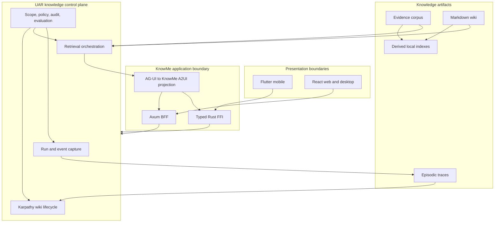
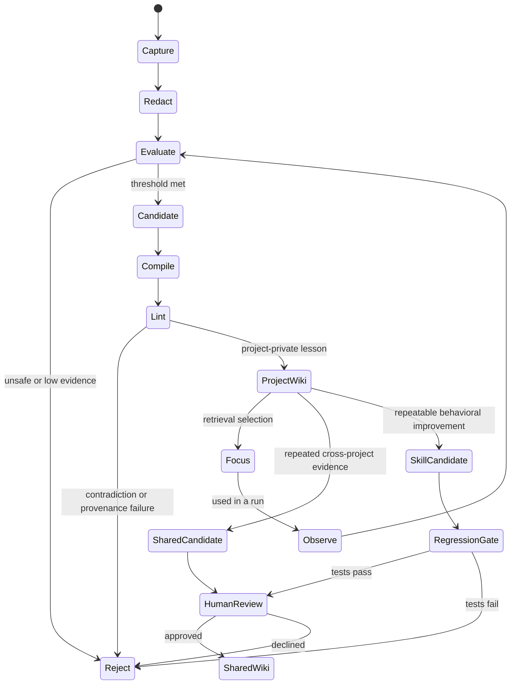

# UAR knowledge base, RAG, and Karpathy wiki strategy

Status: architecture assessment
Date: 2026-07-19
Scope: knowledge architecture and delivery strategy only; no runtime code is implemented by this document
KBD phase context: `model-runtime-per-device`; implementation is 4 of 5 after completing this document-only change

## Decision

Use the Universal Agent Runtime (UAR) as the shared knowledge control plane, but deploy a different runtime profile at each platform boundary:

- **Mobile:** embed a small, platform-safe UAR knowledge kernel in the shared Rust core. Flutter reaches it only through typed FFI. Reuse KnowMe's existing embedded SurrealDB hybrid graph store rather than creating a second mobile database or vector index.
- **Desktop:** run exactly one supervised UAR service. BossFang supervises it when BossFang is present; KnowMe supervises it otherwise. Both clients may use the service, but they must not start competing UAR writers for the same scope.
- **Web:** run UAR as a private service behind the KnowMe Axum application. React communicates with the Axum boundary, not directly with UAR and never with provider credentials.

The knowledge system has three related but deliberately separate artifact classes:

1. **Evidence corpus:** source documents, chunks, embeddings, lexical indexes, graph facts, and citations used by RAG.
2. **Karpathy wiki:** concise, human-readable Markdown lessons distilled from evidence and evaluated execution traces.
3. **Episodic memory:** run events, tool outcomes, feedback, checkpoints, and evaluation records from which lessons may be proposed.

Raw evidence, wiki revisions, provenance, and tombstones are canonical and syncable. Embeddings, BM25 indexes, graph projections, and retrieval caches are derived per device and rebuilt against a declared model binding. Vector rows must not be merged across different embedding models or dimensions.

## Why this shape

### Evidence language and source snapshot

This document uses the following status language deliberately:

- **Observed:** directly verified in repository source or an official source.
- **Inference:** a conclusion drawn from multiple observed facts; the inference is identified as such.
- **Decision/recommendation:** the architecture this strategy selects; it is not a claim that implementation already exists.
- **Blocker:** missing evidence or capability that prevents certification.
- **Open decision:** a product, legal, policy, or ownership choice that this architecture cannot safely infer.
- **Future stage:** ordered work proposed by this strategy, not work completed by this document.

Local implementation observations were rechecked against UAR commit
`9bee88d9745f82d7a63445c36e5e4c6a42048fd5` and the concurrent KnowMe working
tree on 2026-07-19. Later submodule revisions require revalidation before these
status claims are reused.

The original RAG work treats retrieval as explicit non-parametric memory that improves updateability and provenance, while the Ragas framework separates retrieval quality from answer faithfulness and relevance. That distinction maps cleanly to UAR's knowledge APIs and to a separate, reviewable wiki layer. [Lewis et al., *Retrieval-Augmented Generation*](https://arxiv.org/abs/2005.11401) and [Es et al., *Ragas*](https://arxiv.org/abs/2309.15217) provide the research basis.

The codebase already contains most of the seams needed for this direction:

- UAR has knowledge-base CRUD, ingestion and search APIs, embedding backends, citation events, a retrieval pipeline abstraction, lexical verification, and hybrid vector/graph RRF.
- The UAR submodule includes `prometheus-knowledge`: a Markdown wiki, TF-IDF focus/search, linting, a trace store, evaluation, trace-to-wiki compilation, MCP tools, and a UAR tool-provider bridge.
- KnowMe already has an embedded SurrealDB graph store with 384-dimensional embeddings, BM25, vector search, graph expansion, and RRF.
- KnowMe already projects UAR run events into its UI protocol, but mobile UAR execution is explicitly reported as not wired.

Those are useful foundations, not proof of production readiness. The current UAR Rust SDK's embedded builder still starts the full HTTP server and does not expose populated direct-runtime handles. Its root crate is monolithic and its smallest published bundle still includes the Surreal backend. The product matrix marks web stable, desktop preview, mobile experimental, and arbitrary browser WASM unsupported. The present self-learning CLI also has concrete gaps: Codex/OpenCode file adapters return no trace data, trace fields are incompletely correlated, and the CLI's compile block does not yet invoke the available batch compiler.

## Target architecture

This is one logical control plane, not one identical process topology. UAR owns the semantics of runs, retrieval, wiki lifecycle, policy, and events. The platform profile decides whether those semantics execute through an in-process kernel or a supervised service.

## Artifact and authority model

| Artifact | Purpose | Canonical form | Derived form | Default authority |
|---|---|---|---|---|
| Source document | Verifiable evidence | Original bytes or normalized text plus content hash | Chunks and extracted metadata | Ingesting knowledge scope |
| Chunk | Retrieval unit | Text span with source offsets and lineage | Embedding and lexical postings | Corpus revision |
| Graph fact | Multi-hop/entity context | Typed relation with supporting source spans | Neighborhood/community summaries | Corpus revision |
| Wiki entry | Reusable lesson or anti-pattern | Markdown with revision, tags, claims, provenance, confidence | TF-IDF/vector representation | Project-private by default |
| Execution trace | Learning evidence | Redacted structured run/tool/outcome record | Evaluation features and aggregates | Session/project scope |
| Evaluation | Promotion evidence | Metric results, grader version, golden-set version | Dashboard projections | Evaluation run |
| Skill revision | Executable behavior | Versioned skill artifact and policy decision | Runtime caches | Human-approved release |

The evidence corpus answers “what sources support this response?” The wiki answers “what durable lesson has survived evaluation?” Episodic memory answers “what happened during this run?” Conflating them would make retention, trust, and conflict handling unmanageable.

Every record should carry, as applicable:

- tenant, user, workspace/project, knowledge-base, agent, run, and session scopes;
- source URI or local source identity, content hash, capture time, and parser version;
- embedding model identifier, immutable revision, dimension, normalization, and chunking policy;
- origin device/runtime, creation actor, sensitivity class, consent basis, and retention class;
- parent revision, supersedes relation, tombstone state, and synchronization clock;
- claim-to-source spans for wiki entries and answer citations.

The safe default is project-private and user-private. Cross-project or shared-global knowledge is an explicit promotion, never an inference from filesystem location or account identity.

## The Karpathy learning loop

The UAR submodule already expresses the broad loop. KnowMe should make its state transitions and promotion gates explicit:

### 1. Capture

Capture normalized UAR run events, tool names, permission decisions, retrieval identifiers, citations, outcome signals, user corrections, latency, and cancellation/checkpoint events. Do not capture hidden chain-of-thought, secrets, raw credentials, or unrestricted file contents.

UAR's current `TraceCapture` trait and `ExecutionTrace` store are a starting point. They are not yet a universal capture implementation: the Claude Code adapter parses only part of its source format, generic file-based adapters return empty results, tool-result correlation and duration are incomplete, and there is no KnowMe-native UAR event adapter. The first production adapter should consume UAR's own typed run/event stream rather than scrape tool-specific session directories.

### 2. Redact and classify

Apply deterministic secret/PII removal before durable storage. Assign sensitivity and retention classes. Keep an audit event for redaction without retaining the removed value. Mobile traces remain local unless the user and policy permit synchronization.

### 3. Evaluate

Use deterministic signals first: task completion, tool failures, citation coverage, schema validation, user correction, rollback, cancellation reason, and golden-set assertions. LLM judging is supplementary and must record model, prompt, version, and uncertainty.

The current UAR trace evaluator primarily scores whether output exists and whether tool calls failed. That is insufficient for learning because a fluent but wrong output can score well. A production evaluator needs task-specific success criteria plus retrieval and grounding metrics.

### 4. Compile

Compile only eligible traces into a candidate wiki entry containing the reusable lesson, failure mode, conditions, evidence links, confidence, and explicit non-applicability boundaries. UAR's `KnowledgeCompiler` already converts an `ExecutionTrace` into `pk_core::WikiEntry`; the CLI wiring and complete trace data remain unfinished.

### 5. Lint, link, and deduplicate

Reject unsupported claims, duplicate lessons, orphaned citations, scope escalation, and contradictions that lack an explicit resolution. Link related, superseded, and conflicting entries. A contradiction is data to resolve, not text to silently overwrite.

### 6. Select and focus

Build a bounded context packet from four lanes:

1. direct wiki focus using deterministic lexical/TF-IDF selection;
2. semantic and BM25 evidence retrieval;
3. graph expansion for related entities and multi-hop facts;
4. recent episodic context that is relevant and permitted.

Fuse ranked identifiers, then apply authorization, provenance, freshness, diversity, and token-budget filters. UAR's RRF and retrieval abstractions should orchestrate the lanes. On mobile, KnowMe's existing graph store should implement the retrieval backend instead of duplicating retrieval state.

### 7. Compress and archive

Compression must be reversible. Preserve old revisions and source lineage, mark replacements with `supersedes`, and create tombstones for deletions. Scheduled memory compression exists in the submodule, but platform scheduling, scope isolation, and evidence-preserving behavior must be certified independently for KnowMe.

### 8. Optimize only behind a release gate

Do not automatically rewrite production skills from one successful trace. A skill candidate needs multiple independent examples, negative examples, deterministic tests, security-policy checks, sycophancy screening, regression evaluation, and human approval. Wiki promotion and skill optimization are separate approvals.

## Retrieval pipeline

The common retrieval contract should be behavioral rather than database-specific:

| Stage | Required behavior | UAR/KnowMe seam |
|---|---|---|
| Query preparation | Normalize, classify scope, optionally decompose | UAR retrieval pipeline |
| Candidate generation | Dense, lexical, wiki, and graph lanes | UAR backend traits; KnowMe graph-store adapter on mobile |
| Fusion | Stable identifier-level RRF | Existing UAR and KnowMe RRF implementations |
| Verification | Check source spans, authorization, lexical support, and freshness | Extend beyond current overlap-only lexical annotation |
| Context assembly | Deduplicate, diversify, budget, preserve citations | KnowMe context fabric |
| Generation | Use selected provider/model without changing knowledge semantics | UAR provider routing |
| Streaming | Emit retrieval, citation, run, tool, and final-answer events | UAR events projected to AG-UI/A2UI |
| Evaluation | Record retrieval and answer metrics against a frozen set | UAR evaluation assets plus KnowMe platform matrix |

UAR's current lexical verification annotates overlap and, by default, does not drop uncorroborated material. Treat it as a weak signal rather than a factuality guarantee. Citation validity requires source existence, byte/span integrity, scope authorization, and claim support.

Graph retrieval is valuable for relationship and corpus-level questions, but it is not a universal replacement for chunk retrieval. Microsoft's GraphRAG work specifically targets global questions over a corpus, which is why KnowMe should retain direct lexical/vector retrieval and invoke graph/community expansion only when query classification or evaluation shows value. [Microsoft Research GraphRAG](https://www.microsoft.com/en-us/research/project/graphrag/) and [the GraphRAG paper](https://arxiv.org/abs/2404.16130) support this hybrid role.

## Platform contract summary

| Platform | Runtime/process owner | Persistence authority | UI boundary | Required degraded mode |
|---|---|---|---|---|
| Mobile | Embedded UAR knowledge kernel owned by the shared KnowMe Rust core | App-private canonical artifacts plus the existing embedded `gen_ui_db_graph` SurrealDB projection | Flutter → Riverpod/repository → typed Rust FFI | Offline reads and deterministic wiki focus continue from the last certified local state; interrupted jobs checkpoint and resume |
| Desktop | Exactly one supervised UAR service; BossFang supervises when present, otherwise KnowMe/Tauri | That service's exclusive writable UAR scope; UI/entity caches are projections | React → hook → store → typed Tauri/Rust service client | If UAR is unavailable, cached read-only projections remain visible with an explicit stale/unavailable state; writes and learning jobs pause |
| Web | Private UAR service behind the KnowMe Axum BFF | Server-side UAR knowledge scope; PGlite is a client projection/cache only | React → hook → entity/store → KnowMe Axum → UAR | Axum returns typed unavailable/retry state, preserves stream cancellation, and may serve authorized cached projections without silently generating ungrounded answers |

## Mobile profile: embedded knowledge kernel over FFI

### Placement

The target is a mobile-safe library embedded in the existing Rust core, not the current UAR full-server crate. The kernel should contain only:

- run/event types and a native trace adapter;
- knowledge and wiki domain types;
- retrieval orchestration traits and ranking/verification logic;
- `prometheus-knowledge` core/store/librarian functionality that is safe on iOS and Android;
- scope, policy, redaction, evaluation, and checkpoint primitives;
- provider callbacks that delegate embeddings and LLM work to KnowMe's selected runtime.

Exclude Axum listeners, admin UI, Wasmtime, desktop document helpers, process supervision, native filesystem watchers, and duplicated persistence/provider stacks. This requires a real feature and crate boundary in the UAR fork; toggling the SDK's current `embedded` feature is not sufficient.

### Persistence and retrieval

Use the existing `gen_ui_db_graph` embedded SurrealDB store as the mobile persistence/retrieval engine. Adapt UAR's retrieval behavior to it. This preserves one source of truth for mobile memories, existing hybrid BM25/vector/graph RRF, and the architecture invariant that persistence stays in Rust.

Markdown wiki entries remain human-readable canonical artifacts in app-private storage or an equivalent record representation with lossless Markdown export. TF-IDF focus provides a small deterministic offline path. Dense indexes use the active mobile embedding model and are rebuilt when its immutable binding changes.

### Flutter boundary

Flutter receives typed commands and streams for:

- ingest status and cancellation;
- search/focus results with citations and provenance;
- run/retrieval/wiki lifecycle events;
- review queues and conflict summaries;
- runtime capability and resource-budget status.

Flutter does not open databases, build embeddings, call providers, parse raw UAR SSE, or execute the learning loop. Flutter Rust Bridge supports native targets and typed/streaming interop, which fits this boundary. [Flutter Rust Bridge cross-platform guide](https://cjycode.com/flutter_rust_bridge/guides/cross-platform/overview).

### Scheduling and resource policy

Ingestion, indexing, and wiki compilation must be resumable stages with durable checkpoints. Foreground user work has priority. Background processing is opportunistic: Apple background processing can be interrupted, and Android WorkManager is for persistent deferrable work with bounded execution. [Apple Background Tasks](https://developer.apple.com/documentation/backgroundtasks/bgprocessingtask) and [Android WorkManager](https://developer.android.com/reference/androidx/work/WorkManager).

Recommended mobile policy:

- small text ingestion and TF-IDF updates may run locally immediately;
- embedding batches stop on thermal, memory, battery, or time-budget pressure;
- large documents and expensive graph extraction are deferred, user-triggered, or delegated to an authorized desktop/web peer;
- every stage is idempotent and resumes from a content hash/checkpoint;
- offline reads continue against the last certified local indexes.

### Mobile blockers

- No mobile-safe UAR kernel crate/profile exists.
- KnowMe currently excludes the UAR SDK dependency on iOS/Android and reports embedded UAR as not wired.
- `prometheus-knowledge` transitive dependencies and filesystem/network features need a target audit.
- Cross-platform UAR-native trace capture is not implemented.
- Embedded distribution invokes AGPL obligations and requires an explicit licensing decision before product shipment.
- Physical-device memory, thermal, startup, ingestion, and retrieval evidence does not exist.

## Desktop profile: one supervised UAR service

### Placement

The default desktop topology is one UAR sidecar/service per user data authority:

- **BossFang present:** BossFang owns UAR supervision; KnowMe discovers and uses that instance.
- **BossFang absent:** KnowMe/Tauri owns UAR supervision.
- **Advanced isolated mode:** a second instance is permitted only with a separate storage namespace and explicit reason, never against the same writable database or wiki directory.

This follows UAR's own BossFang integration recommendation and Tauri's supported external-binary model. Tauri packages target-specific sidecar binaries and exposes controlled spawn permissions. [Tauri sidecar documentation](https://v2.tauri.app/develop/sidecar/).

### Responsibilities

The supervisor owns binary version compatibility, loopback binding, per-install authentication, readiness, restart/backoff, migrations, logs, graceful shutdown, and exclusive-writer lease. UAR owns knowledge APIs, run capture, indexing, wiki lifecycle, and evaluation. BossFang may route agent/model work through UAR's OpenAI-compatible, A2A, or AG-UI surfaces; it must not maintain a competing hidden wiki for the same scope.

KnowMe's Rust service layer uses the typed UAR SDK over loopback HTTP/SSE. React remains behind hooks/stores and Tauri commands. Direct React access to the sidecar would violate the project layering rule.

### Why not link the full runtime on desktop now

The service boundary is already the supported and testable UAR path. Linking the full runtime would couple KnowMe to UAR's monolithic dependency graph, persistence boot, and AGPL runtime while bypassing operational contracts already documented for BossFang. Reconsider linked desktop mode only after a narrow kernel exists and measured IPC overhead is a demonstrated bottleneck.

### Desktop blockers

- No certified BossFang/KnowMe supervisor discovery and ownership handshake exists for this knowledge scope.
- No exclusive-writer lease has been demonstrated across restart, upgrade, and crash recovery.
- Per-install authentication, migration compatibility, readiness, and graceful-shutdown behavior remain uncertified in KnowMe.
- The read-only degraded UI state and queued-job recovery contract require integration evidence.

## Web profile: UAR behind the KnowMe Axum BFF

### Placement

The browser never embeds UAR. The supported flow is:

React → hook → entity/store layer → KnowMe Axum API → typed UAR client → UAR service

The Axum application owns user/session authentication, tenant and project scoping, rate limits, request validation, provider-policy selection, stream lifecycle, and public error mapping. UAR remains on a private network or authenticated loopback/service network.

The browser receives projected AG-UI/A2UI events and citation-safe records. AG-UI is an event-based bridge between agent backends and user applications; its lifecycle and snapshot/delta patterns fit run and retrieval progress. A2UI supplies safe declarative UI data rather than executable UI code. [AG-UI overview](https://docs.ag-ui.com/), [AG-UI events](https://docs.ag-ui.com/concepts/events), and [A2UI](https://a2ui.org/).

PGlite may cache UI projections and entity state, following the project rules, but it is not the authoritative web knowledge store. Provider keys, unredacted traces, cross-tenant identifiers, and unrestricted source paths never enter React.

### Web blockers

- KnowMe's current Axum server has chat/run surfaces but no scoped knowledge facade/proxy.
- The existing general agent strategy's browser-WASM statement conflicts with UAR's current support matrix; this document supersedes that statement for the knowledge runtime.
- Tenant/scope mappings and service-to-service authentication need one canonical contract.
- Streaming reconnect, citation authorization, and cancellation semantics need web integration tests.

## Synchronization and conflict rules

Synchronize canonical artifacts, not implementation artifacts:

| Sync | Do not sync |
|---|---|
| Source metadata/content when policy permits | HNSW or other vector-index files |
| Wiki Markdown, revision graph, tags, claims, citations | Raw embedding vectors across model bindings |
| Redacted traces selected for sync | Secrets or unrestricted local paths |
| Evaluation records and golden-set identifiers | Device caches and temporary context packets |
| Tombstones and supersession edges | Process leases and local job checkpoints |

Conflict handling:

1. Identical content hashes coalesce.
2. Concurrent wiki edits create sibling revisions; neither silently overwrites the other.
3. A merge records both parents and preserves claim-level provenance.
4. A deletion produces a tombstone; resurrection requires an explicit later revision.
5. Embedding-model mismatch triggers local re-embedding from canonical text.
6. Shared/global promotion creates a new reviewed artifact; it does not mutate the project-private source entry.

Mobile is local-first. Desktop/web may be an authoritative synchronization peer for a user, but authority is declared per scope and not inferred from connectivity. SurrealDB's combined graph, full-text, and vector capabilities support the proposed single-store mobile projection and RRF-style hybrid retrieval. [SurrealDB vector search](https://surrealdb.com/docs/learn/data-models/vector-search/overview), [full-text search](https://surrealdb.com/docs/learn/data-models/full-text-search/overview), and [hybrid search](https://surrealdb.com/docs/learn/data-models/vector-search/hybrid-search).

## Security, privacy, and governance

- Enforce authorization before retrieval, not after generation.
- Filter every retrieval lane by the same scope predicate before fusion.
- Treat imported documents, wiki entries, and traces as untrusted content subject to prompt-injection scanning and source labelling.
- Keep source hashes and citation spans so a response can be re-audited after an index rebuild.
- Redact before persistence and again before promotion to a broader scope.
- Separate “may retrieve,” “may compile,” “may promote,” and “may optimize a skill” permissions.
- Require explicit consent for syncing private traces or personal knowledge off device.
- Retain evaluator and model provenance so a lesson can be regraded.
- Screen candidate lessons and skill changes for sycophancy; the assessment thesis was checked with the project's strict detector and scored 0.0.
- Never use the absence of a user correction as proof that a response was correct.

## Licensing gate

UAR's repository describes the runtime as AGPL-3.0-only while its SDKs are MIT; enabling the Rust SDK's embedded runtime links the AGPL runtime into the application. This is an engineering observation, not legal advice. Before distributing an embedded mobile or linked desktop runtime, product/legal ownership must decide whether the distribution model satisfies the intended license obligations. A service deployment has different distribution considerations but still needs review. No implementation phase may treat the SDK license as if it automatically covers the embedded runtime.

## Evaluation and certification

Maintain one frozen KnowMe knowledge golden set with platform slices and privacy-safe fixtures. BEIR demonstrates why retrieval should be tested across heterogeneous tasks and domains, while Ragas provides separate end-to-end grounding dimensions. [BEIR](https://arxiv.org/abs/2104.08663) and [Ragas](https://arxiv.org/abs/2309.15217).

Required metrics:

| Layer | Metrics |
|---|---|
| Retrieval | Recall@k, MRR, nDCG, lane contribution, duplicate rate, unauthorized-hit count |
| Grounding | Citation precision/coverage, claim support, faithfulness, context precision/recall |
| Answer | Task correctness, answer relevance, abstention correctness, user correction rate |
| Wiki | Provenance completeness, lint failures, contradiction rate, stale-entry rate, promotion reversals |
| Loop | Trace completeness, evaluator agreement, candidate acceptance, regression rate, rollback success |
| Mobile | Cold start, peak RSS, storage growth, energy/thermal budget, checkpoint recovery, offline success |
| Desktop | Sidecar readiness, restart recovery, single-writer enforcement, IPC latency |
| Web | tenant isolation, stream reconnect, cancellation propagation, service degradation behavior |

Promotion gates:

- **RAG pilot:** zero cross-scope retrieval, complete citations, and measurable improvement over lexical-only and vector-only baselines.
- **Project wiki pilot:** every compiled claim has trace/source provenance; contradictions and deletion are reversible.
- **Shared wiki:** human review, repeated evidence from independent contexts, privacy approval, and no unresolved contradiction.
- **Skill optimization:** deterministic regression suite, negative examples, policy checks, sycophancy check, human approval, and rollback artifact.
- **Mobile certification:** physical iOS and Android evidence for memory, thermal, interruption, offline, migration, and license gates.

## Delivery sequence

This is an architecture sequence, not implementation performed by this assessment.

### Stage 0 — contracts and evidence

- Freeze artifact identities, scopes, provenance, event vocabulary, and embedding-model binding.
- Add a current-vs-stale marker to UAR/Prometheus future-work inventories.
- Define the golden set and baseline current KnowMe hybrid retrieval.
- Make licensing and data-residency decisions.

Exit: contracts reviewed; no unresolved ownership or licensing ambiguity.

### Stage 1 — service-first vertical slice

- Use desktop/web UAR service mode for ingest → retrieve → cite → project events.
- Add a UAR-native trace adapter and complete trace correlation.
- Wire evaluate → compile → lint into a project-private review queue.
- Keep skill optimization disabled.

Exit: reproducible service tests, complete provenance, and single-writer behavior.

### Stage 2 — BossFang supervision and web BFF

- Establish supervisor discovery/lease semantics.
- Expose scoped knowledge operations through KnowMe's Rust/Axum service boundary.
- Certify reconnect, cancellation, restart, and tenant isolation.

Exit: one UAR authority per scope and no direct UI/runtime coupling.

### Stage 3 — mobile kernel extraction

- Split UAR domain/orchestration from the full server and audit mobile dependencies.
- Implement the KnowMe graph-store retrieval adapter and typed FFI surface.
- Add checkpointed ingestion/compile scheduling and platform budgets.
- Rebuild derived indexes from canonical synced artifacts.

Exit: physical-device certification and offline parity for the supported mobile subset.

### Stage 4 — controlled learning and promotion

- Enable reviewed project-wiki candidates.
- Measure retrieval/answer outcomes with and without wiki context.
- Introduce shared promotion only after privacy and conflict evidence.
- Introduce skill candidates last, behind the full regression and human-release gate.

Exit: reversible, audited improvements without automatic policy expansion.

## Rejected alternatives

| Alternative | Decision | Reason |
|---|---|---|
| Embed the current full UAR runtime on mobile | Reject now | It starts the server path, lacks populated direct handles, carries unsuitable features/dependencies, and is only experimentally supported on mobile. |
| Run UAR in browser WASM | Reject | UAR's current matrix marks arbitrary browser WASM unsupported; it would also expose inappropriate runtime and credential surfaces. |
| Let BossFang and KnowMe each start UAR against the same store | Reject | Competing writers make migrations, jobs, revision order, and shutdown unsafe. |
| Store wiki lessons only as vectors | Reject | Human audit, revision merge, re-embedding, citations, and portability require canonical text. |
| Use one table for documents, wiki lessons, and traces | Reject | Their trust, retention, promotion, and conflict semantics differ. |
| Automatically update skills from successful runs | Reject | Current evaluation is too shallow and success traces can encode unsafe or sycophantic behavior. |
| Replace KnowMe mobile graph storage with a second UAR database | Reject | It duplicates persistence and indexes and violates the single Rust-owned context-fabric direction. |

## Open decisions

1. Which canonical sync authority owns each user's personal knowledge scope when both desktop and hosted web are available?
2. Is private mobile-to-cloud trace synchronization opt-in per device, per workspace, or per run?
3. Which subset of `prometheus-knowledge` dependencies can be made mobile-safe without forking behavior?
4. Does the mobile product distribute an AGPL-compatible embedded runtime, use a separately licensed kernel, or keep UAR service-only?
5. What minimum number and diversity of independent traces qualifies a wiki entry for shared promotion?
6. Which graph extraction workloads are allowed locally versus delegated?
7. What retention policy applies to rejected candidates and raw traces after their derived wiki lesson is accepted?

These choices materially affect product behavior and must be resolved before implementation, not guessed inside adapters.

## Codebase evidence reviewed

- [UAR overview](../../../rust/vendor/universal-agent-runtime/README.md)
- [UAR product support matrix](../../../rust/vendor/universal-agent-runtime/docs/product-support-matrix.md)
- [UAR/BossFang integration](../../../rust/vendor/universal-agent-runtime/docs/librefang-integration.md)
- [UAR Rust embedded runtime](../../../rust/vendor/universal-agent-runtime/sdks/rust/src/runtime.rs)
- [UAR retrieval pipeline](../../../rust/vendor/universal-agent-runtime/src/uar/rag/pipeline.rs), [hybrid retrieval](../../../rust/vendor/universal-agent-runtime/src/uar/rag/retrieval.rs), and [verification](../../../rust/vendor/universal-agent-runtime/src/uar/rag/verification.rs)
- [Prometheus knowledge system](../../../rust/vendor/universal-agent-runtime/crates/prometheus-skill-system/README.md)
- [Cross-platform trace protocol](../../../rust/vendor/universal-agent-runtime/crates/prometheus-skill-system/tools/prometheus-cli/crates/prometheus-agents/src/trace_protocol.rs), [learning command](../../../rust/vendor/universal-agent-runtime/crates/prometheus-skill-system/tools/prometheus-cli/crates/prometheus-cli/src/commands/learn.rs), and [trace compiler](../../../rust/vendor/universal-agent-runtime/crates/prometheus-skill-system/tools/prometheus-cli/crates/prometheus-learn/src/compile.rs)
- [KnowMe UAR integration seam](../../../rust/crates/gen_ui_agent/src/uar.rs) and [current chat deployment path](../../../rust/crates/gen_ui_agent/src/chat.rs)
- [KnowMe embedded graph-RAG store](../../../rust/crates/gen_ui_db_graph/src/lib.rs)
- [KnowMe context fabric specification](../../knowme-context-fabric-spec.md)
- [General UAR integration strategy](../uar-knowme-runtime-integration.md)

The associated deep-research package, including source registry, contradictions, evidence graph, citations, and synthesis, is in [the `.research` package](research/uar-karpathy-knowledge-plane-2026.research/).
